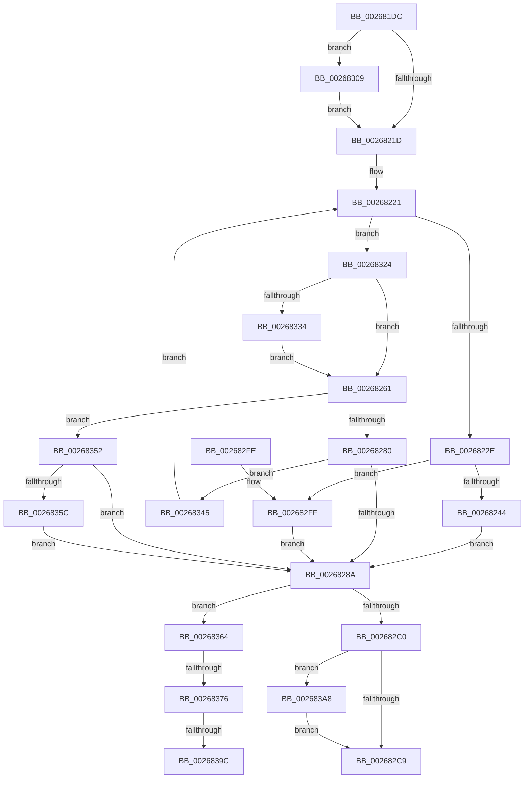

# SMKM_STORE_MGR&lt;SM_TRAITS&gt;::SmCompressCtxProcessEntry

- RVA: `0x002681DC`–`0x002683DA` (길이 `510` bytes)
- VA: `0x00000001402681DC`
- 실행 섹션: `.text`
- PDB 이름 있음: `예`; PDB Function 태그: `예`
- unwind 정보 RVA: `0x000650F0`
- 디코드: `136`개 명령, `510/510` bytes 표시
- 미해석 바이트: `0` (있으면 어셈블리에 `.byte`로 보존)

> 이 문서는 커널 이미지의 기계어와 PDB 기호를 분석해 생성했습니다. 4번과 5번은 함수 원형과 자료형을 바이너리 사용 방식에서 추정한 C 해석이며 원본 소스 복구 결과는 아닙니다.

## 1. Dependencies

- 직접 호출 지점: **5**; 고유 호출 대상: **5**
- 직접 호출자로 확인된 함수: **1**
- RIP 상대 이미지 참조: **0**

### Outgoing calls
- `0x0026826F` → [SmHwAcceleratorPartitionMgrGetDescriptor](SmHwAcceleratorPartitionMgrGetDescriptor_function_0026A190.md) (function, `0x0026A190`)
- `0x002682AE` → [SmStoreCompressBuffer](SmStoreCompressBuffer_function_002683E0.md) (function, `0x002683E0`)
- `0x002682DC` → [SMKM_STORE_MGR<SM_TRAITS>::SmCompressCtxCompleteEntry](SMKM_STORE_MGR_SM_TRAITS_SmCompressCtxCompleteEntry_function_002685C0.md) (function, `0x002685C0`)
- `0x00268316` → [memcpy](../6C/memcpy_function_006C6840.md) (function, `0x006C6840`)
- `0x00268348` → [SMKM_STORE_MGR<SM_TRAITS>::SmCompressCtxCompletePendingEntry](../4A/SMKM_STORE_MGR_SM_TRAITS_SmCompressCtxCompletePendingEntry_function_004A59F8.md) (function, `0x004A59F8`)

### Direct callers
- [SMKM_STORE_MGR&lt;SM_TRAITS&gt;::SmCompressCtxWorkerThread](SMKM_STORE_MGR_SM_TRAITS_SmCompressCtxWorkerThread_function_00267D20.md) at `0x00267F28`

### Static image references
- 디코드된 RIP-relative 메모리 참조가 없습니다.

## 2. Other-region calls and transfers

- 다른 실행 섹션으로 향하는 call: **0**
- call이 아닌 외부 분기/꼬리 이동: **3**
  - `0x00268370` → [sub_006D8FF8 + 0x21](../6D/Unknown_function_006D8FF8.md) (`tail-transfer`)
  - `0x00268396` → [sub_006D8FF8](../6D/Unknown_function_006D8FF8.md) (`tail-transfer`)
  - `0x002683A3` → [sub_006D8FF8](../6D/Unknown_function_006D8FF8.md) (`tail-transfer`)

## 3. Assembly (complete function range)

```asm
002681DC  48 8B C4                        mov rax, rsp
002681DF  48 89 58 10                     mov qword ptr [rax + 0x10], rbx
002681E3  48 89 68 18                     mov qword ptr [rax + 0x18], rbp
002681E7  48 89 70 20                     mov qword ptr [rax + 0x20], rsi
002681EB  57                              push rdi
002681EC  41 54                           push r12
002681EE  41 55                           push r13
002681F0  41 56                           push r14
002681F2  41 57                           push r15
002681F4  48 83 EC 30                     sub rsp, 0x30
002681F8  83 60 08 00                     and dword ptr [rax + 8], 0
002681FC  4C 8B EA                        mov r13, rdx
002681FF  4C 8B 72 50                     mov r14, qword ptr [rdx + 0x50]
00268203  48 8B D9                        mov rbx, rcx
00268206  4C 8B 61 08                     mov r12, qword ptr [rcx + 8]
0026820A  41 83 7E 08 00                  cmp dword ptr [r14 + 8], 0
0026820F  49 8B 46 10                     mov rax, qword ptr [r14 + 0x10]
00268213  4C 8B 78 18                     mov r15, qword ptr [rax + 0x18]
00268217  0F 8C EC 00 00 00               jl 0x140268309
0026821D  48 8D 73 38                     lea rsi, [rbx + 0x38]
00268221  48 8B 56 08                     mov rdx, qword ptr [rsi + 8]
00268225  48 3B D6                        cmp rdx, rsi
00268228  0F 84 F6 00 00 00               je 0x140268324
0026822E  48 8B 3E                        mov rdi, qword ptr [rsi]
00268231  48 8B 07                        mov rax, qword ptr [rdi]
00268234  48 83 E0 F8                     and rax, 0xfffffffffffffff8
00268238  48 89 06                        mov qword ptr [rsi], rax
0026823B  48 3B FA                        cmp rdi, rdx
0026823E  0F 84 BB 00 00 00               je 0x1402682ff
00268244  48 8B 0A                        mov rcx, qword ptr [rdx]
00268247  48 8B C1                        mov rax, rcx
0026824A  83 E1 07                        and ecx, 7
0026824D  48 C1 E8 03                     shr rax, 3
00268251  48 8D 04 C5 F8 FF FF FF         lea rax, [rax*8 - 8]
00268259  48 0B C1                        or rax, rcx
0026825C  48 89 02                        mov qword ptr [rdx], rax
0026825F  EB 29                           jmp 0x14026828a
00268261  45 8B 84 24 A8 00 00 00         mov r8d, dword ptr [r12 + 0xa8]
00268269  8B D5                           mov edx, ebp
0026826B  48 8B 4B 10                     mov rcx, qword ptr [rbx + 0x10]
0026826F  E8 1C 1F 00 00                  call 0x14026a190
00268274  48 8B F8                        mov rdi, rax
00268277  48 85 C0                        test rax, rax
0026827A  0F 85 D2 00 00 00               jne 0x140268352
00268280  40 F6 C5 02                     test bpl, 2
00268284  0F 85 BB 00 00 00               jne 0x140268345
0026828A  49 8B 4D 40                     mov rcx, qword ptr [r13 + 0x40]
0026828E  48 8D 44 24 60                  lea rax, [rsp + 0x60]
00268293  4C 8B 4B 18                     mov r9, qword ptr [rbx + 0x18]
00268297  4D 8D 45 48                     lea r8, [r13 + 0x48]
0026829B  48 89 44 24 28                  mov qword ptr [rsp + 0x28], rax
002682A0  49 8B D7                        mov rdx, r15
002682A3  48 89 7C 24 20                  mov qword ptr [rsp + 0x20], rdi
002682A8  8B 89 C0 12 00 00               mov ecx, dword ptr [rcx + 0x12c0]
002682AE  E8 2D 01 00 00                  call 0x1402683e0
002682B3  8B D0                           mov edx, eax
002682B5  3D 03 01 00 00                  cmp eax, 0x103
002682BA  0F 84 A4 00 00 00               je 0x140268364
002682C0  48 85 FF                        test rdi, rdi
002682C3  0F 85 DF 00 00 00               jne 0x1402683a8
002682C9  44 8B 44 24 60                  mov r8d, dword ptr [rsp + 0x60]
002682CE  41 83 C9 FF                     or r9d, 0xffffffff
002682D2  89 54 24 20                     mov dword ptr [rsp + 0x20], edx
002682D6  48 8B CB                        mov rcx, rbx
002682D9  49 8B D6                        mov rdx, r14
002682DC  E8 DF 02 00 00                  call 0x1402685c0
002682E1  48 8B 5C 24 68                  mov rbx, qword ptr [rsp + 0x68]
002682E6  48 8B 6C 24 70                  mov rbp, qword ptr [rsp + 0x70]
002682EB  48 8B 74 24 78                  mov rsi, qword ptr [rsp + 0x78]
002682F0  48 83 C4 30                     add rsp, 0x30
002682F4  41 5F                           pop r15
002682F6  41 5E                           pop r14
002682F8  41 5D                           pop r13
002682FA  41 5C                           pop r12
002682FC  5F                              pop rdi
002682FD  C3                              ret
002682FE  CC                              int3
002682FF  48 83 26 00                     and qword ptr [rsi], 0
00268303  48 89 76 08                     mov qword ptr [rsi + 8], rsi
00268307  EB 81                           jmp 0x14026828a
00268309  48 8B 49 20                     mov rcx, qword ptr [rcx + 0x20]
0026830D  41 B8 00 10 00 00               mov r8d, 0x1000
00268313  49 8B D7                        mov rdx, r15
00268316  E8 25 E5 45 00                  call 0x1406c6840
0026831B  4C 8B 7B 20                     mov r15, qword ptr [rbx + 0x20]
0026831F  E9 F9 FE FF FF                  jmp 0x14026821d
00268324  33 ED                           xor ebp, ebp
00268326  48 8D 43 28                     lea rax, [rbx + 0x28]
0026832A  48 39 43 30                     cmp qword ptr [rbx + 0x30], rax
0026832E  0F 84 2D FF FF FF               je 0x140268261
00268334  83 7B 48 08                     cmp dword ptr [rbx + 0x48], 8
00268338  1B ED                           sbb ebp, ebp
0026833A  83 E5 FC                        and ebp, 0xfffffffc
0026833D  83 C5 06                        add ebp, 6
00268340  E9 1C FF FF FF                  jmp 0x140268261
00268345  48 8B CB                        mov rcx, rbx
00268348  E8 AB D6 23 00                  call 0x1404a59f8
0026834D  E9 CF FE FF FF                  jmp 0x140268221
00268352  8B 00                           mov eax, dword ptr [rax]
00268354  A8 02                           test al, 2
00268356  0F 84 2E FF FF FF               je 0x14026828a
0026835C  FF 43 48                        inc dword ptr [rbx + 0x48]
0026835F  E9 26 FF FF FF                  jmp 0x14026828a
00268364  4C 89 77 18                     mov qword ptr [rdi + 0x18], r14
00268368  48 8D 4B 28                     lea rcx, [rbx + 0x28]
0026836C  4C 3B 7B 20                     cmp r15, qword ptr [rbx + 0x20]
00268370  0F 85 A3 0C 47 00               jne 0x1406d9019
00268376  48 8B 41 08                     mov rax, qword ptr [rcx + 8]
0026837A  4C 8B 00                        mov r8, qword ptr [rax]
0026837D  8B 07                           mov eax, dword ptr [rdi]
0026837F  83 E0 07                        and eax, 7
00268382  49 C1 E8 03                     shr r8, 3
00268386  48 0B 01                        or rax, qword ptr [rcx]
00268389  48 89 07                        mov qword ptr [rdi], rax
0026838C  48 8B 51 08                     mov rdx, qword ptr [rcx + 8]
00268390  48 89 39                        mov qword ptr [rcx], rdi
00268393  48 3B D1                        cmp rdx, rcx
00268396  0F 85 5C 0C 47 00               jne 0x1406d8ff8
0026839C  48 89 79 08                     mov qword ptr [rcx + 8], rdi
002683A0  48 8B D7                        mov rdx, rdi
002683A3  E9 50 0C 47 00                  jmp 0x1406d8ff8
002683A8  48 8B 43 40                     mov rax, qword ptr [rbx + 0x40]
002683AC  48 8B 08                        mov rcx, qword ptr [rax]
002683AF  8B 07                           mov eax, dword ptr [rdi]
002683B1  48 83 E1 F8                     and rcx, 0xfffffffffffffff8
002683B5  83 E0 07                        and eax, 7
002683B8  48 83 C1 08                     add rcx, 8
002683BC  48 0B C8                        or rcx, rax
002683BF  48 89 0F                        mov qword ptr [rdi], rcx
002683C2  48 8B 4B 40                     mov rcx, qword ptr [rbx + 0x40]
002683C6  8B 01                           mov eax, dword ptr [rcx]
002683C8  83 E0 07                        and eax, 7
002683CB  48 0B C7                        or rax, rdi
002683CE  48 89 01                        mov qword ptr [rcx], rax
002683D1  48 89 7B 40                     mov qword ptr [rbx + 0x40], rdi
002683D5  E9 EF FE FF FF                  jmp 0x1402682c9
```

## 4. C-style interpretation (structured pseudocode)

```c
__int64 __fastcall SMKM_STORE_MGR_SM_TRAITS___SmCompressCtxProcessEntry(__int64 a1, __int64 a2)
{
    __int64 result;
    __int64 v_rbp;
    __int64 v_rsp;
    unsigned __int64 v_stack_m30;
    unsigned __int64 v_stack_m38;
    unsigned __int64 v_stack_p10;
    unsigned __int64 v_stack_p18;
    unsigned __int64 v_stack_p20;
    unsigned __int64 v_stack_p8;

    *(unsigned __int64 *)(v_rsp + 16) = v_rbx;
    *(unsigned __int64 *)(v_rsp + 24) = v_rbp;
    *(unsigned __int64 *)(v_rsp + 32) = v_rsi;
    v_rsp = (v_rsp) - (48);
    if ((*(unsigned int *)(*(unsigned __int64 *)(a2 + 80) + 8)) < 0) goto loc_00268309;
loc_0026821D:
loc_00268221:
    if ((*(unsigned __int64 *)(a1 + 56 + 8)) == (a1 + 56)) goto loc_00268324;
    result = (*(unsigned __int64 *)(*(unsigned __int64 *)(a1 + 56))) & (-8);
    *(unsigned __int64 *)(a1 + 56) = result;
    if ((*(unsigned __int64 *)(a1 + 56)) == (*(unsigned __int64 *)(a1 + 56 + 8))) goto loc_002682FF;
    a1 = (unsigned int)((*(unsigned __int64 *)(*(unsigned __int64 *)(a1 + 56 + 8))) & (7));
    result = (*(unsigned __int64 *)(*(unsigned __int64 *)(a1 + 56 + 8))) >> (3);
    result = (result * 8 - 8) | (a1);
    *(unsigned __int64 *)(*(unsigned __int64 *)(a1 + 56 + 8)) = result;
    goto loc_0026828A;
loc_00268261:
    result = SmHwAcceleratorPartitionMgrGetDescriptor(*(unsigned __int64 *)(a1 + 16), (unsigned int)((unsigned int)(v_rbp)), (unsigned int)(*(unsigned int *)(*(unsigned __int64 *)(a1 + 8) + 168)), a4);
    if (result != 0) goto loc_00268352;
    if ((((unsigned __int8)(v_rbp)) & (2)) != 0) goto loc_00268345;
loc_0026828A:
    v_stack_m30 = v_stack_p8;
    v_stack_m38 = result;
    result = SmStoreCompressBuffer((unsigned int)(*(unsigned int *)(*(unsigned __int64 *)(a2 + 64) + 4800)), *(unsigned __int64 *)(*(unsigned __int64 *)(*(unsigned __int64 *)(a2 + 80) + 16) + 24), a2 + 72, *(unsigned __int64 *)(a1 + 24));
    if (((unsigned int)(result)) == 259) goto loc_00268364;
    if (result != 0) goto loc_002683A8;
loc_002682C9:
    a4 = (unsigned int)((*(unsigned __int64 *)(a1 + 24)) | (0xFFFFFFFFULL));
    v_stack_m38 = (unsigned int)((unsigned int)((unsigned int)(result)));
    result = SMKM_STORE_MGR_SM_TRAITS___SmCompressCtxCompleteEntry(a1, *(unsigned __int64 *)(a2 + 80), (unsigned int)(v_stack_p8), a4);
    v_rsp = (v_rsp) + (48);
    return result;
loc_002682FF:
    *(unsigned __int64 *)(v_stack_p20 + 8) = v_stack_p20;
    goto loc_0026828A;
loc_00268309:
    result = memcpy(*(unsigned __int64 *)(a1 + 32), *(unsigned __int64 *)(*(unsigned __int64 *)(*(unsigned __int64 *)(a2 + 80) + 16) + 24), (unsigned int)(0x1000ULL), a4);
    goto loc_0026821D;
loc_00268324:
    v_rbp = 0;
    if ((*(unsigned __int64 *)(v_stack_p10 + 48)) == (v_stack_p10 + 40)) goto loc_00268261;
    v_rbp = (unsigned int)((v_rbp) & (0xFFFFFFFCULL));
    v_rbp = (unsigned int)((v_rbp) + (6));
    goto loc_00268261;
loc_00268345:
    result = SMKM_STORE_MGR_SM_TRAITS___SmCompressCtxCompletePendingEntry(v_stack_p10, *(unsigned __int64 *)(*(unsigned __int64 *)(*(unsigned __int64 *)(a2 + 80) + 16) + 24), (unsigned int)(0x1000ULL), a4);
    goto loc_00268221;
loc_00268352:
    if ((((unsigned __int8)((unsigned int)(*(unsigned int *)(result)))) & (2)) == 0) goto loc_0026828A;
    goto loc_0026828A;
loc_00268364:
    *(unsigned __int64 *)(result + 24) = *(unsigned __int64 *)(a2 + 80);
    result = (unsigned int)(((unsigned int)(*(unsigned int *)(result))) & (7));
    a3 = (*(unsigned __int64 *)(*(unsigned __int64 *)(v_stack_p10 + 40 + 8))) >> (3);
    result = (result) | (*(unsigned __int64 *)(v_stack_p10 + 40));
    *(unsigned __int64 *)(result) = result;
    *(unsigned __int64 *)(v_stack_p10 + 40) = result;
    *(unsigned __int64 *)(v_stack_p10 + 40 + 8) = result;
loc_002683A8:
    a1 = (*(unsigned __int64 *)(*(unsigned __int64 *)(v_stack_p10 + 64))) & (-8);
    result = (unsigned int)(((unsigned int)(*(unsigned int *)(result))) & (7));
    a1 = (a1) + (8);
    a1 = (a1) | (result);
    *(unsigned __int64 *)(result) = a1;
    result = (unsigned int)(((unsigned int)(*(unsigned int *)(*(unsigned __int64 *)(v_stack_p10 + 64)))) & (7));
    result = (result) | (result);
    *(unsigned __int64 *)(*(unsigned __int64 *)(v_stack_p10 + 64)) = result;
    *(unsigned __int64 *)(v_stack_p10 + 64) = result;
    goto loc_002682C9;
}
```

## 5. (Beta) C Style

```c
int64_t SMKM_STORE_MGR_SM_TRAITS___SmCompressCtxProcessEntry(void *Arg1, void *Arg2)
{
    uint8_t *arg1 = (uint8_t *)Arg1;
    uint8_t *arg2 = (uint8_t *)Arg2;

    int64_t result;
    int64_t local_rbp;
    int64_t local_rsp;
    uint64_t v_stack_m30;
    uint64_t v_stack_m38;
    uint64_t v_stack_p10;
    uint64_t v_stack_p18;
    uint64_t v_stack_p20;
    uint64_t v_stack_p8;

    *(uint64_t *)(local_rsp + 0x10) = local_rbx;
    *(uint64_t *)(local_rsp + 0x18) = local_rbp;
    *(uint64_t *)(local_rsp + 0x20) = local_rsi;
    local_rsp = (local_rsp) - (48);
    if ((*(uint32_t *)(*(uint64_t *)(arg2 + 0x50) + 0x8)) < 0) goto loc_00268309;
loc_0026821D:
loc_00268221:
    if ((*(uint64_t *)(arg1 + 0x38 + 0x8)) == (Arg1 + 56)) goto loc_00268324;
    result = (*(uint64_t *)(*(uint64_t *)(arg1 + 0x38))) & (-8);
    *(uint64_t *)(arg1 + 0x38) = result;
    if ((*(uint64_t *)(arg1 + 0x38)) == (*(uint64_t *)(arg1 + 0x38 + 0x8))) goto loc_002682FF;
    Arg1 = (uint32_t)((*(uint64_t *)(*(uint64_t *)(arg1 + 0x38 + 0x8))) & (7));
    result = (*(uint64_t *)(*(uint64_t *)(arg1 + 0x38 + 0x8))) >> (3);
    result = (result * 8 - 8) | (Arg1);
    *(uint64_t *)(*(uint64_t *)(arg1 + 0x38 + 0x8)) = result;
    goto loc_0026828A;
loc_00268261:
    result = SmHwAcceleratorPartitionMgrGetDescriptor(*(uint64_t *)(arg1 + 0x10), (uint32_t)((uint32_t)(local_rbp)), (uint32_t)(*(uint32_t *)(*(uint64_t *)(arg1 + 0x8) + 0xA8)), a4);
    if (result != 0) goto loc_00268352;
    if ((((uint8_t)(local_rbp)) & (2)) != 0) goto loc_00268345;
loc_0026828A:
    v_stack_m30 = v_stack_p8;
    v_stack_m38 = result;
    result = SmStoreCompressBuffer((uint32_t)(*(uint32_t *)(*(uint64_t *)(arg2 + 0x40) + 0x12C0)), *(uint64_t *)(*(uint64_t *)(*(uint64_t *)(arg2 + 0x50) + 0x10) + 0x18), Arg2 + 72, *(uint64_t *)(arg1 + 0x18));
    if (((uint32_t)(result)) == 259) goto loc_00268364;
    if (result != 0) goto loc_002683A8;
loc_002682C9:
    a4 = (uint32_t)((*(uint64_t *)(arg1 + 0x18)) | (0xFFFFFFFFULL));
    v_stack_m38 = (uint32_t)((uint32_t)((uint32_t)(result)));
    result = SMKM_STORE_MGR_SM_TRAITS___SmCompressCtxCompleteEntry(Arg1, *(uint64_t *)(arg2 + 0x50), (uint32_t)(v_stack_p8), a4);
    local_rsp = (local_rsp) + (48);
    return result;
loc_002682FF:
    *(uint64_t *)(v_stack_p20 + 0x8) = v_stack_p20;
    goto loc_0026828A;
loc_00268309:
    result = memcpy(*(uint64_t *)(arg1 + 0x20), *(uint64_t *)(*(uint64_t *)(*(uint64_t *)(arg2 + 0x50) + 0x10) + 0x18), (uint32_t)(0x1000ULL), a4);
    goto loc_0026821D;
loc_00268324:
    local_rbp = 0;
    if ((*(uint64_t *)(v_stack_p10 + 0x30)) == (v_stack_p10 + 40)) goto loc_00268261;
    local_rbp = (uint32_t)((local_rbp) & (0xFFFFFFFCULL));
    local_rbp = (uint32_t)((local_rbp) + (6));
    goto loc_00268261;
loc_00268345:
    result = SMKM_STORE_MGR_SM_TRAITS___SmCompressCtxCompletePendingEntry(v_stack_p10, *(uint64_t *)(*(uint64_t *)(*(uint64_t *)(arg2 + 0x50) + 0x10) + 0x18), (uint32_t)(0x1000ULL), a4);
    goto loc_00268221;
loc_00268352:
    if ((((uint8_t)((uint32_t)(*(uint32_t *)(result)))) & (2)) == 0) goto loc_0026828A;
    goto loc_0026828A;
loc_00268364:
    *(uint64_t *)(result + 0x18) = *(uint64_t *)(arg2 + 0x50);
    result = (uint32_t)(((uint32_t)(*(uint32_t *)(result))) & (7));
    a3 = (*(uint64_t *)(*(uint64_t *)(v_stack_p10 + 0x28 + 0x8))) >> (3);
    result = (result) | (*(uint64_t *)(v_stack_p10 + 0x28));
    *(uint64_t *)(result) = result;
    *(uint64_t *)(v_stack_p10 + 0x28) = result;
    *(uint64_t *)(v_stack_p10 + 0x28 + 0x8) = result;
loc_002683A8:
    Arg1 = (*(uint64_t *)(*(uint64_t *)(v_stack_p10 + 0x40))) & (-8);
    result = (uint32_t)(((uint32_t)(*(uint32_t *)(result))) & (7));
    Arg1 = (Arg1) + (8);
    Arg1 = (Arg1) | (result);
    *(void **)(result) = Arg1;
    result = (uint32_t)(((uint32_t)(*(uint32_t *)(*(uint64_t *)(v_stack_p10 + 0x40)))) & (7));
    result = (result) | (result);
    *(uint64_t *)(*(uint64_t *)(v_stack_p10 + 0x40)) = result;
    *(uint64_t *)(v_stack_p10 + 0x40) = result;
    goto loc_002682C9;
}
```

### 관측된 메모리 오프셋

구조체 형식이 확인되지 않은 접근은 인자 기준의 오프셋으로만 기록했습니다.

| 기준 인자 | 오프셋 표현 | 폭 (bit) | 접근 |
|---|---:|---:|---|
| `Arg1` | `+ 0x0` | `64` | `R` |
| `Arg1` | `+ 0x0` | `64` | `R/W` |
| `Arg1` | `+ 0x0` | `64` | `W` |
| `Arg1` | `+ 0x8` | `64` | `R` |
| `Arg1` | `+ 0x8` | `64` | `W` |
| `Arg1` | `+ 0x10` | `64` | `R` |
| `Arg1` | `+ 0x18` | `64` | `R` |
| `Arg1` | `+ 0x20` | `64` | `R` |
| `Arg1` | `+ 0x28` | `64` | `R` |
| `Arg1` | `+ 0x30` | `64` | `R` |
| `Arg1` | `+ 0x38` | `64` | `R` |
| `Arg1` | `+ 0x40` | `64` | `R` |
| `Arg1` | `+ 0x40` | `64` | `W` |
| `Arg1` | `+ 0x48` | `32` | `R` |
| `Arg1` | `+ 0x48` | `32` | `R/W` |
| `Arg2` | `+ 0x40` | `64` | `R` |
| `Arg2` | `+ 0x48` | `64` | `R` |
| `Arg2` | `+ 0x50` | `64` | `R` |

## 6. Execution-region graph

[열기: 2D/3D 그래프와 함수 탐색 컨트롤 패널](../../../control-panel.html?section=text&rva=0x002681DC&view=graph)

- 2D 그래프는 위에서 아래로 흐르고, 3D 그래프는 빈 공간을 드래그해 회전합니다. Shift+드래그는 이동, 휠은 확대·축소, 함수 노드 선택은 대상 보고서 이동입니다.

### Static fallback


