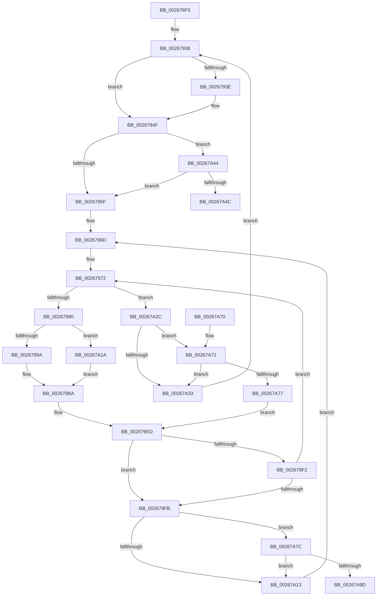

# SMKM_STORE_MGR&lt;SM_TRAITS&gt;::SmCompressCtxProcessReadyQueue

- RVA: `0x002678F0`–`0x00267AA2` (길이 `434` bytes)
- VA: `0x00000001402678F0`
- 실행 섹션: `.text`
- PDB 이름 있음: `예`; PDB Function 태그: `예`
- unwind 정보 RVA: `0x00065078`
- 디코드: `114`개 명령, `434/434` bytes 표시
- 미해석 바이트: `0` (있으면 어셈블리에 `.byte`로 보존)

> 이 문서는 커널 이미지의 기계어와 PDB 기호를 분석해 생성했습니다. 4번과 5번은 함수 원형과 자료형을 바이너리 사용 방식에서 추정한 C 해석이며 원본 소스 복구 결과는 아닙니다.

## 1. Dependencies

- 직접 호출 지점: **4**; 고유 호출 대상: **4**
- 직접 호출자로 확인된 함수: **2**
- RIP 상대 이미지 참조: **1**

### Outgoing calls
- `0x00267968` → [ExReleaseSpinLockExclusive](../2C/ExReleaseSpinLockExclusive_function_002C0EF0.md) (function, `0x002C0EF0`)
- `0x00267A06` → [SMKM_STORE_MGR<SM_TRAITS>::SmFeAddInitiate](SMKM_STORE_MGR_SM_TRAITS_SmFeAddInitiate_function_0026618C.md) (function, `0x0026618C`)
- `0x00267A3A` → [ExAcquireSpinLockExclusive](../24/ExAcquireSpinLockExclusive_function_00248690.md) (function, `0x00248690`)
- `0x00267A59` → [_security_check_cookie](../6A/_security_check_cookie_function_006AC640.md) (function, `0x006AC640`)

### Direct callers
- [SMKM_STORE_MGR&lt;SM_TRAITS&gt;::SmCompressCtxWorkerThread](SMKM_STORE_MGR_SM_TRAITS_SmCompressCtxWorkerThread_function_00267D20.md) at `0x002680C3`
- [SMKM_STORE_MGR&lt;SM_TRAITS&gt;::SmCompressCtxCompleteEntry](SMKM_STORE_MGR_SM_TRAITS_SmCompressCtxCompleteEntry_function_002685C0.md) at `0x0026877B`

### Static image references
- `0x00267907` → RVA `0x00E0A740` (`.data`; read)

## 2. Other-region calls and transfers

- 다른 실행 섹션으로 향하는 call: **0**
- call이 아닌 외부 분기/꼬리 이동: **1**
  - `0x00267A9D` → [sub_006D8FB2](../6D/Unknown_function_006D8FB2.md) (`tail-transfer`)

## 3. Assembly (complete function range)

```asm
002678F0  40 55                           push rbp
002678F2  53                              push rbx
002678F3  56                              push rsi
002678F4  57                              push rdi
002678F5  41 55                           push r13
002678F7  41 56                           push r14
002678F9  41 57                           push r15
002678FB  48 8D 6C 24 B0                  lea rbp, [rsp - 0x50]
00267900  48 81 EC 50 01 00 00            sub rsp, 0x150
00267907  48 8B 05 32 2E BA 00            mov rax, qword ptr [rip + 0xba2e32]
0026790E  48 33 C4                        xor rax, rsp
00267911  48 89 45 40                     mov qword ptr [rbp + 0x40], rax
00267915  48 83 64 24 20 00               and qword ptr [rsp + 0x20], 0
0026791B  48 8B F1                        mov rsi, rcx
0026791E  33 DB                           xor ebx, ebx
00267920  48 8D 4C 24 20                  lea rcx, [rsp + 0x20]
00267925  41 8A C0                        mov al, r8b
00267928  48 89 4C 24 28                  mov qword ptr [rsp + 0x28], rcx
0026792D  4C 8B FA                        mov r15, rdx
00267930  48 8D 7E 78                     lea rdi, [rsi + 0x78]
00267934  44 8D 6B 01                     lea r13d, [rbx + 1]
00267938  48 39 7F 08                     cmp qword ptr [rdi + 8], rdi
0026793C  74 11                           je 0x14026794f
0026793E  0F 10 07                        movups xmm0, xmmword ptr [rdi]
00267941  48 89 7F 08                     mov qword ptr [rdi + 8], rdi
00267945  F3 0F 7F 44 24 20               movdqu xmmword ptr [rsp + 0x20], xmm0
0026794B  48 83 27 00                     and qword ptr [rdi], 0
0026794F  48 8D 4C 24 20                  lea rcx, [rsp + 0x20]
00267954  48 39 4C 24 28                  cmp qword ptr [rsp + 0x28], rcx
00267959  0F 84 E5 00 00 00               je 0x140267a44
0026795F  48 8D 8E 88 00 00 00            lea rcx, [rsi + 0x88]
00267966  8A D0                           mov dl, al
00267968  E8 83 95 05 00                  call 0x1402c0ef0
0026796D  4C 8B 44 24 28                  mov r8, qword ptr [rsp + 0x28]
00267972  48 8D 44 24 20                  lea rax, [rsp + 0x20]
00267977  4C 3B C0                        cmp r8, rax
0026797A  0F 84 AC 00 00 00               je 0x140267a2c
00267980  4C 8B 4C 24 20                  mov r9, qword ptr [rsp + 0x20]
00267985  49 8B 01                        mov rax, qword ptr [r9]
00267988  48 83 E0 F8                     and rax, 0xfffffffffffffff8
0026798C  48 89 44 24 20                  mov qword ptr [rsp + 0x20], rax
00267991  4D 3B C8                        cmp r9, r8
00267994  0F 84 80 00 00 00               je 0x140267a1a
0026799A  49 8B 08                        mov rcx, qword ptr [r8]
0026799D  48 8B C1                        mov rax, rcx
002679A0  83 E1 07                        and ecx, 7
002679A3  48 C1 E8 03                     shr rax, 3
002679A7  48 8D 04 C5 F8 FF FF FF         lea rax, [rax*8 - 8]
002679AF  48 0B C1                        or rax, rcx
002679B2  49 89 00                        mov qword ptr [r8], rax
002679B5  4C 8B 44 24 28                  mov r8, qword ptr [rsp + 0x28]
002679BA  41 8B 41 18                     mov eax, dword ptr [r9 + 0x18]
002679BE  8B D3                           mov edx, ebx
002679C0  48 03 D2                        add rdx, rdx
002679C3  89 44 D4 48                     mov dword ptr [rsp + rdx*8 + 0x48], eax
002679C7  49 8B 41 68                     mov rax, qword ptr [r9 + 0x68]
002679CB  4C 89 4C D4 40                  mov qword ptr [rsp + rdx*8 + 0x40], r9
002679D0  66 44 89 6C D4 4C               mov word ptr [rsp + rdx*8 + 0x4c], r13w
002679D6  0F B7 88 90 1A 00 00            movzx ecx, word ptr [rax + 0x1a90]
002679DD  B8 FF 03 00 00                  mov eax, 0x3ff
002679E2  66 23 C8                        and cx, ax
002679E5  66 89 4C D4 4E                  mov word ptr [rsp + rdx*8 + 0x4e], cx
002679EA  41 03 DD                        add ebx, r13d
002679ED  83 FB 10                        cmp ebx, 0x10
002679F0  74 09                           je 0x1402679fb
002679F2  4D 85 C9                        test r9, r9
002679F5  0F 85 77 FF FF FF               jne 0x140267972
002679FB  44 8B C3                        mov r8d, ebx
002679FE  48 8D 54 24 40                  lea rdx, [rsp + 0x40]
00267A03  49 8B CF                        mov rcx, r15
00267A06  E8 81 E7 FF FF                  call 0x14026618c
00267A0B  89 44 24 30                     mov dword ptr [rsp + 0x30], eax
00267A0F  85 C0                           test eax, eax
00267A11  78 69                           js 0x140267a7c
00267A13  33 DB                           xor ebx, ebx
00267A15  E9 53 FF FF FF                  jmp 0x14026796d
00267A1A  48 83 64 24 20 00               and qword ptr [rsp + 0x20], 0
00267A20  4C 8D 44 24 20                  lea r8, [rsp + 0x20]
00267A25  4C 89 44 24 28                  mov qword ptr [rsp + 0x28], r8
00267A2A  EB 8E                           jmp 0x1402679ba
00267A2C  45 33 C9                        xor r9d, r9d
00267A2F  85 DB                           test ebx, ebx
00267A31  75 3E                           jne 0x140267a71
00267A33  48 8D 8E 88 00 00 00            lea rcx, [rsi + 0x88]
00267A3A  E8 51 0C FE FF                  call 0x140248690
00267A3F  E9 F4 FE FF FF                  jmp 0x140267938
00267A44  85 DB                           test ebx, ebx
00267A46  0F 85 13 FF FF FF               jne 0x14026795f
00267A4C  FF 8E 8C 00 00 00               dec dword ptr [rsi + 0x8c]
00267A52  48 8B 4D 40                     mov rcx, qword ptr [rbp + 0x40]
00267A56  48 33 CC                        xor rcx, rsp
00267A59  E8 E2 4B 44 00                  call 0x1406ac640
00267A5E  48 81 C4 50 01 00 00            add rsp, 0x150
00267A65  41 5F                           pop r15
00267A67  41 5E                           pop r14
00267A69  41 5D                           pop r13
00267A6B  5F                              pop rdi
00267A6C  5E                              pop rsi
00267A6D  5B                              pop rbx
00267A6E  5D                              pop rbp
00267A6F  C3                              ret
00267A70  CC                              int3
00267A71  48 39 7F 08                     cmp qword ptr [rdi + 8], rdi
00267A75  75 BC                           jne 0x140267a33
00267A77  E9 71 FF FF FF                  jmp 0x1402679ed
00267A7C  8B C3                           mov eax, ebx
00267A7E  4C 8D 74 24 40                  lea r14, [rsp + 0x40]
00267A83  48 C1 E0 04                     shl rax, 4
00267A87  48 8D 5C 24 40                  lea rbx, [rsp + 0x40]
00267A8C  48 03 D8                        add rbx, rax
00267A8F  48 8D 44 24 40                  lea rax, [rsp + 0x40]
00267A94  48 3B C3                        cmp rax, rbx
00267A97  0F 83 76 FF FF FF               jae 0x140267a13
00267A9D  E9 10 15 47 00                  jmp 0x1406d8fb2
```

## 4. C-style interpretation (structured pseudocode)

```c
__int64 __fastcall SMKM_STORE_MGR_SM_TRAITS___SmCompressCtxProcessReadyQueue(__int64 a1, __int64 a2, unsigned __int8 a3)
{
    __int64 result;
    __int64 v_rbx;
    __int64 v_rsp;
    unsigned __int64 v_stack_m148;
    unsigned int v_stack_m158;
    unsigned __int64 v_stack_m160;
    unsigned __int64 v_stack_m168;
    unsigned __int64 v_stack_m48;
    unsigned __int64 v_stack_m88;
    unsigned __int64 v_stack_p40;

    v_rsp = (v_rsp) - (336);
    result = (*(unsigned __int64 *)(v_rip + 12201522)) ^ (v_rsp);
    v_stack_m48 = result;
    v_rbx = 0;
    v_stack_m160 = v_stack_m168;
loc_00267938:
    if ((*(unsigned __int64 *)(a1 + 120 + 8)) != (a1 + 120)) {
        *(unsigned __int64 *)(a1 + 120 + 8) = a1 + 120;
        v_stack_m168 = v_xmm0;
    }
    if (v_stack_m160 == v_stack_m168) goto loc_00267A44;
loc_0026795F:
    result = ExReleaseSpinLockExclusive(a1 + 136, a3, a3, a4);
loc_0026796D:
loc_00267972:
    if (v_stack_m160 == v_stack_m168) goto loc_00267A2C;
    result = (*(unsigned __int64 *)(v_stack_m168)) & (-8);
    v_stack_m168 = result;
    if (v_stack_m168 == v_stack_m160) goto loc_00267A1A;
    a1 = (unsigned int)((*(unsigned __int64 *)(v_stack_m160)) & (7));
    result = (*(unsigned __int64 *)(v_stack_m160)) >> (3);
    result = (result * 8 - 8) | (a1);
    *(unsigned __int64 *)(v_stack_m160) = result;
loc_002679BA:
    a2 = (0) + (0);
    *(unsigned int *)(v_rsp + a2 * 8 + 72) = (unsigned int)((unsigned int)(*(unsigned int *)(v_stack_m168 + 24)));
    *(unsigned __int64 *)(v_rsp + a2 * 8 + 64) = v_stack_m168;
    *(unsigned __int16 *)(v_rsp + a2 * 8 + 76) = (unsigned __int16)(v_rbx + 1);
    a1 = (unsigned __int16)((*(unsigned __int16 *)(*(unsigned __int64 *)(v_stack_m168 + 104) + 6800)) & ((unsigned __int16)((unsigned int)(0x3FFULL))));
    *(unsigned __int16 *)(v_rsp + a2 * 8 + 78) = (unsigned __int16)(a1);
    v_rbx = (unsigned int)((v_rbx) + ((unsigned int)(v_rbx + 1)));
loc_002679ED:
    if (((unsigned int)(v_rbx)) == 16) goto loc_002679FB;
    if (v_stack_m168 != 0) goto loc_00267972;
loc_002679FB:
    result = SMKM_STORE_MGR_SM_TRAITS___SmFeAddInitiate(a2, v_stack_m148, (unsigned int)((unsigned int)(v_rbx)), v_stack_m168);
    v_stack_m158 = (unsigned int)(result);
    if (sign_flag) goto loc_00267A7C;
loc_00267A13:
    v_rbx = 0;
    goto loc_0026796D;
loc_00267A1A:
    v_stack_m160 = v_stack_m168;
    goto loc_002679BA;
loc_00267A2C:
    a4 = 0;
    if (0 != 0) goto loc_00267A71;
loc_00267A33:
    result = ExAcquireSpinLockExclusive(a1 + 136, v_stack_m148, v_stack_m168, a4);
    goto loc_00267938;
loc_00267A44:
    if (0 != 0) goto loc_0026795F;
    a1 = (v_stack_m48) ^ (v_rsp);
    result = _security_check_cookie(a1, v_stack_m148, v_stack_m168, a4);
    v_rsp = (v_rsp) + (336);
    return result;
loc_00267A71:
    if ((*(unsigned __int64 *)(a1 + 120 + 8)) != (a1 + 120)) goto loc_00267A33;
    goto loc_002679ED;
loc_00267A7C:
    result = (0) << (4);
    v_rbx = (v_stack_p40) + (result);
    if (v_stack_p40 >= v_rbx) goto loc_00267A13;
}
```

## 5. (Beta) C Style

```c
int64_t SMKM_STORE_MGR_SM_TRAITS___SmCompressCtxProcessReadyQueue(void *Arg1, int64_t Arg2, uint8_t Arg3)
{
    uint8_t *arg1 = (uint8_t *)Arg1;

    int64_t result;
    int64_t local_rbx;
    int64_t local_rsp;
    uint64_t v_stack_m148;
    uint32_t v_stack_m158;
    uint64_t v_stack_m160;
    uint64_t v_stack_m168;
    uint64_t v_stack_m48;
    uint64_t v_stack_m88;
    uint64_t v_stack_p40;

    local_rsp = (local_rsp) - (336);
    result = (*(uint64_t *)(v_rip + 0xBA2E32)) ^ (local_rsp);
    v_stack_m48 = result;
    local_rbx = 0;
    v_stack_m160 = v_stack_m168;
loc_00267938:
    if ((*(uint64_t *)(arg1 + 0x78 + 0x8)) != (Arg1 + 120)) {
        *(void **)(arg1 + 0x78 + 0x8) = Arg1 + 120;
        v_stack_m168 = v_xmm0;
    }
    if (v_stack_m160 == v_stack_m168) goto loc_00267A44;
loc_0026795F:
    result = ExReleaseSpinLockExclusive(Arg1 + 136, Arg3, Arg3, a4);
loc_0026796D:
loc_00267972:
    if (v_stack_m160 == v_stack_m168) goto loc_00267A2C;
    result = (*(uint64_t *)(v_stack_m168)) & (-8);
    v_stack_m168 = result;
    if (v_stack_m168 == v_stack_m160) goto loc_00267A1A;
    Arg1 = (uint32_t)((*(uint64_t *)(v_stack_m160)) & (7));
    result = (*(uint64_t *)(v_stack_m160)) >> (3);
    result = (result * 8 - 8) | (Arg1);
    *(uint64_t *)(v_stack_m160) = result;
loc_002679BA:
    Arg2 = (0) + (0);
    *(uint32_t *)(local_rsp + Arg2 * 8 + 0x48) = (uint32_t)((uint32_t)(*(uint32_t *)(v_stack_m168 + 0x18)));
    *(uint64_t *)(local_rsp + Arg2 * 8 + 0x40) = v_stack_m168;
    *(uint16_t *)(local_rsp + Arg2 * 8 + 0x4C) = (uint16_t)(local_rbx + 1);
    Arg1 = (uint16_t)((*(uint16_t *)(*(uint64_t *)(v_stack_m168 + 0x68) + 0x1A90)) & ((uint16_t)((uint32_t)(0x3FFULL))));
    *(uint16_t *)(local_rsp + Arg2 * 8 + 0x4E) = (uint16_t)(Arg1);
    local_rbx = (uint32_t)((local_rbx) + ((uint32_t)(local_rbx + 1)));
loc_002679ED:
    if (((uint32_t)(local_rbx)) == 16) goto loc_002679FB;
    if (v_stack_m168 != 0) goto loc_00267972;
loc_002679FB:
    result = SMKM_STORE_MGR_SM_TRAITS___SmFeAddInitiate(Arg2, v_stack_m148, (uint32_t)((uint32_t)(local_rbx)), v_stack_m168);
    v_stack_m158 = (uint32_t)(result);
    if (sign_flag) goto loc_00267A7C;
loc_00267A13:
    local_rbx = 0;
    goto loc_0026796D;
loc_00267A1A:
    v_stack_m160 = v_stack_m168;
    goto loc_002679BA;
loc_00267A2C:
    a4 = 0;
    if (0 != 0) goto loc_00267A71;
loc_00267A33:
    result = ExAcquireSpinLockExclusive(Arg1 + 136, v_stack_m148, v_stack_m168, a4);
    goto loc_00267938;
loc_00267A44:
    if (0 != 0) goto loc_0026795F;
    Arg1 = (v_stack_m48) ^ (local_rsp);
    result = _security_check_cookie(Arg1, v_stack_m148, v_stack_m168, a4);
    local_rsp = (local_rsp) + (336);
    return result;
loc_00267A71:
    if ((*(uint64_t *)(arg1 + 0x78 + 0x8)) != (Arg1 + 120)) goto loc_00267A33;
    goto loc_002679ED;
loc_00267A7C:
    result = (0) << (4);
    local_rbx = (v_stack_p40) + (result);
    if (v_stack_p40 >= local_rbx) goto loc_00267A13;
}
```

### 관측된 메모리 오프셋

구조체 형식이 확인되지 않은 접근은 인자 기준의 오프셋으로만 기록했습니다.

| 기준 인자 | 오프셋 표현 | 폭 (bit) | 접근 |
|---|---:|---:|---|
| `Arg1` | `+ 0x0` | `64` | `R/W` |
| `Arg1` | `+ 0x0` | `128` | `R` |
| `Arg1` | `+ 0x8` | `64` | `R` |
| `Arg1` | `+ 0x8` | `64` | `W` |
| `Arg1` | `+ 0x78` | `64` | `R` |
| `Arg1` | `+ 0x88` | `64` | `R` |
| `Arg1` | `+ 0x8C` | `32` | `R/W` |

## 6. Execution-region graph

[열기: 2D/3D 그래프와 함수 탐색 컨트롤 패널](../../../control-panel.html?section=text&rva=0x002678F0&view=graph)

- 2D 그래프는 위에서 아래로 흐르고, 3D 그래프는 빈 공간을 드래그해 회전합니다. Shift+드래그는 이동, 휠은 확대·축소, 함수 노드 선택은 대상 보고서 이동입니다.

### Static fallback


