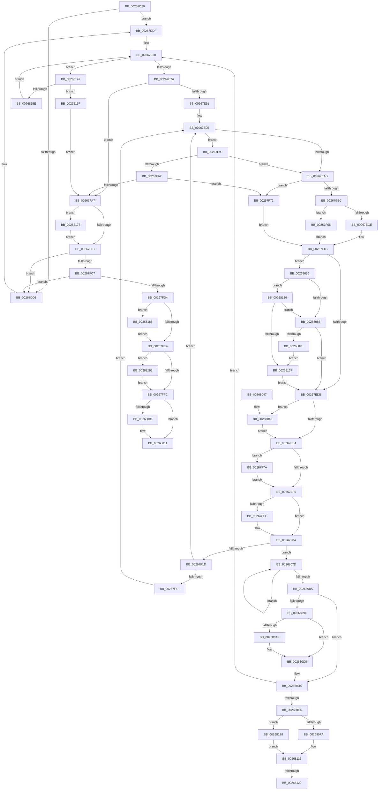

# SMKM_STORE_MGR&lt;SM_TRAITS&gt;::SmCompressCtxWorkerThread

- RVA: `0x00267D20`–`0x002681A6` (길이 `1,158` bytes)
- VA: `0x0000000140267D20`
- 실행 섹션: `.text`
- PDB 이름 있음: `예`; PDB Function 태그: `예`
- unwind 정보 RVA: `0x000650BC`
- 디코드: `290`개 명령, `1,158/1,158` bytes 표시
- 미해석 바이트: `0` (있으면 어셈블리에 `.byte`로 보존)

> 이 문서는 커널 이미지의 기계어와 PDB 기호를 분석해 생성했습니다. 4번과 5번은 함수 원형과 자료형을 바이너리 사용 방식에서 추정한 C 해석이며 원본 소스 복구 결과는 아닙니다.

## 1. Dependencies

- 직접 호출 지점: **24**; 고유 호출 대상: **13**
- 직접 호출자로 확인된 함수: **0**
- RIP 상대 이미지 참조: **1**

### Outgoing calls
- `0x00267DBD` → [ExAcquireSpinLockExclusive](../24/ExAcquireSpinLockExclusive_function_00248690.md) (function, `0x00248690`)
- `0x00267E00` → [KeSetActualBasePriorityThread](../3C/KeSetActualBasePriorityThread_function_003C4370.md) (function, `0x003C4370`)
- `0x00267E0C` → [SMKM_STORE_MGR<SM_TRAITS>::SmCompressCtxUpdateThreadTopology](../3B/SMKM_STORE_MGR_SM_TRAITS_SmCompressCtxUpdateThreadTopology_function_003B216C.md) (function, `0x003B216C`)
- `0x00267E17` → [ExReleaseSpinLockExclusive](../2C/ExReleaseSpinLockExclusive_function_002C0EF0.md) (function, `0x002C0EF0`)
- `0x00267E25` → [KeSetEvent](../33/KeSetEvent_function_0033F310.md) (function, `0x0033F310`)
- `0x00267E65` → [KeWaitForMultipleObjects](../20/KeWaitForMultipleObjects_function_0020D110.md) (function, `0x0020D110`)
- `0x00267E7A` → [ExAcquireSpinLockExclusive](../24/ExAcquireSpinLockExclusive_function_00248690.md) (function, `0x00248690`)
- `0x00267EE7` → [ExReleaseSpinLockExclusiveFromDpcLevel](../24/ExReleaseSpinLockExclusiveFromDpcLevel_function_002497E0.md) (function, `0x002497E0`)
- `0x00267F05` → [KiLowerIrqlProcessIrqlFlags](../4F/KiLowerIrqlProcessIrqlFlags_function_004F5698.md) (function, `0x004F5698`)
- `0x00267F28` → [SMKM_STORE_MGR<SM_TRAITS>::SmCompressCtxProcessEntry](SMKM_STORE_MGR_SM_TRAITS_SmCompressCtxProcessEntry_function_002681DC.md) (function, `0x002681DC`)
- `0x00267F30` → [ExAcquireSpinLockExclusive](../24/ExAcquireSpinLockExclusive_function_00248690.md) (function, `0x00248690`)
- `0x00267F3B` → [SMKM_STORE_MGR<SM_TRAITS>::SmCompressCtxNewThreadNeeded](SMKM_STORE_MGR_SM_TRAITS_SmCompressCtxNewThreadNeeded_function_002681AC.md) (function, `0x002681AC`)
- `0x00267F55` → [KeSetEvent](../33/KeSetEvent_function_0033F310.md) (function, `0x0033F310`)
- `0x00267F83` → [KeSetEvent](../33/KeSetEvent_function_0033F310.md) (function, `0x0033F310`)
- `0x00267FEE` → [ExReleaseSpinLockExclusiveFromDpcLevel](../24/ExReleaseSpinLockExclusiveFromDpcLevel_function_002497E0.md) (function, `0x002497E0`)
- `0x0026800C` → [KiLowerIrqlProcessIrqlFlags](../4F/KiLowerIrqlProcessIrqlFlags_function_004F5698.md) (function, `0x004F5698`)
- `0x00268021` → [SMKM_STORE_MGR<SM_TRAITS>::SmCompressCtxDeleteThreadParams](../3B/SMKM_STORE_MGR_SM_TRAITS_SmCompressCtxDeleteThreadParams_function_003B23D0.md) (function, `0x003B23D0`)
- `0x00268081` → [SMKM_STORE_MGR<SM_TRAITS>::SmCompressCtxCompletePendingEntry](../4A/SMKM_STORE_MGR_SM_TRAITS_SmCompressCtxCompletePendingEntry_function_004A59F8.md) (function, `0x004A59F8`)
- `0x0026809E` → [ExAcquireSpinLockExclusive](../24/ExAcquireSpinLockExclusive_function_00248690.md) (function, `0x00248690`)
- `0x002680C3` → [SMKM_STORE_MGR<SM_TRAITS>::SmCompressCtxProcessReadyQueue](SMKM_STORE_MGR_SM_TRAITS_SmCompressCtxProcessReadyQueue_function_002678F0.md) (function, `0x002678F0`)
- `0x002680CE` → [ExReleaseSpinLockExclusive](../2C/ExReleaseSpinLockExclusive_function_002C0EF0.md) (function, `0x002C0EF0`)
- `0x00268147` → [ExAcquireSpinLockExclusive](../24/ExAcquireSpinLockExclusive_function_00248690.md) (function, `0x00248690`)
- `0x00268163` → [ExReleaseSpinLockExclusive](../2C/ExReleaseSpinLockExclusive_function_002C0EF0.md) (function, `0x002C0EF0`)
- `0x0026819C` → [KeSetEvent](../33/KeSetEvent_function_0033F310.md) (function, `0x0033F310`)

### Direct callers
- 이 함수 시작 RVA로 연결되는 직접 call은 확인되지 않았습니다. 간접 호출은 완전히 역산할 수 없습니다.

### Static image references
- `0x00267EF5` → RVA `0x00FC6D20` (`ALMOSTRO`; read)

## 2. Other-region calls and transfers

- 다른 실행 섹션으로 향하는 call: **0**
- call이 아닌 외부 분기/꼬리 이동: **2**
  - `0x0026811A` → [sub_006D8FE6](../6D/Unknown_function_006D8FE6.md) (`tail-transfer`)
  - `0x00268123` → [sub_006D8FE6](../6D/Unknown_function_006D8FE6.md) (`tail-transfer`)

## 3. Assembly (complete function range)

```asm
00267D20  48 8B C4                        mov rax, rsp
00267D23  48 89 58 10                     mov qword ptr [rax + 0x10], rbx
00267D27  48 89 70 18                     mov qword ptr [rax + 0x18], rsi
00267D2B  48 89 78 20                     mov qword ptr [rax + 0x20], rdi
00267D2F  55                              push rbp
00267D30  41 54                           push r12
00267D32  41 55                           push r13
00267D34  41 56                           push r14
00267D36  41 57                           push r15
00267D38  48 8D 68 A1                     lea rbp, [rax - 0x5f]
00267D3C  48 81 EC C0 00 00 00            sub rsp, 0xc0
00267D43  48 8B 19                        mov rbx, qword ptr [rcx]
00267D46  4C 8B E9                        mov r13, rcx
00267D49  33 F6                           xor esi, esi
00267D4B  4C 8B 7B 08                     mov r15, qword ptr [rbx + 8]
00267D4F  48 8D 43 50                     lea rax, [rbx + 0x50]
00267D53  48 89 45 B7                     mov qword ptr [rbp - 0x49], rax
00267D57  48 8D 43 20                     lea rax, [rbx + 0x20]
00267D5B  48 89 45 BF                     mov qword ptr [rbp - 0x41], rax
00267D5F  48 8B 41 08                     mov rax, qword ptr [rcx + 8]
00267D63  48 89 45 E7                     mov qword ptr [rbp - 0x19], rax
00267D67  48 C7 45 67 80 0F 05 FD         mov qword ptr [rbp + 0x67], 0xfffffffffd050f80
00267D6F  48 89 75 2F                     mov qword ptr [rbp + 0x2f], rsi
00267D73  48 89 5D EF                     mov qword ptr [rbp - 0x11], rbx
00267D77  49 8B 07                        mov rax, qword ptr [r15]
00267D7A  48 8B 88 E0 07 00 00            mov rcx, qword ptr [rax + 0x7e0]
00267D81  49 8B 45 18                     mov rax, qword ptr [r13 + 0x18]
00267D85  48 89 45 FF                     mov qword ptr [rbp - 1], rax
00267D89  49 8B 45 20                     mov rax, qword ptr [r13 + 0x20]
00267D8D  48 89 45 07                     mov qword ptr [rbp + 7], rax
00267D91  48 8D 45 0F                     lea rax, [rbp + 0xf]
00267D95  48 89 45 17                     mov qword ptr [rbp + 0x17], rax
00267D99  48 8D 45 1F                     lea rax, [rbp + 0x1f]
00267D9D  48 89 4D F7                     mov qword ptr [rbp - 9], rcx
00267DA1  48 8B CB                        mov rcx, rbx
00267DA4  48 89 45 27                     mov qword ptr [rbp + 0x27], rax
00267DA8  48 89 75 0F                     mov qword ptr [rbp + 0xf], rsi
00267DAC  48 89 75 1F                     mov qword ptr [rbp + 0x1f], rsi
00267DB0  65 48 8B 04 25 88 01 00 00      mov rax, qword ptr gs:[0x188]
00267DB9  48 89 45 D7                     mov qword ptr [rbp - 0x29], rax
00267DBD  E8 CE 08 FE FF                  call 0x140248690
00267DC2  FF 83 9C 00 00 00               inc dword ptr [rbx + 0x9c]
00267DC8  48 8D 4B 68                     lea rcx, [rbx + 0x68]
00267DCC  48 8B 51 08                     mov rdx, qword ptr [rcx + 8]
00267DD0  40 8A F8                        mov dil, al
00267DD3  48 39 0A                        cmp qword ptr [rdx], rcx
00267DD6  74 07                           je 0x140267ddf
00267DD8  B9 03 00 00 00                  mov ecx, 3
00267DDD  CD 29                           int 0x29
00267DDF  48 89 4D C7                     mov qword ptr [rbp - 0x39], rcx
00267DE3  48 8D 45 C7                     lea rax, [rbp - 0x39]
00267DE7  48 89 55 CF                     mov qword ptr [rbp - 0x31], rdx
00267DEB  48 89 02                        mov qword ptr [rdx], rax
00267DEE  48 8D 45 C7                     lea rax, [rbp - 0x39]
00267DF2  48 89 41 08                     mov qword ptr [rcx + 8], rax
00267DF6  8B 93 98 00 00 00               mov edx, dword ptr [rbx + 0x98]
00267DFC  48 8B 4D D7                     mov rcx, qword ptr [rbp - 0x29]
00267E00  E8 6B C5 15 00                  call 0x1403c4370
00267E05  48 8B 55 D7                     mov rdx, qword ptr [rbp - 0x29]
00267E09  48 8B CB                        mov rcx, rbx
00267E0C  E8 5B A3 14 00                  call 0x1403b216c
00267E11  40 8A D7                        mov dl, dil
00267E14  48 8B CB                        mov rcx, rbx
00267E17  E8 D4 90 05 00                  call 0x1402c0ef0
00267E1C  49 8B 4D 10                     mov rcx, qword ptr [r13 + 0x10]
00267E20  45 33 C0                        xor r8d, r8d
00267E23  33 D2                           xor edx, edx
00267E25  E8 E6 74 0D 00                  call 0x14033f310
00267E2A  44 8B F6                        mov r14d, esi
00267E2D  44 8B E6                        mov r12d, esi
00267E30  83 BB 9C 00 00 00 01            cmp dword ptr [rbx + 0x9c], 1
00267E37  48 8D 45 67                     lea rax, [rbp + 0x67]
00267E3B  41 B9 1A 00 00 00               mov r9d, 0x1a
00267E41  48 89 74 24 38                  mov qword ptr [rsp + 0x38], rsi
00267E46  48 0F 46 C6                     cmovbe rax, rsi
00267E4A  48 8D 55 B7                     lea rdx, [rbp - 0x49]
00267E4E  48 89 44 24 30                  mov qword ptr [rsp + 0x30], rax
00267E53  40 88 74 24 28                  mov byte ptr [rsp + 0x28], sil
00267E58  45 8D 41 E7                     lea r8d, [r9 - 0x19]
00267E5C  40 88 74 24 20                  mov byte ptr [rsp + 0x20], sil
00267E61  41 8D 49 E8                     lea ecx, [r9 - 0x18]
00267E65  E8 A6 52 FA FF                  call 0x14020d110
00267E6A  8B F8                           mov edi, eax
00267E6C  48 8B CB                        mov rcx, rbx
00267E6F  3D 02 01 00 00                  cmp eax, 0x102
00267E74  0F 84 CD 02 00 00               je 0x140268147
00267E7A  E8 11 08 FE FF                  call 0x140248690
00267E7F  45 33 C0                        xor r8d, r8d
00267E82  40 8A F0                        mov sil, al
00267E85  45 8D 48 01                     lea r9d, [r8 + 1]
00267E89  85 FF                           test edi, edi
00267E8B  0F 84 16 01 00 00               je 0x140267fa7
00267E91  44 01 8B A0 00 00 00            add dword ptr [rbx + 0xa0], r9d
00267E98  45 8B E1                        mov r12d, r9d
00267E9B  41 8B F8                        mov edi, r8d
00267E9E  44 39 8B 9C 00 00 00            cmp dword ptr [rbx + 0x9c], r9d
00267EA5  0F 87 E5 00 00 00               ja 0x140267f90
00267EAB  48 8D 4B 10                     lea rcx, [rbx + 0x10]
00267EAF  48 8B 51 08                     mov rdx, qword ptr [rcx + 8]
00267EB3  48 3B D1                        cmp rdx, rcx
00267EB6  0F 84 B6 00 00 00               je 0x140267f72
00267EBC  48 8B 39                        mov rdi, qword ptr [rcx]
00267EBF  48 8B 07                        mov rax, qword ptr [rdi]
00267EC2  48 89 01                        mov qword ptr [rcx], rax
00267EC5  48 3B FA                        cmp rdi, rdx
00267EC8  0F 84 98 00 00 00               je 0x140267f66
00267ECE  48 FF 0A                        dec qword ptr [rdx]
00267ED1  44 39 43 24                     cmp dword ptr [rbx + 0x24], r8d
00267ED5  0F 84 7B 01 00 00               je 0x140268056
00267EDB  48 85 FF                        test rdi, rdi
00267EDE  0F 84 64 01 00 00               je 0x140268048
00267EE4  48 8B CB                        mov rcx, rbx
00267EE7  E8 F4 18 FE FF                  call 0x1402497e0
00267EEC  45 85 F6                        test r14d, r14d
00267EEF  0F 85 85 00 00 00               jne 0x140267f7a
00267EF5  83 3D 24 EE D5 00 00            cmp dword ptr [rip + 0xd5ee24], 0
00267EFC  74 0C                           je 0x140267f0a
00267EFE  44 0F 20 C1                     mov rcx, cr8
00267F02  40 8A D6                        mov dl, sil
00267F05  E8 8E D7 28 00                  call 0x1404f5698
00267F0A  40 0F B6 C6                     movzx eax, sil
00267F0E  44 0F 22 C0                     mov cr8, rax
00267F12  33 F6                           xor esi, esi
00267F14  48 85 FF                        test rdi, rdi
00267F17  0F 84 60 01 00 00               je 0x14026807d
00267F1D  48 83 C7 B8                     add rdi, -0x48
00267F21  48 8D 4D E7                     lea rcx, [rbp - 0x19]
00267F25  48 8B D7                        mov rdx, rdi
00267F28  E8 AF 02 00 00                  call 0x1402681dc
00267F2D  48 8B CB                        mov rcx, rbx
00267F30  E8 5B 07 FE FF                  call 0x140248690
00267F35  48 8B CB                        mov rcx, rbx
00267F38  40 8A F0                        mov sil, al
00267F3B  E8 6C 02 00 00                  call 0x1402681ac
00267F40  45 33 C0                        xor r8d, r8d
00267F43  45 8D 48 01                     lea r9d, [r8 + 1]
00267F47  85 C0                           test eax, eax
00267F49  0F 84 4F FF FF FF               je 0x140267e9e
00267F4F  48 8D 4B 38                     lea rcx, [rbx + 0x38]
00267F53  33 D2                           xor edx, edx
00267F55  E8 B6 73 0D 00                  call 0x14033f310
00267F5A  45 33 C0                        xor r8d, r8d
00267F5D  45 8D 48 01                     lea r9d, [r8 + 1]
00267F61  E9 38 FF FF FF                  jmp 0x140267e9e
00267F66  48 89 49 08                     mov qword ptr [rcx + 8], rcx
00267F6A  4C 89 01                        mov qword ptr [rcx], r8
00267F6D  E9 5F FF FF FF                  jmp 0x140267ed1
00267F72  49 8B F8                        mov rdi, r8
00267F75  E9 57 FF FF FF                  jmp 0x140267ed1
00267F7A  45 33 C0                        xor r8d, r8d
00267F7D  48 8D 4B 20                     lea rcx, [rbx + 0x20]
00267F81  33 D2                           xor edx, edx
00267F83  E8 88 73 0D 00                  call 0x14033f310
00267F88  45 33 F6                        xor r14d, r14d
00267F8B  E9 65 FF FF FF                  jmp 0x140267ef5
00267F90  41 8B 4F 2C                     mov ecx, dword ptr [r15 + 0x2c]
00267F94  41 8B 47 28                     mov eax, dword ptr [r15 + 0x28]
00267F98  2B C8                           sub ecx, eax
00267F9A  85 C9                           test ecx, ecx
00267F9C  0F 8E 09 FF FF FF               jle 0x140267eab
00267FA2  48 85 FF                        test rdi, rdi
00267FA5  75 CB                           jne 0x140267f72
00267FA7  44 39 43 24                     cmp dword ptr [rbx + 0x24], r8d
00267FAB  0F 84 C6 01 00 00               je 0x140268177
00267FB1  48 8B 4D C7                     mov rcx, qword ptr [rbp - 0x39]
00267FB5  48 8D 55 C7                     lea rdx, [rbp - 0x39]
00267FB9  48 8B 45 CF                     mov rax, qword ptr [rbp - 0x31]
00267FBD  48 39 51 08                     cmp qword ptr [rcx + 8], rdx
00267FC1  0F 85 11 FE FF FF               jne 0x140267dd8
00267FC7  48 8D 55 C7                     lea rdx, [rbp - 0x39]
00267FCB  48 39 10                        cmp qword ptr [rax], rdx
00267FCE  0F 85 04 FE FF FF               jne 0x140267dd8
00267FD4  48 89 08                        mov qword ptr [rax], rcx
00267FD7  48 89 41 08                     mov qword ptr [rcx + 8], rax
00267FDB  45 85 E4                        test r12d, r12d
00267FDE  0F 85 A4 01 00 00               jne 0x140268188
00267FE4  44 29 8B 9C 00 00 00            sub dword ptr [rbx + 0x9c], r9d
00267FEB  48 8B CB                        mov rcx, rbx
00267FEE  E8 ED 17 FE FF                  call 0x1402497e0
00267FF3  45 85 F6                        test r14d, r14d
00267FF6  0F 85 97 01 00 00               jne 0x140268193
00267FFC  83 3D 1D ED D5 00 00            cmp dword ptr [rip + 0xd5ed1d], 0
00268003  74 0C                           je 0x140268011
00268005  44 0F 20 C1                     mov rcx, cr8
00268009  40 8A D6                        mov dl, sil
0026800C  E8 87 D6 28 00                  call 0x1404f5698
00268011  40 0F B6 C6                     movzx eax, sil
00268015  44 0F 22 C0                     mov cr8, rax
00268019  F0 41 FF 4F 2C                  lock dec dword ptr [r15 + 0x2c]
0026801E  49 8B CD                        mov rcx, r13
00268021  E8 AA A3 14 00                  call 0x1403b23d0
00268026  4C 8D 9C 24 C0 00 00 00         lea r11, [rsp + 0xc0]
0026802E  49 8B 5B 38                     mov rbx, qword ptr [r11 + 0x38]
00268032  49 8B 73 40                     mov rsi, qword ptr [r11 + 0x40]
00268036  49 8B 7B 48                     mov rdi, qword ptr [r11 + 0x48]
0026803A  49 8B E3                        mov rsp, r11
0026803D  41 5F                           pop r15
0026803F  41 5E                           pop r14
00268041  41 5D                           pop r13
00268043  41 5C                           pop r12
00268045  5D                              pop rbp
00268046  C3                              ret
00268047  CC                              int3
00268048  FF 8B A0 00 00 00               dec dword ptr [rbx + 0xa0]
0026804E  45 8B E0                        mov r12d, r8d
00268051  E9 8E FE FF FF                  jmp 0x140267ee4
00268056  48 8B 43 18                     mov rax, qword ptr [rbx + 0x18]
0026805A  48 8B 08                        mov rcx, qword ptr [rax]
0026805D  48 85 FF                        test rdi, rdi
00268060  0F 84 D0 00 00 00               je 0x140268136
00268066  8B 83 A0 00 00 00               mov eax, dword ptr [rbx + 0xa0]
0026806C  C1 E0 05                        shl eax, 5
0026806F  48 3B C8                        cmp rcx, rax
00268072  0F 86 63 FE FF FF               jbe 0x140267edb
00268078  E9 C2 00 00 00                  jmp 0x14026813f
0026807D  48 8D 4D E7                     lea rcx, [rbp - 0x19]
00268081  E8 72 D9 23 00                  call 0x1404a59f8
00268086  85 C0                           test eax, eax
00268088  75 F3                           jne 0x14026807d
0026808A  48 8D 43 78                     lea rax, [rbx + 0x78]
0026808E  48 39 40 08                     cmp qword ptr [rax + 8], rax
00268092  74 41                           je 0x1402680d5
00268094  48 8D B3 88 00 00 00            lea rsi, [rbx + 0x88]
0026809B  48 8B CE                        mov rcx, rsi
0026809E  E8 ED 05 FE FF                  call 0x140248690
002680A3  83 BB 8C 00 00 00 00            cmp dword ptr [rbx + 0x8c], 0
002680AA  40 8A F8                        mov dil, al
002680AD  75 19                           jne 0x1402680c8
002680AF  C7 83 8C 00 00 00 01 00 00 00   mov dword ptr [rbx + 0x8c], 1
002680B9  44 8A C0                        mov r8b, al
002680BC  48 8B 55 E7                     mov rdx, qword ptr [rbp - 0x19]
002680C0  48 8B CB                        mov rcx, rbx
002680C3  E8 28 F8 FF FF                  call 0x1402678f0
002680C8  40 8A D7                        mov dl, dil
002680CB  48 8B CE                        mov rcx, rsi
002680CE  E8 1D 8E 05 00                  call 0x1402c0ef0
002680D3  33 F6                           xor esi, esi
002680D5  48 8B 55 27                     mov rdx, qword ptr [rbp + 0x27]
002680D9  48 8D 45 1F                     lea rax, [rbp + 0x1f]
002680DD  48 3B D0                        cmp rdx, rax
002680E0  0F 84 4A FD FF FF               je 0x140267e30
002680E6  4C 8B 45 1F                     mov r8, qword ptr [rbp + 0x1f]
002680EA  49 8B 00                        mov rax, qword ptr [r8]
002680ED  48 83 E0 F8                     and rax, 0xfffffffffffffff8
002680F1  48 89 45 1F                     mov qword ptr [rbp + 0x1f], rax
002680F5  4C 3B C2                        cmp r8, rdx
002680F8  74 2E                           je 0x140268128
002680FA  48 8B 0A                        mov rcx, qword ptr [rdx]
002680FD  48 8B C1                        mov rax, rcx
00268100  83 E1 07                        and ecx, 7
00268103  48 C1 E8 03                     shr rax, 3
00268107  48 8D 04 C5 F8 FF FF FF         lea rax, [rax*8 - 8]
0026810F  48 0B C1                        or rax, rcx
00268112  48 89 02                        mov qword ptr [rdx], rax
00268115  41 8B 00                        mov eax, dword ptr [r8]
00268118  A8 02                           test al, 2
0026811A  0F 84 C6 0E 47 00               je 0x1406d8fe6
00268120  FF 4D 2F                        dec dword ptr [rbp + 0x2f]
00268123  E9 BE 0E 47 00                  jmp 0x1406d8fe6
00268128  48 8D 45 1F                     lea rax, [rbp + 0x1f]
0026812C  48 89 75 1F                     mov qword ptr [rbp + 0x1f], rsi
00268130  48 89 45 27                     mov qword ptr [rbp + 0x27], rax
00268134  EB DF                           jmp 0x140268115
00268136  48 85 C9                        test rcx, rcx
00268139  0F 84 27 FF FF FF               je 0x140268066
0026813F  45 8B F1                        mov r14d, r9d
00268142  E9 94 FD FF FF                  jmp 0x140267edb
00268147  E8 44 05 FE FF                  call 0x140248690
0026814C  41 B9 01 00 00 00               mov r9d, 1
00268152  40 8A F0                        mov sil, al
00268155  44 39 8B 9C 00 00 00            cmp dword ptr [rbx + 0x9c], r9d
0026815C  77 11                           ja 0x14026816f
0026815E  8A D0                           mov dl, al
00268160  48 8B CB                        mov rcx, rbx
00268163  E8 88 8D 05 00                  call 0x1402c0ef0
00268168  33 F6                           xor esi, esi
0026816A  E9 C1 FC FF FF                  jmp 0x140267e30
0026816F  45 33 C0                        xor r8d, r8d
00268172  E9 30 FE FF FF                  jmp 0x140267fa7
00268177  48 8D 43 10                     lea rax, [rbx + 0x10]
0026817B  48 39 40 08                     cmp qword ptr [rax + 8], rax
0026817F  45 0F 45 F1                     cmovne r14d, r9d
00268183  E9 29 FE FF FF                  jmp 0x140267fb1
00268188  FF 8B A0 00 00 00               dec dword ptr [rbx + 0xa0]
0026818E  E9 51 FE FF FF                  jmp 0x140267fe4
00268193  48 8D 4B 20                     lea rcx, [rbx + 0x20]
00268197  45 33 C0                        xor r8d, r8d
0026819A  33 D2                           xor edx, edx
0026819C  E8 6F 71 0D 00                  call 0x14033f310
002681A1  E9 56 FE FF FF                  jmp 0x140267ffc
```

## 4. C-style interpretation (structured pseudocode)

```c
__int64 __fastcall SMKM_STORE_MGR_SM_TRAITS___SmCompressCtxWorkerThread(__int64 a1, __int64 a2, int a3)
{
    __int64 result;
    __int64 v_r14;
    __int64 v_rdi;
    __int64 v_rsi;
    __int64 v_rsp;
    unsigned __int64 v_stack_m28;
    unsigned __int64 v_stack_mB0;
    unsigned __int64 v_stack_mB8;
    unsigned __int8 v_stack_mC0;
    unsigned __int8 v_stack_mC8;

    *(unsigned __int64 *)(v_rsp + 16) = v_rbx;
    *(unsigned __int64 *)(v_rsp + 24) = v_rsi;
    *(unsigned __int64 *)(v_rsp + 32) = v_rdi;
    v_rsp = (v_rsp) - (192);
    v_rsi = 0;
    *(unsigned __int64 *)(v_rsp - 95 - 73) = *(unsigned __int64 *)(a1) + 80;
    *(unsigned __int64 *)(v_rsp - 95 - 65) = *(unsigned __int64 *)(a1) + 32;
    *(unsigned __int64 *)(v_rsp - 95 - 25) = *(unsigned __int64 *)(a1 + 8);
    *(unsigned __int64 *)(v_rsp - 95 + 103) = 0xFFFFFFFFFD050F80ULL;
    *(unsigned __int64 *)(v_rsp - 95 + 47) = 0;
    *(unsigned __int64 *)(v_rsp - 95 - 17) = *(unsigned __int64 *)(a1);
    *(unsigned __int64 *)(v_rsp - 95 - 1) = *(unsigned __int64 *)(a1 + 24);
    *(unsigned __int64 *)(v_rsp - 95 + 7) = *(unsigned __int64 *)(a1 + 32);
    *(unsigned __int64 *)(v_rsp - 95 + 23) = v_rsp - 95 + 15;
    *(unsigned __int64 *)(v_rsp - 95 - 9) = *(unsigned __int64 *)(*(unsigned __int64 *)(*(unsigned __int64 *)(*(unsigned __int64 *)(a1) + 8)) + 2016);
    *(unsigned __int64 *)(v_rsp - 95 + 39) = v_rsp - 95 + 31;
    *(unsigned __int64 *)(v_rsp - 95 + 15) = 0;
    *(unsigned __int64 *)(v_rsp - 95 + 31) = 0;
    *(unsigned __int64 *)(v_rsp - 95 - 41) = *(unsigned __int64 *)(gs_base + (0 + 392));
    result = ExAcquireSpinLockExclusive(*(unsigned __int64 *)(a1), a2, a3, a4);
    if ((*(unsigned __int64 *)(*(unsigned __int64 *)(*(unsigned __int64 *)(a1) + 104 + 8))) != (*(unsigned __int64 *)(a1) + 104)) {
        a1 = 3;
    }
    *(unsigned __int64 *)(v_rsp - 95 - 57) = a1;
    *(unsigned __int64 *)(v_rsp - 95 - 49) = *(unsigned __int64 *)(*(unsigned __int64 *)(a1) + 104 + 8);
    *(unsigned __int64 *)(*(unsigned __int64 *)(*(unsigned __int64 *)(a1) + 104 + 8)) = v_rsp - 95 - 57;
    *(unsigned __int64 *)(a1 + 8) = v_rsp - 95 - 57;
    result = KeSetActualBasePriorityThread(*(unsigned __int64 *)(v_rsp - 95 - 41), (unsigned int)(*(unsigned int *)(*(unsigned __int64 *)(a1) + 152)), a3, a4);
    result = SMKM_STORE_MGR_SM_TRAITS___SmCompressCtxUpdateThreadTopology(*(unsigned __int64 *)(a1), *(unsigned __int64 *)(v_rsp - 95 - 41), a3, a4);
    result = ExReleaseSpinLockExclusive(*(unsigned __int64 *)(a1), (unsigned __int8)((unsigned __int8)(result)), a3, a4);
    a3 = 0;
    a2 = 0;
    result = KeSetEvent(*(unsigned __int64 *)(a1 + 16), a2, a3, a4);
loc_00267E30:
    v_stack_mB0 = 0;
    result = v_rsp - 95 + 103;
    if ((*(unsigned int *)(*(unsigned __int64 *)(a1) + 156)) <= 1) { result = 0; }
    v_stack_mB8 = result;
    v_stack_mC0 = 0;
    v_stack_mC8 = 0;
    result = KeWaitForMultipleObjects(26 - 24, v_rsp - 95 - 73, 26 - 25, 26);
    if (((unsigned int)(result)) == 258) goto loc_00268147;
    result = ExAcquireSpinLockExclusive(*(unsigned __int64 *)(a1), v_rsp - 95 - 73, 26 - 25, 26);
    a3 = 0;
    if ((unsigned int)((unsigned int)((unsigned int)(result))) == 0) goto loc_00267FA7;
loc_00267E9E:
    if ((*(unsigned int *)(*(unsigned __int64 *)(a1) + 156)) > ((unsigned int)(a3 + 1))) goto loc_00267F90;
loc_00267EAB:
    if ((*(unsigned __int64 *)(*(unsigned __int64 *)(a1) + 16 + 8)) == (*(unsigned __int64 *)(a1) + 16)) goto loc_00267F72;
    *(unsigned __int64 *)(*(unsigned __int64 *)(a1) + 16) = *(unsigned __int64 *)(*(unsigned __int64 *)(*(unsigned __int64 *)(a1) + 16));
    if ((*(unsigned __int64 *)(*(unsigned __int64 *)(a1) + 16)) == (*(unsigned __int64 *)(*(unsigned __int64 *)(a1) + 16 + 8))) goto loc_00267F66;
loc_00267ED1:
    if ((*(unsigned int *)(*(unsigned __int64 *)(a1) + 36)) == 0) goto loc_00268056;
loc_00267EDB:
    if (*(unsigned __int64 *)(*(unsigned __int64 *)(a1) + 16) == 0) goto loc_00268048;
loc_00267EE4:
    result = ExReleaseSpinLockExclusiveFromDpcLevel(*(unsigned __int64 *)(a1), *(unsigned __int64 *)(*(unsigned __int64 *)(a1) + 16 + 8), a3, a3 + 1);
    if (0 != 0) goto loc_00267F7A;
loc_00267EF5:
    if ((*(unsigned int *)(v_rip + 14020132)) != 0) {
        a1 = v_cr8;
        a2 = (unsigned __int8)((unsigned __int8)(result));
        result = KiLowerIrqlProcessIrqlFlags(a1, a2, a3, a3 + 1);
    }
    v_rsi = 0;
    if (*(unsigned __int64 *)(*(unsigned __int64 *)(a1) + 16) == 0) goto loc_0026807D;
    v_rdi = (*(unsigned __int64 *)(*(unsigned __int64 *)(a1) + 16)) + (-72);
    result = SMKM_STORE_MGR_SM_TRAITS___SmCompressCtxProcessEntry(v_rsp - 95 - 25, v_rdi, a3, a3 + 1);
    result = ExAcquireSpinLockExclusive(*(unsigned __int64 *)(a1), v_rdi, a3, a3 + 1);
    result = SMKM_STORE_MGR_SM_TRAITS___SmCompressCtxNewThreadNeeded(*(unsigned __int64 *)(a1), v_rdi, a3, a3 + 1);
    a3 = 0;
    if ((unsigned int)(result) == 0) goto loc_00267E9E;
    a2 = 0;
    result = KeSetEvent(*(unsigned __int64 *)(a1) + 56, a2, a3, a3 + 1);
    a3 = 0;
    goto loc_00267E9E;
loc_00267F66:
    *(unsigned __int64 *)(*(unsigned __int64 *)(a1) + 56 + 8) = *(unsigned __int64 *)(a1) + 56;
    *(unsigned __int64 *)(*(unsigned __int64 *)(a1) + 56) = 0;
    goto loc_00267ED1;
loc_00267F72:
    goto loc_00267ED1;
loc_00267F7A:
    a3 = 0;
    a2 = 0;
    result = KeSetEvent(*(unsigned __int64 *)(a1) + 32, a2, a3, a3 + 1);
    v_r14 = 0;
    goto loc_00267EF5;
loc_00267F90:
    a1 = (unsigned int)(((unsigned int)(*(unsigned int *)(*(unsigned __int64 *)(*(unsigned __int64 *)(a1) + 8) + 44))) - ((unsigned int)((unsigned int)(*(unsigned int *)(*(unsigned __int64 *)(*(unsigned __int64 *)(a1) + 8) + 40)))));
    if (condition_is_less_or_equal) goto loc_00267EAB;
    if (0 != 0) goto loc_00267F72;
loc_00267FA7:
    if ((*(unsigned int *)(*(unsigned __int64 *)(a1) + 36)) == 0) goto loc_00268177;
loc_00267FB1:
    if ((*(unsigned __int64 *)(*(unsigned __int64 *)(v_rsp - 95 - 57) + 8)) != (v_rsp - 95 - 57)) goto loc_00267DD8;
    if ((*(unsigned __int64 *)(*(unsigned __int64 *)(v_rsp - 95 - 49))) != (v_rsp - 95 - 57)) goto loc_00267DD8;
    *(unsigned __int64 *)(*(unsigned __int64 *)(v_rsp - 95 - 49)) = *(unsigned __int64 *)(v_rsp - 95 - 57);
    *(unsigned __int64 *)(*(unsigned __int64 *)(v_rsp - 95 - 57) + 8) = *(unsigned __int64 *)(v_rsp - 95 - 49);
    if ((unsigned int)((unsigned int)((unsigned int)(a3 + 1))) != 0) goto loc_00268188;
loc_00267FE4:
    result = ExReleaseSpinLockExclusiveFromDpcLevel(*(unsigned __int64 *)(a1), v_rsp - 95 - 57, a3, a3 + 1);
    if (0 != 0) goto loc_00268193;
loc_00267FFC:
    if ((*(unsigned int *)(v_rip + 14019869)) != 0) {
        a1 = (unsigned __int8)((unsigned __int8)(result));
        a2 = (unsigned __int8)((unsigned __int8)(result));
        result = KiLowerIrqlProcessIrqlFlags(a1, a2, a3, a3 + 1);
    }
    result = SMKM_STORE_MGR_SM_TRAITS___SmCompressCtxDeleteThreadParams(a1, a2, a3, a3 + 1);
    return result;
loc_00268048:
    goto loc_00267EE4;
loc_00268056:
    if (*(unsigned __int64 *)(v_stack_m28 + 72) == 0) goto loc_00268136;
loc_00268066:
    result = (unsigned int)(((unsigned int)(*(unsigned int *)(*(unsigned __int64 *)(v_stack_m28 + 56) + 160))) << (5));
    if ((*(unsigned __int64 *)(*(unsigned __int64 *)(*(unsigned __int64 *)(v_stack_m28 + 56) + 24))) <= result) goto loc_00267EDB;
    goto loc_0026813F;
loc_0026807D:
    result = SMKM_STORE_MGR_SM_TRAITS___SmCompressCtxCompletePendingEntry(v_rsp - 95 - 25, a2, a3, a3 + 1);
    if ((unsigned int)(result) != 0) goto loc_0026807D;
    if ((*(unsigned __int64 *)(*(unsigned __int64 *)(v_stack_m28 + 56) + 120 + 8)) == (*(unsigned __int64 *)(v_stack_m28 + 56) + 120)) goto loc_002680D5;
    result = ExAcquireSpinLockExclusive(*(unsigned __int64 *)(v_stack_m28 + 56) + 136, a2, a3, a3 + 1);
    if ((*(unsigned int *)(*(unsigned __int64 *)(v_stack_m28 + 56) + 140)) == 0) {
        *(unsigned int *)(*(unsigned __int64 *)(v_stack_m28 + 56) + 140) = 1;
        a3 = (unsigned __int8)(result);
        a2 = *(unsigned __int64 *)(v_rsp - 95 - 25);
        a1 = *(unsigned __int64 *)(v_stack_m28 + 56);
        result = SMKM_STORE_MGR_SM_TRAITS___SmCompressCtxProcessReadyQueue(a1, a2, a3, a3 + 1);
    }
    result = ExReleaseSpinLockExclusive(*(unsigned __int64 *)(v_stack_m28 + 56) + 136, (unsigned __int8)((unsigned __int8)(result)), a3, a3 + 1);
    v_rsi = 0;
loc_002680D5:
    if ((*(unsigned __int64 *)(v_rsp - 95 + 39)) == (v_rsp - 95 + 31)) goto loc_00267E30;
    result = (*(unsigned __int64 *)(*(unsigned __int64 *)(v_rsp - 95 + 31))) & (-8);
    *(unsigned __int64 *)(v_rsp - 95 + 31) = result;
    if ((*(unsigned __int64 *)(v_rsp - 95 + 31)) == (*(unsigned __int64 *)(v_rsp - 95 + 39))) goto loc_00268128;
    a1 = (unsigned int)((*(unsigned __int64 *)(*(unsigned __int64 *)(v_rsp - 95 + 39))) & (7));
    result = (*(unsigned __int64 *)(*(unsigned __int64 *)(v_rsp - 95 + 39))) >> (3);
    result = (result * 8 - 8) | (a1);
    *(unsigned __int64 *)(*(unsigned __int64 *)(v_rsp - 95 + 39)) = result;
loc_00268115:
loc_00268128:
    *(unsigned __int64 *)(v_rsp - 95 + 31) = 0;
    *(unsigned __int64 *)(v_rsp - 95 + 39) = v_rsp - 95 + 31;
    goto loc_00268115;
loc_00268136:
    if (a1 == 0) goto loc_00268066;
loc_0026813F:
    goto loc_00267EDB;
loc_00268147:
    result = ExAcquireSpinLockExclusive(a1, *(unsigned __int64 *)(v_rsp - 95 + 39), *(unsigned __int64 *)(v_rsp - 95 + 31), a3 + 1);
    if ((*(unsigned int *)(*(unsigned __int64 *)(v_stack_m28 + 56) + 156)) > 1) goto loc_0026816F;
    result = ExReleaseSpinLockExclusive(*(unsigned __int64 *)(v_stack_m28 + 56), (unsigned __int8)(result), *(unsigned __int64 *)(v_rsp - 95 + 31), 1);
    v_rsi = 0;
    goto loc_00267E30;
loc_0026816F:
    a3 = 0;
    goto loc_00267FA7;
loc_00268177:
    v_r14 = (unsigned int)((unsigned int)(a3 + 1));
    if ((*(unsigned __int64 *)(*(unsigned __int64 *)(v_stack_m28 + 56) + 16 + 8)) != (*(unsigned __int64 *)(v_stack_m28 + 56) + 16)) { v_r14 = 1; }
    goto loc_00267FB1;
loc_00268188:
    goto loc_00267FE4;
loc_00268193:
    a3 = 0;
    a2 = 0;
    result = KeSetEvent(*(unsigned __int64 *)(v_stack_m28 + 56) + 32, a2, a3, 1);
    goto loc_00267FFC;
}
```

## 5. (Beta) C Style

```c
int64_t SMKM_STORE_MGR_SM_TRAITS___SmCompressCtxWorkerThread(void *Arg1, int64_t Arg2, int32_t Arg3)
{
    uint8_t *arg1 = (uint8_t *)Arg1;

    int64_t result;
    int64_t local_r14;
    int64_t local_rdi;
    int64_t local_rsi;
    int64_t local_rsp;
    uint64_t v_stack_m28;
    uint64_t v_stack_mB0;
    uint64_t v_stack_mB8;
    uint8_t v_stack_mC0;
    uint8_t v_stack_mC8;

    *(uint64_t *)(local_rsp + 0x10) = local_rbx;
    *(uint64_t *)(local_rsp + 0x18) = local_rsi;
    *(uint64_t *)(local_rsp + 0x20) = local_rdi;
    local_rsp = (local_rsp) - (192);
    local_rsi = 0;
    *(uint64_t *)(local_rsp - 0x5F - 0x49) = *(uint64_t *)(arg1) + 80;
    *(uint64_t *)(local_rsp - 0x5F - 0x41) = *(uint64_t *)(arg1) + 32;
    *(uint64_t *)(local_rsp - 0x5F - 0x19) = *(uint64_t *)(arg1 + 0x8);
    *(uint64_t *)(local_rsp - 0x5F + 0x67) = 0xFFFFFFFFFD050F80ULL;
    *(uint64_t *)(local_rsp - 0x5F + 0x2F) = 0;
    *(uint64_t *)(local_rsp - 0x5F - 0x11) = *(uint64_t *)(arg1);
    *(uint64_t *)(local_rsp - 0x5F - 0x1) = *(uint64_t *)(arg1 + 0x18);
    *(uint64_t *)(local_rsp - 0x5F + 0x7) = *(uint64_t *)(arg1 + 0x20);
    *(uint64_t *)(local_rsp - 0x5F + 0x17) = local_rsp - 95 + 15;
    *(uint64_t *)(local_rsp - 0x5F - 0x9) = *(uint64_t *)(*(uint64_t *)(*(uint64_t *)(*(uint64_t *)(arg1) + 0x8)) + 0x7E0);
    *(uint64_t *)(local_rsp - 0x5F + 0x27) = local_rsp - 95 + 31;
    *(uint64_t *)(local_rsp - 0x5F + 0xF) = 0;
    *(uint64_t *)(local_rsp - 0x5F + 0x1F) = 0;
    *(uint64_t *)(local_rsp - 0x5F - 0x29) = *(uint64_t *)(gs_base + (0 + 0x188));
    result = ExAcquireSpinLockExclusive(*(uint64_t *)(arg1), Arg2, Arg3, a4);
    if ((*(uint64_t *)(*(uint64_t *)(*(uint64_t *)(arg1) + 0x68 + 0x8))) != (*(uint64_t *)(arg1) + 104)) {
        Arg1 = 3;
    }
    *(void **)(local_rsp - 0x5F - 0x39) = Arg1;
    *(uint64_t *)(local_rsp - 0x5F - 0x31) = *(uint64_t *)(*(uint64_t *)(arg1) + 0x68 + 0x8);
    *(uint64_t *)(*(uint64_t *)(*(uint64_t *)(arg1) + 0x68 + 0x8)) = local_rsp - 95 - 57;
    *(uint64_t *)(arg1 + 0x8) = local_rsp - 95 - 57;
    result = KeSetActualBasePriorityThread(*(uint64_t *)(local_rsp - 0x5F - 0x29), (uint32_t)(*(uint32_t *)(*(uint64_t *)(arg1) + 0x98)), Arg3, a4);
    result = SMKM_STORE_MGR_SM_TRAITS___SmCompressCtxUpdateThreadTopology(*(uint64_t *)(arg1), *(uint64_t *)(local_rsp - 0x5F - 0x29), Arg3, a4);
    result = ExReleaseSpinLockExclusive(*(uint64_t *)(arg1), (uint8_t)((uint8_t)(result)), Arg3, a4);
    Arg3 = 0;
    Arg2 = 0;
    result = KeSetEvent(*(uint64_t *)(arg1 + 0x10), Arg2, Arg3, a4);
loc_00267E30:
    v_stack_mB0 = 0;
    result = local_rsp - 95 + 103;
    if ((*(uint32_t *)(*(uint64_t *)(arg1) + 0x9C)) <= 1) { result = 0; }
    v_stack_mB8 = result;
    v_stack_mC0 = 0;
    v_stack_mC8 = 0;
    result = KeWaitForMultipleObjects(26 - 24, local_rsp - 95 - 73, 26 - 25, 26);
    if (((uint32_t)(result)) == 258) goto loc_00268147;
    result = ExAcquireSpinLockExclusive(*(uint64_t *)(arg1), local_rsp - 95 - 73, 26 - 25, 26);
    Arg3 = 0;
    if ((uint32_t)((uint32_t)((uint32_t)(result))) == 0) goto loc_00267FA7;
loc_00267E9E:
    if ((*(uint32_t *)(*(uint64_t *)(arg1) + 0x9C)) > ((uint32_t)(Arg3 + 1))) goto loc_00267F90;
loc_00267EAB:
    if ((*(uint64_t *)(*(uint64_t *)(arg1) + 0x10 + 0x8)) == (*(uint64_t *)(arg1) + 16)) goto loc_00267F72;
    *(uint64_t *)(*(uint64_t *)(arg1) + 0x10) = *(uint64_t *)(*(uint64_t *)(*(uint64_t *)(arg1) + 0x10));
    if ((*(uint64_t *)(*(uint64_t *)(arg1) + 0x10)) == (*(uint64_t *)(*(uint64_t *)(arg1) + 0x10 + 0x8))) goto loc_00267F66;
loc_00267ED1:
    if ((*(uint32_t *)(*(uint64_t *)(arg1) + 0x24)) == 0) goto loc_00268056;
loc_00267EDB:
    if (*(uint64_t *)(*(uint64_t *)(arg1) + 0x10) == 0) goto loc_00268048;
loc_00267EE4:
    result = ExReleaseSpinLockExclusiveFromDpcLevel(*(uint64_t *)(arg1), *(uint64_t *)(*(uint64_t *)(arg1) + 0x10 + 0x8), Arg3, Arg3 + 1);
    if (0 != 0) goto loc_00267F7A;
loc_00267EF5:
    if ((*(uint32_t *)(v_rip + 0xD5EE24)) != 0) {
        Arg1 = v_cr8;
        Arg2 = (uint8_t)((uint8_t)(result));
        result = KiLowerIrqlProcessIrqlFlags(Arg1, Arg2, Arg3, Arg3 + 1);
    }
    local_rsi = 0;
    if (*(uint64_t *)(*(uint64_t *)(arg1) + 0x10) == 0) goto loc_0026807D;
    local_rdi = (*(uint64_t *)(*(uint64_t *)(arg1) + 0x10)) + (-72);
    result = SMKM_STORE_MGR_SM_TRAITS___SmCompressCtxProcessEntry(local_rsp - 95 - 25, local_rdi, Arg3, Arg3 + 1);
    result = ExAcquireSpinLockExclusive(*(uint64_t *)(arg1), local_rdi, Arg3, Arg3 + 1);
    result = SMKM_STORE_MGR_SM_TRAITS___SmCompressCtxNewThreadNeeded(*(uint64_t *)(arg1), local_rdi, Arg3, Arg3 + 1);
    Arg3 = 0;
    if ((uint32_t)(result) == 0) goto loc_00267E9E;
    Arg2 = 0;
    result = KeSetEvent(*(uint64_t *)(arg1) + 56, Arg2, Arg3, Arg3 + 1);
    Arg3 = 0;
    goto loc_00267E9E;
loc_00267F66:
    *(uint64_t *)(*(uint64_t *)(arg1) + 0x38 + 0x8) = *(uint64_t *)(arg1) + 56;
    *(uint64_t *)(*(uint64_t *)(arg1) + 0x38) = 0;
    goto loc_00267ED1;
loc_00267F72:
    goto loc_00267ED1;
loc_00267F7A:
    Arg3 = 0;
    Arg2 = 0;
    result = KeSetEvent(*(uint64_t *)(arg1) + 32, Arg2, Arg3, Arg3 + 1);
    local_r14 = 0;
    goto loc_00267EF5;
loc_00267F90:
    Arg1 = (uint32_t)(((uint32_t)(*(uint32_t *)(*(uint64_t *)(*(uint64_t *)(arg1) + 0x8) + 0x2C))) - ((uint32_t)((uint32_t)(*(uint32_t *)(*(uint64_t *)(*(uint64_t *)(arg1) + 0x8) + 0x28)))));
    if (condition_is_less_or_equal) goto loc_00267EAB;
    if (0 != 0) goto loc_00267F72;
loc_00267FA7:
    if ((*(uint32_t *)(*(uint64_t *)(arg1) + 0x24)) == 0) goto loc_00268177;
loc_00267FB1:
    if ((*(uint64_t *)(*(uint64_t *)(local_rsp - 0x5F - 0x39) + 0x8)) != (local_rsp - 95 - 57)) goto loc_00267DD8;
    if ((*(uint64_t *)(*(uint64_t *)(local_rsp - 0x5F - 0x31))) != (local_rsp - 95 - 57)) goto loc_00267DD8;
    *(uint64_t *)(*(uint64_t *)(local_rsp - 0x5F - 0x31)) = *(uint64_t *)(local_rsp - 0x5F - 0x39);
    *(uint64_t *)(*(uint64_t *)(local_rsp - 0x5F - 0x39) + 0x8) = *(uint64_t *)(local_rsp - 0x5F - 0x31);
    if ((uint32_t)((uint32_t)((uint32_t)(Arg3 + 1))) != 0) goto loc_00268188;
loc_00267FE4:
    result = ExReleaseSpinLockExclusiveFromDpcLevel(*(uint64_t *)(arg1), local_rsp - 95 - 57, Arg3, Arg3 + 1);
    if (0 != 0) goto loc_00268193;
loc_00267FFC:
    if ((*(uint32_t *)(v_rip + 0xD5ED1D)) != 0) {
        Arg1 = (uint8_t)((uint8_t)(result));
        Arg2 = (uint8_t)((uint8_t)(result));
        result = KiLowerIrqlProcessIrqlFlags(Arg1, Arg2, Arg3, Arg3 + 1);
    }
    result = SMKM_STORE_MGR_SM_TRAITS___SmCompressCtxDeleteThreadParams(Arg1, Arg2, Arg3, Arg3 + 1);
    return result;
loc_00268048:
    goto loc_00267EE4;
loc_00268056:
    if (*(uint64_t *)(v_stack_m28 + 0x48) == 0) goto loc_00268136;
loc_00268066:
    result = (uint32_t)(((uint32_t)(*(uint32_t *)(*(uint64_t *)(v_stack_m28 + 0x38) + 0xA0))) << (5));
    if ((*(uint64_t *)(*(uint64_t *)(*(uint64_t *)(v_stack_m28 + 0x38) + 0x18))) <= result) goto loc_00267EDB;
    goto loc_0026813F;
loc_0026807D:
    result = SMKM_STORE_MGR_SM_TRAITS___SmCompressCtxCompletePendingEntry(local_rsp - 95 - 25, Arg2, Arg3, Arg3 + 1);
    if ((uint32_t)(result) != 0) goto loc_0026807D;
    if ((*(uint64_t *)(*(uint64_t *)(v_stack_m28 + 0x38) + 0x78 + 0x8)) == (*(uint64_t *)(v_stack_m28 + 0x38) + 120)) goto loc_002680D5;
    result = ExAcquireSpinLockExclusive(*(uint64_t *)(v_stack_m28 + 0x38) + 136, Arg2, Arg3, Arg3 + 1);
    if ((*(uint32_t *)(*(uint64_t *)(v_stack_m28 + 0x38) + 0x8C)) == 0) {
        *(uint32_t *)(*(uint64_t *)(v_stack_m28 + 0x38) + 0x8C) = 1;
        Arg3 = (uint8_t)(result);
        Arg2 = *(uint64_t *)(local_rsp - 0x5F - 0x19);
        Arg1 = *(uint64_t *)(v_stack_m28 + 0x38);
        result = SMKM_STORE_MGR_SM_TRAITS___SmCompressCtxProcessReadyQueue(Arg1, Arg2, Arg3, Arg3 + 1);
    }
    result = ExReleaseSpinLockExclusive(*(uint64_t *)(v_stack_m28 + 0x38) + 136, (uint8_t)((uint8_t)(result)), Arg3, Arg3 + 1);
    local_rsi = 0;
loc_002680D5:
    if ((*(uint64_t *)(local_rsp - 0x5F + 0x27)) == (local_rsp - 95 + 31)) goto loc_00267E30;
    result = (*(uint64_t *)(*(uint64_t *)(local_rsp - 0x5F + 0x1F))) & (-8);
    *(uint64_t *)(local_rsp - 0x5F + 0x1F) = result;
    if ((*(uint64_t *)(local_rsp - 0x5F + 0x1F)) == (*(uint64_t *)(local_rsp - 0x5F + 0x27))) goto loc_00268128;
    Arg1 = (uint32_t)((*(uint64_t *)(*(uint64_t *)(local_rsp - 0x5F + 0x27))) & (7));
    result = (*(uint64_t *)(*(uint64_t *)(local_rsp - 0x5F + 0x27))) >> (3);
    result = (result * 8 - 8) | (Arg1);
    *(uint64_t *)(*(uint64_t *)(local_rsp - 0x5F + 0x27)) = result;
loc_00268115:
loc_00268128:
    *(uint64_t *)(local_rsp - 0x5F + 0x1F) = 0;
    *(uint64_t *)(local_rsp - 0x5F + 0x27) = local_rsp - 95 + 31;
    goto loc_00268115;
loc_00268136:
    if (Arg1 == NULL) goto loc_00268066;
loc_0026813F:
    goto loc_00267EDB;
loc_00268147:
    result = ExAcquireSpinLockExclusive(Arg1, *(uint64_t *)(local_rsp - 0x5F + 0x27), *(uint64_t *)(local_rsp - 0x5F + 0x1F), Arg3 + 1);
    if ((*(uint32_t *)(*(uint64_t *)(v_stack_m28 + 0x38) + 0x9C)) > 1) goto loc_0026816F;
    result = ExReleaseSpinLockExclusive(*(uint64_t *)(v_stack_m28 + 0x38), (uint8_t)(result), *(uint64_t *)(local_rsp - 0x5F + 0x1F), 1);
    local_rsi = 0;
    goto loc_00267E30;
loc_0026816F:
    Arg3 = 0;
    goto loc_00267FA7;
loc_00268177:
    local_r14 = (uint32_t)((uint32_t)(Arg3 + 1));
    if ((*(uint64_t *)(*(uint64_t *)(v_stack_m28 + 0x38) + 0x10 + 0x8)) != (*(uint64_t *)(v_stack_m28 + 0x38) + 16)) { local_r14 = 1; }
    goto loc_00267FB1;
loc_00268188:
    goto loc_00267FE4;
loc_00268193:
    Arg3 = 0;
    Arg2 = 0;
    result = KeSetEvent(*(uint64_t *)(v_stack_m28 + 0x38) + 32, Arg2, Arg3, 1);
    goto loc_00267FFC;
}
```

### 관측된 메모리 오프셋

구조체 형식이 확인되지 않은 접근은 인자 기준의 오프셋으로만 기록했습니다.

| 기준 인자 | 오프셋 표현 | 폭 (bit) | 접근 |
|---|---:|---:|---|
| `Arg1` | `+ 0x0` | `64` | `R` |
| `Arg1` | `+ 0x8` | `64` | `R` |
| `Arg1` | `+ 0x10` | `64` | `R` |
| `Arg1` | `+ 0x18` | `64` | `R` |
| `Arg1` | `+ 0x20` | `64` | `R` |

## 6. Execution-region graph

[열기: 2D/3D 그래프와 함수 탐색 컨트롤 패널](../../../control-panel.html?section=text&rva=0x00267D20&view=graph)

- 2D 그래프는 위에서 아래로 흐르고, 3D 그래프는 빈 공간을 드래그해 회전합니다. Shift+드래그는 이동, 휠은 확대·축소, 함수 노드 선택은 대상 보고서 이동입니다.

### Static fallback


