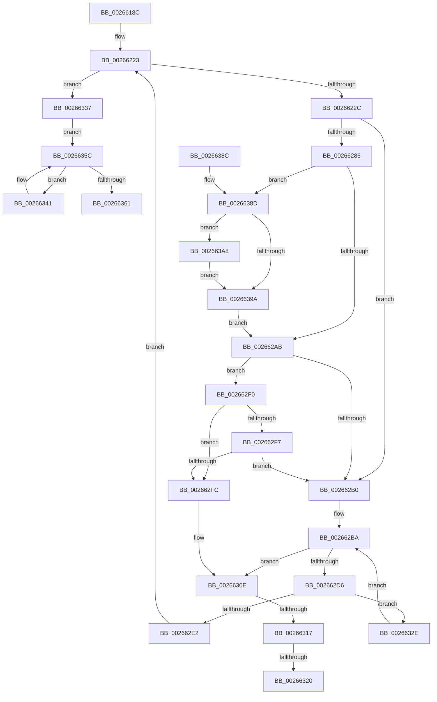

# SMKM_STORE_MGR&lt;SM_TRAITS&gt;::SmFeAddInitiate

- RVA: `0x0026618C`–`0x002663B4` (길이 `552` bytes)
- VA: `0x000000014026618C`
- 실행 섹션: `.text`
- PDB 이름 있음: `예`; PDB Function 태그: `예`
- unwind 정보 RVA: `0x00064D0C`
- 디코드: `151`개 명령, `552/552` bytes 표시
- 미해석 바이트: `0` (있으면 어셈블리에 `.byte`로 보존)

> 이 문서는 커널 이미지의 기계어와 PDB 기호를 분석해 생성했습니다. 4번과 5번은 함수 원형과 자료형을 바이너리 사용 방식에서 추정한 C 해석이며 원본 소스 복구 결과는 아닙니다.

## 1. Dependencies

- 직접 호출 지점: **8**; 고유 호출 대상: **8**
- 직접 호출자로 확인된 함수: **2**
- RIP 상대 이미지 참조: **1**

### Outgoing calls
- `0x002661D0` → [memset](../6C/memset_function_006C6C40.md) (function, `0x006C6C40`)
- `0x0026621B` → [StLockAcquireExclusive](StLockAcquireExclusive_function_00266FF0.md) (function, `0x00266FF0`)
- `0x00266251` → [B_TREE<_SM_PAGE_KEY,SMKM_STORE_MGR<SM_TRAITS>::SMKM_FRONTEND_ENTRY,4096,B_TREE_DUMMY_NODE_POOL,B_TREE_KEY_COMPARATOR<_SM_PAGE_KEY> >::BTreeSearchKey](B_TREE__SM_PAGE_KEY_SMKM_STORE_MGR_SM_TRAITS_SMKM_FRONTEND_ENTRY_4096_B_TREE_DUMMY_NODE_POOL_B_TREE__function_00266E10.md) (function, `0x00266E10`)
- `0x00266277` → [B_TREE<_SM_PAGE_KEY,SMKM_STORE_MGR<SM_TRAITS>::SMKM_FRONTEND_ENTRY,4096,B_TREE_DUMMY_NODE_POOL,B_TREE_KEY_COMPARATOR<_SM_PAGE_KEY> >::BTreeIteratorFromSearchResult](../2E/B_TREE__SM_PAGE_KEY_SMKM_STORE_MGR_SM_TRAITS_SMKM_FRONTEND_ENTRY_4096_B_TREE_DUMMY_NODE_POOL_B_TREE__function_002E07E0.md) (function, `0x002E07E0`)
- `0x002662CB` → [B_TREE<_SM_PAGE_KEY,SMKM_STORE_MGR<SM_TRAITS>::SMKM_FRONTEND_ENTRY,4096,B_TREE_DUMMY_NODE_POOL,B_TREE_KEY_COMPARATOR<_SM_PAGE_KEY> >::BTreeInsert](B_TREE__SM_PAGE_KEY_SMKM_STORE_MGR_SM_TRAITS_SMKM_FRONTEND_ENTRY_4096_B_TREE_DUMMY_NODE_POOL_B_TREE__function_002663C0.md) (function, `0x002663C0`)
- `0x0026633A` → [StLockReleaseExclusive](StLockReleaseExclusive_function_00267050.md) (function, `0x00267050`)
- `0x00266353` → [SMKM_STORE_MGR<SM_TRAITS>::SmIoCtxQueueWork](../31/SMKM_STORE_MGR_SM_TRAITS_SmIoCtxQueueWork_function_00317440.md) (function, `0x00317440`)
- `0x0026636C` → [_security_check_cookie](../6A/_security_check_cookie_function_006AC640.md) (function, `0x006AC640`)

### Direct callers
- [SMKM_STORE_MGR&lt;SM_TRAITS&gt;::SmCompressCtxProcessReadyQueue](SMKM_STORE_MGR_SM_TRAITS_SmCompressCtxProcessReadyQueue_function_002678F0.md) at `0x00267A06`
- [SMKM_STORE_MGR&lt;SM_TRAITS&gt;::SmPageWrite](../34/SMKM_STORE_MGR_SM_TRAITS_SmPageWrite_function_0034BA54.md) at `0x0034BD35`

### Static image references
- `0x002661A8` → RVA `0x00E0A740` (`.data`; read)

## 2. Other-region calls and transfers

- 다른 실행 섹션으로 향하는 call: **0**
- call이 아닌 외부 분기/꼬리 이동: **3**
  - `0x00266311` → [sub_006D8E6C + 0x33](../6D/Unknown_function_006D8E6C.md) (`tail-transfer`)
  - `0x0026631A` → [sub_006D8E6C + 0x33](../6D/Unknown_function_006D8E6C.md) (`tail-transfer`)
  - `0x00266329` → [sub_006D8E6C](../6D/Unknown_function_006D8E6C.md) (`tail-transfer`)

## 3. Assembly (complete function range)

```asm
0026618C  48 89 5C 24 18                  mov qword ptr [rsp + 0x18], rbx
00266191  55                              push rbp
00266192  56                              push rsi
00266193  57                              push rdi
00266194  41 54                           push r12
00266196  41 55                           push r13
00266198  41 56                           push r14
0026619A  41 57                           push r15
0026619C  48 8D 6C 24 E0                  lea rbp, [rsp - 0x20]
002661A1  48 81 EC 20 01 00 00            sub rsp, 0x120
002661A8  48 8B 05 91 45 BA 00            mov rax, qword ptr [rip + 0xba4591]
002661AF  48 33 C4                        xor rax, rsp
002661B2  48 89 45 10                     mov qword ptr [rbp + 0x10], rax
002661B6  45 8B F8                        mov r15d, r8d
002661B9  48 8B F2                        mov rsi, rdx
002661BC  48 8B F9                        mov rdi, rcx
002661BF  48 89 4C 24 50                  mov qword ptr [rsp + 0x50], rcx
002661C4  33 D2                           xor edx, edx
002661C6  48 8D 4D 88                     lea rcx, [rbp - 0x78]
002661CA  41 B8 80 00 00 00               mov r8d, 0x80
002661D0  E8 6B 0A 46 00                  call 0x1406c6c40
002661D5  33 C9                           xor ecx, ecx
002661D7  49 C1 E7 04                     shl r15, 4
002661DB  48 89 4C 24 38                  mov qword ptr [rsp + 0x38], rcx
002661E0  48 8D 45 88                     lea rax, [rbp - 0x78]
002661E4  48 89 4C 24 68                  mov qword ptr [rsp + 0x68], rcx
002661E9  4C 8D A7 B8 01 00 00            lea r12, [rdi + 0x1b8]
002661F0  48 89 4C 24 70                  mov qword ptr [rsp + 0x70], rcx
002661F5  44 8B F1                        mov r14d, ecx
002661F8  48 89 4D 80                     mov qword ptr [rbp - 0x80], rcx
002661FC  4C 03 FE                        add r15, rsi
002661FF  89 4C 24 78                     mov dword ptr [rsp + 0x78], ecx
00266203  4C 8B EE                        mov r13, rsi
00266206  49 8B CC                        mov rcx, r12
00266209  48 89 44 24 60                  mov qword ptr [rsp + 0x60], rax
0026620E  C7 44 24 7C 08 00 00 00         mov dword ptr [rsp + 0x7c], 8
00266216  C6 44 24 3E 01                  mov byte ptr [rsp + 0x3e], 1
0026621B  E8 D0 0D 00 00                  call 0x140266ff0
00266220  41 8B CE                        mov ecx, r14d
00266223  4D 3B EF                        cmp r13, r15
00266226  0F 83 0B 01 00 00               jae 0x140266337
0026622C  41 0F B7 45 0C                  movzx eax, word ptr [r13 + 0xc]
00266231  4C 8D 44 24 60                  lea r8, [rsp + 0x60]
00266236  41 8B 5D 08                     mov ebx, dword ptr [r13 + 8]
0026623A  03 C8                           add ecx, eax
0026623C  48 81 C7 C0 01 00 00            add rdi, 0x1c0
00266243  89 4C 24 30                     mov dword ptr [rsp + 0x30], ecx
00266247  48 8B CF                        mov rcx, rdi
0026624A  48 89 7C 24 58                  mov qword ptr [rsp + 0x58], rdi
0026624F  8B D3                           mov edx, ebx
00266251  E8 BA 0B 00 00                  call 0x140266e10
00266256  45 0F B7 55 0C                  movzx r10d, word ptr [r13 + 0xc]
0026625B  4C 8D 44 24 60                  lea r8, [rsp + 0x60]
00266260  45 8B 4D 08                     mov r9d, dword ptr [r13 + 8]
00266264  48 8D 54 24 40                  lea rdx, [rsp + 0x40]
00266269  0F 57 C0                        xorps xmm0, xmm0
0026626C  41 FF CA                        dec r10d
0026626F  45 03 D1                        add r10d, r9d
00266272  0F 11 44 24 40                  movups xmmword ptr [rsp + 0x40], xmm0
00266277  E8 64 A5 07 00                  call 0x1402e07e0
0026627C  4C 8B 44 24 40                  mov r8, qword ptr [rsp + 0x40]
00266281  4D 85 C0                        test r8, r8
00266284  74 2A                           je 0x1402662b0
00266286  48 8B 54 24 48                  mov rdx, qword ptr [rsp + 0x48]
0026628B  41 8B 00                        mov eax, dword ptr [r8]
0026628E  48 83 C2 08                     add rdx, 8
00266292  0F B7 C0                        movzx eax, ax
00266295  48 83 C0 02                     add rax, 2
00266299  48 89 54 24 48                  mov qword ptr [rsp + 0x48], rdx
0026629E  49 8D 04 C0                     lea rax, [r8 + rax*8]
002662A2  48 3B D0                        cmp rdx, rax
002662A5  0F 83 E2 00 00 00               jae 0x14026638d
002662AB  48 85 D2                        test rdx, rdx
002662AE  75 40                           jne 0x1402662f0
002662B0  41 0F B7 45 0E                  movzx eax, word ptr [r13 + 0xe]
002662B5  66 89 44 24 3C                  mov word ptr [rsp + 0x3c], ax
002662BA  4C 8D 44 24 60                  lea r8, [rsp + 0x60]
002662BF  89 5C 24 38                     mov dword ptr [rsp + 0x38], ebx
002662C3  48 8D 54 24 38                  lea rdx, [rsp + 0x38]
002662C8  48 8B CF                        mov rcx, rdi
002662CB  E8 F0 00 00 00                  call 0x1402663c0
002662D0  8B F8                           mov edi, eax
002662D2  85 C0                           test eax, eax
002662D4  78 38                           js 0x14026630e
002662D6  8B 4C 24 30                     mov ecx, dword ptr [rsp + 0x30]
002662DA  41 FF C6                        inc r14d
002662DD  44 3B F1                        cmp r14d, ecx
002662E0  75 4C                           jne 0x14026632e
002662E2  48 8B 7C 24 50                  mov rdi, qword ptr [rsp + 0x50]
002662E7  49 83 C5 10                     add r13, 0x10
002662EB  E9 33 FF FF FF                  jmp 0x140266223
002662F0  8B 02                           mov eax, dword ptr [rdx]
002662F2  44 3B C8                        cmp r9d, eax
002662F5  73 05                           jae 0x1402662fc
002662F7  44 3B D0                        cmp r10d, eax
002662FA  72 B4                           jb 0x1402662b0
002662FC  8A 42 07                        mov al, byte ptr [rdx + 7]
002662FF  24 01                           and al, 1
00266301  F6 D8                           neg al
00266303  1B FF                           sbb edi, edi
00266305  83 E7 BF                        and edi, 0xffffffbf
00266308  81 C7 76 04 00 C0               add edi, 0xc0000476
0026630E  45 85 F6                        test r14d, r14d
00266311  0F 84 88 2B 47 00               je 0x1406d8e9f
00266317  49 3B F7                        cmp rsi, r15
0026631A  0F 83 7F 2B 47 00               jae 0x1406d8e9f
00266320  4C 8B 6C 24 50                  mov r13, qword ptr [rsp + 0x50]
00266325  48 83 C6 08                     add rsi, 8
00266329  E9 3E 2B 47 00                  jmp 0x1406d8e6c
0026632E  48 8B 7C 24 58                  mov rdi, qword ptr [rsp + 0x58]
00266333  FF C3                           inc ebx
00266335  EB 83                           jmp 0x1402662ba
00266337  49 8B CC                        mov rcx, r12
0026633A  E8 11 0D 00 00                  call 0x140267050
0026633F  EB 1B                           jmp 0x14026635c
00266341  48 8B 0E                        mov rcx, qword ptr [rsi]
00266344  48 8B D7                        mov rdx, rdi
00266347  44 0F B7 46 0E                  movzx r8d, word ptr [rsi + 0xe]
0026634C  4C 8B C9                        mov r9, rcx
0026634F  48 8B 49 20                     mov rcx, qword ptr [rcx + 0x20]
00266353  E8 E8 10 0B 00                  call 0x140317440
00266358  48 83 C6 10                     add rsi, 0x10
0026635C  49 3B F7                        cmp rsi, r15
0026635F  72 E0                           jb 0x140266341
00266361  33 FF                           xor edi, edi
00266363  8B C7                           mov eax, edi
00266365  48 8B 4D 10                     mov rcx, qword ptr [rbp + 0x10]
00266369  48 33 CC                        xor rcx, rsp
0026636C  E8 CF 62 44 00                  call 0x1406ac640
00266371  48 8B 9C 24 70 01 00 00         mov rbx, qword ptr [rsp + 0x170]
00266379  48 81 C4 20 01 00 00            add rsp, 0x120
00266380  41 5F                           pop r15
00266382  41 5E                           pop r14
00266384  41 5D                           pop r13
00266386  41 5C                           pop r12
00266388  5F                              pop rdi
00266389  5E                              pop rsi
0026638A  5D                              pop rbp
0026638B  C3                              ret
0026638C  CC                              int3
0026638D  49 8B 40 08                     mov rax, qword ptr [r8 + 8]
00266391  48 8D 48 10                     lea rcx, [rax + 0x10]
00266395  48 85 C0                        test rax, rax
00266398  75 0E                           jne 0x1402663a8
0026639A  48 F7 D8                        neg rax
0026639D  48 1B D2                        sbb rdx, rdx
002663A0  48 23 D1                        and rdx, rcx
002663A3  E9 03 FF FF FF                  jmp 0x1402662ab
002663A8  48 89 44 24 40                  mov qword ptr [rsp + 0x40], rax
002663AD  48 89 4C 24 48                  mov qword ptr [rsp + 0x48], rcx
002663B2  EB E6                           jmp 0x14026639a
```

## 4. C-style interpretation (structured pseudocode)

```c
__int64 __fastcall SMKM_STORE_MGR_SM_TRAITS___SmFeAddInitiate(__int64 a1, __int64 a2, int a3)
{
    __int64 result;
    __int64 v_r10;
    __int64 v_r13;
    __int64 v_r14;
    __int64 v_r15;
    __int64 v_rbx;
    __int64 v_rdi;
    __int64 v_rsi;
    __int64 v_rsp;
    unsigned __int64 v_stack_m100;
    unsigned __int64 v_stack_m108;
    unsigned __int64 v_stack_m110;
    unsigned __int64 v_stack_m118;
    unsigned __int8 v_stack_m11A;
    unsigned __int16 v_stack_m11C;
    unsigned __int64 v_stack_m120;
    unsigned int v_stack_m128;
    unsigned __int64 v_stack_m48;
    unsigned __int64 v_stack_m58;
    unsigned __int64 v_stack_mD0;
    unsigned __int64 v_stack_mD8;
    unsigned int v_stack_mDC;
    unsigned int v_stack_mE0;
    unsigned __int64 v_stack_mE8;
    unsigned __int64 v_stack_mF0;
    unsigned __int64 v_stack_mF8;
    unsigned __int64 v_stack_p18;
    unsigned __int64 v_stack_p40;
    unsigned __int64 v_stack_p48;

    v_stack_p18 = v_rbx;
    v_rsp = (v_rsp) - (288);
    result = (*(unsigned __int64 *)(v_rip + 12207505)) ^ (v_rsp);
    v_stack_m48 = result;
    v_stack_m108 = a1;
    a2 = 0;
    result = memset(v_stack_mD0, a2, 128, a4);
    a1 = 0;
    v_r15 = ((unsigned int)(a3)) << (4);
    v_stack_m120 = 0;
    v_stack_mF0 = 0;
    v_stack_mE8 = 0;
    v_stack_mD8 = 0;
    v_r15 = (v_r15) + (0);
    v_stack_mE0 = 0;
    v_stack_mF8 = v_stack_mD0;
    v_stack_mDC = 8;
    v_stack_m11A = 1;
    result = StLockAcquireExclusive(a1 + 440, a2, 128, a4);
loc_00266223:
    if (0 >= v_r15) goto loc_00266337;
    a1 = (unsigned int)((0) + ((unsigned int)(*(unsigned __int16 *)(0 + 12))));
    v_rdi = (a1) + (448);
    v_stack_m128 = (unsigned int)(a1);
    v_stack_m100 = v_rdi;
    result = B_TREE__SM_PAGE_KEY_SMKM_STORE_MGR_SM_TRAITS___SMKM_FRONTEND_ENTRY_4096_B_TREE_DUMMY_NODE_POOL_B_TRE(v_rdi, (unsigned int)((unsigned int)((unsigned int)(*(unsigned int *)(0 + 8)))), v_stack_mF8, a4);
    v_r10 = (unsigned int)((*(unsigned __int16 *)(0 + 12)) - 1);
    v_r10 = (unsigned int)((v_r10) + ((unsigned int)((unsigned int)(*(unsigned int *)(0 + 8)))));
    v_stack_m118 = v_xmm0;
    result = B_TREE__SM_PAGE_KEY_SMKM_STORE_MGR_SM_TRAITS___SMKM_FRONTEND_ENTRY_4096_B_TREE_DUMMY_NODE_POOL_B_TRE(v_rdi, v_stack_m118, v_stack_mF8, (unsigned int)(*(unsigned int *)(0 + 8)));
    if (v_stack_m118 == 0) goto loc_002662B0;
    a2 = (v_stack_m110) + (8);
    result = ((unsigned __int16)((unsigned int)(*(unsigned int *)(v_stack_m118)))) + (2);
    v_stack_m110 = a2;
    if (a2 >= (v_stack_m118 + result * 8)) goto loc_0026638D;
loc_002662AB:
    if (a2 != 0) goto loc_002662F0;
loc_002662B0:
    v_stack_m11C = (unsigned __int16)(*(unsigned __int16 *)(0 + 14));
loc_002662BA:
    v_stack_m120 = (unsigned int)((unsigned int)(*(unsigned int *)(0 + 8)));
    result = B_TREE__SM_PAGE_KEY_SMKM_STORE_MGR_SM_TRAITS___SMKM_FRONTEND_ENTRY_4096_B_TREE_DUMMY_NODE_POOL_B_TRE(v_rdi, v_stack_m120, v_stack_mF8, (unsigned int)(*(unsigned int *)(0 + 8)));
    if (sign_flag) goto loc_0026630E;
    v_r14 = (unsigned int)((0) + 1);
    if (((unsigned int)(v_r14)) != ((unsigned int)((unsigned int)(v_stack_m128)))) goto loc_0026632E;
    v_r13 = (0) + (16);
    goto loc_00266223;
loc_002662F0:
    if (((unsigned int)((unsigned int)(*(unsigned int *)(0 + 8)))) >= ((unsigned int)((unsigned int)(*(unsigned int *)(v_stack_m120))))) goto loc_002662FC;
    if (((unsigned int)(v_r10)) < ((unsigned int)((unsigned int)(*(unsigned int *)(v_stack_m120))))) goto loc_002662B0;
loc_002662FC:
    result = (unsigned __int8)((*(unsigned __int8 *)(v_stack_m120 + 7)) & (1));
    result = (unsigned __int8)(-(result));
    v_rdi = (unsigned int)((v_stack_m108) & (0xFFFFFFBFULL));
    v_rdi = (unsigned int)((v_rdi) + (0xC0000476ULL));
loc_0026630E:
    v_rsi = (a2) + (8);
loc_0026632E:
    v_rbx = (unsigned int)(((unsigned int)(*(unsigned int *)(0 + 8))) + 1);
    goto loc_002662BA;
loc_00266337:
    result = StLockReleaseExclusive(a1 + 440, v_stack_m120, v_stack_mF8, (unsigned int)(*(unsigned int *)(0 + 8)));
    goto loc_0026635C;
loc_00266341:
    result = SMKM_STORE_MGR_SM_TRAITS___SmIoCtxQueueWork(*(unsigned __int64 *)(*(unsigned __int64 *)(v_rsi) + 32), v_stack_m100, *(unsigned __int16 *)(v_rsi + 14), *(unsigned __int64 *)(v_rsi));
    v_rsi = (v_rsi) + (16);
loc_0026635C:
    if (v_rsi < v_r15) goto loc_00266341;
    v_rdi = 0;
    a1 = (v_stack_m48) ^ (v_rsp);
    result = _security_check_cookie(a1, v_stack_m100, *(unsigned __int16 *)(v_rsi + 14), *(unsigned __int64 *)(v_rsi));
    v_rsp = (v_rsp) + (288);
    return result;
loc_0026638D:
    if (*(unsigned __int64 *)(*(unsigned __int16 *)(v_rsi + 14) + 8) != 0) goto loc_002663A8;
loc_0026639A:
    result = -(*(unsigned __int64 *)(*(unsigned __int16 *)(v_rsi + 14) + 8));
    a2 = (v_stack_m100) & (*(unsigned __int64 *)(*(unsigned __int16 *)(v_rsi + 14) + 8) + 16);
    goto loc_002662AB;
loc_002663A8:
    v_stack_p40 = result;
    v_stack_p48 = *(unsigned __int64 *)(*(unsigned __int16 *)(v_rsi + 14) + 8) + 16;
    goto loc_0026639A;
}
```

## 5. (Beta) C Style

```c
int64_t SMKM_STORE_MGR_SM_TRAITS___SmFeAddInitiate(void *Arg1, int64_t Arg2, int32_t Arg3)
{
    uint8_t *arg1 = (uint8_t *)Arg1;

    int64_t result;
    int64_t local_r10;
    int64_t local_r13;
    int64_t local_r14;
    int64_t local_r15;
    int64_t local_rbx;
    int64_t local_rdi;
    int64_t local_rsi;
    int64_t local_rsp;
    uint64_t v_stack_m100;
    uint64_t v_stack_m108;
    uint64_t v_stack_m110;
    uint64_t v_stack_m118;
    uint8_t v_stack_m11A;
    uint16_t v_stack_m11C;
    uint64_t v_stack_m120;
    uint32_t v_stack_m128;
    uint64_t v_stack_m48;
    uint64_t v_stack_m58;
    uint64_t v_stack_mD0;
    uint64_t v_stack_mD8;
    uint32_t v_stack_mDC;
    uint32_t v_stack_mE0;
    uint64_t v_stack_mE8;
    uint64_t v_stack_mF0;
    uint64_t v_stack_mF8;
    uint64_t v_stack_p18;
    uint64_t v_stack_p40;
    uint64_t v_stack_p48;

    v_stack_p18 = local_rbx;
    local_rsp = (local_rsp) - (288);
    result = (*(uint64_t *)(v_rip + 0xBA4591)) ^ (local_rsp);
    v_stack_m48 = result;
    v_stack_m108 = Arg1;
    Arg2 = 0;
    result = memset(v_stack_mD0, Arg2, 128, a4);
    Arg1 = 0;
    local_r15 = ((uint32_t)(Arg3)) << (4);
    v_stack_m120 = 0;
    v_stack_mF0 = 0;
    v_stack_mE8 = 0;
    v_stack_mD8 = 0;
    local_r15 = (local_r15) + (0);
    v_stack_mE0 = 0;
    v_stack_mF8 = v_stack_mD0;
    v_stack_mDC = 8;
    v_stack_m11A = 1;
    result = StLockAcquireExclusive(Arg1 + 440, Arg2, 128, a4);
loc_00266223:
    if (0 >= local_r15) goto loc_00266337;
    Arg1 = (uint32_t)((0) + ((uint32_t)(*(uint16_t *)(0 + 0xC))));
    local_rdi = (Arg1) + (448);
    v_stack_m128 = (uint32_t)(Arg1);
    v_stack_m100 = local_rdi;
    result = B_TREE__SM_PAGE_KEY_SMKM_STORE_MGR_SM_TRAITS___SMKM_FRONTEND_ENTRY_4096_B_TREE_DUMMY_NODE_POOL_B_TRE(local_rdi, (uint32_t)((uint32_t)((uint32_t)(*(uint32_t *)(0 + 0x8)))), v_stack_mF8, a4);
    local_r10 = (uint32_t)((*(uint16_t *)(0 + 0xC)) - 1);
    local_r10 = (uint32_t)((local_r10) + ((uint32_t)((uint32_t)(*(uint32_t *)(0 + 0x8)))));
    v_stack_m118 = v_xmm0;
    result = B_TREE__SM_PAGE_KEY_SMKM_STORE_MGR_SM_TRAITS___SMKM_FRONTEND_ENTRY_4096_B_TREE_DUMMY_NODE_POOL_B_TRE(local_rdi, v_stack_m118, v_stack_mF8, (uint32_t)(*(uint32_t *)(0 + 0x8)));
    if (v_stack_m118 == 0) goto loc_002662B0;
    Arg2 = (v_stack_m110) + (8);
    result = ((uint16_t)((uint32_t)(*(uint32_t *)(v_stack_m118)))) + (2);
    v_stack_m110 = Arg2;
    if (Arg2 >= (v_stack_m118 + result * 8)) goto loc_0026638D;
loc_002662AB:
    if (Arg2 != 0) goto loc_002662F0;
loc_002662B0:
    v_stack_m11C = (uint16_t)(*(uint16_t *)(0 + 0xE));
loc_002662BA:
    v_stack_m120 = (uint32_t)((uint32_t)(*(uint32_t *)(0 + 0x8)));
    result = B_TREE__SM_PAGE_KEY_SMKM_STORE_MGR_SM_TRAITS___SMKM_FRONTEND_ENTRY_4096_B_TREE_DUMMY_NODE_POOL_B_TRE(local_rdi, v_stack_m120, v_stack_mF8, (uint32_t)(*(uint32_t *)(0 + 0x8)));
    if (sign_flag) goto loc_0026630E;
    local_r14 = (uint32_t)((0) + 1);
    if (((uint32_t)(local_r14)) != ((uint32_t)((uint32_t)(v_stack_m128)))) goto loc_0026632E;
    local_r13 = (0) + (16);
    goto loc_00266223;
loc_002662F0:
    if (((uint32_t)((uint32_t)(*(uint32_t *)(0 + 0x8)))) >= ((uint32_t)((uint32_t)(*(uint32_t *)(v_stack_m120))))) goto loc_002662FC;
    if (((uint32_t)(local_r10)) < ((uint32_t)((uint32_t)(*(uint32_t *)(v_stack_m120))))) goto loc_002662B0;
loc_002662FC:
    result = (uint8_t)((*(uint8_t *)(v_stack_m120 + 0x7)) & (1));
    result = (uint8_t)(-(result));
    local_rdi = (uint32_t)((v_stack_m108) & (0xFFFFFFBFULL));
    local_rdi = (uint32_t)((local_rdi) + (0xC0000476ULL));
loc_0026630E:
    local_rsi = (Arg2) + (8);
loc_0026632E:
    local_rbx = (uint32_t)(((uint32_t)(*(uint32_t *)(0 + 0x8))) + 1);
    goto loc_002662BA;
loc_00266337:
    result = StLockReleaseExclusive(Arg1 + 440, v_stack_m120, v_stack_mF8, (uint32_t)(*(uint32_t *)(0 + 0x8)));
    goto loc_0026635C;
loc_00266341:
    result = SMKM_STORE_MGR_SM_TRAITS___SmIoCtxQueueWork(*(uint64_t *)(*(uint64_t *)(local_rsi) + 0x20), v_stack_m100, *(uint16_t *)(local_rsi + 0xE), *(uint64_t *)(local_rsi));
    local_rsi = (local_rsi) + (16);
loc_0026635C:
    if (local_rsi < local_r15) goto loc_00266341;
    local_rdi = 0;
    Arg1 = (v_stack_m48) ^ (local_rsp);
    result = _security_check_cookie(Arg1, v_stack_m100, *(uint16_t *)(local_rsi + 0xE), *(uint64_t *)(local_rsi));
    local_rsp = (local_rsp) + (288);
    return result;
loc_0026638D:
    if (*(uint64_t *)(*(uint16_t *)(local_rsi + 0xE) + 0x8) != 0) goto loc_002663A8;
loc_0026639A:
    result = -(*(uint64_t *)(*(uint16_t *)(local_rsi + 0xE) + 0x8));
    Arg2 = (v_stack_m100) & (*(uint64_t *)(*(uint16_t *)(local_rsi + 0xE) + 0x8) + 16);
    goto loc_002662AB;
loc_002663A8:
    v_stack_p40 = result;
    v_stack_p48 = *(uint64_t *)(*(uint16_t *)(local_rsi + 0xE) + 0x8) + 16;
    goto loc_0026639A;
}
```

### 관측된 메모리 오프셋

구조체 형식이 확인되지 않은 접근은 인자 기준의 오프셋으로만 기록했습니다.

| 기준 인자 | 오프셋 표현 | 폭 (bit) | 접근 |
|---|---:|---:|---|
| `Arg1` | `+ 0x1B8` | `64` | `R` |

## 6. Execution-region graph

[열기: 2D/3D 그래프와 함수 탐색 컨트롤 패널](../../../control-panel.html?section=text&rva=0x0026618C&view=graph)

- 2D 그래프는 위에서 아래로 흐르고, 3D 그래프는 빈 공간을 드래그해 회전합니다. Shift+드래그는 이동, 휠은 확대·축소, 함수 노드 선택은 대상 보고서 이동입니다.

### Static fallback


