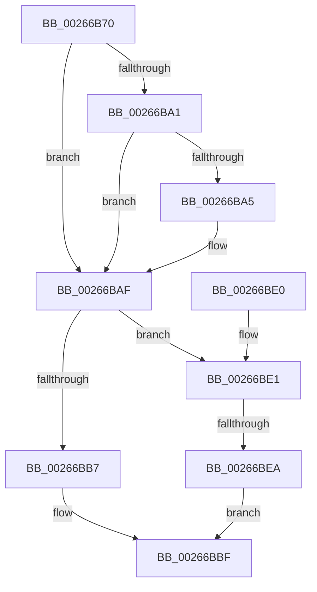

# SMKM_STORE_MGR&lt;SM_TRAITS&gt;::SmFeDeleteEntry

- RVA: `0x00266B70`–`0x00266BFA` (길이 `138` bytes)
- VA: `0x0000000140266B70`
- 실행 섹션: `.text`
- PDB 이름 있음: `예`; PDB Function 태그: `예`
- unwind 정보 RVA: `0x00064E68`
- 디코드: `39`개 명령, `138/138` bytes 표시
- 미해석 바이트: `0` (있으면 어셈블리에 `.byte`로 보존)

> 이 문서는 커널 이미지의 기계어와 PDB 기호를 분석해 생성했습니다. 4번과 5번은 함수 원형과 자료형을 바이너리 사용 방식에서 추정한 C 해석이며 원본 소스 복구 결과는 아닙니다.

## 1. Dependencies

- 직접 호출 지점: **1**; 고유 호출 대상: **1**
- 직접 호출자로 확인된 함수: **2**
- RIP 상대 이미지 참조: **0**

### Outgoing calls
- `0x00266BC5` → [B_TREE<_SM_PAGE_KEY,SMKM_STORE_MGR<SM_TRAITS>::SMKM_FRONTEND_ENTRY,4096,B_TREE_DUMMY_NODE_POOL,B_TREE_KEY_COMPARATOR<_SM_PAGE_KEY> >::BTreeDeleteEx](B_TREE__SM_PAGE_KEY_SMKM_STORE_MGR_SM_TRAITS_SMKM_FRONTEND_ENTRY_4096_B_TREE_DUMMY_NODE_POOL_B_TREE__function_00266C00.md) (function, `0x00266C00`)

### Direct callers
- [SMKM_STORE_MGR&lt;SM_TRAITS&gt;::SmFeStoreDelete](../3B/SMKM_STORE_MGR_SM_TRAITS_SmFeStoreDelete_function_003B12F0.md) at `0x003B13DC`
- [SMKM_STORE_MGR&lt;SM_TRAITS&gt;::SmFeStoreEvictKeys](../61/SMKM_STORE_MGR_SM_TRAITS_SmFeStoreEvictKeys_function_0061041C.md) at `0x00610537`

### Static image references
- 디코드된 RIP-relative 메모리 참조가 없습니다.

## 2. Other-region calls and transfers

- 다른 실행 섹션으로 향하는 call: **0**
- call이 아닌 외부 분기/꼬리 이동: **1**
  - `0x00266BE4` → [sub_006D8EE4](../6D/Unknown_function_006D8EE4.md) (`tail-transfer`)

## 3. Assembly (complete function range)

```asm
00266B70  48 89 5C 24 08                  mov qword ptr [rsp + 8], rbx
00266B75  48 89 74 24 10                  mov qword ptr [rsp + 0x10], rsi
00266B7A  48 89 7C 24 18                  mov qword ptr [rsp + 0x18], rdi
00266B7F  41 56                           push r14
00266B81  48 83 EC 20                     sub rsp, 0x20
00266B85  48 8D B1 C0 01 00 00            lea rsi, [rcx + 0x1c0]
00266B8C  49 8B F8                        mov rdi, r8
00266B8F  8B 4A 18                        mov ecx, dword ptr [rdx + 0x18]
00266B92  48 8D 42 08                     lea rax, [rdx + 8]
00266B96  48 8B DA                        mov rbx, rdx
00266B99  4C 8B F0                        mov r14, rax
00266B9C  83 F9 FF                        cmp ecx, -1
00266B9F  74 0E                           je 0x140266baf
00266BA1  85 C9                           test ecx, ecx
00266BA3  74 0A                           je 0x140266baf
00266BA5  8D 41 FF                        lea eax, [rcx - 1]
00266BA8  48 C1 E0 04                     shl rax, 4
00266BAC  48 03 02                        add rax, qword ptr [rdx]
00266BAF  49 8B 10                        mov rdx, qword ptr [r8]
00266BB2  48 39 10                        cmp qword ptr [rax], rdx
00266BB5  75 2A                           jne 0x140266be1
00266BB7  49 8B 48 08                     mov rcx, qword ptr [r8 + 8]
00266BBB  48 89 48 08                     mov qword ptr [rax + 8], rcx
00266BBF  48 8B D3                        mov rdx, rbx
00266BC2  48 8B CE                        mov rcx, rsi
00266BC5  E8 36 00 00 00                  call 0x140266c00
00266BCA  48 8B 5C 24 30                  mov rbx, qword ptr [rsp + 0x30]
00266BCF  48 8B 74 24 38                  mov rsi, qword ptr [rsp + 0x38]
00266BD4  48 8B 7C 24 40                  mov rdi, qword ptr [rsp + 0x40]
00266BD9  48 83 C4 20                     add rsp, 0x20
00266BDD  41 5E                           pop r14
00266BDF  C3                              ret
00266BE0  CC                              int3
00266BE1  83 F9 FF                        cmp ecx, -1
00266BE4  0F 85 FA 22 47 00               jne 0x1406d8ee4
00266BEA  41 0F 10 00                     movups xmm0, xmmword ptr [r8]
00266BEE  49 C7 06 00 00 00 00            mov qword ptr [r14], 0
00266BF5  0F 11 00                        movups xmmword ptr [rax], xmm0
00266BF8  EB C5                           jmp 0x140266bbf
```

## 4. C-style interpretation (structured pseudocode)

```c
__int64 __fastcall SMKM_STORE_MGR_SM_TRAITS___SmFeDeleteEntry(__int64 a1, __int64 a2, __int64 a3)
{
    __int64 result;
    __int64 v_rsp;
    unsigned __int64 v_stack_p10;
    unsigned __int64 v_stack_p18;
    unsigned __int64 v_stack_p8;

    v_stack_p8 = v_rbx;
    v_stack_p10 = v_rsi;
    v_stack_p18 = v_rdi;
    v_rsp = (v_rsp) - (32);
    if (((unsigned int)((unsigned int)(*(unsigned int *)(a2 + 24)))) == -1) goto loc_00266BAF;
    result = a2 + 8;
    if ((unsigned int)((unsigned int)(*(unsigned int *)(a2 + 24))) != 0) {
        result = (unsigned int)(*(unsigned int *)(a2 + 24)) - 1;
        result = (result) << (4);
        result = (result) + (*(unsigned __int64 *)(a2));
    }
    if ((*(unsigned __int64 *)(result)) != (*(unsigned __int64 *)(a3))) goto loc_00266BE1;
    *(unsigned __int64 *)(result + 8) = *(unsigned __int64 *)(a3 + 8);
loc_00266BBF:
    result = B_TREE__SM_PAGE_KEY_SMKM_STORE_MGR_SM_TRAITS___SMKM_FRONTEND_ENTRY_4096_B_TREE_DUMMY_NODE_POOL_B_TRE(a1 + 448, a2, a3, a4);
    v_rsp = (v_rsp) + (32);
    return result;
loc_00266BE1:
    *(unsigned __int64 *)(a2 + 8) = 0;
    *(unsigned __int64 *)(result) = v_xmm0;
    goto loc_00266BBF;
}
```

## 5. (Beta) C Style

```c
int64_t SMKM_STORE_MGR_SM_TRAITS___SmFeDeleteEntry(void *Arg1, void *Arg2, void *Arg3)
{
    uint8_t *arg1 = (uint8_t *)Arg1;
    uint8_t *arg2 = (uint8_t *)Arg2;
    uint8_t *arg3 = (uint8_t *)Arg3;

    int64_t result;
    int64_t local_rsp;
    uint64_t v_stack_p10;
    uint64_t v_stack_p18;
    uint64_t v_stack_p8;

    v_stack_p8 = local_rbx;
    v_stack_p10 = local_rsi;
    v_stack_p18 = local_rdi;
    local_rsp = (local_rsp) - (32);
    if (((uint32_t)((uint32_t)(*(uint32_t *)(arg2 + 0x18)))) == -1) goto loc_00266BAF;
    result = Arg2 + 8;
    if ((uint32_t)((uint32_t)(*(uint32_t *)(arg2 + 0x18))) != 0) {
        result = (uint32_t)(*(uint32_t *)(arg2 + 0x18)) - 1;
        result = (result) << (4);
        result = (result) + (*(uint64_t *)(arg2));
    }
    if ((*(uint64_t *)(result)) != (*(uint64_t *)(arg3))) goto loc_00266BE1;
    *(uint64_t *)(result + 0x8) = *(uint64_t *)(arg3 + 0x8);
loc_00266BBF:
    result = B_TREE__SM_PAGE_KEY_SMKM_STORE_MGR_SM_TRAITS___SMKM_FRONTEND_ENTRY_4096_B_TREE_DUMMY_NODE_POOL_B_TRE(Arg1 + 448, Arg2, Arg3, a4);
    local_rsp = (local_rsp) + (32);
    return result;
loc_00266BE1:
    *(uint64_t *)(arg2 + 0x8) = 0;
    *(uint64_t *)(result) = v_xmm0;
    goto loc_00266BBF;
}
```

### 관측된 메모리 오프셋

구조체 형식이 확인되지 않은 접근은 인자 기준의 오프셋으로만 기록했습니다.

| 기준 인자 | 오프셋 표현 | 폭 (bit) | 접근 |
|---|---:|---:|---|
| `Arg1` | `+ 0x1C0` | `64` | `R` |
| `Arg2` | `+ 0x0` | `64` | `R` |
| `Arg2` | `+ 0x0` | `64` | `W` |
| `Arg2` | `+ 0x8` | `64` | `R` |
| `Arg2` | `+ 0x18` | `32` | `R` |
| `Arg3` | `+ 0x0` | `64` | `R` |
| `Arg3` | `+ 0x0` | `128` | `R` |
| `Arg3` | `+ 0x8` | `64` | `R` |

## 6. Execution-region graph

[열기: 2D/3D 그래프와 함수 탐색 컨트롤 패널](../../../control-panel.html?section=text&rva=0x00266B70&view=graph)

- 2D 그래프는 위에서 아래로 흐르고, 3D 그래프는 빈 공간을 드래그해 회전합니다. Shift+드래그는 이동, 휠은 확대·축소, 함수 노드 선택은 대상 보고서 이동입니다.

### Static fallback


