# SMKM_STORE_MGR&lt;SM_TRAITS&gt;::SmFeEvictComplete

- RVA: `0x00266854`–`0x00266B64` (길이 `784` bytes)
- VA: `0x0000000140266854`
- 실행 섹션: `.text`
- PDB 이름 있음: `예`; PDB Function 태그: `예`
- unwind 정보 RVA: `0x00064E30`
- 디코드: `200`개 명령, `784/784` bytes 표시
- 미해석 바이트: `0` (있으면 어셈블리에 `.byte`로 보존)

> 이 문서는 커널 이미지의 기계어와 PDB 기호를 분석해 생성했습니다. 4번과 5번은 함수 원형과 자료형을 바이너리 사용 방식에서 추정한 C 해석이며 원본 소스 복구 결과는 아닙니다.

## 1. Dependencies

- 직접 호출 지점: **12**; 고유 호출 대상: **12**
- 직접 호출자로 확인된 함수: **1**
- RIP 상대 이미지 참조: **2**

### Outgoing calls
- `0x00266897` → [memset](../6C/memset_function_006C6C40.md) (function, `0x006C6C40`)
- `0x002668D3` → [StLockAcquireExclusive](StLockAcquireExclusive_function_00266FF0.md) (function, `0x00266FF0`)
- `0x002668E8` → [B_TREE<_SM_PAGE_KEY,SMKM_STORE_MGR<SM_TRAITS>::SMKM_FRONTEND_ENTRY,4096,B_TREE_DUMMY_NODE_POOL,B_TREE_KEY_COMPARATOR<_SM_PAGE_KEY> >::BTreeSearchKey](B_TREE__SM_PAGE_KEY_SMKM_STORE_MGR_SM_TRAITS_SMKM_FRONTEND_ENTRY_4096_B_TREE_DUMMY_NODE_POOL_B_TREE__function_00266E10.md) (function, `0x00266E10`)
- `0x002668F6` → [B_TREE<_SM_PAGE_KEY,SMKM_STORE_MGR<SM_TRAITS>::SMKM_FRONTEND_ENTRY,4096,B_TREE_DUMMY_NODE_POOL,B_TREE_KEY_COMPARATOR<_SM_PAGE_KEY> >::BTreeIteratorFromSearchResult](../2E/B_TREE__SM_PAGE_KEY_SMKM_STORE_MGR_SM_TRAITS_SMKM_FRONTEND_ENTRY_4096_B_TREE_DUMMY_NODE_POOL_B_TREE__function_002E07E0.md) (function, `0x002E07E0`)
- `0x0026696C` → [B_TREE<_SM_PAGE_KEY,SMKM_STORE_MGR<SM_TRAITS>::SMKM_FRONTEND_ENTRY,4096,B_TREE_DUMMY_NODE_POOL,B_TREE_KEY_COMPARATOR<_SM_PAGE_KEY> >::BTreeDeleteEx](B_TREE__SM_PAGE_KEY_SMKM_STORE_MGR_SM_TRAITS_SMKM_FRONTEND_ENTRY_4096_B_TREE_DUMMY_NODE_POOL_B_TREE__function_00266C00.md) (function, `0x00266C00`)
- `0x00266980` → [StLockReleaseExclusive](StLockReleaseExclusive_function_00267050.md) (function, `0x00267050`)
- `0x00266A03` → [_security_check_cookie](../6A/_security_check_cookie_function_006AC640.md) (function, `0x006AC640`)
- `0x00266A9B` → [guard_dispatch_icall](../6B/guard_dispatch_icall_function_006BAAD0.md) (function, `0x006BAAD0`)
- `0x00266B04` → [ExQueueWorkItemToPartition](../35/ExQueueWorkItemToPartition_function_00356E2C.md) (function, `0x00356E2C`)
- `0x00266B1D` → [KeWaitForSingleObject](../20/KeWaitForSingleObject_function_0020E6B0.md) (function, `0x0020E6B0`)
- `0x00266B30` → [ExQueueWorkItem](../2F/ExQueueWorkItem_function_002F9520.md) (function, `0x002F9520`)
- `0x00266B47` → [B_TREE<_SM_PAGE_KEY,SMKM_STORE_MGR<SM_TRAITS>::SMKM_FRONTEND_ENTRY,4096,B_TREE_DUMMY_NODE_POOL,B_TREE_KEY_COMPARATOR<_SM_PAGE_KEY> >::BTreeSearchResultDeref](../2E/B_TREE__SM_PAGE_KEY_SMKM_STORE_MGR_SM_TRAITS_SMKM_FRONTEND_ENTRY_4096_B_TREE_DUMMY_NODE_POOL_B_TREE__function_002E07C0.md) (function, `0x002E07C0`)

### Direct callers
- [SMKM_STORE_MGR&lt;SM_TRAITS&gt;::SmIoCtxWorkItemComplete](../20/SMKM_STORE_MGR_SM_TRAITS_SmIoCtxWorkItemComplete_function_00205850.md) at `0x00205A07`

### Static image references
- `0x00266870` → RVA `0x00E0A740` (`.data`; read)
- `0x00266AC0` → RVA `0x00434130` (`SmKmStoreDeleteWhenEmptyWorker`; read)

## 2. Other-region calls and transfers

- 다른 실행 섹션으로 향하는 call: **0**
- call이 아닌 외부 분기/꼬리 이동: **1**
  - `0x00266B50` → [sub_006D8EAE](../6D/Unknown_function_006D8EAE.md) (`tail-transfer`)

## 3. Assembly (complete function range)

```asm
00266854  48 89 5C 24 18                  mov qword ptr [rsp + 0x18], rbx
00266859  55                              push rbp
0026685A  56                              push rsi
0026685B  57                              push rdi
0026685C  41 54                           push r12
0026685E  41 55                           push r13
00266860  41 56                           push r14
00266862  41 57                           push r15
00266864  48 8D 6C 24 A0                  lea rbp, [rsp - 0x60]
00266869  48 81 EC 60 01 00 00            sub rsp, 0x160
00266870  48 8B 05 C9 3E BA 00            mov rax, qword ptr [rip + 0xba3ec9]
00266877  48 33 C4                        xor rax, rsp
0026687A  48 89 45 50                     mov qword ptr [rbp + 0x50], rax
0026687E  8B 1A                           mov ebx, dword ptr [rdx]
00266880  45 8B E8                        mov r13d, r8d
00266883  48 8B F1                        mov rsi, rcx
00266886  44 89 4C 24 30                  mov dword ptr [rsp + 0x30], r9d
0026688B  33 D2                           xor edx, edx
0026688D  48 8D 4D C8                     lea rcx, [rbp - 0x38]
00266891  41 B8 80 00 00 00               mov r8d, 0x80
00266897  E8 A4 03 46 00                  call 0x1406c6c40
0026689C  48 83 65 A8 00                  and qword ptr [rbp - 0x58], 0
002668A1  48 8D 45 C8                     lea rax, [rbp - 0x38]
002668A5  48 83 65 B0 00                  and qword ptr [rbp - 0x50], 0
002668AA  4C 8D A6 B8 01 00 00            lea r12, [rsi + 0x1b8]
002668B1  48 83 65 C0 00                  and qword ptr [rbp - 0x40], 0
002668B6  0F 57 C0                        xorps xmm0, xmm0
002668B9  83 65 B8 00                     and dword ptr [rbp - 0x48], 0
002668BD  49 8B CC                        mov rcx, r12
002668C0  45 33 F6                        xor r14d, r14d
002668C3  48 89 45 A0                     mov qword ptr [rbp - 0x60], rax
002668C7  0F 11 44 24 38                  movups xmmword ptr [rsp + 0x38], xmm0
002668CC  C7 45 BC 08 00 00 00            mov dword ptr [rbp - 0x44], 8
002668D3  E8 18 07 00 00                  call 0x140266ff0
002668D8  4C 8D BE C0 01 00 00            lea r15, [rsi + 0x1c0]
002668DF  4C 8D 45 A0                     lea r8, [rbp - 0x60]
002668E3  8B D3                           mov edx, ebx
002668E5  49 8B CF                        mov rcx, r15
002668E8  E8 23 05 00 00                  call 0x140266e10
002668ED  4C 8D 45 A0                     lea r8, [rbp - 0x60]
002668F1  48 8D 54 24 38                  lea rdx, [rsp + 0x38]
002668F6  E8 E5 9E 07 00                  call 0x1402e07e0
002668FB  4C 8B 4C 24 38                  mov r9, qword ptr [rsp + 0x38]
00266900  4D 85 C9                        test r9, r9
00266903  0F 84 2E 02 00 00               je 0x140266b37
00266909  48 8B 54 24 40                  mov rdx, qword ptr [rsp + 0x40]
0026690E  41 8B 01                        mov eax, dword ptr [r9]
00266911  48 83 C2 08                     add rdx, 8
00266915  0F B7 C0                        movzx eax, ax
00266918  48 8B FA                        mov rdi, rdx
0026691B  48 83 C0 02                     add rax, 2
0026691F  48 89 54 24 40                  mov qword ptr [rsp + 0x40], rdx
00266924  49 8D 04 C1                     lea rax, [r9 + rax*8]
00266928  48 3B D0                        cmp rdx, rax
0026692B  0F 83 07 01 00 00               jae 0x140266a38
00266931  C6 42 06 00                     mov byte ptr [rdx + 6], 0
00266935  41 83 C8 FF                     or r8d, 0xffffffff
00266939  8B 45 B8                        mov eax, dword ptr [rbp - 0x48]
0026693C  41 3B C0                        cmp eax, r8d
0026693F  0F 84 E2 01 00 00               je 0x140266b27
00266945  85 C0                           test eax, eax
00266947  0F 84 DA 01 00 00               je 0x140266b27
0026694D  8D 48 FF                        lea ecx, [rax - 1]
00266950  48 C1 E1 04                     shl rcx, 4
00266954  48 03 4D A0                     add rcx, qword ptr [rbp - 0x60]
00266958  4C 39 09                        cmp qword ptr [rcx], r9
0026695B  0F 85 E2 01 00 00               jne 0x140266b43
00266961  48 89 79 08                     mov qword ptr [rcx + 8], rdi
00266965  48 8D 55 A0                     lea rdx, [rbp - 0x60]
00266969  49 8B CF                        mov rcx, r15
0026696C  E8 8F 02 00 00                  call 0x140266c00
00266971  41 FF C6                        inc r14d
00266974  45 3B F5                        cmp r14d, r13d
00266977  0F 85 A7 00 00 00               jne 0x140266a24
0026697D  49 8B CC                        mov rcx, r12
00266980  E8 CB 06 00 00                  call 0x140267050
00266985  8B 4C 24 30                     mov ecx, dword ptr [rsp + 0x30]
00266989  41 B9 FF 03 00 00               mov r9d, 0x3ff
0026698F  49 23 C9                        and rcx, r9
00266992  33 FF                           xor edi, edi
00266994  48 8B C1                        mov rax, rcx
00266997  48 C1 E8 05                     shr rax, 5
0026699B  48 8B 14 C6                     mov rdx, qword ptr [rsi + rax*8]
0026699F  48 85 D2                        test rdx, rdx
002669A2  0F 84 88 00 00 00               je 0x140266a30
002669A8  83 E1 1F                        and ecx, 0x1f
002669AB  48 8D 04 89                     lea rax, [rcx + rcx*4]
002669AF  48 8D 04 C2                     lea rax, [rdx + rax*8]
002669B3  4C 8B 00                        mov r8, qword ptr [rax]
002669B6  48 89 7C 24 58                  mov qword ptr [rsp + 0x58], rdi
002669BB  40 88 7C 24 73                  mov byte ptr [rsp + 0x73], dil
002669C0  89 7D 94                        mov dword ptr [rbp - 0x6c], edi
002669C3  41 8B 98 90 1A 00 00            mov ebx, dword ptr [r8 + 0x1a90]
002669CA  41 23 D9                        and ebx, r9d
002669CD  48 89 7C 24 30                  mov qword ptr [rsp + 0x30], rdi
002669D2  8B C3                           mov eax, ebx
002669D4  48 C1 E8 05                     shr rax, 5
002669D8  8B CB                           mov ecx, ebx
002669DA  48 8B 14 C6                     mov rdx, qword ptr [rsi + rax*8]
002669DE  48 85 D2                        test rdx, rdx
002669E1  74 48                           je 0x140266a2b
002669E3  83 E1 1F                        and ecx, 0x1f
002669E6  48 8D 04 89                     lea rax, [rcx + rcx*4]
002669EA  48 8D 14 C2                     lea rdx, [rdx + rax*8]
002669EE  8A 42 22                        mov al, byte ptr [rdx + 0x22]
002669F1  41 BE 01 00 00 00               mov r14d, 1
002669F7  41 84 C6                        test r14b, al
002669FA  75 69                           jne 0x140266a65
002669FC  48 8B 4D 50                     mov rcx, qword ptr [rbp + 0x50]
00266A00  48 33 CC                        xor rcx, rsp
00266A03  E8 38 5C 44 00                  call 0x1406ac640
00266A08  48 8B 9C 24 B0 01 00 00         mov rbx, qword ptr [rsp + 0x1b0]
00266A10  48 81 C4 60 01 00 00            add rsp, 0x160
00266A17  41 5F                           pop r15
00266A19  41 5E                           pop r14
00266A1B  41 5D                           pop r13
00266A1D  41 5C                           pop r12
00266A1F  5F                              pop rdi
00266A20  5E                              pop rsi
00266A21  5D                              pop rbp
00266A22  C3                              ret
00266A23  CC                              int3
00266A24  FF C3                           inc ebx
00266A26  E9 B4 FE FF FF                  jmp 0x1402668df
00266A2B  48 8B D7                        mov rdx, rdi
00266A2E  EB BE                           jmp 0x1402669ee
00266A30  48 8B C7                        mov rax, rdi
00266A33  E9 7B FF FF FF                  jmp 0x1402669b3
00266A38  49 8B 41 08                     mov rax, qword ptr [r9 + 8]
00266A3C  48 8D 48 10                     lea rcx, [rax + 0x10]
00266A40  48 85 C0                        test rax, rax
00266A43  75 0E                           jne 0x140266a53
00266A45  48 F7 D8                        neg rax
00266A48  48 1B D2                        sbb rdx, rdx
00266A4B  48 23 D1                        and rdx, rcx
00266A4E  E9 DE FE FF FF                  jmp 0x140266931
00266A53  4C 8B C8                        mov r9, rax
00266A56  48 89 44 24 38                  mov qword ptr [rsp + 0x38], rax
00266A5B  48 8B F9                        mov rdi, rcx
00266A5E  48 89 4C 24 40                  mov qword ptr [rsp + 0x40], rcx
00266A63  EB E0                           jmp 0x140266a45
00266A65  49 39 78 58                     cmp qword ptr [r8 + 0x58], rdi
00266A69  75 91                           jne 0x1402669fc
00266A6B  0F 0D 4A 22                     prefetchw byte ptr [rdx + 0x22]
00266A6F  8A 42 22                        mov al, byte ptr [rdx + 0x22]
00266A72  8A C8                           mov cl, al
00266A74  80 C9 02                        or cl, 2
00266A77  F0 0F B0 4A 22                  lock cmpxchg byte ptr [rdx + 0x22], cl
00266A7C  75 F4                           jne 0x140266a72
00266A7E  A8 02                           test al, 2
00266A80  0F 85 76 FF FF FF               jne 0x1402669fc
00266A86  48 8B 86 00 01 00 00            mov rax, qword ptr [rsi + 0x100]
00266A8D  48 8D 54 24 30                  lea rdx, [rsp + 0x30]
00266A92  41 B8 08 00 00 00               mov r8d, 8
00266A98  48 8B CE                        mov rcx, rsi
00266A9B  E8 30 40 45 00                  call 0x1406baad0
00266AA0  85 C0                           test eax, eax
00266AA2  0F 88 54 FF FF FF               js 0x1402669fc
00266AA8  4C 8B 4C 24 30                  mov r9, qword ptr [rsp + 0x30]
00266AAD  48 8D 44 24 78                  lea rax, [rsp + 0x78]
00266AB2  48 89 45 80                     mov qword ptr [rbp - 0x80], rax
00266AB6  48 8D 44 24 78                  lea rax, [rsp + 0x78]
00266ABB  48 89 44 24 78                  mov qword ptr [rsp + 0x78], rax
00266AC0  48 8D 05 69 D6 1C 00            lea rax, [rip + 0x1cd669]
00266AC7  48 89 44 24 60                  mov qword ptr [rsp + 0x60], rax
00266ACC  48 8D 44 24 50                  lea rax, [rsp + 0x50]
00266AD1  48 89 44 24 68                  mov qword ptr [rsp + 0x68], rax
00266AD6  41 8B D6                        mov edx, r14d
00266AD9  48 89 7C 24 58                  mov qword ptr [rsp + 0x58], rdi
00266ADE  48 8D 4C 24 50                  lea rcx, [rsp + 0x50]
00266AE3  48 C7 44 24 70 00 00 06 00      mov qword ptr [rsp + 0x70], 0x60000
00266AEC  89 7D 94                        mov dword ptr [rbp - 0x6c], edi
00266AEF  48 89 75 88                     mov qword ptr [rbp - 0x78], rsi
00266AF3  89 5D 90                        mov dword ptr [rbp - 0x70], ebx
00266AF6  48 89 7C 24 50                  mov qword ptr [rsp + 0x50], rdi
00266AFB  4D 85 C9                        test r9, r9
00266AFE  74 30                           je 0x140266b30
00266B00  41 83 C8 FF                     or r8d, 0xffffffff
00266B04  E8 23 03 0F 00                  call 0x140356e2c
00266B09  45 33 C9                        xor r9d, r9d
00266B0C  48 89 7C 24 20                  mov qword ptr [rsp + 0x20], rdi
00266B11  45 33 C0                        xor r8d, r8d
00266B14  48 8D 4C 24 70                  lea rcx, [rsp + 0x70]
00266B19  41 8D 51 1A                     lea edx, [r9 + 0x1a]
00266B1D  E8 8E 7B FA FF                  call 0x14020e6b0
00266B22  E9 D5 FE FF FF                  jmp 0x1402669fc
00266B27  48 8D 4D A8                     lea rcx, [rbp - 0x58]
00266B2B  E9 28 FE FF FF                  jmp 0x140266958
00266B30  E8 EB 29 09 00                  call 0x1402f9520
00266B35  EB D2                           jmp 0x140266b09
00266B37  48 8B 7C 24 40                  mov rdi, qword ptr [rsp + 0x40]
00266B3C  33 D2                           xor edx, edx
00266B3E  E9 EE FD FF FF                  jmp 0x140266931
00266B43  48 8D 55 A0                     lea rdx, [rbp - 0x60]
00266B47  E8 74 9C 07 00                  call 0x1402e07c0
00266B4C  44 39 45 B8                     cmp dword ptr [rbp - 0x48], r8d
00266B50  0F 85 58 23 47 00               jne 0x1406d8eae
00266B56  0F 10 44 24 38                  movups xmm0, xmmword ptr [rsp + 0x38]
00266B5B  F3 0F 7F 01                     movdqu xmmword ptr [rcx], xmm0
00266B5F  E9 01 FE FF FF                  jmp 0x140266965
```

## 4. C-style interpretation (structured pseudocode)

```c
__int64 __fastcall SMKM_STORE_MGR_SM_TRAITS___SmFeEvictComplete(__int64 a1, __int64 a2, int a3, int a4)
{
    __int64 result;
    __int64 v_r14;
    __int64 v_rbx;
    __int64 v_rdi;
    __int64 v_rsp;
    unsigned int v_stack_m104;
    unsigned int v_stack_m108;
    unsigned __int64 v_stack_m110;
    unsigned __int64 v_stack_m118;
    unsigned __int8 v_stack_m125;
    unsigned __int64 v_stack_m140;
    unsigned __int64 v_stack_m158;
    unsigned __int64 v_stack_m160;
    unsigned int v_stack_m168;
    unsigned __int64 v_stack_m48;
    unsigned __int64 v_stack_m98;
    unsigned __int64 v_stack_mD0;
    unsigned __int64 v_stack_mD8;
    unsigned int v_stack_mDC;
    unsigned int v_stack_mE0;
    unsigned __int64 v_stack_mE8;
    unsigned __int64 v_stack_mF0;
    unsigned __int64 v_stack_mF8;
    unsigned __int64 v_stack_p18;
    unsigned __int64 v_stack_p20;
    unsigned __int64 v_stack_p30;
    unsigned __int64 v_stack_p38;
    unsigned __int64 v_stack_p40;
    unsigned __int64 v_stack_p50;
    unsigned __int64 v_stack_p58;
    unsigned __int64 v_stack_p60;
    unsigned __int64 v_stack_p68;
    unsigned __int64 v_stack_p70;
    unsigned __int64 v_stack_p78;

    v_stack_p18 = v_rbx;
    v_rsp = (v_rsp) - (352);
    result = (*(unsigned __int64 *)(v_rip + 12205769)) ^ (v_rsp);
    v_stack_m48 = result;
    v_stack_m168 = a4;
    a2 = 0;
    result = memset(v_stack_mD0, a2, 128, a4);
    v_r14 = 0;
    v_stack_mF8 = v_stack_mD0;
    v_stack_m160 = v_xmm0;
    v_stack_mDC = 8;
    result = StLockAcquireExclusive(a1 + 440, a2, 128, a4);
loc_002668DF:
    result = B_TREE__SM_PAGE_KEY_SMKM_STORE_MGR_SM_TRAITS___SMKM_FRONTEND_ENTRY_4096_B_TREE_DUMMY_NODE_POOL_B_TRE(a1 + 448, (unsigned int)((unsigned int)((unsigned int)(*(unsigned int *)(a2)))), v_stack_mF8, a4);
    result = B_TREE__SM_PAGE_KEY_SMKM_STORE_MGR_SM_TRAITS___SMKM_FRONTEND_ENTRY_4096_B_TREE_DUMMY_NODE_POOL_B_TRE(a1 + 448, v_stack_m160, v_stack_mF8, a4);
    if (v_stack_m160 == 0) goto loc_00266B37;
    a2 = (v_stack_m158) + (8);
    result = ((unsigned __int16)((unsigned int)(*(unsigned int *)(v_stack_m160)))) + (2);
    v_stack_m158 = a2;
    if (a2 >= (v_stack_m160 + result * 8)) goto loc_00266A38;
loc_00266931:
    *(unsigned __int8 *)(a2 + 6) = 0;
    a3 = (unsigned int)((v_stack_mF8) | (0xFFFFFFFFULL));
    if (((unsigned int)((unsigned int)(v_stack_mE0))) == a3) goto loc_00266B27;
    if ((unsigned int)((unsigned int)(v_stack_mE0)) == 0) goto loc_00266B27;
    a1 = ((unsigned int)(v_stack_mE0) - 1) << (4);
    a1 = (a1) + (v_stack_mF8);
loc_00266958:
    if ((*(unsigned __int64 *)(a1)) != v_stack_m160) goto loc_00266B43;
    *(unsigned __int64 *)(a1 + 8) = a2;
loc_00266965:
    result = B_TREE__SM_PAGE_KEY_SMKM_STORE_MGR_SM_TRAITS___SMKM_FRONTEND_ENTRY_4096_B_TREE_DUMMY_NODE_POOL_B_TRE(a1 + 448, v_stack_mF8, a3, v_stack_m160);
    v_r14 = (unsigned int)((v_r14) + 1);
    if (((unsigned int)(v_r14)) != ((unsigned int)((unsigned int)(a3)))) goto loc_00266A24;
    result = StLockReleaseExclusive(a1 + 440, v_stack_mF8, a3, v_stack_m160);
    a1 = ((unsigned int)(v_stack_m168)) & ((unsigned int)(0x3FFULL));
    v_rdi = 0;
    result = (a1) >> (5);
    if (*(unsigned __int64 *)(a1 + result * 8) == 0) goto loc_00266A30;
    a1 = (unsigned int)((a1) & (31));
loc_002669B3:
    v_stack_m140 = 0;
    v_stack_m125 = 0;
    v_stack_m104 = 0;
    v_rbx = (unsigned int)(((unsigned int)(*(unsigned int *)(*(unsigned __int64 *)(*(unsigned __int64 *)(a1 + result * 8) + a1 + a1 * 4 * 8) + 6800))) & ((unsigned int)((unsigned int)(0x3FFULL))));
    v_stack_m168 = 0;
    result = ((unsigned int)((unsigned int)(v_rbx))) >> (5);
    if (*(unsigned __int64 *)(a1 + result * 8) == 0) goto loc_00266A2B;
    a1 = (unsigned int)(((unsigned int)((unsigned int)(v_rbx))) & (31));
loc_002669EE:
    if (((1) & ((unsigned __int8)(*(unsigned __int8 *)(*(unsigned __int64 *)(a1 + result * 8) + a1 + a1 * 4 * 8 + 34)))) != 0) goto loc_00266A65;
loc_002669FC:
    a1 = (v_stack_m48) ^ (v_rsp);
    result = _security_check_cookie(a1, *(unsigned __int64 *)(a1 + result * 8) + a1 + a1 * 4 * 8, *(unsigned __int64 *)(*(unsigned __int64 *)(a1 + result * 8) + a1 + a1 * 4 * 8), (unsigned int)(0x3FFULL));
    v_rsp = (v_rsp) + (352);
    return result;
loc_00266A24:
    v_rbx = (unsigned int)((v_stack_p18) + 1);
    goto loc_002668DF;
loc_00266A2B:
    goto loc_002669EE;
loc_00266A30:
    goto loc_002669B3;
loc_00266A38:
    if (*(unsigned __int64 *)((unsigned int)(0x3FFULL) + 8) != 0) goto loc_00266A53;
loc_00266A45:
    result = -(*(unsigned __int64 *)((unsigned int)(0x3FFULL) + 8));
    a2 = (0) & (*(unsigned __int64 *)((unsigned int)(0x3FFULL) + 8) + 16);
    goto loc_00266931;
loc_00266A53:
    v_stack_p38 = result;
    v_stack_p40 = *(unsigned __int64 *)((unsigned int)(0x3FFULL) + 8) + 16;
    goto loc_00266A45;
loc_00266A65:
    if ((*(unsigned __int64 *)(*(unsigned __int64 *)(*(unsigned __int64 *)(a1 + result * 8) + a1 + a1 * 4 * 8) + 88)) != (*(unsigned __int64 *)((unsigned int)(0x3FFULL) + 8) + 16)) goto loc_002669FC;
loc_00266A72:
    a1 = (unsigned __int8)(((unsigned __int8)(*(unsigned __int8 *)(a2 + 34))) | (2));
    if (condition_is_not_equal) goto loc_00266A72;
    if ((((unsigned __int8)(*(unsigned __int8 *)(a2 + 34))) & (2)) != 0) goto loc_002669FC;
    result = guard_dispatch_icall(a1, v_stack_p30, 8, result);
    if (sign_flag) goto loc_002669FC;
    v_stack_m118 = v_stack_p78;
    v_stack_p78 = v_stack_p78;
    v_stack_p60 = v_rip + 1889897;
    v_stack_p68 = v_stack_p50;
    v_stack_p58 = *(unsigned __int64 *)((unsigned int)(0x3FFULL) + 8) + 16;
    v_stack_p70 = 0x60000ULL;
    v_stack_m104 = (unsigned int)(*(unsigned __int64 *)((unsigned int)(0x3FFULL) + 8) + 16);
    v_stack_m110 = a1;
    v_stack_m108 = (unsigned int)(v_rbx);
    v_stack_p50 = *(unsigned __int64 *)((unsigned int)(0x3FFULL) + 8) + 16;
    if (v_stack_p30 == 0) goto loc_00266B30;
    a3 = (unsigned int)((8) | (0xFFFFFFFFULL));
    result = ExQueueWorkItemToPartition(v_stack_p50, 1, a3, v_stack_p30);
loc_00266B09:
    a4 = 0;
    v_stack_p20 = *(unsigned __int64 *)((unsigned int)(0x3FFULL) + 8) + 16;
    a3 = 0;
    result = KeWaitForSingleObject(v_stack_p70, a4 + 26, a3, a4);
    goto loc_002669FC;
loc_00266B27:
    goto loc_00266958;
loc_00266B30:
    result = ExQueueWorkItem(v_stack_mF0, a4 + 26, a3, a4);
    goto loc_00266B09;
loc_00266B37:
    a2 = 0;
    goto loc_00266931;
loc_00266B43:
    result = B_TREE__SM_PAGE_KEY_SMKM_STORE_MGR_SM_TRAITS___SMKM_FRONTEND_ENTRY_4096_B_TREE_DUMMY_NODE_POOL_B_TRE(v_stack_mF0, v_stack_mF8, a3, a4);
    *(unsigned __int64 *)(v_stack_mF0) = v_xmm0;
    goto loc_00266965;
}
```

## 5. (Beta) C Style

```c
int64_t SMKM_STORE_MGR_SM_TRAITS___SmFeEvictComplete(void *Arg1, void *Arg2, int32_t Arg3, int32_t Arg4)
{
    uint8_t *arg1 = (uint8_t *)Arg1;
    uint8_t *arg2 = (uint8_t *)Arg2;

    int64_t result;
    int64_t local_r14;
    int64_t local_rbx;
    int64_t local_rdi;
    int64_t local_rsp;
    uint32_t v_stack_m104;
    uint32_t v_stack_m108;
    uint64_t v_stack_m110;
    uint64_t v_stack_m118;
    uint8_t v_stack_m125;
    uint64_t v_stack_m140;
    uint64_t v_stack_m158;
    uint64_t v_stack_m160;
    uint32_t v_stack_m168;
    uint64_t v_stack_m48;
    uint64_t v_stack_m98;
    uint64_t v_stack_mD0;
    uint64_t v_stack_mD8;
    uint32_t v_stack_mDC;
    uint32_t v_stack_mE0;
    uint64_t v_stack_mE8;
    uint64_t v_stack_mF0;
    uint64_t v_stack_mF8;
    uint64_t v_stack_p18;
    uint64_t v_stack_p20;
    uint64_t v_stack_p30;
    uint64_t v_stack_p38;
    uint64_t v_stack_p40;
    uint64_t v_stack_p50;
    uint64_t v_stack_p58;
    uint64_t v_stack_p60;
    uint64_t v_stack_p68;
    uint64_t v_stack_p70;
    uint64_t v_stack_p78;

    v_stack_p18 = local_rbx;
    local_rsp = (local_rsp) - (352);
    result = (*(uint64_t *)(v_rip + 0xBA3EC9)) ^ (local_rsp);
    v_stack_m48 = result;
    v_stack_m168 = Arg4;
    Arg2 = 0;
    result = memset(v_stack_mD0, Arg2, 128, Arg4);
    local_r14 = 0;
    v_stack_mF8 = v_stack_mD0;
    v_stack_m160 = v_xmm0;
    v_stack_mDC = 8;
    result = StLockAcquireExclusive(Arg1 + 440, Arg2, 128, Arg4);
loc_002668DF:
    result = B_TREE__SM_PAGE_KEY_SMKM_STORE_MGR_SM_TRAITS___SMKM_FRONTEND_ENTRY_4096_B_TREE_DUMMY_NODE_POOL_B_TRE(Arg1 + 448, (uint32_t)((uint32_t)((uint32_t)(*(uint32_t *)(arg2)))), v_stack_mF8, Arg4);
    result = B_TREE__SM_PAGE_KEY_SMKM_STORE_MGR_SM_TRAITS___SMKM_FRONTEND_ENTRY_4096_B_TREE_DUMMY_NODE_POOL_B_TRE(Arg1 + 448, v_stack_m160, v_stack_mF8, Arg4);
    if (v_stack_m160 == 0) goto loc_00266B37;
    Arg2 = (v_stack_m158) + (8);
    result = ((uint16_t)((uint32_t)(*(uint32_t *)(v_stack_m160)))) + (2);
    v_stack_m158 = Arg2;
    if (Arg2 >= (v_stack_m160 + result * 8)) goto loc_00266A38;
loc_00266931:
    *(uint8_t *)(arg2 + 0x6) = 0;
    Arg3 = (uint32_t)((v_stack_mF8) | (0xFFFFFFFFULL));
    if (((uint32_t)((uint32_t)(v_stack_mE0))) == Arg3) goto loc_00266B27;
    if ((uint32_t)((uint32_t)(v_stack_mE0)) == 0) goto loc_00266B27;
    Arg1 = ((uint32_t)(v_stack_mE0) - 1) << (4);
    Arg1 = (Arg1) + (v_stack_mF8);
loc_00266958:
    if ((*(uint64_t *)(arg1)) != v_stack_m160) goto loc_00266B43;
    *(void **)(arg1 + 0x8) = Arg2;
loc_00266965:
    result = B_TREE__SM_PAGE_KEY_SMKM_STORE_MGR_SM_TRAITS___SMKM_FRONTEND_ENTRY_4096_B_TREE_DUMMY_NODE_POOL_B_TRE(Arg1 + 448, v_stack_mF8, Arg3, v_stack_m160);
    local_r14 = (uint32_t)((local_r14) + 1);
    if (((uint32_t)(local_r14)) != ((uint32_t)((uint32_t)(Arg3)))) goto loc_00266A24;
    result = StLockReleaseExclusive(Arg1 + 440, v_stack_mF8, Arg3, v_stack_m160);
    Arg1 = ((uint32_t)(v_stack_m168)) & ((uint32_t)(0x3FFULL));
    local_rdi = 0;
    result = (Arg1) >> (5);
    if (*(uint64_t *)(arg1 + result * 8) == 0) goto loc_00266A30;
    Arg1 = (uint32_t)((Arg1) & (31));
loc_002669B3:
    v_stack_m140 = 0;
    v_stack_m125 = 0;
    v_stack_m104 = 0;
    local_rbx = (uint32_t)(((uint32_t)(*(uint32_t *)(*(uint64_t *)(*(uint64_t *)(arg1 + result * 8) + arg1 + arg1 * 4 * 8) + 0x1A90))) & ((uint32_t)((uint32_t)(0x3FFULL))));
    v_stack_m168 = 0;
    result = ((uint32_t)((uint32_t)(local_rbx))) >> (5);
    if (*(uint64_t *)(arg1 + result * 8) == 0) goto loc_00266A2B;
    Arg1 = (uint32_t)(((uint32_t)((uint32_t)(local_rbx))) & (31));
loc_002669EE:
    if (((1) & ((uint8_t)(*(uint8_t *)(*(uint64_t *)(arg1 + result * 8) + arg1 + arg1 * 4 * 8 + 0x22)))) != 0) goto loc_00266A65;
loc_002669FC:
    Arg1 = (v_stack_m48) ^ (local_rsp);
    result = _security_check_cookie(Arg1, *(uint64_t *)(arg1 + result * 8) + Arg1 + Arg1 * 4 * 8, *(uint64_t *)(*(uint64_t *)(arg1 + result * 8) + arg1 + arg1 * 4 * 8), (uint32_t)(0x3FFULL));
    local_rsp = (local_rsp) + (352);
    return result;
loc_00266A24:
    local_rbx = (uint32_t)((v_stack_p18) + 1);
    goto loc_002668DF;
loc_00266A2B:
    goto loc_002669EE;
loc_00266A30:
    goto loc_002669B3;
loc_00266A38:
    if (*(uint64_t *)((uint32_t)(0x3FFULL) + 0x8) != 0) goto loc_00266A53;
loc_00266A45:
    result = -(*(uint64_t *)((uint32_t)(0x3FFULL) + 0x8));
    Arg2 = (0) & (*(uint64_t *)((uint32_t)(0x3FFULL) + 0x8) + 16);
    goto loc_00266931;
loc_00266A53:
    v_stack_p38 = result;
    v_stack_p40 = *(uint64_t *)((uint32_t)(0x3FFULL) + 0x8) + 16;
    goto loc_00266A45;
loc_00266A65:
    if ((*(uint64_t *)(*(uint64_t *)(*(uint64_t *)(arg1 + result * 8) + arg1 + arg1 * 4 * 8) + 0x58)) != (*(uint64_t *)((uint32_t)(0x3FFULL) + 0x8) + 16)) goto loc_002669FC;
loc_00266A72:
    Arg1 = (uint8_t)(((uint8_t)(*(uint8_t *)(arg2 + 0x22))) | (2));
    if (condition_is_not_equal) goto loc_00266A72;
    if ((((uint8_t)(*(uint8_t *)(arg2 + 0x22))) & (2)) != 0) goto loc_002669FC;
    result = guard_dispatch_icall(Arg1, v_stack_p30, 8, result);
    if (sign_flag) goto loc_002669FC;
    v_stack_m118 = v_stack_p78;
    v_stack_p78 = v_stack_p78;
    v_stack_p60 = v_rip + 1889897;
    v_stack_p68 = v_stack_p50;
    v_stack_p58 = *(uint64_t *)((uint32_t)(0x3FFULL) + 0x8) + 16;
    v_stack_p70 = 0x60000ULL;
    v_stack_m104 = (uint32_t)(*(uint64_t *)((uint32_t)(0x3FFULL) + 0x8) + 16);
    v_stack_m110 = Arg1;
    v_stack_m108 = (uint32_t)(local_rbx);
    v_stack_p50 = *(uint64_t *)((uint32_t)(0x3FFULL) + 0x8) + 16;
    if (v_stack_p30 == 0) goto loc_00266B30;
    Arg3 = (uint32_t)((8) | (0xFFFFFFFFULL));
    result = ExQueueWorkItemToPartition(v_stack_p50, 1, Arg3, v_stack_p30);
loc_00266B09:
    Arg4 = 0;
    v_stack_p20 = *(uint64_t *)((uint32_t)(0x3FFULL) + 0x8) + 16;
    Arg3 = 0;
    result = KeWaitForSingleObject(v_stack_p70, Arg4 + 26, Arg3, Arg4);
    goto loc_002669FC;
loc_00266B27:
    goto loc_00266958;
loc_00266B30:
    result = ExQueueWorkItem(v_stack_mF0, Arg4 + 26, Arg3, Arg4);
    goto loc_00266B09;
loc_00266B37:
    Arg2 = 0;
    goto loc_00266931;
loc_00266B43:
    result = B_TREE__SM_PAGE_KEY_SMKM_STORE_MGR_SM_TRAITS___SMKM_FRONTEND_ENTRY_4096_B_TREE_DUMMY_NODE_POOL_B_TRE(v_stack_mF0, v_stack_mF8, Arg3, Arg4);
    *(uint64_t *)(v_stack_mF0) = v_xmm0;
    goto loc_00266965;
}
```

### 관측된 메모리 오프셋

구조체 형식이 확인되지 않은 접근은 인자 기준의 오프셋으로만 기록했습니다.

| 기준 인자 | 오프셋 표현 | 폭 (bit) | 접근 |
|---|---:|---:|---|
| `Arg1` | `+ 0x0 + rax*8` | `64` | `R` |
| `Arg1` | `+ 0x100` | `64` | `R` |
| `Arg1` | `+ 0x1B8` | `64` | `R` |
| `Arg1` | `+ 0x1C0` | `64` | `R` |
| `Arg2` | `+ 0x0` | `32` | `R` |

## 6. Execution-region graph

[열기: 2D/3D 그래프와 함수 탐색 컨트롤 패널](../../../control-panel.html?section=text&rva=0x00266854&view=graph)

- 2D 그래프는 위에서 아래로 흐르고, 3D 그래프는 빈 공간을 드래그해 회전합니다. Shift+드래그는 이동, 휠은 확대·축소, 함수 노드 선택은 대상 보고서 이동입니다.

### Static fallback

```mermaid
flowchart TD
  bb_00266854[BB_00266854]
  bb_002668DF[BB_002668DF]
  bb_00266909[BB_00266909]
  bb_00266931[BB_00266931]
  bb_00266945[BB_00266945]
  bb_0026694D[BB_0026694D]
  bb_00266958[BB_00266958]
  bb_00266961[BB_00266961]
  bb_00266965[BB_00266965]
  bb_0026697D[BB_0026697D]
  bb_002669A8[BB_002669A8]
  bb_002669B3[BB_002669B3]
  bb_002669E3[BB_002669E3]
  bb_002669EE[BB_002669EE]
  bb_002669FC[BB_002669FC]
  bb_00266A23[BB_00266A23]
  bb_00266A24[BB_00266A24]
  bb_00266A2B[BB_00266A2B]
  bb_00266A30[BB_00266A30]
  bb_00266A38[BB_00266A38]
  bb_00266A45[BB_00266A45]
  bb_00266A53[BB_00266A53]
  bb_00266A65[BB_00266A65]
  bb_00266A6B[BB_00266A6B]
  bb_00266A72[BB_00266A72]
  bb_00266A7E[BB_00266A7E]
  bb_00266A86[BB_00266A86]
  bb_00266AA8[BB_00266AA8]
  bb_00266B00[BB_00266B00]
  bb_00266B09[BB_00266B09]
  bb_00266B27[BB_00266B27]
  bb_00266B30[BB_00266B30]
  bb_00266B37[BB_00266B37]
  bb_00266B43[BB_00266B43]
  bb_00266B56[BB_00266B56]
  bb_00266854 -->|flow| bb_002668DF
  bb_002668DF -->|branch| bb_00266B37
  bb_002668DF -->|fallthrough| bb_00266909
  bb_00266909 -->|branch| bb_00266A38
  bb_00266909 -->|fallthrough| bb_00266931
  bb_00266931 -->|branch| bb_00266B27
  bb_00266931 -->|fallthrough| bb_00266945
  bb_00266945 -->|branch| bb_00266B27
  bb_00266945 -->|fallthrough| bb_0026694D
  bb_0026694D -->|flow| bb_00266958
  bb_00266958 -->|branch| bb_00266B43
  bb_00266958 -->|fallthrough| bb_00266961
  bb_00266961 -->|flow| bb_00266965
  bb_00266965 -->|branch| bb_00266A24
  bb_00266965 -->|fallthrough| bb_0026697D
  bb_0026697D -->|branch| bb_00266A30
  bb_0026697D -->|fallthrough| bb_002669A8
  bb_002669A8 -->|flow| bb_002669B3
  bb_002669B3 -->|branch| bb_00266A2B
  bb_002669B3 -->|fallthrough| bb_002669E3
  bb_002669E3 -->|flow| bb_002669EE
  bb_002669EE -->|branch| bb_00266A65
  bb_002669EE -->|fallthrough| bb_002669FC
  bb_00266A23 -->|flow| bb_00266A24
  bb_00266A24 -->|branch| bb_002668DF
  bb_00266A2B -->|branch| bb_002669EE
  bb_00266A30 -->|branch| bb_002669B3
  bb_00266A38 -->|branch| bb_00266A53
  bb_00266A38 -->|fallthrough| bb_00266A45
  bb_00266A45 -->|branch| bb_00266931
  bb_00266A53 -->|branch| bb_00266A45
  bb_00266A65 -->|branch| bb_002669FC
  bb_00266A65 -->|fallthrough| bb_00266A6B
  bb_00266A6B -->|flow| bb_00266A72
  bb_00266A72 -->|branch| bb_00266A72
  bb_00266A72 -->|fallthrough| bb_00266A7E
  bb_00266A7E -->|branch| bb_002669FC
  bb_00266A7E -->|fallthrough| bb_00266A86
  bb_00266A86 -->|branch| bb_002669FC
  bb_00266A86 -->|fallthrough| bb_00266AA8
  bb_00266AA8 -->|branch| bb_00266B30
  bb_00266AA8 -->|fallthrough| bb_00266B00
  bb_00266B00 -->|flow| bb_00266B09
  bb_00266B09 -->|branch| bb_002669FC
  bb_00266B27 -->|branch| bb_00266958
  bb_00266B30 -->|branch| bb_00266B09
  bb_00266B37 -->|branch| bb_00266931
  bb_00266B43 -->|fallthrough| bb_00266B56
  bb_00266B56 -->|branch| bb_00266965
```


