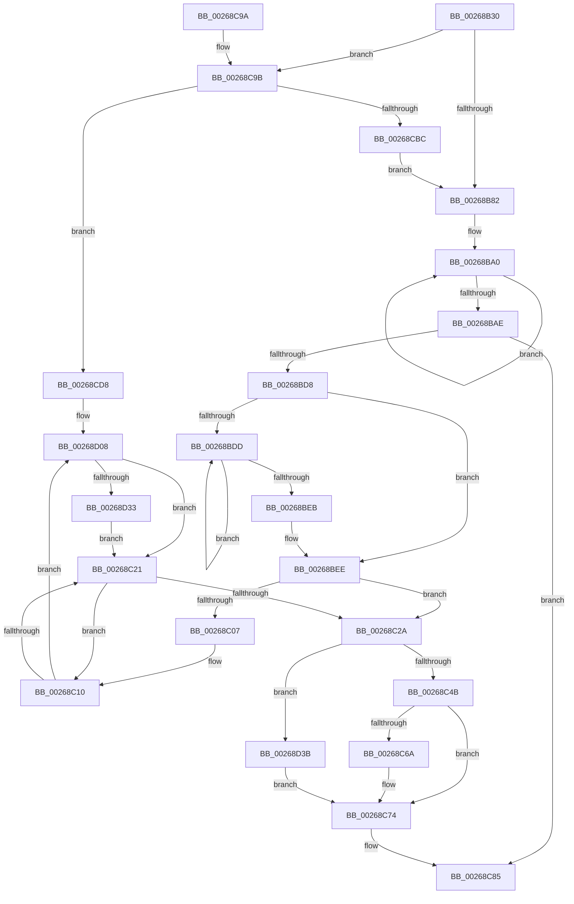

# ST_STORE&lt;SM_TRAITS&gt;::StDmPageRecordUnprotect

- RVA: `0x00268B30`–`0x00268D47` (길이 `535` bytes)
- VA: `0x0000000140268B30`
- 실행 섹션: `.text`
- PDB 이름 있음: `예`; PDB Function 태그: `아니요`
- unwind 정보 RVA: `0x000651F0`
- 디코드: `132`개 명령, `535/535` bytes 표시
- 미해석 바이트: `0` (있으면 어셈블리에 `.byte`로 보존)

> 이 문서는 커널 이미지의 기계어와 PDB 기호를 분석해 생성했습니다. 4번과 5번은 함수 원형과 자료형을 바이너리 사용 방식에서 추정한 C 해석이며 원본 소스 복구 결과는 아닙니다.

## 1. Dependencies

- 직접 호출 지점: **4**; 고유 호출 대상: **4**
- 직접 호출자로 확인된 함수: **7**
- RIP 상대 이미지 참조: **0**

### Outgoing calls
- `0x00268CA6` → [wyhash](wyhash_function_00269FE4.md) (function, `0x00269FE4`)
- `0x00268CCB` → [ExProtectPoolEx](ExProtectPoolEx_function_002695D8.md) (function, `0x002695D8`)
- `0x00268CE5` → [SmPrepareForFatalHeapCorruption](SmPrepareForFatalHeapCorruption_function_00267AC0.md) (function, `0x00267AC0`)
- `0x00268D02` → [KeBugCheckEx](../4F/KeBugCheckEx_function_004FD660.md) (function, `0x004FD660`)

### Direct callers
- [ST_STORE&lt;SM_TRAITS&gt;::StDmPageRemove](../20/ST_STORE_SM_TRAITS_StDmPageRemove_function_002049A0.md) at `0x00204B35`
- [ST_STORE&lt;SM_TRAITS&gt;::StDmpSinglePageAdd](../20/ST_STORE_SM_TRAITS_StDmpSinglePageAdd_function_0020502C.md) at `0x002052A0`
- [ST_STORE&lt;SM_TRAITS&gt;::StDmCombineRegion](../3B/ST_STORE_SM_TRAITS_StDmCombineRegion_function_003B0E34.md) at `0x003B0EC4`
- [ST_STORE&lt;SM_TRAITS&gt;::StDmCombinePageEntry](../41/ST_STORE_SM_TRAITS_StDmCombinePageEntry_function_00410D40.md) at `0x00410EAD`
- [ST_STORE&lt;SM_TRAITS&gt;::StCompactRegions](../4A/ST_STORE_SM_TRAITS_StCompactRegions_function_004A48E0.md) at `0x004A4981`
- [ST_STORE&lt;SM_TRAITS&gt;::StCompactRegions](../4A/ST_STORE_SM_TRAITS_StCompactRegions_function_004A48E0.md) at `0x004A4C32`
- [ST_STORE&lt;SM_TRAITS&gt;::StDmCombinePageRecords](../4E/ST_STORE_SM_TRAITS_StDmCombinePageRecords_function_004EBC80.md) at `0x004EBCE9`
- [ST_STORE&lt;SM_TRAITS&gt;::StDmCombinePageRecords](../4E/ST_STORE_SM_TRAITS_StDmCombinePageRecords_function_004EBC80.md) at `0x004EBCF4`
- [ST_STORE&lt;SM_TRAITS&gt;::StDmGetStatsBitmap](../60/ST_STORE_SM_TRAITS_StDmGetStatsBitmap_function_0060D838.md) at `0x0060D8AA`

### Static image references
- 디코드된 RIP-relative 메모리 참조가 없습니다.

## 2. Other-region calls and transfers

- 다른 실행 섹션으로 향하는 call: **0**
- 별도 외부 분기/꼬리 이동을 확인하지 못했습니다.

## 3. Assembly (complete function range)

```asm
00268B30  48 89 5C 24 10                  mov qword ptr [rsp + 0x10], rbx
00268B35  48 89 6C 24 18                  mov qword ptr [rsp + 0x18], rbp
00268B3A  48 89 74 24 20                  mov qword ptr [rsp + 0x20], rsi
00268B3F  57                              push rdi
00268B40  48 83 EC 30                     sub rsp, 0x30
00268B44  48 81 E2 00 F0 FF FF            and rdx, 0xfffffffffffff000
00268B4B  33 FF                           xor edi, edi
00268B4D  48 8B F1                        mov rsi, rcx
00268B50  89 7C 24 40                     mov dword ptr [rsp + 0x40], edi
00268B54  BD 01 00 00 00                  mov ebp, 1
00268B59  48 89 7C 24 40                  mov qword ptr [rsp + 0x40], rdi
00268B5E  8B DD                           mov ebx, ebp
00268B60  44 8B 42 10                     mov r8d, dword ptr [rdx + 0x10]
00268B64  41 0F BD C8                     bsr ecx, r8d
00268B68  D3 E3                           shl ebx, cl
00268B6A  49 33 D8                        xor rbx, r8
00268B6D  48 C1 E3 04                     shl rbx, 4
00268B71  48 03 9C CE C0 00 00 00         add rbx, qword ptr [rsi + rcx*8 + 0xc0]
00268B79  39 7B 0C                        cmp dword ptr [rbx + 0xc], edi
00268B7C  0F 85 19 01 00 00               jne 0x140268c9b
00268B82  4C 8B 8E F0 08 00 00            mov r9, qword ptr [rsi + 0x8f0]
00268B89  48 BA B0 03 00 00 80 F7 FF FF   movabs rdx, 0xfffff780000003b0
00268B93  49 B8 08 00 00 00 80 F7 FF FF   movabs r8, 0xfffff78000000008
00268B9D  0F 1F 00                        nop dword ptr [rax]
00268BA0  48 8B 0A                        mov rcx, qword ptr [rdx]
00268BA3  4D 8B 10                        mov r10, qword ptr [r8]
00268BA6  48 8B 02                        mov rax, qword ptr [rdx]
00268BA9  48 3B C8                        cmp rcx, rax
00268BAC  75 F2                           jne 0x140268ba0
00268BAE  4C 2B D1                        sub r10, rcx
00268BB1  4D 89 51 70                     mov qword ptr [r9 + 0x70], r10
00268BB5  49 C7 41 60 80 96 98 00         mov qword ptr [r9 + 0x60], 0x989680
00268BBD  49 8D 82 00 A3 E1 11            lea rax, [r10 + 0x11e1a300]
00268BC4  49 89 41 68                     mov qword ptr [r9 + 0x68], rax
00268BC8  41 8B 81 E0 00 00 00            mov eax, dword ptr [r9 + 0xe0]
00268BCF  40 84 C5                        test bpl, al
00268BD2  0F 85 AD 00 00 00               jne 0x140268c85
00268BD8  4D 85 D2                        test r10, r10
00268BDB  75 11                           jne 0x140268bee
00268BDD  48 8B 0A                        mov rcx, qword ptr [rdx]
00268BE0  4D 8B 10                        mov r10, qword ptr [r8]
00268BE3  48 8B 02                        mov rax, qword ptr [rdx]
00268BE6  48 3B C8                        cmp rcx, rax
00268BE9  75 F2                           jne 0x140268bdd
00268BEB  4C 2B D1                        sub r10, rcx
00268BEE  4D 8D 99 A8 00 00 00            lea r11, [r9 + 0xa8]
00268BF5  48 C7 C1 FF FF FF FF            mov rcx, 0xffffffffffffffff
00268BFC  49 8B C1                        mov rax, r9
00268BFF  48 8B F1                        mov rsi, rcx
00268C02  4D 3B CB                        cmp r9, r11
00268C05  73 23                           jae 0x140268c2a
00268C07  66 0F 1F 84 00 00 00 00 00      nop word ptr [rax + rax]
00268C10  4C 8B 40 08                     mov r8, qword ptr [rax + 8]
00268C14  48 8B D9                        mov rbx, rcx
00268C17  49 83 F8 FF                     cmp r8, -1
00268C1B  0F 85 E7 00 00 00               jne 0x140268d08
00268C21  48 83 C0 18                     add rax, 0x18
00268C25  49 3B C3                        cmp rax, r11
00268C28  72 E6                           jb 0x140268c10
00268C2A  49 3B CA                        cmp rcx, r10
00268C2D  49 8B D2                        mov rdx, r10
00268C30  48 0F 43 D1                     cmovae rdx, rcx
00268C34  49 3B F2                        cmp rsi, r10
00268C37  49 8B CA                        mov rcx, r10
00268C3A  48 0F 43 CE                     cmovae rcx, rsi
00268C3E  49 89 0B                        mov qword ptr [r11], rcx
00268C41  48 83 F9 FF                     cmp rcx, -1
00268C45  0F 84 F0 00 00 00               je 0x140268d3b
00268C4B  48 8B C2                        mov rax, rdx
00268C4E  48 8B F9                        mov rdi, rcx
00268C51  49 2B C2                        sub rax, r10
00268C54  49 2B FA                        sub rdi, r10
00268C57  48 3B CA                        cmp rcx, rdx
00268C5A  48 0F 43 F8                     cmovae rdi, rax
00268C5E  49 89 B9 B0 00 00 00            mov qword ptr [r9 + 0xb0], rdi
00268C65  48 85 FF                        test rdi, rdi
00268C68  75 0A                           jne 0x140268c74
00268C6A  49 89 A9 B0 00 00 00            mov qword ptr [r9 + 0xb0], rbp
00268C71  48 8B FD                        mov rdi, rbp
00268C74  49 8B 81 B0 E6 FF FF            mov rax, qword ptr [r9 - 0x1950]
00268C7B  48 F7 DF                        neg rdi
00268C7E  48 89 B8 10 1D 00 00            mov qword ptr [rax + 0x1d10], rdi
00268C85  48 8B 5C 24 48                  mov rbx, qword ptr [rsp + 0x48]
00268C8A  48 8B 6C 24 50                  mov rbp, qword ptr [rsp + 0x50]
00268C8F  48 8B 74 24 58                  mov rsi, qword ptr [rsp + 0x58]
00268C94  48 83 C4 30                     add rsp, 0x30
00268C98  5F                              pop rdi
00268C99  C3                              ret
00268C9A  CC                              int3
00268C9B  48 8B 0B                        mov rcx, qword ptr [rbx]
00268C9E  45 33 C0                        xor r8d, r8d
00268CA1  BA 00 10 00 00                  mov edx, 0x1000
00268CA6  E8 39 13 00 00                  call 0x140269fe4
00268CAB  44 8B 43 0C                     mov r8d, dword ptr [rbx + 0xc]
00268CAF  85 C0                           test eax, eax
00268CB1  48 8B 0B                        mov rcx, qword ptr [rbx]
00268CB4  0F 44 C5                        cmove eax, ebp
00268CB7  41 3B C0                        cmp eax, r8d
00268CBA  75 1C                           jne 0x140268cd8
00268CBC  41 B9 04 00 00 00               mov r9d, 4
00268CC2  41 B8 00 10 00 00               mov r8d, 0x1000
00268CC8  48 8B D1                        mov rdx, rcx
00268CCB  E8 08 09 00 00                  call 0x1402695d8
00268CD0  89 7B 0C                        mov dword ptr [rbx + 0xc], edi
00268CD3  E9 AA FE FF FF                  jmp 0x140268b82
00268CD8  48 8D 54 24 40                  lea rdx, [rsp + 0x40]
00268CDD  44 8B C8                        mov r9d, eax
00268CE0  48 89 54 24 20                  mov qword ptr [rsp + 0x20], rdx
00268CE5  E8 D6 ED FF FF                  call 0x140267ac0
00268CEA  48 8B 44 24 40                  mov rax, qword ptr [rsp + 0x40]
00268CEF  33 D2                           xor edx, edx
00268CF1  44 8B 4B 0C                     mov r9d, dword ptr [rbx + 0xc]
00268CF5  B9 C7 01 00 00                  mov ecx, 0x1c7
00268CFA  4C 8B 03                        mov r8, qword ptr [rbx]
00268CFD  48 89 44 24 20                  mov qword ptr [rsp + 0x20], rax
00268D02  E8 59 49 29 00                  call 0x1404fd660
00268D07  CC                              int3
00268D08  48 8B 50 10                     mov rdx, qword ptr [rax + 0x10]
00268D0C  49 8B CA                        mov rcx, r10
00268D0F  49 2B 89 B8 00 00 00            sub rcx, qword ptr [r9 + 0xb8]
00268D16  48 3B D1                        cmp rdx, rcx
00268D19  48 0F 42 D1                     cmovb rdx, rcx
00268D1D  48 8B 08                        mov rcx, qword ptr [rax]
00268D20  48 03 CA                        add rcx, rdx
00268D23  48 3B CB                        cmp rcx, rbx
00268D26  48 0F 43 CB                     cmovae rcx, rbx
00268D2A  4C 3B C6                        cmp r8, rsi
00268D2D  0F 83 EE FE FF FF               jae 0x140268c21
00268D33  49 8B F0                        mov rsi, r8
00268D36  E9 E6 FE FF FF                  jmp 0x140268c21
00268D3B  49 89 B9 B0 00 00 00            mov qword ptr [r9 + 0xb0], rdi
00268D42  E9 2D FF FF FF                  jmp 0x140268c74
```

## 4. C-style interpretation (structured pseudocode)

```c
__int64 __fastcall ST_STORE_SM_TRAITS___StDmPageRecordUnprotect(__int64 a1, __int64 a2)
{
    __int64 result;
    __int64 v_r10;
    __int64 v_rbx;
    __int64 v_rdi;
    __int64 v_rsp;
    unsigned __int64 v_stack_p10;
    unsigned __int64 v_stack_p18;
    unsigned __int64 v_stack_p20;
    unsigned __int64 v_stack_p40;
    unsigned int v_stack_p8;

    v_stack_p10 = v_rbx;
    v_stack_p18 = v_rbp;
    v_stack_p20 = v_rsi;
    v_rsp = (v_rsp) - (48);
    a2 = (a2) & (0xFFFFFFFFFFFFF000ULL);
    v_rdi = 0;
    v_stack_p8 = 0;
    v_stack_p8 = 0;
    v_rbx = (unsigned int)((1) << ((unsigned __int8)(a1)));
    v_rbx = (v_rbx) ^ ((unsigned int)(*(unsigned int *)(a2 + 16)));
    v_rbx = (v_rbx) << (4);
    v_rbx = (v_rbx) + (*(unsigned __int64 *)(a1 + a1 * 8 + 192));
    if ((*(unsigned int *)(v_rbx + 12)) != 0) goto loc_00268C9B;
loc_00268B82:
loc_00268BA0:
    if ((*(unsigned __int64 *)(a2)) != (*(unsigned __int64 *)(a2))) goto loc_00268BA0;
    v_r10 = (*(unsigned __int64 *)((unsigned int)(*(unsigned int *)(a2 + 16)))) - (*(unsigned __int64 *)(a2));
    *(unsigned __int64 *)(*(unsigned __int64 *)(a1 + 2288) + 112) = v_r10;
    *(unsigned __int64 *)(*(unsigned __int64 *)(a1 + 2288) + 96) = 0x989680ULL;
    *(unsigned __int64 *)(*(unsigned __int64 *)(a1 + 2288) + 104) = v_r10 + 300000000;
    if (((1) & ((unsigned __int8)((unsigned int)(*(unsigned int *)(*(unsigned __int64 *)(a1 + 2288) + 224))))) != 0) goto loc_00268C85;
    if (v_r10 != 0) goto loc_00268BEE;
loc_00268BDD:
    if ((*(unsigned __int64 *)(a2)) != (*(unsigned __int64 *)(a2))) goto loc_00268BDD;
    v_r10 = (*(unsigned __int64 *)((unsigned int)(*(unsigned int *)(a2 + 16)))) - (*(unsigned __int64 *)(a2));
loc_00268BEE:
    if ((*(unsigned __int64 *)(a1 + 2288)) >= (*(unsigned __int64 *)(a1 + 2288) + 168)) goto loc_00268C2A;
loc_00268C10:
    if ((*(unsigned __int64 *)(*(unsigned __int64 *)(a1 + 2288) + 8)) != -1) goto loc_00268D08;
loc_00268C21:
    result = (*(unsigned __int64 *)(a1 + 2288)) + (24);
    if (result < (*(unsigned __int64 *)(a1 + 2288) + 168)) goto loc_00268C10;
loc_00268C2A:
    a2 = v_r10;
    if (-1 >= v_r10) { a2 = -1; }
    a1 = v_r10;
    if (-1 >= v_r10) { a1 = -1; }
    *(unsigned __int64 *)(*(unsigned __int64 *)(a1 + 2288) + 168) = a1;
    if (a1 == -1) goto loc_00268D3B;
    result = (a2) - (v_r10);
    v_rdi = (a1) - (v_r10);
    if (a1 >= a2) { v_rdi = result; }
    *(unsigned __int64 *)(*(unsigned __int64 *)(a1 + 2288) + 176) = v_rdi;
    if (v_rdi == 0) {
        *(unsigned __int64 *)(*(unsigned __int64 *)(a1 + 2288) + 176) = 1;
        v_rdi = 1;
    }
    v_rdi = -(v_rdi);
    *(unsigned __int64 *)(*(unsigned __int64 *)(*(unsigned __int64 *)(a1 + 2288) - 6480) + 7440) = v_rdi;
loc_00268C85:
    v_rsp = (v_rsp) + (48);
    return *(unsigned __int64 *)(*(unsigned __int64 *)(a1 + 2288) - 6480);
loc_00268C9B:
    a3 = 0;
    result = wyhash(*(unsigned __int64 *)(v_stack_p10), (unsigned int)(0x1000ULL), a3, *(unsigned __int64 *)(a1 + 2288));
    if ((unsigned int)(result) == 0) { result = (unsigned int)(v_stack_p18); }
    if (((unsigned int)(result)) != ((unsigned int)((unsigned int)(*(unsigned int *)(v_stack_p10 + 12))))) goto loc_00268CD8;
    result = ExProtectPoolEx(*(unsigned __int64 *)(v_stack_p10), *(unsigned __int64 *)(v_stack_p10), (unsigned int)(0x1000ULL), 4);
    *(unsigned int *)(v_stack_p10 + 12) = (unsigned int)(v_rdi);
    goto loc_00268B82;
loc_00268CD8:
    v_stack_p20 = v_stack_p40;
    result = SmPrepareForFatalHeapCorruption(*(unsigned __int64 *)(v_stack_p10), v_stack_p40, (unsigned int)(0x1000ULL), (unsigned int)((unsigned int)(result)));
    a2 = 0;
    v_stack_p20 = v_stack_p40;
    result = KeBugCheckEx(455, a2, *(unsigned __int64 *)(v_stack_p10), (unsigned int)(*(unsigned int *)(v_stack_p10 + 12)));
loc_00268D08:
    a1 = (v_r10) - (*(unsigned __int64 *)((unsigned int)(*(unsigned int *)(v_stack_p10 + 12)) + 184));
    a2 = *(unsigned __int64 *)(result + 16);
    if ((*(unsigned __int64 *)(result + 16)) < a1) { a2 = a1; }
    a1 = (*(unsigned __int64 *)(result)) + (a2);
    if (a1 >= v_stack_p10) { a1 = v_stack_p10; }
    if ((*(unsigned __int64 *)(v_stack_p10)) >= v_stack_p20) goto loc_00268C21;
    goto loc_00268C21;
loc_00268D3B:
    *(unsigned __int64 *)((unsigned int)(*(unsigned int *)(v_stack_p10 + 12)) + 176) = v_rdi;
    goto loc_00268C74;
}
```

## 5. (Beta) C Style

```c
int64_t ST_STORE_SM_TRAITS___StDmPageRecordUnprotect(void *Arg1, void *Arg2)
{
    uint8_t *arg1 = (uint8_t *)Arg1;
    uint8_t *arg2 = (uint8_t *)Arg2;

    int64_t result;
    int64_t local_r10;
    int64_t local_rbx;
    int64_t local_rdi;
    int64_t local_rsp;
    uint64_t v_stack_p10;
    uint64_t v_stack_p18;
    uint64_t v_stack_p20;
    uint64_t v_stack_p40;
    uint32_t v_stack_p8;

    v_stack_p10 = local_rbx;
    v_stack_p18 = local_rbp;
    v_stack_p20 = local_rsi;
    local_rsp = (local_rsp) - (48);
    Arg2 = (Arg2) & (0xFFFFFFFFFFFFF000ULL);
    local_rdi = 0;
    v_stack_p8 = 0;
    v_stack_p8 = 0;
    local_rbx = (uint32_t)((1) << ((uint8_t)(Arg1)));
    local_rbx = (local_rbx) ^ ((uint32_t)(*(uint32_t *)(arg2 + 0x10)));
    local_rbx = (local_rbx) << (4);
    local_rbx = (local_rbx) + (*(uint64_t *)(arg1 + arg1 * 8 + 0xC0));
    if ((*(uint32_t *)(local_rbx + 0xC)) != 0) goto loc_00268C9B;
loc_00268B82:
loc_00268BA0:
    if ((*(uint64_t *)(arg2)) != (*(uint64_t *)(arg2))) goto loc_00268BA0;
    local_r10 = (*(uint64_t *)((uint32_t)(*(uint32_t *)(arg2 + 0x10)))) - (*(uint64_t *)(arg2));
    *(uint64_t *)(*(uint64_t *)(arg1 + 0x8F0) + 0x70) = local_r10;
    *(uint64_t *)(*(uint64_t *)(arg1 + 0x8F0) + 0x60) = 0x989680ULL;
    *(uint64_t *)(*(uint64_t *)(arg1 + 0x8F0) + 0x68) = local_r10 + 300000000;
    if (((1) & ((uint8_t)((uint32_t)(*(uint32_t *)(*(uint64_t *)(arg1 + 0x8F0) + 0xE0))))) != 0) goto loc_00268C85;
    if (local_r10 != 0) goto loc_00268BEE;
loc_00268BDD:
    if ((*(uint64_t *)(arg2)) != (*(uint64_t *)(arg2))) goto loc_00268BDD;
    local_r10 = (*(uint64_t *)((uint32_t)(*(uint32_t *)(arg2 + 0x10)))) - (*(uint64_t *)(arg2));
loc_00268BEE:
    if ((*(uint64_t *)(arg1 + 0x8F0)) >= (*(uint64_t *)(arg1 + 0x8F0) + 168)) goto loc_00268C2A;
loc_00268C10:
    if ((*(uint64_t *)(*(uint64_t *)(arg1 + 0x8F0) + 0x8)) != -1) goto loc_00268D08;
loc_00268C21:
    result = (*(uint64_t *)(arg1 + 0x8F0)) + (24);
    if (result < (*(uint64_t *)(arg1 + 0x8F0) + 168)) goto loc_00268C10;
loc_00268C2A:
    Arg2 = local_r10;
    if (-1 >= local_r10) { Arg2 = -1; }
    Arg1 = local_r10;
    if (-1 >= local_r10) { Arg1 = -1; }
    *(void **)(*(uint64_t *)(arg1 + 0x8F0) + 0xA8) = Arg1;
    if (Arg1 == -1) goto loc_00268D3B;
    result = (Arg2) - (local_r10);
    local_rdi = (Arg1) - (local_r10);
    if (Arg1 >= Arg2) { local_rdi = result; }
    *(uint64_t *)(*(uint64_t *)(arg1 + 0x8F0) + 0xB0) = local_rdi;
    if (local_rdi == 0) {
        *(uint64_t *)(*(uint64_t *)(arg1 + 0x8F0) + 0xB0) = 1;
        local_rdi = 1;
    }
    local_rdi = -(local_rdi);
    *(uint64_t *)(*(uint64_t *)(*(uint64_t *)(arg1 + 0x8F0) - 0x1950) + 0x1D10) = local_rdi;
loc_00268C85:
    local_rsp = (local_rsp) + (48);
    return *(uint64_t *)(*(uint64_t *)(arg1 + 0x8F0) - 0x1950);
loc_00268C9B:
    a3 = 0;
    result = wyhash(*(uint64_t *)(v_stack_p10), (uint32_t)(0x1000ULL), a3, *(uint64_t *)(arg1 + 0x8F0));
    if ((uint32_t)(result) == 0) { result = (uint32_t)(v_stack_p18); }
    if (((uint32_t)(result)) != ((uint32_t)((uint32_t)(*(uint32_t *)(v_stack_p10 + 0xC))))) goto loc_00268CD8;
    result = ExProtectPoolEx(*(uint64_t *)(v_stack_p10), *(uint64_t *)(v_stack_p10), (uint32_t)(0x1000ULL), 4);
    *(uint32_t *)(v_stack_p10 + 0xC) = (uint32_t)(local_rdi);
    goto loc_00268B82;
loc_00268CD8:
    v_stack_p20 = v_stack_p40;
    result = SmPrepareForFatalHeapCorruption(*(uint64_t *)(v_stack_p10), v_stack_p40, (uint32_t)(0x1000ULL), (uint32_t)((uint32_t)(result)));
    Arg2 = 0;
    v_stack_p20 = v_stack_p40;
    result = KeBugCheckEx(455, Arg2, *(uint64_t *)(v_stack_p10), (uint32_t)(*(uint32_t *)(v_stack_p10 + 0xC)));
loc_00268D08:
    Arg1 = (local_r10) - (*(uint64_t *)((uint32_t)(*(uint32_t *)(v_stack_p10 + 0xC)) + 0xB8));
    Arg2 = *(uint64_t *)(result + 0x10);
    if ((*(uint64_t *)(result + 0x10)) < Arg1) { Arg2 = Arg1; }
    Arg1 = (*(uint64_t *)(result)) + (Arg2);
    if (Arg1 >= v_stack_p10) { Arg1 = v_stack_p10; }
    if ((*(uint64_t *)(v_stack_p10)) >= v_stack_p20) goto loc_00268C21;
    goto loc_00268C21;
loc_00268D3B:
    *(uint64_t *)((uint32_t)(*(uint32_t *)(v_stack_p10 + 0xC)) + 0xB0) = local_rdi;
    goto loc_00268C74;
}
```

### 관측된 메모리 오프셋

구조체 형식이 확인되지 않은 접근은 인자 기준의 오프셋으로만 기록했습니다.

| 기준 인자 | 오프셋 표현 | 폭 (bit) | 접근 |
|---|---:|---:|---|
| `Arg1` | `+ 0xC0 + rcx*8` | `64` | `R` |
| `Arg1` | `+ 0x8F0` | `64` | `R` |
| `Arg2` | `+ 0x10` | `32` | `R` |

## 6. Execution-region graph

[열기: 2D/3D 그래프와 함수 탐색 컨트롤 패널](../../../control-panel.html?section=text&rva=0x00268B30&view=graph)

- 2D 그래프는 위에서 아래로 흐르고, 3D 그래프는 빈 공간을 드래그해 회전합니다. Shift+드래그는 이동, 휠은 확대·축소, 함수 노드 선택은 대상 보고서 이동입니다.

### Static fallback


