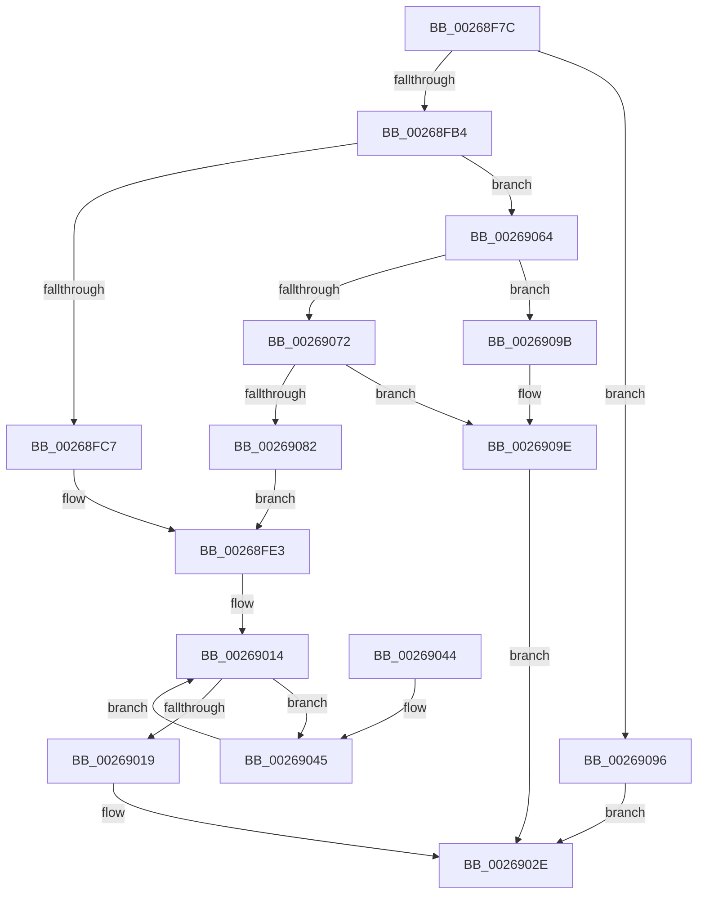

# SmHpBufferAlloc

- RVA: `0x00268F7C`–`0x002690AA` (길이 `302` bytes)
- VA: `0x0000000140268F7C`
- 실행 섹션: `.text`
- PDB 이름 있음: `예`; PDB Function 태그: `아니요`
- unwind 정보 RVA: `0x00065258`
- 디코드: `83`개 명령, `302/302` bytes 표시
- 미해석 바이트: `0` (있으면 어셈블리에 `.byte`로 보존)

> 이 문서는 커널 이미지의 기계어와 PDB 기호를 분석해 생성했습니다. 4번과 5번은 함수 원형과 자료형을 바이너리 사용 방식에서 추정한 C 해석이며 원본 소스 복구 결과는 아닙니다.

## 1. Dependencies

- 직접 호출 지점: **4**; 고유 호출 대상: **4**
- 직접 호출자로 확인된 함수: **1**
- RIP 상대 이미지 참조: **0**

### Outgoing calls
- `0x00268FA1` → [ExAllocatePool2](../../poolcode/B8/ExAllocatePool2_function_00B820F0.md) (function, `0x00B820F0`)
- `0x00269029` → [SmHpBufferUpdateFullness](SmHpBufferUpdateFullness_function_002690B0.md) (function, `0x002690B0`)
- `0x00269075` → [SmBinaryArrayGrow](../4A/SmBinaryArrayGrow_function_004A8EF8.md) (function, `0x004A8EF8`)
- `0x002690A3` → [ExFreePoolWithTag](../../poolcode/B8/ExFreePoolWithTag_function_00B82870.md) (function, `0x00B82870`)

### Direct callers
- [sub_002689C7](Unknown_function_002689C7.md) at `0x00268AB3`

### Static image references
- 디코드된 RIP-relative 메모리 참조가 없습니다.

## 2. Other-region calls and transfers

- 다른 실행 섹션으로 향하는 call: **2**
  - `0x00268FA1` → [ExAllocatePool2](../../poolcode/B8/ExAllocatePool2_function_00B820F0.md) (`.text` → `POOLCODE`)
  - `0x002690A3` → [ExFreePoolWithTag](../../poolcode/B8/ExFreePoolWithTag_function_00B82870.md) (`.text` → `POOLCODE`)
- 별도 외부 분기/꼬리 이동을 확인하지 못했습니다.

## 3. Assembly (complete function range)

```asm
00268F7C  48 89 5C 24 08                  mov qword ptr [rsp + 8], rbx
00268F81  48 89 6C 24 18                  mov qword ptr [rsp + 0x18], rbp
00268F86  56                              push rsi
00268F87  57                              push rdi
00268F88  41 56                           push r14
00268F8A  48 83 EC 20                     sub rsp, 0x20
00268F8E  48 8B F1                        mov rsi, rcx
00268F91  BA 00 10 00 00                  mov edx, 0x1000
00268F96  B9 40 00 00 00                  mov ecx, 0x40
00268F9B  41 B8 73 6D 43 42               mov r8d, 0x42436d73
00268FA1  E8 4A 91 91 00                  call 0x140b820f0
00268FA6  33 ED                           xor ebp, ebp
00268FA8  48 8B D8                        mov rbx, rax
00268FAB  48 85 C0                        test rax, rax
00268FAE  0F 84 E2 00 00 00               je 0x140269096
00268FB4  8B 96 20 02 00 00               mov edx, dword ptr [rsi + 0x220]
00268FBA  44 8D 75 01                     lea r14d, [rbp + 1]
00268FBE  83 FA FF                        cmp edx, -1
00268FC1  0F 84 9D 00 00 00               je 0x140269064
00268FC7  0F BD CA                        bsr ecx, edx
00268FCA  41 8B FE                        mov edi, r14d
00268FCD  D3 E7                           shl edi, cl
00268FCF  48 33 FA                        xor rdi, rdx
00268FD2  48 C1 E7 04                     shl rdi, 4
00268FD6  48 03 3C CE                     add rdi, qword ptr [rsi + rcx*8]
00268FDA  8B 47 08                        mov eax, dword ptr [rdi + 8]
00268FDD  89 86 20 02 00 00               mov dword ptr [rsi + 0x220], eax
00268FE3  89 6B 14                        mov dword ptr [rbx + 0x14], ebp
00268FE6  4C 8D 8B 00 10 00 00            lea r9, [rbx + 0x1000]
00268FED  89 53 10                        mov dword ptr [rbx + 0x10], edx
00268FF0  4C 8D 47 08                     lea r8, [rdi + 8]
00268FF4  48 89 5B 08                     mov qword ptr [rbx + 8], rbx
00268FF8  48 89 1B                        mov qword ptr [rbx], rbx
00268FFB  48 89 6F 08                     mov qword ptr [rdi + 8], rbp
00268FFF  48 89 1F                        mov qword ptr [rdi], rbx
00269002  8B 96 18 01 00 00               mov edx, dword ptr [rsi + 0x118]
00269008  8B 8E 10 01 00 00               mov ecx, dword ptr [rsi + 0x110]
0026900E  48 03 D3                        add rdx, rbx
00269011  48 03 CA                        add rcx, rdx
00269014  49 3B C9                        cmp rcx, r9
00269017  76 2C                           jbe 0x140269045
00269019  66 41 81 08 FF FF               or word ptr [r8], 0xffff
0026901F  48 8B D7                        mov rdx, rdi
00269022  44 0F B7 C5                     movzx r8d, bp
00269026  48 8B CE                        mov rcx, rsi
00269029  E8 82 00 00 00                  call 0x1402690b0
0026902E  48 8B 5C 24 40                  mov rbx, qword ptr [rsp + 0x40]
00269033  48 8B C7                        mov rax, rdi
00269036  48 8B 6C 24 50                  mov rbp, qword ptr [rsp + 0x50]
0026903B  48 83 C4 20                     add rsp, 0x20
0026903F  41 5E                           pop r14
00269041  5F                              pop rdi
00269042  5E                              pop rsi
00269043  C3                              ret
00269044  CC                              int3
00269045  0F B7 C2                        movzx eax, dx
00269048  66 41 03 EE                     add bp, r14w
0026904C  66 2B C3                        sub ax, bx
0026904F  66 41 89 00                     mov word ptr [r8], ax
00269053  4C 8B C2                        mov r8, rdx
00269056  8B 86 10 01 00 00               mov eax, dword ptr [rsi + 0x110]
0026905C  48 8B D1                        mov rdx, rcx
0026905F  48 03 C8                        add rcx, rax
00269062  EB B0                           jmp 0x140269014
00269064  8B 96 00 01 00 00               mov edx, dword ptr [rsi + 0x100]
0026906A  3B 96 04 01 00 00               cmp edx, dword ptr [rsi + 0x104]
00269070  77 29                           ja 0x14026909b
00269072  48 8B CE                        mov rcx, rsi
00269075  E8 7E FE 23 00                  call 0x1404a8ef8
0026907A  48 8B F8                        mov rdi, rax
0026907D  48 85 C0                        test rax, rax
00269080  74 1C                           je 0x14026909e
00269082  8B 96 00 01 00 00               mov edx, dword ptr [rsi + 0x100]
00269088  8D 4A 01                        lea ecx, [rdx + 1]
0026908B  89 8E 00 01 00 00               mov dword ptr [rsi + 0x100], ecx
00269091  E9 4D FF FF FF                  jmp 0x140268fe3
00269096  48 8B FD                        mov rdi, rbp
00269099  EB 93                           jmp 0x14026902e
0026909B  48 8B FD                        mov rdi, rbp
0026909E  33 D2                           xor edx, edx
002690A0  48 8B CB                        mov rcx, rbx
002690A3  E8 C8 97 91 00                  call 0x140b82870
002690A8  EB 84                           jmp 0x14026902e
```

## 4. C-style interpretation (structured pseudocode)

```c
__int64 __fastcall SmHpBufferAlloc(__int64 a1)
{
    __int64 result;
    __int64 v_rbp;
    __int64 v_rdi;
    __int64 v_rsp;
    unsigned __int64 v_stack_p18;
    unsigned __int64 v_stack_p8;

    v_stack_p8 = v_rbx;
    v_stack_p18 = v_rbp;
    v_rsp = (v_rsp) - (32);
    result = ExAllocatePool2(64, (unsigned int)(0x1000ULL), (unsigned int)(0x42436D73ULL), a4);
    v_rbp = 0;
    if (result == 0) goto loc_00269096;
    if (((unsigned int)((unsigned int)(*(unsigned int *)(a1 + 544)))) == -1) goto loc_00269064;
    v_rdi = (unsigned int)(((unsigned int)((unsigned int)(v_rbp + 1))) << (64));
    v_rdi = (v_rdi) ^ ((unsigned int)(*(unsigned int *)(a1 + 544)));
    v_rdi = (v_rdi) << (4);
    v_rdi = (v_rdi) + (*(unsigned __int64 *)(a1 + 64 * 8));
    *(unsigned int *)(a1 + 544) = (unsigned int)((unsigned int)(*(unsigned int *)(v_rdi + 8)));
loc_00268FE3:
    *(unsigned int *)(result + 20) = 0;
    *(unsigned int *)(result + 16) = (unsigned int)((unsigned int)(*(unsigned int *)(a1 + 544)));
    *(unsigned __int64 *)(result + 8) = result;
    *(unsigned __int64 *)(result) = result;
    *(unsigned __int64 *)(v_rdi + 8) = 0;
    *(unsigned __int64 *)(v_rdi) = result;
    a2 = ((unsigned int)(*(unsigned int *)(a1 + 280))) + (result);
    a1 = ((unsigned int)(*(unsigned int *)(a1 + 272))) + (a2);
loc_00269014:
    if (a1 <= (result + 4096)) goto loc_00269045;
    result = SmHpBufferUpdateFullness(a1, v_rdi, 0, result + 4096);
loc_0026902E:
    v_rsp = (v_rsp) + (32);
    return v_rdi;
loc_00269045:
    v_rbp = (unsigned __int16)((v_stack_p18) + ((unsigned __int16)(v_rbp + 1)));
    result = (unsigned __int16)(((unsigned __int16)(v_rdi)) - ((unsigned __int16)(v_stack_p8)));
    *(unsigned __int16 *)(0) = (unsigned __int16)(result);
    a1 = (a1) + ((unsigned int)(*(unsigned int *)(a1 + 272)));
    goto loc_00269014;
loc_00269064:
    if (((unsigned int)((unsigned int)(*(unsigned int *)(a1 + 256)))) > (*(unsigned int *)(a1 + 260))) goto loc_0026909B;
    result = SmBinaryArrayGrow(a1, (unsigned int)(*(unsigned int *)(a1 + 256)), v_rdi, result + 4096);
    if (result == 0) goto loc_0026909E;
    *(unsigned int *)(a1 + 256) = (unsigned int)((unsigned int)(*(unsigned int *)(a1 + 256)) + 1);
    goto loc_00268FE3;
loc_00269096:
    goto loc_0026902E;
loc_0026909B:
loc_0026909E:
    a2 = 0;
    result = ExFreePoolWithTag(v_stack_p8, a2, v_rdi, result + 4096);
    goto loc_0026902E;
}
```

## 5. (Beta) C Style

```c
int64_t SmHpBufferAlloc(void *Arg1)
{
    uint8_t *arg1 = (uint8_t *)Arg1;

    int64_t result;
    int64_t local_rbp;
    int64_t local_rdi;
    int64_t local_rsp;
    uint64_t v_stack_p18;
    uint64_t v_stack_p8;

    v_stack_p8 = local_rbx;
    v_stack_p18 = local_rbp;
    local_rsp = (local_rsp) - (32);
    result = ExAllocatePool2(64, (uint32_t)(0x1000ULL), (uint32_t)(0x42436D73ULL), a4);
    local_rbp = 0;
    if (result == 0) goto loc_00269096;
    if (((uint32_t)((uint32_t)(*(uint32_t *)(arg1 + 0x220)))) == -1) goto loc_00269064;
    local_rdi = (uint32_t)(((uint32_t)((uint32_t)(local_rbp + 1))) << (64));
    local_rdi = (local_rdi) ^ ((uint32_t)(*(uint32_t *)(arg1 + 0x220)));
    local_rdi = (local_rdi) << (4);
    local_rdi = (local_rdi) + (*(uint64_t *)(arg1 + 0x40 * 8));
    *(uint32_t *)(arg1 + 0x220) = (uint32_t)((uint32_t)(*(uint32_t *)(local_rdi + 0x8)));
loc_00268FE3:
    *(uint32_t *)(result + 0x14) = 0;
    *(uint32_t *)(result + 0x10) = (uint32_t)((uint32_t)(*(uint32_t *)(arg1 + 0x220)));
    *(uint64_t *)(result + 0x8) = result;
    *(uint64_t *)(result) = result;
    *(uint64_t *)(local_rdi + 0x8) = 0;
    *(uint64_t *)(local_rdi) = result;
    a2 = ((uint32_t)(*(uint32_t *)(arg1 + 0x118))) + (result);
    Arg1 = ((uint32_t)(*(uint32_t *)(arg1 + 0x110))) + (a2);
loc_00269014:
    if (Arg1 <= (result + 4096)) goto loc_00269045;
    result = SmHpBufferUpdateFullness(Arg1, local_rdi, 0, result + 4096);
loc_0026902E:
    local_rsp = (local_rsp) + (32);
    return local_rdi;
loc_00269045:
    local_rbp = (uint16_t)((v_stack_p18) + ((uint16_t)(local_rbp + 1)));
    result = (uint16_t)(((uint16_t)(local_rdi)) - ((uint16_t)(v_stack_p8)));
    *(uint16_t *)(0) = (uint16_t)(result);
    Arg1 = (Arg1) + ((uint32_t)(*(uint32_t *)(arg1 + 0x110)));
    goto loc_00269014;
loc_00269064:
    if (((uint32_t)((uint32_t)(*(uint32_t *)(arg1 + 0x100)))) > (*(uint32_t *)(arg1 + 0x104))) goto loc_0026909B;
    result = SmBinaryArrayGrow(Arg1, (uint32_t)(*(uint32_t *)(arg1 + 0x100)), local_rdi, result + 4096);
    if (result == 0) goto loc_0026909E;
    *(uint32_t *)(arg1 + 0x100) = (uint32_t)((uint32_t)(*(uint32_t *)(arg1 + 0x100)) + 1);
    goto loc_00268FE3;
loc_00269096:
    goto loc_0026902E;
loc_0026909B:
loc_0026909E:
    a2 = 0;
    result = ExFreePoolWithTag(v_stack_p8, a2, local_rdi, result + 4096);
    goto loc_0026902E;
}
```

### 관측된 메모리 오프셋

구조체 형식이 확인되지 않은 접근은 인자 기준의 오프셋으로만 기록했습니다.

| 기준 인자 | 오프셋 표현 | 폭 (bit) | 접근 |
|---|---:|---:|---|
| `Arg1` | `+ 0x0 + rcx*8` | `64` | `R` |
| `Arg1` | `+ 0x100` | `32` | `R` |
| `Arg1` | `+ 0x100` | `32` | `W` |
| `Arg1` | `+ 0x104` | `32` | `R` |
| `Arg1` | `+ 0x110` | `32` | `R` |
| `Arg1` | `+ 0x118` | `32` | `R` |
| `Arg1` | `+ 0x220` | `32` | `R` |
| `Arg1` | `+ 0x220` | `32` | `W` |

## 6. Execution-region graph

[열기: 2D/3D 그래프와 함수 탐색 컨트롤 패널](../../../control-panel.html?section=text&rva=0x00268F7C&view=graph)

- 2D 그래프는 위에서 아래로 흐르고, 3D 그래프는 빈 공간을 드래그해 회전합니다. Shift+드래그는 이동, 휠은 확대·축소, 함수 노드 선택은 대상 보고서 이동입니다.

### Static fallback


