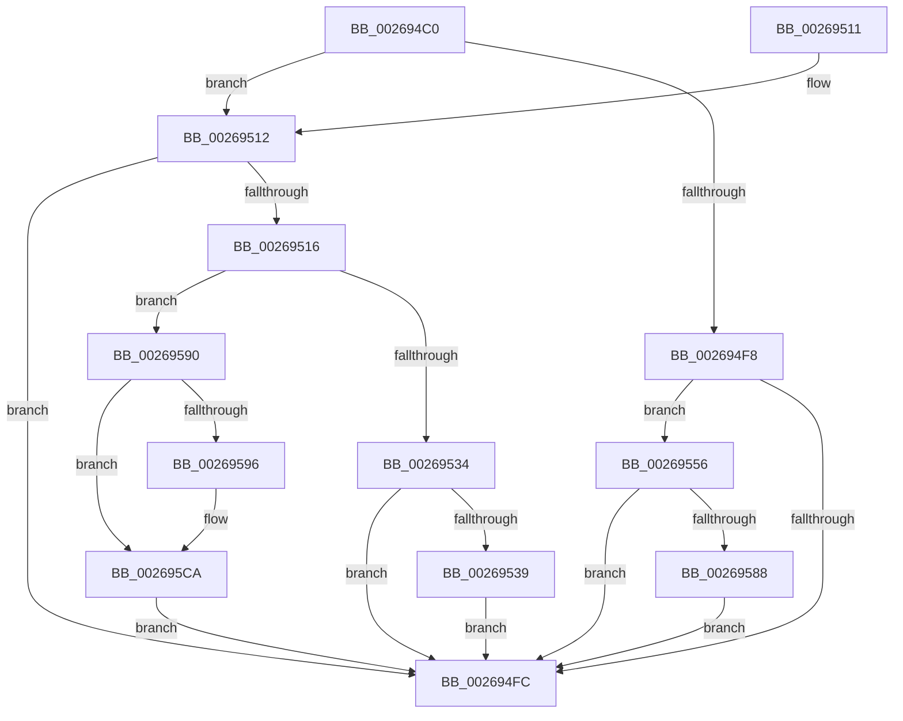

# SmHpBufferProtectEx

- RVA: `0x002694C0`–`0x002695D2` (길이 `274` bytes)
- VA: `0x00000001402694C0`
- 실행 섹션: `.text`
- PDB 이름 있음: `예`; PDB Function 태그: `아니요`
- unwind 정보 RVA: `0x00065338`
- 디코드: `79`개 명령, `274/274` bytes 표시
- 미해석 바이트: `0` (있으면 어셈블리에 `.byte`로 보존)

> 이 문서는 커널 이미지의 기계어와 PDB 기호를 분석해 생성했습니다. 4번과 5번은 함수 원형과 자료형을 바이너리 사용 방식에서 추정한 C 해석이며 원본 소스 복구 결과는 아닙니다.

## 1. Dependencies

- 직접 호출 지점: **6**; 고유 호출 대상: **4**
- 직접 호출자로 확인된 함수: **1**
- RIP 상대 이미지 참조: **0**

### Outgoing calls
- `0x00269521` → [wyhash](wyhash_function_00269FE4.md) (function, `0x00269FE4`)
- `0x0026954B` → [ExProtectPoolEx](ExProtectPoolEx_function_002695D8.md) (function, `0x002695D8`)
- `0x00269568` → [ExProtectPoolEx](ExProtectPoolEx_function_002695D8.md) (function, `0x002695D8`)
- `0x00269578` → [wyhash](wyhash_function_00269FE4.md) (function, `0x00269FE4`)
- `0x002695A6` → [SmPrepareForFatalHeapCorruption](SmPrepareForFatalHeapCorruption_function_00267AC0.md) (function, `0x00267AC0`)
- `0x002695C4` → [KeBugCheckEx](../4F/KeBugCheckEx_function_004FD660.md) (function, `0x004FD660`)

### Direct callers
- [sub_00269110](Unknown_function_00269110.md) at `0x002691C2`

### Static image references
- 디코드된 RIP-relative 메모리 참조가 없습니다.

## 2. Other-region calls and transfers

- 다른 실행 섹션으로 향하는 call: **0**
- 별도 외부 분기/꼬리 이동을 확인하지 못했습니다.

## 3. Assembly (complete function range)

```asm
002694C0  48 89 5C 24 10                  mov qword ptr [rsp + 0x10], rbx
002694C5  48 89 6C 24 18                  mov qword ptr [rsp + 0x18], rbp
002694CA  48 89 4C 24 08                  mov qword ptr [rsp + 8], rcx
002694CF  56                              push rsi
002694D0  57                              push rdi
002694D1  41 56                           push r14
002694D3  48 83 EC 30                     sub rsp, 0x30
002694D7  45 33 F6                        xor r14d, r14d
002694DA  41 8B E9                        mov ebp, r9d
002694DD  41 8B C0                        mov eax, r8d
002694E0  4C 89 74 24 50                  mov qword ptr [rsp + 0x50], r14
002694E5  83 E0 03                        and eax, 3
002694E8  41 8B F8                        mov edi, r8d
002694EB  48 8B F2                        mov rsi, rdx
002694EE  41 8D 5E 01                     lea ebx, [r14 + 1]
002694F2  44 39 72 0C                     cmp dword ptr [rdx + 0xc], r14d
002694F6  75 1A                           jne 0x140269512
002694F8  85 C0                           test eax, eax
002694FA  74 5A                           je 0x140269556
002694FC  48 8B 6C 24 60                  mov rbp, qword ptr [rsp + 0x60]
00269501  8B C3                           mov eax, ebx
00269503  48 8B 5C 24 58                  mov rbx, qword ptr [rsp + 0x58]
00269508  48 83 C4 30                     add rsp, 0x30
0026950C  41 5E                           pop r14
0026950E  5F                              pop rdi
0026950F  5E                              pop rsi
00269510  C3                              ret
00269511  CC                              int3
00269512  85 C0                           test eax, eax
00269514  74 E6                           je 0x1402694fc
00269516  48 8B 0A                        mov rcx, qword ptr [rdx]
00269519  45 33 C0                        xor r8d, r8d
0026951C  BA 00 10 00 00                  mov edx, 0x1000
00269521  E8 BE 0A 00 00                  call 0x140269fe4
00269526  44 8B 46 0C                     mov r8d, dword ptr [rsi + 0xc]
0026952A  85 C0                           test eax, eax
0026952C  0F 44 C3                        cmove eax, ebx
0026952F  41 3B C0                        cmp eax, r8d
00269532  75 5C                           jne 0x140269590
00269534  40 84 FB                        test bl, dil
00269537  74 C3                           je 0x1402694fc
00269539  48 8B 0E                        mov rcx, qword ptr [rsi]
0026953C  41 B9 04 00 00 00               mov r9d, 4
00269542  48 8B D1                        mov rdx, rcx
00269545  41 B8 00 10 00 00               mov r8d, 0x1000
0026954B  E8 88 00 00 00                  call 0x1402695d8
00269550  44 89 76 0C                     mov dword ptr [rsi + 0xc], r14d
00269554  EB A6                           jmp 0x1402694fc
00269556  48 8B 0A                        mov rcx, qword ptr [rdx]
00269559  41 B9 02 00 00 00               mov r9d, 2
0026955F  48 8B D1                        mov rdx, rcx
00269562  41 B8 00 10 00 00               mov r8d, 0x1000
00269568  E8 6B 00 00 00                  call 0x1402695d8
0026956D  48 8B 0E                        mov rcx, qword ptr [rsi]
00269570  45 33 C0                        xor r8d, r8d
00269573  BA 00 10 00 00                  mov edx, 0x1000
00269578  E8 67 0A 00 00                  call 0x140269fe4
0026957D  89 46 0C                        mov dword ptr [rsi + 0xc], eax
00269580  85 C0                           test eax, eax
00269582  0F 85 74 FF FF FF               jne 0x1402694fc
00269588  89 5E 0C                        mov dword ptr [rsi + 0xc], ebx
0026958B  E9 6C FF FF FF                  jmp 0x1402694fc
00269590  40 F6 C7 04                     test dil, 4
00269594  75 34                           jne 0x1402695ca
00269596  48 8D 4C 24 50                  lea rcx, [rsp + 0x50]
0026959B  44 8B C8                        mov r9d, eax
0026959E  48 89 4C 24 20                  mov qword ptr [rsp + 0x20], rcx
002695A3  48 8B 0E                        mov rcx, qword ptr [rsi]
002695A6  E8 15 E5 FF FF                  call 0x140267ac0
002695AB  48 8B 44 24 50                  mov rax, qword ptr [rsp + 0x50]
002695B0  48 8B D5                        mov rdx, rbp
002695B3  44 8B 4E 0C                     mov r9d, dword ptr [rsi + 0xc]
002695B7  B9 C7 01 00 00                  mov ecx, 0x1c7
002695BC  4C 8B 06                        mov r8, qword ptr [rsi]
002695BF  48 89 44 24 20                  mov qword ptr [rsp + 0x20], rax
002695C4  E8 97 40 29 00                  call 0x1404fd660
002695C9  CC                              int3
002695CA  41 8B DE                        mov ebx, r14d
002695CD  E9 2A FF FF FF                  jmp 0x1402694fc
```

## 4. C-style interpretation (structured pseudocode)

```c
__int64 __fastcall SmHpBufferProtectEx(__int64 a1, __int64 a2, int a3, int a4)
{
    __int64 result;
    __int64 v_r14;
    __int64 v_rsp;
    unsigned __int64 v_stack_p10;
    unsigned __int64 v_stack_p18;
    unsigned __int64 v_stack_p20;
    unsigned __int64 v_stack_p50;
    unsigned __int64 v_stack_p8;

    v_stack_p10 = v_rbx;
    v_stack_p18 = v_rbp;
    v_stack_p8 = a1;
    v_rsp = (v_rsp) - (48);
    v_r14 = 0;
    v_stack_p8 = 0;
    result = (unsigned int)(((unsigned int)(a3)) & (3));
    if ((*(unsigned int *)(a2 + 12)) != 0) goto loc_00269512;
    if ((unsigned int)(result) == 0) goto loc_00269556;
loc_002694FC:
    v_rsp = (v_rsp) + (48);
    return (unsigned int)((unsigned int)(v_r14 + 1));
loc_00269512:
    if ((unsigned int)((unsigned int)((unsigned int)(v_r14 + 1))) == 0) goto loc_002694FC;
    a3 = 0;
    result = wyhash(*(unsigned __int64 *)(a2), (unsigned int)(0x1000ULL), a3, a4);
    if ((unsigned int)(result) == 0) { result = (unsigned int)(v_stack_p10); }
    if (((unsigned int)(result)) != ((unsigned int)((unsigned int)(*(unsigned int *)(a2 + 12))))) goto loc_00269590;
    if ((((unsigned __int8)(v_stack_p10)) & ((unsigned __int8)((unsigned int)(a3)))) == 0) goto loc_002694FC;
    result = ExProtectPoolEx(*(unsigned __int64 *)(a2), *(unsigned __int64 *)(a2), (unsigned int)(0x1000ULL), 4);
    *(unsigned int *)(a2 + 12) = 0;
    goto loc_002694FC;
loc_00269556:
    result = ExProtectPoolEx(*(unsigned __int64 *)(*(unsigned __int64 *)(a2)), *(unsigned __int64 *)(*(unsigned __int64 *)(a2)), (unsigned int)(0x1000ULL), 2);
    a3 = 0;
    result = wyhash(*(unsigned __int64 *)(a2), (unsigned int)(0x1000ULL), a3, 2);
    *(unsigned int *)(a2 + 12) = (unsigned int)(result);
    if ((unsigned int)(result) != 0) goto loc_002694FC;
    *(unsigned int *)(a2 + 12) = (unsigned int)(v_stack_p10);
    goto loc_002694FC;
loc_00269590:
    if ((((unsigned __int8)((unsigned int)(a3))) & (4)) == 0) {
        a1 = v_stack_p50;
        a4 = (unsigned int)(result);
        v_stack_p20 = a1;
        a1 = *(unsigned __int64 *)(a2);
        result = SmPrepareForFatalHeapCorruption(a1, (unsigned int)(0x1000ULL), a3, a4);
        result = v_stack_p50;
        a2 = v_stack_p18;
        a4 = *(unsigned int *)(a2 + 12);
        a1 = 455;
        a3 = *(unsigned __int64 *)(a2);
        v_stack_p20 = result;
        result = KeBugCheckEx(a1, a2, a3, a4);
    }
    goto loc_002694FC;
}
```

## 5. (Beta) C Style

```c
int64_t SmHpBufferProtectEx(int64_t Arg1, void *Arg2, int32_t Arg3, int32_t Arg4)
{
    uint8_t *arg2 = (uint8_t *)Arg2;

    int64_t result;
    int64_t local_r14;
    int64_t local_rsp;
    uint64_t v_stack_p10;
    uint64_t v_stack_p18;
    uint64_t v_stack_p20;
    uint64_t v_stack_p50;
    uint64_t v_stack_p8;

    v_stack_p10 = local_rbx;
    v_stack_p18 = local_rbp;
    v_stack_p8 = Arg1;
    local_rsp = (local_rsp) - (48);
    local_r14 = 0;
    v_stack_p8 = 0;
    result = (uint32_t)(((uint32_t)(Arg3)) & (3));
    if ((*(uint32_t *)(arg2 + 0xC)) != 0) goto loc_00269512;
    if ((uint32_t)(result) == 0) goto loc_00269556;
loc_002694FC:
    local_rsp = (local_rsp) + (48);
    return (uint32_t)((uint32_t)(local_r14 + 1));
loc_00269512:
    if ((uint32_t)((uint32_t)((uint32_t)(local_r14 + 1))) == 0) goto loc_002694FC;
    Arg3 = 0;
    result = wyhash(*(uint64_t *)(arg2), (uint32_t)(0x1000ULL), Arg3, Arg4);
    if ((uint32_t)(result) == 0) { result = (uint32_t)(v_stack_p10); }
    if (((uint32_t)(result)) != ((uint32_t)((uint32_t)(*(uint32_t *)(arg2 + 0xC))))) goto loc_00269590;
    if ((((uint8_t)(v_stack_p10)) & ((uint8_t)((uint32_t)(Arg3)))) == 0) goto loc_002694FC;
    result = ExProtectPoolEx(*(uint64_t *)(arg2), *(uint64_t *)(arg2), (uint32_t)(0x1000ULL), 4);
    *(uint32_t *)(arg2 + 0xC) = 0;
    goto loc_002694FC;
loc_00269556:
    result = ExProtectPoolEx(*(uint64_t *)(*(uint64_t *)(arg2)), *(uint64_t *)(*(uint64_t *)(arg2)), (uint32_t)(0x1000ULL), 2);
    Arg3 = 0;
    result = wyhash(*(uint64_t *)(arg2), (uint32_t)(0x1000ULL), Arg3, 2);
    *(uint32_t *)(arg2 + 0xC) = (uint32_t)(result);
    if ((uint32_t)(result) != 0) goto loc_002694FC;
    *(uint32_t *)(arg2 + 0xC) = (uint32_t)(v_stack_p10);
    goto loc_002694FC;
loc_00269590:
    if ((((uint8_t)((uint32_t)(Arg3))) & (4)) == 0) {
        Arg1 = v_stack_p50;
        Arg4 = (uint32_t)(result);
        v_stack_p20 = Arg1;
        Arg1 = *(uint64_t *)(arg2);
        result = SmPrepareForFatalHeapCorruption(Arg1, (uint32_t)(0x1000ULL), Arg3, Arg4);
        result = v_stack_p50;
        Arg2 = v_stack_p18;
        Arg4 = *(uint32_t *)(arg2 + 0xC);
        Arg1 = 455;
        Arg3 = *(uint64_t *)(arg2);
        v_stack_p20 = result;
        result = KeBugCheckEx(Arg1, Arg2, Arg3, Arg4);
    }
    goto loc_002694FC;
}
```

### 관측된 메모리 오프셋

구조체 형식이 확인되지 않은 접근은 인자 기준의 오프셋으로만 기록했습니다.

| 기준 인자 | 오프셋 표현 | 폭 (bit) | 접근 |
|---|---:|---:|---|
| `Arg2` | `+ 0x0` | `64` | `R` |
| `Arg2` | `+ 0xC` | `32` | `R` |
| `Arg2` | `+ 0xC` | `32` | `W` |

## 6. Execution-region graph

[열기: 2D/3D 그래프와 함수 탐색 컨트롤 패널](../../../control-panel.html?section=text&rva=0x002694C0&view=graph)

- 2D 그래프는 위에서 아래로 흐르고, 3D 그래프는 빈 공간을 드래그해 회전합니다. Shift+드래그는 이동, 휠은 확대·축소, 함수 노드 선택은 대상 보고서 이동입니다.

### Static fallback


