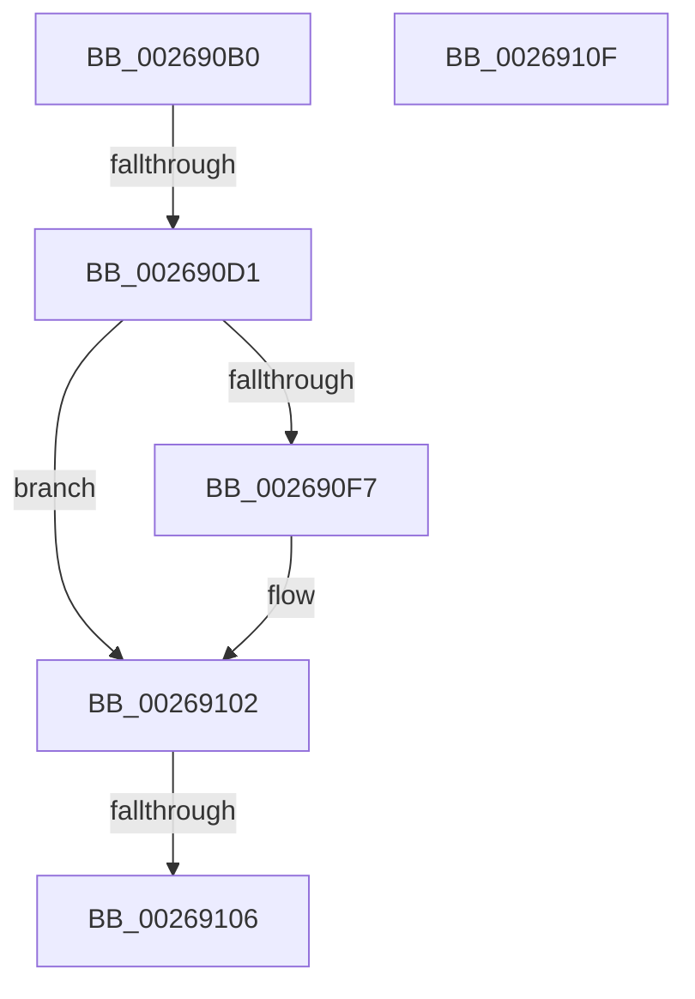

# SmHpBufferUpdateFullness

- RVA: `0x002690B0`–`0x00269110` (길이 `96` bytes)
- VA: `0x00000001402690B0`
- 실행 섹션: `.text`
- PDB 이름 있음: `예`; PDB Function 태그: `아니요`
- unwind 정보 RVA: `0x00065270`
- 디코드: `33`개 명령, `96/96` bytes 표시
- 미해석 바이트: `0` (있으면 어셈블리에 `.byte`로 보존)

> 이 문서는 커널 이미지의 기계어와 PDB 기호를 분석해 생성했습니다. 4번과 5번은 함수 원형과 자료형을 바이너리 사용 방식에서 추정한 C 해석이며 원본 소스 복구 결과는 아닙니다.

## 1. Dependencies

- 직접 호출 지점: **0**; 고유 호출 대상: **0**
- 직접 호출자로 확인된 함수: **2**
- RIP 상대 이미지 참조: **0**

### Outgoing calls
- 직접 디코드된 call 명령이 없습니다.

### Direct callers
- [SmHpBufferAlloc](SmHpBufferAlloc_function_00268F7C.md) at `0x00269029`
- [SmHpBufferCleanup](../3B/SmHpBufferCleanup_function_003B1480.md) at `0x003B149E`

### Static image references
- 디코드된 RIP-relative 메모리 참조가 없습니다.

## 2. Other-region calls and transfers

- 다른 실행 섹션으로 향하는 call: **0**
- call이 아닌 외부 분기/꼬리 이동: **2**
  - `0x002690CB` → [sub_002691F2](Unknown_function_002691F2.md) (`tail-transfer`)
  - `0x00269104` → [sub_00269110](Unknown_function_00269110.md) (`tail-transfer`)

## 3. Assembly (complete function range)

```asm
002690B0  40 53                           push rbx
002690B2  55                              push rbp
002690B3  56                              push rsi
002690B4  57                              push rdi
002690B5  48 83 EC 38                     sub rsp, 0x38
002690B9  0F B7 42 0A                     movzx eax, word ptr [rdx + 0xa]
002690BD  48 8B F2                        mov rsi, rdx
002690C0  48 8B E9                        mov rbp, rcx
002690C3  BB FF FF FF FF                  mov ebx, 0xffffffff
002690C8  66 85 C0                        test ax, ax
002690CB  0F 84 21 01 00 00               je 0x1402691f2
002690D1  0F B6 89 28 02 00 00            movzx ecx, byte ptr [rcx + 0x228]
002690D8  8B F8                           mov edi, eax
002690DA  D3 EF                           shr edi, cl
002690DC  66 41 03 C0                     add ax, r8w
002690E0  66 89 42 0A                     mov word ptr [rdx + 0xa], ax
002690E4  41 0F BF C0                     movsx eax, r8w
002690E8  01 85 30 02 00 00               add dword ptr [rbp + 0x230], eax
002690EE  0F B7 42 0A                     movzx eax, word ptr [rdx + 0xa]
002690F2  66 85 C0                        test ax, ax
002690F5  74 0B                           je 0x140269102
002690F7  0F B6 8D 28 02 00 00            movzx ecx, byte ptr [rbp + 0x228]
002690FE  8B D8                           mov ebx, eax
00269100  D3 EB                           shr ebx, cl
00269102  3B FB                           cmp edi, ebx
00269104  75 0A                           jne 0x140269110
00269106  48 83 C4 38                     add rsp, 0x38
0026910A  5F                              pop rdi
0026910B  5E                              pop rsi
0026910C  5D                              pop rbp
0026910D  5B                              pop rbx
0026910E  C3                              ret
0026910F  CC                              int3
```

## 4. C-style interpretation (structured pseudocode)

```c
__int64 __fastcall SmHpBufferUpdateFullness(__int64 a1, __int64 a2, unsigned __int16 a3)
{
    __int64 result;
    __int64 v_rbx;
    __int64 v_rdi;
    __int64 v_rsp;

    v_rsp = (v_rsp) - (56);
    v_rdi = (unsigned int)(((unsigned int)((unsigned int)(*(unsigned __int16 *)(a2 + 10)))) >> ((unsigned __int8)(*(unsigned __int8 *)(a1 + 552))));
    result = (unsigned __int16)((*(unsigned __int16 *)(a2 + 10)) + (a3));
    *(unsigned __int16 *)(a2 + 10) = (unsigned __int16)(result);
    v_rbx = (unsigned int)(0xFFFFFFFFULL);
    if ((unsigned __int16)(*(unsigned __int16 *)(a2 + 10)) != 0) {
        a1 = *(unsigned __int8 *)(a1 + 552);
        v_rbx = (unsigned int)(*(unsigned __int16 *)(a2 + 10));
        v_rbx = (unsigned int)((v_rbx) >> ((unsigned __int8)(a1)));
    }
    v_rsp = (v_rsp) + (56);
    return *(unsigned __int16 *)(a2 + 10);
}
```

## 5. (Beta) C Style

```c
int64_t SmHpBufferUpdateFullness(void *Arg1, void *Arg2, uint16_t Arg3)
{
    uint8_t *arg1 = (uint8_t *)Arg1;
    uint8_t *arg2 = (uint8_t *)Arg2;

    int64_t result;
    int64_t local_rbx;
    int64_t local_rdi;
    int64_t local_rsp;

    local_rsp = (local_rsp) - (56);
    local_rdi = (uint32_t)(((uint32_t)((uint32_t)(*(uint16_t *)(arg2 + 0xA)))) >> ((uint8_t)(*(uint8_t *)(arg1 + 0x228))));
    result = (uint16_t)((*(uint16_t *)(arg2 + 0xA)) + (Arg3));
    *(uint16_t *)(arg2 + 0xA) = (uint16_t)(result);
    local_rbx = (uint32_t)(0xFFFFFFFFULL);
    if ((uint16_t)(*(uint16_t *)(arg2 + 0xA)) != 0) {
        Arg1 = *(uint8_t *)(arg1 + 0x228);
        local_rbx = (uint32_t)(*(uint16_t *)(arg2 + 0xA));
        local_rbx = (uint32_t)((local_rbx) >> ((uint8_t)(Arg1)));
    }
    local_rsp = (local_rsp) + (56);
    return *(uint16_t *)(arg2 + 0xA);
}
```

### 관측된 메모리 오프셋

구조체 형식이 확인되지 않은 접근은 인자 기준의 오프셋으로만 기록했습니다.

| 기준 인자 | 오프셋 표현 | 폭 (bit) | 접근 |
|---|---:|---:|---|
| `Arg1` | `+ 0x228` | `8` | `R` |
| `Arg1` | `+ 0x230` | `32` | `R/W` |
| `Arg2` | `+ 0xA` | `16` | `R` |
| `Arg2` | `+ 0xA` | `16` | `W` |

## 6. Execution-region graph

[열기: 2D/3D 그래프와 함수 탐색 컨트롤 패널](../../../control-panel.html?section=text&rva=0x002690B0&view=graph)

- 2D 그래프는 위에서 아래로 흐르고, 3D 그래프는 빈 공간을 드래그해 회전합니다. Shift+드래그는 이동, 휠은 확대·축소, 함수 노드 선택은 대상 보고서 이동입니다.

### Static fallback


