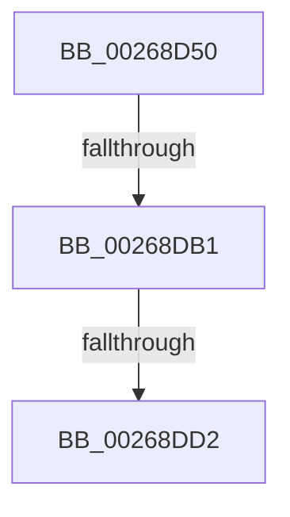

# SmHpChunkFree

- RVA: `0x00268D50`–`0x00268DDD` (길이 `141` bytes)
- VA: `0x0000000140268D50`
- 실행 섹션: `.text`
- PDB 이름 있음: `예`; PDB Function 태그: `아니요`
- unwind 정보 RVA: `0x00065208`
- 디코드: `40`개 명령, `141/141` bytes 표시
- 미해석 바이트: `0` (있으면 어셈블리에 `.byte`로 보존)

> 이 문서는 커널 이미지의 기계어와 PDB 기호를 분석해 생성했습니다. 4번과 5번은 함수 원형과 자료형을 바이너리 사용 방식에서 추정한 C 해석이며 원본 소스 복구 결과는 아닙니다.

## 1. Dependencies

- 직접 호출 지점: **0**; 고유 호출 대상: **0**
- 직접 호출자로 확인된 함수: **4**
- RIP 상대 이미지 참조: **0**

### Outgoing calls
- 직접 디코드된 call 명령이 없습니다.

### Direct callers
- [ST_STORE&lt;SM_TRAITS&gt;::StDmPageRemove](../20/ST_STORE_SM_TRAITS_StDmPageRemove_function_002049A0.md) at `0x00204D77`
- [ST_STORE&lt;SM_TRAITS&gt;::StDmpSinglePageAdd](../20/ST_STORE_SM_TRAITS_StDmpSinglePageAdd_function_0020502C.md) at `0x0020539B`
- [ST_STORE&lt;SM_TRAITS&gt;::StDmCleanup](../3A/ST_STORE_SM_TRAITS_StDmCleanup_function_003AF8D4.md) at `0x003AFB4E`
- [ST_STORE&lt;SM_TRAITS&gt;::StDmCombinePageEntry](../41/ST_STORE_SM_TRAITS_StDmCombinePageEntry_function_00410D40.md) at `0x00410EB8`

### Static image references
- 디코드된 RIP-relative 메모리 참조가 없습니다.

## 2. Other-region calls and transfers

- 다른 실행 섹션으로 향하는 call: **0**
- call이 아닌 외부 분기/꼬리 이동: **2**
  - `0x00268DAB` → [sub_00268EB6](Unknown_function_00268EB6.md) (`tail-transfer`)
  - `0x00268DD0` → [sub_00268DDD](Unknown_function_00268DDD.md) (`tail-transfer`)

## 3. Assembly (complete function range)

```asm
00268D50  48 89 5C 24 18                  mov qword ptr [rsp + 0x18], rbx
00268D55  55                              push rbp
00268D56  56                              push rsi
00268D57  57                              push rdi
00268D58  41 54                           push r12
00268D5A  41 56                           push r14
00268D5C  48 83 EC 30                     sub rsp, 0x30
00268D60  48 8B C2                        mov rax, rdx
00268D63  45 33 F6                        xor r14d, r14d
00268D66  48 25 00 F0 FF FF               and rax, 0xfffffffffffff000
00268D6C  44 89 74 24 60                  mov dword ptr [rsp + 0x60], r14d
00268D71  48 8B D9                        mov rbx, rcx
00268D74  41 BC 01 00 00 00               mov r12d, 1
00268D7A  41 8B FC                        mov edi, r12d
00268D7D  41 8D 76 FF                     lea esi, [r14 - 1]
00268D81  44 8B 40 10                     mov r8d, dword ptr [rax + 0x10]
00268D85  41 0F BD C8                     bsr ecx, r8d
00268D89  D3 E7                           shl edi, cl
00268D8B  49 33 F8                        xor rdi, r8
00268D8E  48 C1 E7 04                     shl rdi, 4
00268D92  48 03 3C CB                     add rdi, qword ptr [rbx + rcx*8]
00268D96  0F B7 47 08                     movzx eax, word ptr [rdi + 8]
00268D9A  66 89 02                        mov word ptr [rdx], ax
00268D9D  66 2B 17                        sub dx, word ptr [rdi]
00268DA0  0F B7 47 0A                     movzx eax, word ptr [rdi + 0xa]
00268DA4  66 89 57 08                     mov word ptr [rdi + 8], dx
00268DA8  66 85 C0                        test ax, ax
00268DAB  0F 84 05 01 00 00               je 0x140268eb6
00268DB1  0F B6 8B 28 02 00 00            movzx ecx, byte ptr [rbx + 0x228]
00268DB8  8B E8                           mov ebp, eax
00268DBA  D3 ED                           shr ebp, cl
00268DBC  66 FF C0                        inc ax
00268DBF  66 89 47 0A                     mov word ptr [rdi + 0xa], ax
00268DC3  FF 83 30 02 00 00               inc dword ptr [rbx + 0x230]
00268DC9  0F B7 47 0A                     movzx eax, word ptr [rdi + 0xa]
00268DCD  66 85 C0                        test ax, ax
00268DD0  74 0B                           je 0x140268ddd
00268DD2  0F B6 8B 28 02 00 00            movzx ecx, byte ptr [rbx + 0x228]
00268DD9  8B F0                           mov esi, eax
00268DDB  D3 EE                           shr esi, cl
```

## 4. C-style interpretation (structured pseudocode)

```c
__int64 __fastcall SmHpChunkFree(__int64 a1, __int64 a2)
{
    __int64 result;
    __int64 v_r14;
    __int64 v_rbp;
    __int64 v_rdi;
    __int64 v_rsi;
    __int64 v_rsp;
    unsigned __int64 v_stack_p18;
    unsigned int v_stack_p8;

    v_stack_p18 = v_rbx;
    v_rsp = (v_rsp) - (48);
    v_r14 = 0;
    result = (a2) & (0xFFFFFFFFFFFFF000ULL);
    v_stack_p8 = 0;
    v_rdi = (unsigned int)((1) << ((unsigned __int8)(a1)));
    v_rdi = (v_rdi) ^ ((unsigned int)(*(unsigned int *)(result + 16)));
    v_rdi = (v_rdi) << (4);
    v_rdi = (v_rdi) + (*(unsigned __int64 *)(a1 + a1 * 8));
    *(unsigned __int16 *)(a2) = (unsigned __int16)(*(unsigned __int16 *)(v_rdi + 8));
    a2 = (unsigned __int16)((a2) - (*(unsigned __int16 *)(v_rdi)));
    *(unsigned __int16 *)(v_rdi + 8) = (unsigned __int16)(a2);
    v_rbp = (unsigned int)(((unsigned int)((unsigned int)(*(unsigned __int16 *)(v_rdi + 10)))) >> ((unsigned __int8)(*(unsigned __int8 *)(a1 + 552))));
    result = (unsigned __int16)((*(unsigned __int16 *)(v_rdi + 10)) + 1);
    *(unsigned __int16 *)(v_rdi + 10) = (unsigned __int16)(result);
    v_rsi = (unsigned int)(((unsigned int)((unsigned int)(*(unsigned __int16 *)(v_rdi + 10)))) >> ((unsigned __int8)(*(unsigned __int8 *)(a1 + 552))));
    return *(unsigned __int16 *)(v_rdi + 10);
}
```

## 5. (Beta) C Style

```c
int64_t SmHpChunkFree(void *Arg1, void *Arg2)
{
    uint8_t *arg1 = (uint8_t *)Arg1;
    uint8_t *arg2 = (uint8_t *)Arg2;

    int64_t result;
    int64_t local_r14;
    int64_t local_rbp;
    int64_t local_rdi;
    int64_t local_rsi;
    int64_t local_rsp;
    uint64_t v_stack_p18;
    uint32_t v_stack_p8;

    v_stack_p18 = local_rbx;
    local_rsp = (local_rsp) - (48);
    local_r14 = 0;
    result = (Arg2) & (0xFFFFFFFFFFFFF000ULL);
    v_stack_p8 = 0;
    local_rdi = (uint32_t)((1) << ((uint8_t)(Arg1)));
    local_rdi = (local_rdi) ^ ((uint32_t)(*(uint32_t *)(result + 0x10)));
    local_rdi = (local_rdi) << (4);
    local_rdi = (local_rdi) + (*(uint64_t *)(arg1 + arg1 * 8));
    *(uint16_t *)(arg2) = (uint16_t)(*(uint16_t *)(local_rdi + 0x8));
    Arg2 = (uint16_t)((Arg2) - (*(uint16_t *)(local_rdi)));
    *(uint16_t *)(local_rdi + 0x8) = (uint16_t)(Arg2);
    local_rbp = (uint32_t)(((uint32_t)((uint32_t)(*(uint16_t *)(local_rdi + 0xA)))) >> ((uint8_t)(*(uint8_t *)(arg1 + 0x228))));
    result = (uint16_t)((*(uint16_t *)(local_rdi + 0xA)) + 1);
    *(uint16_t *)(local_rdi + 0xA) = (uint16_t)(result);
    local_rsi = (uint32_t)(((uint32_t)((uint32_t)(*(uint16_t *)(local_rdi + 0xA)))) >> ((uint8_t)(*(uint8_t *)(arg1 + 0x228))));
    return *(uint16_t *)(local_rdi + 0xA);
}
```

### 관측된 메모리 오프셋

구조체 형식이 확인되지 않은 접근은 인자 기준의 오프셋으로만 기록했습니다.

| 기준 인자 | 오프셋 표현 | 폭 (bit) | 접근 |
|---|---:|---:|---|
| `Arg1` | `+ 0x0 + rcx*8` | `64` | `R` |
| `Arg1` | `+ 0x228` | `8` | `R` |
| `Arg1` | `+ 0x230` | `32` | `R/W` |
| `Arg2` | `+ 0x0` | `16` | `W` |
| `Arg2` | `+ 0x10` | `32` | `R` |

## 6. Execution-region graph

[열기: 2D/3D 그래프와 함수 탐색 컨트롤 패널](../../../control-panel.html?section=text&rva=0x00268D50&view=graph)

- 2D 그래프는 위에서 아래로 흐르고, 3D 그래프는 빈 공간을 드래그해 회전합니다. Shift+드래그는 이동, 휠은 확대·축소, 함수 노드 선택은 대상 보고서 이동입니다.

### Static fallback


