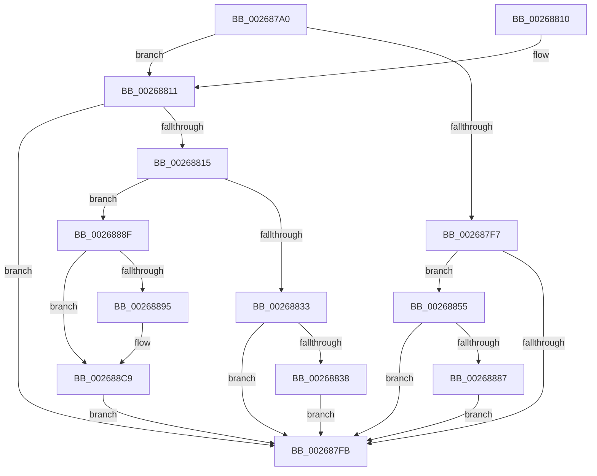

# SmHpChunkUnprotect

- RVA: `0x002687A0`–`0x002688D1` (길이 `305` bytes)
- VA: `0x00000001402687A0`
- 실행 섹션: `.text`
- PDB 이름 있음: `예`; PDB Function 태그: `아니요`
- unwind 정보 RVA: `0x00065178`
- 디코드: `87`개 명령, `305/305` bytes 표시
- 미해석 바이트: `0` (있으면 어셈블리에 `.byte`로 보존)

> 이 문서는 커널 이미지의 기계어와 PDB 기호를 분석해 생성했습니다. 4번과 5번은 함수 원형과 자료형을 바이너리 사용 방식에서 추정한 C 해석이며 원본 소스 복구 결과는 아닙니다.

## 1. Dependencies

- 직접 호출 지점: **6**; 고유 호출 대상: **4**
- 직접 호출자로 확인된 함수: **1**
- RIP 상대 이미지 참조: **0**

### Outgoing calls
- `0x00268820` → [wyhash](wyhash_function_00269FE4.md) (function, `0x00269FE4`)
- `0x0026884A` → [ExProtectPoolEx](ExProtectPoolEx_function_002695D8.md) (function, `0x002695D8`)
- `0x00268867` → [ExProtectPoolEx](ExProtectPoolEx_function_002695D8.md) (function, `0x002695D8`)
- `0x00268877` → [wyhash](wyhash_function_00269FE4.md) (function, `0x00269FE4`)
- `0x002688A5` → [SmPrepareForFatalHeapCorruption](SmPrepareForFatalHeapCorruption_function_00267AC0.md) (function, `0x00267AC0`)
- `0x002688C3` → [KeBugCheckEx](../4F/KeBugCheckEx_function_004FD660.md) (function, `0x004FD660`)

### Direct callers
- [ST_STORE&lt;SM_TRAITS&gt;::StDmHandleDecompressionFailure](../60/ST_STORE_SM_TRAITS_StDmHandleDecompressionFailure_function_0060DA74.md) at `0x0060DBB0`

### Static image references
- 디코드된 RIP-relative 메모리 참조가 없습니다.

## 2. Other-region calls and transfers

- 다른 실행 섹션으로 향하는 call: **0**
- 별도 외부 분기/꼬리 이동을 확인하지 못했습니다.

## 3. Assembly (complete function range)

```asm
002687A0  48 89 5C 24 10                  mov qword ptr [rsp + 0x10], rbx
002687A5  48 89 6C 24 18                  mov qword ptr [rsp + 0x18], rbp
002687AA  56                              push rsi
002687AB  57                              push rdi
002687AC  41 56                           push r14
002687AE  48 83 EC 30                     sub rsp, 0x30
002687B2  48 81 E2 00 F0 FF FF            and rdx, 0xfffffffffffff000
002687B9  41 8B E9                        mov ebp, r9d
002687BC  45 33 F6                        xor r14d, r14d
002687BF  4C 8B D9                        mov r11, rcx
002687C2  BB 01 00 00 00                  mov ebx, 1
002687C7  44 89 74 24 50                  mov dword ptr [rsp + 0x50], r14d
002687CC  8B FB                           mov edi, ebx
002687CE  4C 89 74 24 50                  mov qword ptr [rsp + 0x50], r14
002687D3  44 8B 52 10                     mov r10d, dword ptr [rdx + 0x10]
002687D7  41 8B C0                        mov eax, r8d
002687DA  41 0F BD CA                     bsr ecx, r10d
002687DE  83 E0 03                        and eax, 3
002687E1  41 8B F0                        mov esi, r8d
002687E4  D3 E7                           shl edi, cl
002687E6  49 33 FA                        xor rdi, r10
002687E9  48 C1 E7 04                     shl rdi, 4
002687ED  49 03 3C CB                     add rdi, qword ptr [r11 + rcx*8]
002687F1  44 39 77 0C                     cmp dword ptr [rdi + 0xc], r14d
002687F5  75 1A                           jne 0x140268811
002687F7  85 C0                           test eax, eax
002687F9  74 5A                           je 0x140268855
002687FB  48 8B 6C 24 60                  mov rbp, qword ptr [rsp + 0x60]
00268800  8B C3                           mov eax, ebx
00268802  48 8B 5C 24 58                  mov rbx, qword ptr [rsp + 0x58]
00268807  48 83 C4 30                     add rsp, 0x30
0026880B  41 5E                           pop r14
0026880D  5F                              pop rdi
0026880E  5E                              pop rsi
0026880F  C3                              ret
00268810  CC                              int3
00268811  85 C0                           test eax, eax
00268813  74 E6                           je 0x1402687fb
00268815  48 8B 0F                        mov rcx, qword ptr [rdi]
00268818  45 33 C0                        xor r8d, r8d
0026881B  BA 00 10 00 00                  mov edx, 0x1000
00268820  E8 BF 17 00 00                  call 0x140269fe4
00268825  44 8B 47 0C                     mov r8d, dword ptr [rdi + 0xc]
00268829  85 C0                           test eax, eax
0026882B  0F 44 C3                        cmove eax, ebx
0026882E  41 3B C0                        cmp eax, r8d
00268831  75 5C                           jne 0x14026888f
00268833  40 84 F3                        test bl, sil
00268836  74 C3                           je 0x1402687fb
00268838  48 8B 0F                        mov rcx, qword ptr [rdi]
0026883B  41 B9 04 00 00 00               mov r9d, 4
00268841  48 8B D1                        mov rdx, rcx
00268844  41 B8 00 10 00 00               mov r8d, 0x1000
0026884A  E8 89 0D 00 00                  call 0x1402695d8
0026884F  44 89 77 0C                     mov dword ptr [rdi + 0xc], r14d
00268853  EB A6                           jmp 0x1402687fb
00268855  48 8B 0F                        mov rcx, qword ptr [rdi]
00268858  41 B9 02 00 00 00               mov r9d, 2
0026885E  48 8B D1                        mov rdx, rcx
00268861  41 B8 00 10 00 00               mov r8d, 0x1000
00268867  E8 6C 0D 00 00                  call 0x1402695d8
0026886C  48 8B 0F                        mov rcx, qword ptr [rdi]
0026886F  45 33 C0                        xor r8d, r8d
00268872  BA 00 10 00 00                  mov edx, 0x1000
00268877  E8 68 17 00 00                  call 0x140269fe4
0026887C  89 47 0C                        mov dword ptr [rdi + 0xc], eax
0026887F  85 C0                           test eax, eax
00268881  0F 85 74 FF FF FF               jne 0x1402687fb
00268887  89 5F 0C                        mov dword ptr [rdi + 0xc], ebx
0026888A  E9 6C FF FF FF                  jmp 0x1402687fb
0026888F  40 F6 C6 04                     test sil, 4
00268893  75 34                           jne 0x1402688c9
00268895  48 8D 4C 24 50                  lea rcx, [rsp + 0x50]
0026889A  44 8B C8                        mov r9d, eax
0026889D  48 89 4C 24 20                  mov qword ptr [rsp + 0x20], rcx
002688A2  48 8B 0F                        mov rcx, qword ptr [rdi]
002688A5  E8 16 F2 FF FF                  call 0x140267ac0
002688AA  48 8B 44 24 50                  mov rax, qword ptr [rsp + 0x50]
002688AF  48 8B D5                        mov rdx, rbp
002688B2  44 8B 4F 0C                     mov r9d, dword ptr [rdi + 0xc]
002688B6  B9 C7 01 00 00                  mov ecx, 0x1c7
002688BB  4C 8B 07                        mov r8, qword ptr [rdi]
002688BE  48 89 44 24 20                  mov qword ptr [rsp + 0x20], rax
002688C3  E8 98 4D 29 00                  call 0x1404fd660
002688C8  CC                              int3
002688C9  41 8B DE                        mov ebx, r14d
002688CC  E9 2A FF FF FF                  jmp 0x1402687fb
```

## 4. C-style interpretation (structured pseudocode)

```c
__int64 __fastcall SmHpChunkUnprotect(__int64 a1, __int64 a2, int a3, int a4)
{
    __int64 result;
    __int64 v_r14;
    __int64 v_rdi;
    __int64 v_rsp;
    unsigned __int64 v_stack_p10;
    unsigned __int64 v_stack_p18;
    unsigned __int64 v_stack_p20;
    unsigned __int64 v_stack_p50;
    unsigned int v_stack_p8;

    v_stack_p10 = v_rbx;
    v_stack_p18 = v_rbp;
    v_rsp = (v_rsp) - (48);
    a2 = (a2) & (0xFFFFFFFFFFFFF000ULL);
    v_r14 = 0;
    v_stack_p8 = 0;
    v_stack_p8 = 0;
    result = (unsigned int)(((unsigned int)(a3)) & (3));
    v_rdi = (unsigned int)((1) << ((unsigned __int8)(a1)));
    v_rdi = (v_rdi) ^ ((unsigned int)(*(unsigned int *)(a2 + 16)));
    v_rdi = (v_rdi) << (4);
    v_rdi = (v_rdi) + (*(unsigned __int64 *)(a1 + a1 * 8));
    if ((*(unsigned int *)(v_rdi + 12)) != 0) goto loc_00268811;
    if ((unsigned int)(result) == 0) goto loc_00268855;
loc_002687FB:
    v_rsp = (v_rsp) + (48);
    return 1;
loc_00268811:
    if (1 == 0) goto loc_002687FB;
    a3 = 0;
    result = wyhash(*(unsigned __int64 *)(v_rdi), (unsigned int)(0x1000ULL), a3, a4);
    if ((unsigned int)(result) == 0) { result = (unsigned int)(v_stack_p10); }
    if (((unsigned int)(result)) != ((unsigned int)((unsigned int)(*(unsigned int *)(v_rdi + 12))))) goto loc_0026888F;
    if ((((unsigned __int8)(v_stack_p10)) & ((unsigned __int8)((unsigned int)(a3)))) == 0) goto loc_002687FB;
    result = ExProtectPoolEx(*(unsigned __int64 *)(v_rdi), *(unsigned __int64 *)(v_rdi), (unsigned int)(0x1000ULL), 4);
    *(unsigned int *)(v_rdi + 12) = 0;
    goto loc_002687FB;
loc_00268855:
    result = ExProtectPoolEx(*(unsigned __int64 *)(v_rdi), *(unsigned __int64 *)(v_rdi), (unsigned int)(0x1000ULL), 2);
    a3 = 0;
    result = wyhash(*(unsigned __int64 *)(v_rdi), (unsigned int)(0x1000ULL), a3, 2);
    *(unsigned int *)(v_rdi + 12) = (unsigned int)(result);
    if ((unsigned int)(result) != 0) goto loc_002687FB;
    *(unsigned int *)(v_rdi + 12) = (unsigned int)(v_stack_p10);
    goto loc_002687FB;
loc_0026888F:
    if ((((unsigned __int8)((unsigned int)(a3))) & (4)) == 0) {
        a1 = v_stack_p50;
        a4 = (unsigned int)(result);
        v_stack_p20 = a1;
        a1 = *(unsigned __int64 *)(v_rdi);
        result = SmPrepareForFatalHeapCorruption(a1, (unsigned int)(0x1000ULL), a3, a4);
        result = v_stack_p50;
        a2 = v_stack_p18;
        a4 = *(unsigned int *)(v_rdi + 12);
        a1 = 455;
        a3 = *(unsigned __int64 *)(v_rdi);
        v_stack_p20 = result;
        result = KeBugCheckEx(a1, a2, a3, a4);
    }
    goto loc_002687FB;
}
```

## 5. (Beta) C Style

```c
int64_t SmHpChunkUnprotect(void *Arg1, void *Arg2, int32_t Arg3, int32_t Arg4)
{
    uint8_t *arg1 = (uint8_t *)Arg1;
    uint8_t *arg2 = (uint8_t *)Arg2;

    int64_t result;
    int64_t local_r14;
    int64_t local_rdi;
    int64_t local_rsp;
    uint64_t v_stack_p10;
    uint64_t v_stack_p18;
    uint64_t v_stack_p20;
    uint64_t v_stack_p50;
    uint32_t v_stack_p8;

    v_stack_p10 = local_rbx;
    v_stack_p18 = local_rbp;
    local_rsp = (local_rsp) - (48);
    Arg2 = (Arg2) & (0xFFFFFFFFFFFFF000ULL);
    local_r14 = 0;
    v_stack_p8 = 0;
    v_stack_p8 = 0;
    result = (uint32_t)(((uint32_t)(Arg3)) & (3));
    local_rdi = (uint32_t)((1) << ((uint8_t)(Arg1)));
    local_rdi = (local_rdi) ^ ((uint32_t)(*(uint32_t *)(arg2 + 0x10)));
    local_rdi = (local_rdi) << (4);
    local_rdi = (local_rdi) + (*(uint64_t *)(arg1 + arg1 * 8));
    if ((*(uint32_t *)(local_rdi + 0xC)) != 0) goto loc_00268811;
    if ((uint32_t)(result) == 0) goto loc_00268855;
loc_002687FB:
    local_rsp = (local_rsp) + (48);
    return 1;
loc_00268811:
    if (1 == 0) goto loc_002687FB;
    Arg3 = 0;
    result = wyhash(*(uint64_t *)(local_rdi), (uint32_t)(0x1000ULL), Arg3, Arg4);
    if ((uint32_t)(result) == 0) { result = (uint32_t)(v_stack_p10); }
    if (((uint32_t)(result)) != ((uint32_t)((uint32_t)(*(uint32_t *)(local_rdi + 0xC))))) goto loc_0026888F;
    if ((((uint8_t)(v_stack_p10)) & ((uint8_t)((uint32_t)(Arg3)))) == 0) goto loc_002687FB;
    result = ExProtectPoolEx(*(uint64_t *)(local_rdi), *(uint64_t *)(local_rdi), (uint32_t)(0x1000ULL), 4);
    *(uint32_t *)(local_rdi + 0xC) = 0;
    goto loc_002687FB;
loc_00268855:
    result = ExProtectPoolEx(*(uint64_t *)(local_rdi), *(uint64_t *)(local_rdi), (uint32_t)(0x1000ULL), 2);
    Arg3 = 0;
    result = wyhash(*(uint64_t *)(local_rdi), (uint32_t)(0x1000ULL), Arg3, 2);
    *(uint32_t *)(local_rdi + 0xC) = (uint32_t)(result);
    if ((uint32_t)(result) != 0) goto loc_002687FB;
    *(uint32_t *)(local_rdi + 0xC) = (uint32_t)(v_stack_p10);
    goto loc_002687FB;
loc_0026888F:
    if ((((uint8_t)((uint32_t)(Arg3))) & (4)) == 0) {
        Arg1 = v_stack_p50;
        Arg4 = (uint32_t)(result);
        v_stack_p20 = Arg1;
        Arg1 = *(uint64_t *)(local_rdi);
        result = SmPrepareForFatalHeapCorruption(Arg1, (uint32_t)(0x1000ULL), Arg3, Arg4);
        result = v_stack_p50;
        Arg2 = v_stack_p18;
        Arg4 = *(uint32_t *)(local_rdi + 0xC);
        Arg1 = 455;
        Arg3 = *(uint64_t *)(local_rdi);
        v_stack_p20 = result;
        result = KeBugCheckEx(Arg1, Arg2, Arg3, Arg4);
    }
    goto loc_002687FB;
}
```

### 관측된 메모리 오프셋

구조체 형식이 확인되지 않은 접근은 인자 기준의 오프셋으로만 기록했습니다.

| 기준 인자 | 오프셋 표현 | 폭 (bit) | 접근 |
|---|---:|---:|---|
| `Arg1` | `+ 0x0 + rcx*8` | `64` | `R` |
| `Arg2` | `+ 0x10` | `32` | `R` |

## 6. Execution-region graph

[열기: 2D/3D 그래프와 함수 탐색 컨트롤 패널](../../../control-panel.html?section=text&rva=0x002687A0&view=graph)

- 2D 그래프는 위에서 아래로 흐르고, 3D 그래프는 빈 공간을 드래그해 회전합니다. Shift+드래그는 이동, 휠은 확대·축소, 함수 노드 선택은 대상 보고서 이동입니다.

### Static fallback


