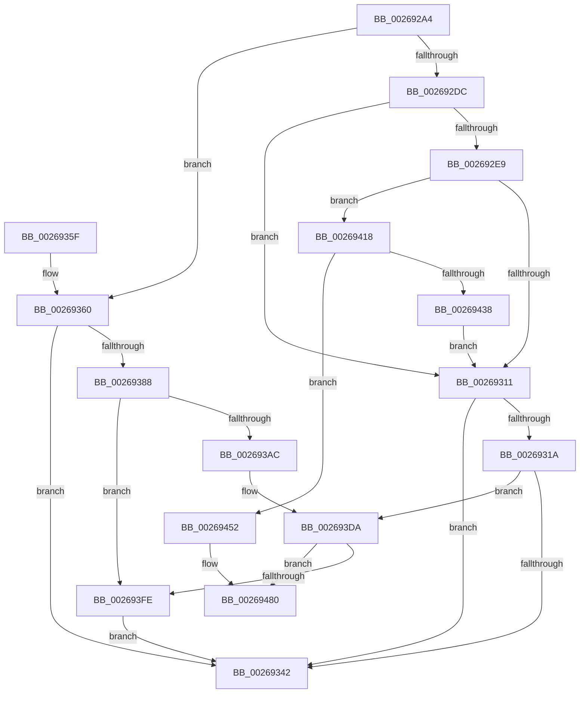

# SmHpUnprotectListNeighbors

- RVA: `0x002692A4`–`0x002694AE` (길이 `522` bytes)
- VA: `0x00000001402692A4`
- 실행 섹션: `.text`
- PDB 이름 있음: `예`; PDB Function 태그: `아니요`
- unwind 정보 RVA: `0x00065318`
- 디코드: `148`개 명령, `522/522` bytes 표시
- 미해석 바이트: `0` (있으면 어셈블리에 `.byte`로 보존)

> 이 문서는 커널 이미지의 기계어와 PDB 기호를 분석해 생성했습니다. 4번과 5번은 함수 원형과 자료형을 바이너리 사용 방식에서 추정한 C 해석이며 원본 소스 복구 결과는 아닙니다.

## 1. Dependencies

- 직접 호출 지점: **11**; 고유 호출 대상: **4**
- 직접 호출자로 확인된 함수: **3**
- RIP 상대 이미지 참조: **0**

### Outgoing calls
- `0x00269395` → [wyhash](wyhash_function_00269FE4.md) (function, `0x00269FE4`)
- `0x002693B8` → [SmPrepareForFatalHeapCorruption](SmPrepareForFatalHeapCorruption_function_00267AC0.md) (function, `0x00267AC0`)
- `0x002693D4` → [KeBugCheckEx](../4F/KeBugCheckEx_function_004FD660.md) (function, `0x004FD660`)
- `0x002693E3` → [wyhash](wyhash_function_00269FE4.md) (function, `0x00269FE4`)
- `0x0026940A` → [ExProtectPoolEx](ExProtectPoolEx_function_002695D8.md) (function, `0x002695D8`)
- `0x00269421` → [wyhash](wyhash_function_00269FE4.md) (function, `0x00269FE4`)
- `0x00269444` → [ExProtectPoolEx](ExProtectPoolEx_function_002695D8.md) (function, `0x002695D8`)
- `0x0026945E` → [SmPrepareForFatalHeapCorruption](SmPrepareForFatalHeapCorruption_function_00267AC0.md) (function, `0x00267AC0`)
- `0x0026947A` → [KeBugCheckEx](../4F/KeBugCheckEx_function_004FD660.md) (function, `0x004FD660`)
- `0x0026948C` → [SmPrepareForFatalHeapCorruption](SmPrepareForFatalHeapCorruption_function_00267AC0.md) (function, `0x00267AC0`)
- `0x002694A8` → [KeBugCheckEx](../4F/KeBugCheckEx_function_004FD660.md) (function, `0x004FD660`)

### Direct callers
- [sub_002689C7](Unknown_function_002689C7.md) at `0x002689F4`
- [sub_002689C7](Unknown_function_002689C7.md) at `0x00268A49`
- [sub_00268DDD](Unknown_function_00268DDD.md) at `0x00268E40`
- [sub_00268DDD](Unknown_function_00268DDD.md) at `0x00268E95`
- [sub_00269110](Unknown_function_00269110.md) at `0x00269154`

### Static image references
- 디코드된 RIP-relative 메모리 참조가 없습니다.

## 2. Other-region calls and transfers

- 다른 실행 섹션으로 향하는 call: **0**
- 별도 외부 분기/꼬리 이동을 확인하지 못했습니다.

## 3. Assembly (complete function range)

```asm
002692A4  48 89 5C 24 08                  mov qword ptr [rsp + 8], rbx
002692A9  48 89 74 24 10                  mov qword ptr [rsp + 0x10], rsi
002692AE  48 89 7C 24 20                  mov qword ptr [rsp + 0x20], rdi
002692B3  55                              push rbp
002692B4  41 54                           push r12
002692B6  41 55                           push r13
002692B8  41 56                           push r14
002692BA  41 57                           push r15
002692BC  48 8B EC                        mov rbp, rsp
002692BF  48 83 EC 30                     sub rsp, 0x30
002692C3  45 33 ED                        xor r13d, r13d
002692C6  49 8B F0                        mov rsi, r8
002692C9  4C 8B FA                        mov r15, rdx
002692CC  4C 8B E1                        mov r12, rcx
002692CF  45 8D 75 01                     lea r14d, [r13 + 1]
002692D3  4D 85 C0                        test r8, r8
002692D6  0F 84 84 00 00 00               je 0x140269360
002692DC  49 8B 00                        mov rax, qword ptr [r8]
002692DF  BF 00 10 00 00                  mov edi, 0x1000
002692E4  48 3B C2                        cmp rax, rdx
002692E7  74 28                           je 0x140269311
002692E9  8B 50 10                        mov edx, dword ptr [rax + 0x10]
002692EC  41 8B DE                        mov ebx, r14d
002692EF  0F BD CA                        bsr ecx, edx
002692F2  44 89 6D 40                     mov dword ptr [rbp + 0x40], r13d
002692F6  D3 E3                           shl ebx, cl
002692F8  48 33 DA                        xor rbx, rdx
002692FB  4C 89 6D 40                     mov qword ptr [rbp + 0x40], r13
002692FF  48 C1 E3 04                     shl rbx, 4
00269303  49 03 1C CC                     add rbx, qword ptr [r12 + rcx*8]
00269307  44 39 6B 0C                     cmp dword ptr [rbx + 0xc], r13d
0026930B  0F 85 07 01 00 00               jne 0x140269418
00269311  48 8B 46 08                     mov rax, qword ptr [rsi + 8]
00269315  49 3B C7                        cmp rax, r15
00269318  74 28                           je 0x140269342
0026931A  8B 50 10                        mov edx, dword ptr [rax + 0x10]
0026931D  41 8B DE                        mov ebx, r14d
00269320  0F BD CA                        bsr ecx, edx
00269323  44 89 6D 40                     mov dword ptr [rbp + 0x40], r13d
00269327  D3 E3                           shl ebx, cl
00269329  48 33 DA                        xor rbx, rdx
0026932C  4C 89 6D 40                     mov qword ptr [rbp + 0x40], r13
00269330  48 C1 E3 04                     shl rbx, 4
00269334  49 03 1C CC                     add rbx, qword ptr [r12 + rcx*8]
00269338  44 39 6B 0C                     cmp dword ptr [rbx + 0xc], r13d
0026933C  0F 85 98 00 00 00               jne 0x1402693da
00269342  48 8B 5C 24 60                  mov rbx, qword ptr [rsp + 0x60]
00269347  48 8B 74 24 68                  mov rsi, qword ptr [rsp + 0x68]
0026934C  48 8B 7C 24 78                  mov rdi, qword ptr [rsp + 0x78]
00269351  48 83 C4 30                     add rsp, 0x30
00269355  41 5F                           pop r15
00269357  41 5E                           pop r14
00269359  41 5D                           pop r13
0026935B  41 5C                           pop r12
0026935D  5D                              pop rbp
0026935E  C3                              ret
0026935F  CC                              int3
00269360  48 8B 42 08                     mov rax, qword ptr [rdx + 8]
00269364  41 8B DE                        mov ebx, r14d
00269367  44 89 6D 40                     mov dword ptr [rbp + 0x40], r13d
0026936B  4C 89 6D 40                     mov qword ptr [rbp + 0x40], r13
0026936F  8B 50 10                        mov edx, dword ptr [rax + 0x10]
00269372  0F BD CA                        bsr ecx, edx
00269375  D3 E3                           shl ebx, cl
00269377  48 33 DA                        xor rbx, rdx
0026937A  48 C1 E3 04                     shl rbx, 4
0026937E  49 03 1C CC                     add rbx, qword ptr [r12 + rcx*8]
00269382  44 39 6B 0C                     cmp dword ptr [rbx + 0xc], r13d
00269386  74 BA                           je 0x140269342
00269388  48 8B 0B                        mov rcx, qword ptr [rbx]
0026938B  BF 00 10 00 00                  mov edi, 0x1000
00269390  8B D7                           mov edx, edi
00269392  45 33 C0                        xor r8d, r8d
00269395  E8 4A 0C 00 00                  call 0x140269fe4
0026939A  44 8B 43 0C                     mov r8d, dword ptr [rbx + 0xc]
0026939E  85 C0                           test eax, eax
002693A0  48 8B 0B                        mov rcx, qword ptr [rbx]
002693A3  41 0F 44 C6                     cmove eax, r14d
002693A7  41 3B C0                        cmp eax, r8d
002693AA  74 52                           je 0x1402693fe
002693AC  48 8D 55 40                     lea rdx, [rbp + 0x40]
002693B0  44 8B C8                        mov r9d, eax
002693B3  48 89 54 24 20                  mov qword ptr [rsp + 0x20], rdx
002693B8  E8 03 E7 FF FF                  call 0x140267ac0
002693BD  48 8B 45 40                     mov rax, qword ptr [rbp + 0x40]
002693C1  33 D2                           xor edx, edx
002693C3  44 8B 4B 0C                     mov r9d, dword ptr [rbx + 0xc]
002693C7  B9 C7 01 00 00                  mov ecx, 0x1c7
002693CC  4C 8B 03                        mov r8, qword ptr [rbx]
002693CF  48 89 44 24 20                  mov qword ptr [rsp + 0x20], rax
002693D4  E8 87 42 29 00                  call 0x1404fd660
002693D9  CC                              int3
002693DA  48 8B 0B                        mov rcx, qword ptr [rbx]
002693DD  45 33 C0                        xor r8d, r8d
002693E0  48 8B D7                        mov rdx, rdi
002693E3  E8 FC 0B 00 00                  call 0x140269fe4
002693E8  44 8B 43 0C                     mov r8d, dword ptr [rbx + 0xc]
002693EC  85 C0                           test eax, eax
002693EE  48 8B 0B                        mov rcx, qword ptr [rbx]
002693F1  41 0F 44 C6                     cmove eax, r14d
002693F5  41 3B C0                        cmp eax, r8d
002693F8  0F 85 82 00 00 00               jne 0x140269480
002693FE  41 B9 04 00 00 00               mov r9d, 4
00269404  4C 8B C7                        mov r8, rdi
00269407  48 8B D1                        mov rdx, rcx
0026940A  E8 C9 01 00 00                  call 0x1402695d8
0026940F  44 89 6B 0C                     mov dword ptr [rbx + 0xc], r13d
00269413  E9 2A FF FF FF                  jmp 0x140269342
00269418  48 8B 0B                        mov rcx, qword ptr [rbx]
0026941B  45 33 C0                        xor r8d, r8d
0026941E  48 8B D7                        mov rdx, rdi
00269421  E8 BE 0B 00 00                  call 0x140269fe4
00269426  44 8B 43 0C                     mov r8d, dword ptr [rbx + 0xc]
0026942A  85 C0                           test eax, eax
0026942C  48 8B 0B                        mov rcx, qword ptr [rbx]
0026942F  41 0F 44 C6                     cmove eax, r14d
00269433  41 3B C0                        cmp eax, r8d
00269436  75 1A                           jne 0x140269452
00269438  41 B9 04 00 00 00               mov r9d, 4
0026943E  4C 8B C7                        mov r8, rdi
00269441  48 8B D1                        mov rdx, rcx
00269444  E8 8F 01 00 00                  call 0x1402695d8
00269449  44 89 6B 0C                     mov dword ptr [rbx + 0xc], r13d
0026944D  E9 BF FE FF FF                  jmp 0x140269311
00269452  48 8D 55 40                     lea rdx, [rbp + 0x40]
00269456  44 8B C8                        mov r9d, eax
00269459  48 89 54 24 20                  mov qword ptr [rsp + 0x20], rdx
0026945E  E8 5D E6 FF FF                  call 0x140267ac0
00269463  48 8B 45 40                     mov rax, qword ptr [rbp + 0x40]
00269467  33 D2                           xor edx, edx
00269469  44 8B 4B 0C                     mov r9d, dword ptr [rbx + 0xc]
0026946D  B9 C7 01 00 00                  mov ecx, 0x1c7
00269472  4C 8B 03                        mov r8, qword ptr [rbx]
00269475  48 89 44 24 20                  mov qword ptr [rsp + 0x20], rax
0026947A  E8 E1 41 29 00                  call 0x1404fd660
0026947F  CC                              int3
00269480  48 8D 55 40                     lea rdx, [rbp + 0x40]
00269484  44 8B C8                        mov r9d, eax
00269487  48 89 54 24 20                  mov qword ptr [rsp + 0x20], rdx
0026948C  E8 2F E6 FF FF                  call 0x140267ac0
00269491  48 8B 45 40                     mov rax, qword ptr [rbp + 0x40]
00269495  33 D2                           xor edx, edx
00269497  44 8B 4B 0C                     mov r9d, dword ptr [rbx + 0xc]
0026949B  B9 C7 01 00 00                  mov ecx, 0x1c7
002694A0  4C 8B 03                        mov r8, qword ptr [rbx]
002694A3  48 89 44 24 20                  mov qword ptr [rsp + 0x20], rax
002694A8  E8 B3 41 29 00                  call 0x1404fd660
002694AD  CC                              int3
```

## 4. C-style interpretation (structured pseudocode)

```c
__int64 __fastcall SmHpUnprotectListNeighbors(__int64 a1, __int64 a2, __int64 a3)
{
    __int64 result;
    __int64 v_r13;
    __int64 v_rbx;
    __int64 v_rsp;
    unsigned __int64 v_stack_p10;
    unsigned int v_stack_p18;
    unsigned __int64 v_stack_p20;
    unsigned __int64 v_stack_p8;

    v_stack_p8 = v_rbx;
    v_stack_p10 = v_rsi;
    v_stack_p20 = v_rdi;
    v_rsp = (v_rsp) - (48);
    v_r13 = 0;
    if (a3 == 0) goto loc_00269360;
    if ((*(unsigned __int64 *)(a3)) == a2) goto loc_00269311;
    v_stack_p18 = 0;
    v_rbx = (unsigned int)(((unsigned int)((unsigned int)(v_r13 + 1))) << ((unsigned __int8)(a1)));
    v_rbx = (v_rbx) ^ ((unsigned int)(*(unsigned int *)(*(unsigned __int64 *)(a3) + 16)));
    v_stack_p18 = 0;
    v_rbx = (v_rbx) << (4);
    v_rbx = (v_rbx) + (*(unsigned __int64 *)(a1 + a1 * 8));
    if ((*(unsigned int *)(v_rbx + 12)) != 0) goto loc_00269418;
loc_00269311:
    if ((*(unsigned __int64 *)(a3 + 8)) == a2) goto loc_00269342;
    v_stack_p18 = 0;
    v_rbx = (unsigned int)(((unsigned int)((unsigned int)(v_r13 + 1))) << ((unsigned __int8)(a1)));
    v_rbx = (v_rbx) ^ ((unsigned int)(*(unsigned int *)(*(unsigned __int64 *)(a3 + 8) + 16)));
    v_stack_p18 = 0;
    v_rbx = (v_rbx) << (4);
    v_rbx = (v_rbx) + (*(unsigned __int64 *)(a1 + a1 * 8));
    if ((*(unsigned int *)(v_rbx + 12)) != 0) goto loc_002693DA;
loc_00269342:
    v_rsp = (v_rsp) + (48);
    return *(unsigned __int64 *)(a3 + 8);
loc_00269360:
    v_stack_p18 = 0;
    v_stack_p18 = 0;
    v_rbx = (unsigned int)(((unsigned int)((unsigned int)(v_r13 + 1))) << ((unsigned __int8)(a1)));
    v_rbx = (v_rbx) ^ ((unsigned int)(*(unsigned int *)(*(unsigned __int64 *)((unsigned int)(*(unsigned int *)(*(unsigned __int64 *)(a3 + 8) + 16)) + 8) + 16)));
    v_rbx = (v_rbx) << (4);
    v_rbx = (v_rbx) + (*(unsigned __int64 *)(a1 + a1 * 8));
    if ((*(unsigned int *)(v_rbx + 12)) == 0) goto loc_00269342;
    a3 = 0;
    result = wyhash(*(unsigned __int64 *)(v_rbx), (unsigned int)((unsigned int)((unsigned int)(0x1000ULL))), a3, a4);
    if ((unsigned int)(result) == 0) { result = (unsigned int)(v_r13 + 1); }
    if (((unsigned int)(result)) == ((unsigned int)((unsigned int)(*(unsigned int *)(v_rbx + 12))))) goto loc_002693FE;
    v_stack_p20 = v_stack_p18;
    result = SmPrepareForFatalHeapCorruption(*(unsigned __int64 *)(v_rbx), v_stack_p18, (unsigned int)(*(unsigned int *)(v_rbx + 12)), (unsigned int)((unsigned int)(result)));
    a2 = 0;
    v_stack_p20 = v_stack_p18;
    result = KeBugCheckEx(455, a2, *(unsigned __int64 *)(v_rbx), (unsigned int)(*(unsigned int *)(v_rbx + 12)));
loc_002693DA:
    a3 = 0;
    result = wyhash(*(unsigned __int64 *)(v_rbx), (unsigned int)(0x1000ULL), a3, (unsigned int)(*(unsigned int *)(v_rbx + 12)));
    if ((unsigned int)(result) == 0) { result = (unsigned int)(v_r13 + 1); }
    if (((unsigned int)(result)) != ((unsigned int)((unsigned int)(*(unsigned int *)(v_rbx + 12))))) goto loc_00269480;
loc_002693FE:
    result = ExProtectPoolEx(*(unsigned __int64 *)(v_rbx), *(unsigned __int64 *)(v_rbx), (unsigned int)(0x1000ULL), 4);
    *(unsigned int *)(v_rbx + 12) = 0;
    goto loc_00269342;
loc_00269418:
    a3 = 0;
    result = wyhash(*(unsigned __int64 *)(v_rbx), (unsigned int)(0x1000ULL), a3, 4);
    if ((unsigned int)(result) == 0) { result = (unsigned int)(v_r13 + 1); }
    if (((unsigned int)(result)) != ((unsigned int)((unsigned int)(*(unsigned int *)(v_rbx + 12))))) goto loc_00269452;
    result = ExProtectPoolEx(*(unsigned __int64 *)(v_rbx), *(unsigned __int64 *)(v_rbx), (unsigned int)(0x1000ULL), 4);
    *(unsigned int *)(v_rbx + 12) = 0;
    goto loc_00269311;
loc_00269452:
    v_stack_p20 = v_stack_p18;
    result = SmPrepareForFatalHeapCorruption(*(unsigned __int64 *)(v_rbx), v_stack_p18, (unsigned int)(0x1000ULL), (unsigned int)((unsigned int)(result)));
    a2 = 0;
    v_stack_p20 = v_stack_p18;
    result = KeBugCheckEx(455, a2, *(unsigned __int64 *)(v_rbx), (unsigned int)(*(unsigned int *)(v_rbx + 12)));
loc_00269480:
    v_stack_p20 = v_stack_p18;
    result = SmPrepareForFatalHeapCorruption(455, v_stack_p18, *(unsigned __int64 *)(v_rbx), (unsigned int)((unsigned int)(result)));
    a2 = 0;
    v_stack_p20 = v_stack_p18;
    result = KeBugCheckEx(455, a2, *(unsigned __int64 *)(v_rbx), (unsigned int)(*(unsigned int *)(v_rbx + 12)));
    return result;
}
```

## 5. (Beta) C Style

```c
int64_t SmHpUnprotectListNeighbors(void *Arg1, void *Arg2, void *Arg3)
{
    uint8_t *arg1 = (uint8_t *)Arg1;
    uint8_t *arg2 = (uint8_t *)Arg2;
    uint8_t *arg3 = (uint8_t *)Arg3;

    int64_t result;
    int64_t local_r13;
    int64_t local_rbx;
    int64_t local_rsp;
    uint64_t v_stack_p10;
    uint32_t v_stack_p18;
    uint64_t v_stack_p20;
    uint64_t v_stack_p8;

    v_stack_p8 = local_rbx;
    v_stack_p10 = local_rsi;
    v_stack_p20 = local_rdi;
    local_rsp = (local_rsp) - (48);
    local_r13 = 0;
    if (Arg3 == NULL) goto loc_00269360;
    if ((*(uint64_t *)(arg3)) == Arg2) goto loc_00269311;
    v_stack_p18 = 0;
    local_rbx = (uint32_t)(((uint32_t)((uint32_t)(local_r13 + 1))) << ((uint8_t)(Arg1)));
    local_rbx = (local_rbx) ^ ((uint32_t)(*(uint32_t *)(*(uint64_t *)(arg3) + 0x10)));
    v_stack_p18 = 0;
    local_rbx = (local_rbx) << (4);
    local_rbx = (local_rbx) + (*(uint64_t *)(arg1 + arg1 * 8));
    if ((*(uint32_t *)(local_rbx + 0xC)) != 0) goto loc_00269418;
loc_00269311:
    if ((*(uint64_t *)(arg3 + 0x8)) == Arg2) goto loc_00269342;
    v_stack_p18 = 0;
    local_rbx = (uint32_t)(((uint32_t)((uint32_t)(local_r13 + 1))) << ((uint8_t)(Arg1)));
    local_rbx = (local_rbx) ^ ((uint32_t)(*(uint32_t *)(*(uint64_t *)(arg3 + 0x8) + 0x10)));
    v_stack_p18 = 0;
    local_rbx = (local_rbx) << (4);
    local_rbx = (local_rbx) + (*(uint64_t *)(arg1 + arg1 * 8));
    if ((*(uint32_t *)(local_rbx + 0xC)) != 0) goto loc_002693DA;
loc_00269342:
    local_rsp = (local_rsp) + (48);
    return *(uint64_t *)(arg3 + 0x8);
loc_00269360:
    v_stack_p18 = 0;
    v_stack_p18 = 0;
    local_rbx = (uint32_t)(((uint32_t)((uint32_t)(local_r13 + 1))) << ((uint8_t)(Arg1)));
    local_rbx = (local_rbx) ^ ((uint32_t)(*(uint32_t *)(*(uint64_t *)((uint32_t)(*(uint32_t *)(*(uint64_t *)(arg3 + 0x8) + 0x10)) + 0x8) + 0x10)));
    local_rbx = (local_rbx) << (4);
    local_rbx = (local_rbx) + (*(uint64_t *)(arg1 + arg1 * 8));
    if ((*(uint32_t *)(local_rbx + 0xC)) == 0) goto loc_00269342;
    Arg3 = 0;
    result = wyhash(*(uint64_t *)(local_rbx), (uint32_t)((uint32_t)((uint32_t)(0x1000ULL))), Arg3, a4);
    if ((uint32_t)(result) == 0) { result = (uint32_t)(local_r13 + 1); }
    if (((uint32_t)(result)) == ((uint32_t)((uint32_t)(*(uint32_t *)(local_rbx + 0xC))))) goto loc_002693FE;
    v_stack_p20 = v_stack_p18;
    result = SmPrepareForFatalHeapCorruption(*(uint64_t *)(local_rbx), v_stack_p18, (uint32_t)(*(uint32_t *)(local_rbx + 0xC)), (uint32_t)((uint32_t)(result)));
    Arg2 = 0;
    v_stack_p20 = v_stack_p18;
    result = KeBugCheckEx(455, Arg2, *(uint64_t *)(local_rbx), (uint32_t)(*(uint32_t *)(local_rbx + 0xC)));
loc_002693DA:
    Arg3 = 0;
    result = wyhash(*(uint64_t *)(local_rbx), (uint32_t)(0x1000ULL), Arg3, (uint32_t)(*(uint32_t *)(local_rbx + 0xC)));
    if ((uint32_t)(result) == 0) { result = (uint32_t)(local_r13 + 1); }
    if (((uint32_t)(result)) != ((uint32_t)((uint32_t)(*(uint32_t *)(local_rbx + 0xC))))) goto loc_00269480;
loc_002693FE:
    result = ExProtectPoolEx(*(uint64_t *)(local_rbx), *(uint64_t *)(local_rbx), (uint32_t)(0x1000ULL), 4);
    *(uint32_t *)(local_rbx + 0xC) = 0;
    goto loc_00269342;
loc_00269418:
    Arg3 = 0;
    result = wyhash(*(uint64_t *)(local_rbx), (uint32_t)(0x1000ULL), Arg3, 4);
    if ((uint32_t)(result) == 0) { result = (uint32_t)(local_r13 + 1); }
    if (((uint32_t)(result)) != ((uint32_t)((uint32_t)(*(uint32_t *)(local_rbx + 0xC))))) goto loc_00269452;
    result = ExProtectPoolEx(*(uint64_t *)(local_rbx), *(uint64_t *)(local_rbx), (uint32_t)(0x1000ULL), 4);
    *(uint32_t *)(local_rbx + 0xC) = 0;
    goto loc_00269311;
loc_00269452:
    v_stack_p20 = v_stack_p18;
    result = SmPrepareForFatalHeapCorruption(*(uint64_t *)(local_rbx), v_stack_p18, (uint32_t)(0x1000ULL), (uint32_t)((uint32_t)(result)));
    Arg2 = 0;
    v_stack_p20 = v_stack_p18;
    result = KeBugCheckEx(455, Arg2, *(uint64_t *)(local_rbx), (uint32_t)(*(uint32_t *)(local_rbx + 0xC)));
loc_00269480:
    v_stack_p20 = v_stack_p18;
    result = SmPrepareForFatalHeapCorruption(455, v_stack_p18, *(uint64_t *)(local_rbx), (uint32_t)((uint32_t)(result)));
    Arg2 = 0;
    v_stack_p20 = v_stack_p18;
    result = KeBugCheckEx(455, Arg2, *(uint64_t *)(local_rbx), (uint32_t)(*(uint32_t *)(local_rbx + 0xC)));
    return result;
}
```

### 관측된 메모리 오프셋

구조체 형식이 확인되지 않은 접근은 인자 기준의 오프셋으로만 기록했습니다.

| 기준 인자 | 오프셋 표현 | 폭 (bit) | 접근 |
|---|---:|---:|---|
| `Arg1` | `+ 0x0 + rcx*8` | `64` | `R` |
| `Arg2` | `+ 0x8` | `64` | `R` |
| `Arg3` | `+ 0x8` | `64` | `R` |

## 6. Execution-region graph

[열기: 2D/3D 그래프와 함수 탐색 컨트롤 패널](../../../control-panel.html?section=text&rva=0x002692A4&view=graph)

- 2D 그래프는 위에서 아래로 흐르고, 3D 그래프는 빈 공간을 드래그해 회전합니다. Shift+드래그는 이동, 휠은 확대·축소, 함수 노드 선택은 대상 보고서 이동입니다.

### Static fallback


