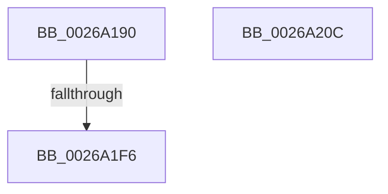

# SmHwAcceleratorPartitionMgrGetDescriptor

- RVA: `0x0026A190`–`0x0026A20D` (길이 `125` bytes)
- VA: `0x000000014026A190`
- 실행 섹션: `.text`
- PDB 이름 있음: `예`; PDB Function 태그: `예`
- unwind 정보 RVA: `0x000653D8`
- 디코드: `43`개 명령, `125/125` bytes 표시
- 미해석 바이트: `0` (있으면 어셈블리에 `.byte`로 보존)

> 이 문서는 커널 이미지의 기계어와 PDB 기호를 분석해 생성했습니다. 4번과 5번은 함수 원형과 자료형을 바이너리 사용 방식에서 추정한 C 해석이며 원본 소스 복구 결과는 아닙니다.

## 1. Dependencies

- 직접 호출 지점: **0**; 고유 호출 대상: **0**
- 직접 호출자로 확인된 함수: **2**
- RIP 상대 이미지 참조: **0**

### Outgoing calls
- 직접 디코드된 call 명령이 없습니다.

### Direct callers
- [SMKM_STORE_MGR&lt;SM_TRAITS&gt;::SmCompressCtxProcessEntry](SMKM_STORE_MGR_SM_TRAITS_SmCompressCtxProcessEntry_function_002681DC.md) at `0x0026826F`
- [sub_006E6668](../6E/Unknown_function_006E6668.md) at `0x006E66B1`

### Static image references
- 디코드된 RIP-relative 메모리 참조가 없습니다.

## 2. Other-region calls and transfers

- 다른 실행 섹션으로 향하는 call: **0**
- call이 아닌 외부 분기/꼬리 이동: **1**
  - `0x0026A1F0` → [sub_006D969C](../6D/Unknown_function_006D969C.md) (`tail-transfer`)

## 3. Assembly (complete function range)

```asm
0026A190  48 8B C4                        mov rax, rsp
0026A193  44 89 40 18                     mov dword ptr [rax + 0x18], r8d
0026A197  89 50 10                        mov dword ptr [rax + 0x10], edx
0026A19A  48 89 48 08                     mov qword ptr [rax + 8], rcx
0026A19E  55                              push rbp
0026A19F  53                              push rbx
0026A1A0  56                              push rsi
0026A1A1  57                              push rdi
0026A1A2  41 54                           push r12
0026A1A4  41 55                           push r13
0026A1A6  41 56                           push r14
0026A1A8  41 57                           push r15
0026A1AA  48 8D 68 A1                     lea rbp, [rax - 0x5f]
0026A1AE  48 81 EC 88 00 00 00            sub rsp, 0x88
0026A1B5  44 8B FA                        mov r15d, edx
0026A1B8  4C 8B F1                        mov r14, rcx
0026A1BB  41 F7 D7                        not r15d
0026A1BE  45 33 ED                        xor r13d, r13d
0026A1C1  41 83 E7 01                     and r15d, 1
0026A1C5  4C 89 6D CF                     mov qword ptr [rbp - 0x31], r13
0026A1C9  0F 57 C0                        xorps xmm0, xmm0
0026A1CC  0F 11 45 F7                     movups xmmword ptr [rbp - 9], xmm0
0026A1D0  4A 8B 44 F9 20                  mov rax, qword ptr [rcx + r15*8 + 0x20]
0026A1D5  48 83 C1 38                     add rcx, 0x38
0026A1D9  0F 11 45 07                     movups xmmword ptr [rbp + 7], xmm0
0026A1DD  48 89 45 E7                     mov qword ptr [rbp - 0x19], rax
0026A1E1  43 8B 44 BE 30                  mov eax, dword ptr [r14 + r15*4 + 0x30]
0026A1E6  4A 8D 0C F9                     lea rcx, [rcx + r15*8]
0026A1EA  48 89 4D D7                     mov qword ptr [rbp - 0x29], rcx
0026A1EE  85 C0                           test eax, eax
0026A1F0  0F 85 A6 F4 46 00               jne 0x1406d969c
0026A1F6  33 C0                           xor eax, eax
0026A1F8  48 81 C4 88 00 00 00            add rsp, 0x88
0026A1FF  41 5F                           pop r15
0026A201  41 5E                           pop r14
0026A203  41 5D                           pop r13
0026A205  41 5C                           pop r12
0026A207  5F                              pop rdi
0026A208  5E                              pop rsi
0026A209  5B                              pop rbx
0026A20A  5D                              pop rbp
0026A20B  C3                              ret
0026A20C  CC                              int3
```

## 4. C-style interpretation (structured pseudocode)

```c
__int64 __fastcall SmHwAcceleratorPartitionMgrGetDescriptor(__int64 a1, int a2, int a3)
{
    __int64 result;
    __int64 v_r13;
    __int64 v_r15;
    __int64 v_rsp;

    *(unsigned int *)(v_rsp + 24) = a3;
    *(unsigned int *)(v_rsp + 16) = a2;
    *(unsigned __int64 *)(v_rsp + 8) = a1;
    v_rsp = (v_rsp) - (136);
    v_r15 = (unsigned int)(~((unsigned int)(a2)));
    v_r13 = 0;
    v_r15 = (unsigned int)((v_r15) & (1));
    *(unsigned __int64 *)(v_rsp - 95 - 49) = 0;
    *(unsigned __int64 *)(v_rsp - 95 - 9) = v_xmm0;
    a1 = (a1) + (56);
    *(unsigned __int64 *)(v_rsp - 95 + 7) = v_xmm0;
    *(unsigned __int64 *)(v_rsp - 95 - 25) = *(unsigned __int64 *)(a1 + v_r15 * 8 + 32);
    *(unsigned __int64 *)(v_rsp - 95 - 41) = a1 + v_r15 * 8;
    result = 0;
    v_rsp = (v_rsp) + (136);
    return result;
}
```

## 5. (Beta) C Style

```c
int64_t SmHwAcceleratorPartitionMgrGetDescriptor(void *Arg1, int32_t Arg2, int32_t Arg3)
{
    uint8_t *arg1 = (uint8_t *)Arg1;

    int64_t result;
    int64_t local_r13;
    int64_t local_r15;
    int64_t local_rsp;

    *(uint32_t *)(local_rsp + 0x18) = Arg3;
    *(uint32_t *)(local_rsp + 0x10) = Arg2;
    *(void **)(local_rsp + 0x8) = Arg1;
    local_rsp = (local_rsp) - (136);
    local_r15 = (uint32_t)(~((uint32_t)(Arg2)));
    local_r13 = 0;
    local_r15 = (uint32_t)((local_r15) & (1));
    *(uint64_t *)(local_rsp - 0x5F - 0x31) = 0;
    *(uint64_t *)(local_rsp - 0x5F - 0x9) = v_xmm0;
    Arg1 = (Arg1) + (56);
    *(uint64_t *)(local_rsp - 0x5F + 0x7) = v_xmm0;
    *(uint64_t *)(local_rsp - 0x5F - 0x19) = *(uint64_t *)(arg1 + local_r15 * 8 + 0x20);
    *(void **)(local_rsp - 0x5F - 0x29) = Arg1 + local_r15 * 8;
    result = 0;
    local_rsp = (local_rsp) + (136);
    return result;
}
```

### 관측된 메모리 오프셋

구조체 형식이 확인되지 않은 접근은 인자 기준의 오프셋으로만 기록했습니다.

| 기준 인자 | 오프셋 표현 | 폭 (bit) | 접근 |
|---|---:|---:|---|
| `Arg1` | `+ 0x0 + r15*8` | `64` | `R` |
| `Arg1` | `+ 0x20 + r15*8` | `64` | `R` |
| `Arg1` | `+ 0x30 + r15*4` | `32` | `R` |

## 6. Execution-region graph

[열기: 2D/3D 그래프와 함수 탐색 컨트롤 패널](../../../control-panel.html?section=text&rva=0x0026A190&view=graph)

- 2D 그래프는 위에서 아래로 흐르고, 3D 그래프는 빈 공간을 드래그해 회전합니다. Shift+드래그는 이동, 휠은 확대·축소, 함수 노드 선택은 대상 보고서 이동입니다.

### Static fallback


