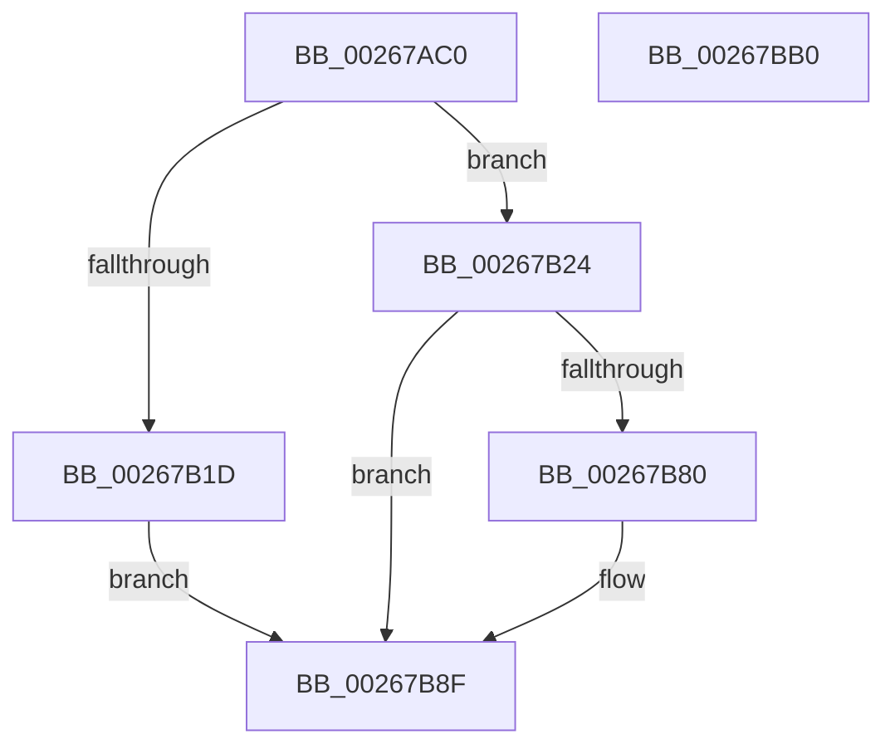

# SmPrepareForFatalHeapCorruption

- RVA: `0x00267AC0`–`0x00267BB1` (길이 `241` bytes)
- VA: `0x0000000140267AC0`
- 실행 섹션: `.text`
- PDB 이름 있음: `예`; PDB Function 태그: `아니요`
- unwind 정보 RVA: `0x0005FEF8`
- 디코드: `65`개 명령, `241/241` bytes 표시
- 미해석 바이트: `0` (있으면 어셈블리에 `.byte`로 보존)

> 이 문서는 커널 이미지의 기계어와 PDB 기호를 분석해 생성했습니다. 4번과 5번은 함수 원형과 자료형을 바이너리 사용 방식에서 추정한 C 해석이며 원본 소스 복구 결과는 아닙니다.

## 1. Dependencies

- 직접 호출 지점: **5**; 고유 호출 대상: **5**
- 직접 호출자로 확인된 함수: **8**
- RIP 상대 이미지 참조: **2**

### Outgoing calls
- `0x00267AE6` → [MmGetPhysicalAddress](../23/MmGetPhysicalAddress_function_0023A500.md) (function, `0x0023A500`)
- `0x00267B0E` → [ExAllocatePool2](../../poolcode/B8/ExAllocatePool2_function_00B820F0.md) (function, `0x00B820F0`)
- `0x00267B5B` → [memcpy](../6C/memcpy_function_006C6840.md) (function, `0x006C6840`)
- `0x00267B77` → [KeRegisterBugCheckReasonCallback](../47/KeRegisterBugCheckReasonCallback_function_004720A0.md) (function, `0x004720A0`)
- `0x00267B8A` → [ExFreePoolWithTag](../../poolcode/B8/ExFreePoolWithTag_function_00B82870.md) (function, `0x00B82870`)

### Direct callers
- [SmHpChunkUnprotect](SmHpChunkUnprotect_function_002687A0.md) at `0x002688A5`
- [sub_002689C7](Unknown_function_002689C7.md) at `0x00268AE9`
- [ST_STORE&lt;SM_TRAITS&gt;::StDmPageRecordUnprotect](ST_STORE_SM_TRAITS_StDmPageRecordUnprotect_function_00268B30.md) at `0x00268CE5`
- [sub_00268EBD](Unknown_function_00268EBD.md) at `0x00268F40`
- [sub_0026925A](Unknown_function_0026925A.md) at `0x00269267`
- [SmHpUnprotectListNeighbors](SmHpUnprotectListNeighbors_function_002692A4.md) at `0x002693B8`
- [SmHpUnprotectListNeighbors](SmHpUnprotectListNeighbors_function_002692A4.md) at `0x0026945E`
- [SmHpUnprotectListNeighbors](SmHpUnprotectListNeighbors_function_002692A4.md) at `0x0026948C`
- [SmHpBufferProtectEx](SmHpBufferProtectEx_function_002694C0.md) at `0x002695A6`
- [SmHpChunkHeapProtect](../3A/SmHpChunkHeapProtect_function_003AFD8C.md) at `0x003AFEA6`

### Static image references
- `0x00267B60` → RVA `0x006CD950` (` ?? ::FNODOBFM::`string'`; read)
- `0x00267B6D` → RVA `0x006103E0` (`SmFatalHeapCorruptionDumpCallback`; read)

## 2. Other-region calls and transfers

- 다른 실행 섹션으로 향하는 call: **2**
  - `0x00267B0E` → [ExAllocatePool2](../../poolcode/B8/ExAllocatePool2_function_00B820F0.md) (`.text` → `POOLCODE`)
  - `0x00267B8A` → [ExFreePoolWithTag](../../poolcode/B8/ExFreePoolWithTag_function_00B82870.md) (`.text` → `POOLCODE`)
- 별도 외부 분기/꼬리 이동을 확인하지 못했습니다.

## 3. Assembly (complete function range)

```asm
00267AC0  48 8B C4                        mov rax, rsp
00267AC3  48 89 58 08                     mov qword ptr [rax + 8], rbx
00267AC7  48 89 68 10                     mov qword ptr [rax + 0x10], rbp
00267ACB  48 89 70 18                     mov qword ptr [rax + 0x18], rsi
00267ACF  48 89 78 20                     mov qword ptr [rax + 0x20], rdi
00267AD3  41 54                           push r12
00267AD5  41 56                           push r14
00267AD7  41 57                           push r15
00267AD9  48 83 EC 20                     sub rsp, 0x20
00267ADD  41 8B E9                        mov ebp, r9d
00267AE0  48 8B F1                        mov rsi, rcx
00267AE3  45 8B F8                        mov r15d, r8d
00267AE6  E8 15 2A FD FF                  call 0x14023a500
00267AEB  4C 8B 74 24 60                  mov r14, qword ptr [rsp + 0x60]
00267AF0  48 99                           cqo
00267AF2  41 BC 00 10 00 00               mov r12d, 0x1000
00267AF8  B9 40 00 00 00                  mov ecx, 0x40
00267AFD  49 F7 FC                        idiv r12
00267B00  41 8D 54 24 60                  lea edx, [r12 + 0x60]
00267B05  41 B8 73 6D 62 50               mov r8d, 0x50626d73
00267B0B  49 89 06                        mov qword ptr [r14], rax
00267B0E  E8 DD A5 91 00                  call 0x140b820f0
00267B13  33 DB                           xor ebx, ebx
00267B15  48 8B F8                        mov rdi, rax
00267B18  48 85 C0                        test rax, rax
00267B1B  75 07                           jne 0x140267b24
00267B1D  BB 9A 00 00 C0                  mov ebx, 0xc000009a
00267B22  EB 6B                           jmp 0x140267b8f
00267B24  88 58 2C                        mov byte ptr [rax + 0x2c], bl
00267B27  48 8D 48 37                     lea rcx, [rax + 0x37]
00267B2B  48 83 E1 F8                     and rcx, 0xfffffffffffffff8
00267B2F  4D 8B C4                        mov r8, r12
00267B32  48 8B D6                        mov rdx, rsi
00267B35  48 C7 01 01 00 00 00            mov qword ptr [rcx], 1
00267B3C  48 89 59 30                     mov qword ptr [rcx + 0x30], rbx
00267B40  49 8B 06                        mov rax, qword ptr [r14]
00267B43  48 89 41 28                     mov qword ptr [rcx + 0x28], rax
00267B47  48 89 71 08                     mov qword ptr [rcx + 8], rsi
00267B4B  4C 89 61 10                     mov qword ptr [rcx + 0x10], r12
00267B4F  48 89 69 20                     mov qword ptr [rcx + 0x20], rbp
00267B53  4C 89 79 18                     mov qword ptr [rcx + 0x18], r15
00267B57  48 83 C1 30                     add rcx, 0x30
00267B5B  E8 E0 EC 45 00                  call 0x1406c6840
00267B60  4C 8D 0D E9 5D 46 00            lea r9, [rip + 0x465de9]
00267B67  41 B8 02 00 00 00               mov r8d, 2
00267B6D  48 8D 15 6C 88 3A 00            lea rdx, [rip + 0x3a886c]
00267B74  48 8B CF                        mov rcx, rdi
00267B77  E8 24 A5 20 00                  call 0x1404720a0
00267B7C  84 C0                           test al, al
00267B7E  75 0F                           jne 0x140267b8f
00267B80  33 D2                           xor edx, edx
00267B82  48 8B CF                        mov rcx, rdi
00267B85  BB 9A 00 00 C0                  mov ebx, 0xc000009a
00267B8A  E8 E1 AC 91 00                  call 0x140b82870
00267B8F  48 8B 6C 24 48                  mov rbp, qword ptr [rsp + 0x48]
00267B94  8B C3                           mov eax, ebx
00267B96  48 8B 5C 24 40                  mov rbx, qword ptr [rsp + 0x40]
00267B9B  48 8B 74 24 50                  mov rsi, qword ptr [rsp + 0x50]
00267BA0  48 8B 7C 24 58                  mov rdi, qword ptr [rsp + 0x58]
00267BA5  48 83 C4 20                     add rsp, 0x20
00267BA9  41 5F                           pop r15
00267BAB  41 5E                           pop r14
00267BAD  41 5C                           pop r12
00267BAF  C3                              ret
00267BB0  CC                              int3
```

## 4. C-style interpretation (structured pseudocode)

```c
__int64 __fastcall SmPrepareForFatalHeapCorruption(__int64 a1, __int64 a2, int a3, int a4, __int64 a5)
{
    __int64 result;
    __int64 v_rbx;
    __int64 v_rsp;
    unsigned __int64 v_stack_p10;
    unsigned __int64 v_stack_p18;
    unsigned __int64 v_stack_p20;
    unsigned __int64 v_stack_p8;

    *(unsigned __int64 *)(v_rsp + 8) = v_rbx;
    *(unsigned __int64 *)(v_rsp + 16) = v_rbp;
    *(unsigned __int64 *)(v_rsp + 24) = v_rsi;
    *(unsigned __int64 *)(v_rsp + 32) = v_rdi;
    v_rsp = (v_rsp) - (32);
    result = MmGetPhysicalAddress(a1, a2, a3, a4);
    *(unsigned __int64 *)(a5) = result;
    result = ExAllocatePool2(64, (unsigned int)(0x1000ULL) + 96, (unsigned int)(0x50626D73ULL), a4);
    v_rbx = 0;
    if (result != 0) goto loc_00267B24;
    goto loc_00267B8F;
loc_00267B24:
    *(unsigned __int8 *)(result + 44) = (unsigned __int8)((unsigned int)(0xC000009AULL));
    a1 = (result + 55) & (-8);
    *(unsigned __int64 *)(a1) = 1;
    *(unsigned __int64 *)(a1 + 48) = (unsigned int)(0xC000009AULL);
    *(unsigned __int64 *)(a1 + 40) = *(unsigned __int64 *)(a5);
    *(unsigned __int64 *)(a1 + 8) = a1;
    *(unsigned __int64 *)(a1 + 16) = (unsigned int)(0x1000ULL);
    *(unsigned __int64 *)(a1 + 32) = (unsigned int)(a4);
    *(unsigned __int64 *)(a1 + 24) = (unsigned int)(a3);
    a1 = (a1) + (48);
    result = memcpy(a1, a1, (unsigned int)(0x1000ULL), a4);
    result = KeRegisterBugCheckReasonCallback(result, v_rip + 3836012, 2, v_rip + 4611561);
    v_rbx = (unsigned int)(0xC000009AULL);
    if ((unsigned __int8)(result) == 0) {
        a2 = 0;
        a1 = result;
        v_rbx = 0xC000009AULL;
        result = ExFreePoolWithTag(a1, a2, 2, v_rip + 4611561);
    }
    v_rsp = (v_rsp) + (32);
    return (unsigned int)((unsigned int)(v_rbx));
}
```

## 5. (Beta) C Style

```c
int64_t SmPrepareForFatalHeapCorruption(int64_t Arg1, int64_t Arg2, int32_t Arg3, int32_t Arg4, void *Arg5)
{
    uint8_t *arg5 = (uint8_t *)Arg5;

    int64_t result;
    int64_t local_rbx;
    int64_t local_rsp;
    uint64_t v_stack_p10;
    uint64_t v_stack_p18;
    uint64_t v_stack_p20;
    uint64_t v_stack_p8;

    *(uint64_t *)(local_rsp + 0x8) = local_rbx;
    *(uint64_t *)(local_rsp + 0x10) = local_rbp;
    *(uint64_t *)(local_rsp + 0x18) = local_rsi;
    *(uint64_t *)(local_rsp + 0x20) = local_rdi;
    local_rsp = (local_rsp) - (32);
    result = MmGetPhysicalAddress(Arg1, Arg2, Arg3, Arg4);
    *(uint64_t *)(arg5) = result;
    result = ExAllocatePool2(64, (uint32_t)(0x1000ULL) + 96, (uint32_t)(0x50626D73ULL), Arg4);
    local_rbx = 0;
    if (result != 0) goto loc_00267B24;
    goto loc_00267B8F;
loc_00267B24:
    *(uint8_t *)(result + 0x2C) = (uint8_t)((uint32_t)(0xC000009AULL));
    Arg1 = (result + 55) & (-8);
    *(uint64_t *)(Arg1) = 1;
    *(uint64_t *)(Arg1 + 0x30) = (uint32_t)(0xC000009AULL);
    *(uint64_t *)(Arg1 + 0x28) = *(uint64_t *)(arg5);
    *(uint64_t *)(Arg1 + 0x8) = Arg1;
    *(uint64_t *)(Arg1 + 0x10) = (uint32_t)(0x1000ULL);
    *(uint64_t *)(Arg1 + 0x20) = (uint32_t)(Arg4);
    *(uint64_t *)(Arg1 + 0x18) = (uint32_t)(Arg3);
    Arg1 = (Arg1) + (48);
    result = memcpy(Arg1, Arg1, (uint32_t)(0x1000ULL), Arg4);
    result = KeRegisterBugCheckReasonCallback(result, v_rip + 3836012, 2, v_rip + 4611561);
    local_rbx = (uint32_t)(0xC000009AULL);
    if ((uint8_t)(result) == 0) {
        Arg2 = 0;
        Arg1 = result;
        local_rbx = 0xC000009AULL;
        result = ExFreePoolWithTag(Arg1, Arg2, 2, v_rip + 4611561);
    }
    local_rsp = (local_rsp) + (32);
    return (uint32_t)((uint32_t)(local_rbx));
}
```

### 관측된 메모리 오프셋

구조체 형식이 확인되지 않은 접근은 인자 기준의 오프셋으로만 기록했습니다.

| 기준 인자 | 오프셋 표현 | 폭 (bit) | 접근 |
|---|---:|---:|---|
| `Arg5` | `+ 0x0` | `64` | `R` |
| `Arg5` | `+ 0x0` | `64` | `W` |

## 6. Execution-region graph

[열기: 2D/3D 그래프와 함수 탐색 컨트롤 패널](../../../control-panel.html?section=text&rva=0x00267AC0&view=graph)

- 2D 그래프는 위에서 아래로 흐르고, 3D 그래프는 빈 공간을 드래그해 회전합니다. Shift+드래그는 이동, 휠은 확대·축소, 함수 노드 선택은 대상 보고서 이동입니다.

### Static fallback


