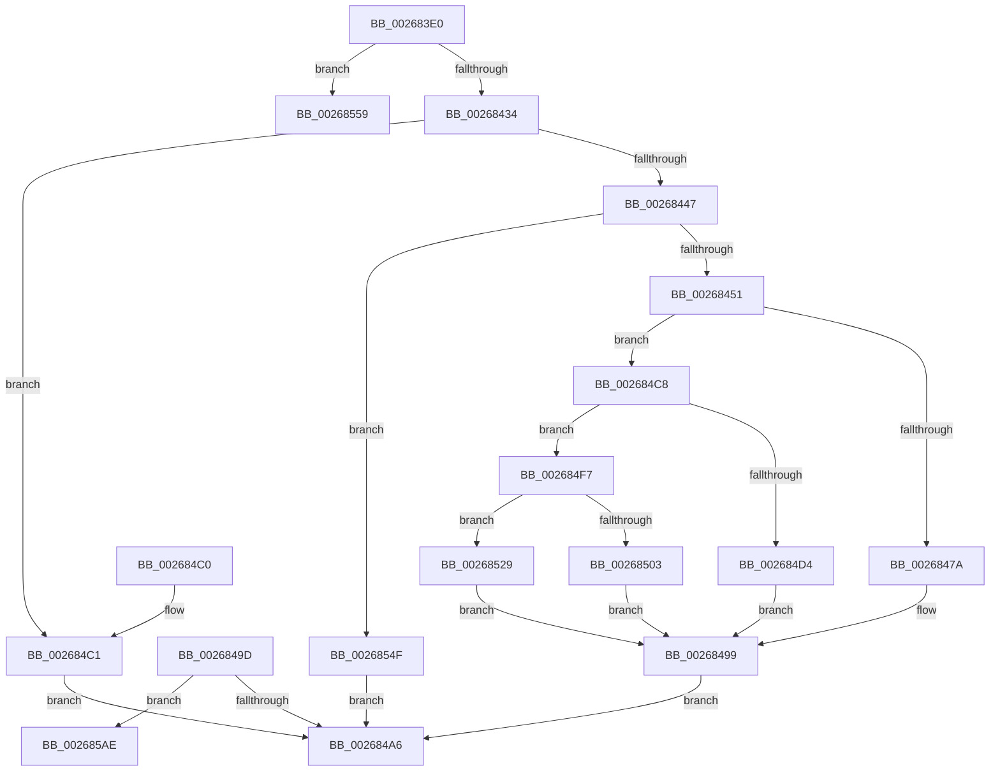

# SmStoreCompressBuffer

- RVA: `0x002683E0`–`0x002685B8` (길이 `472` bytes)
- VA: `0x00000001402683E0`
- 실행 섹션: `.text`
- PDB 이름 있음: `예`; PDB Function 태그: `예`
- unwind 정보 RVA: `0x00065120`
- 디코드: `123`개 명령, `472/472` bytes 표시
- 미해석 바이트: `0` (있으면 어셈블리에 `.byte`로 보존)

> 이 문서는 커널 이미지의 기계어와 PDB 기호를 분석해 생성했습니다. 4번과 5번은 함수 원형과 자료형을 바이너리 사용 방식에서 추정한 C 해석이며 원본 소스 복구 결과는 아닙니다.

## 1. Dependencies

- 직접 호출 지점: **4**; 고유 호출 대상: **4**
- 직접 호출자로 확인된 함수: **1**
- RIP 상대 이미지 참조: **4**

### Outgoing calls
- `0x00268494` → [RtlCompressBufferLz4](RtlCompressBufferLz4_function_0026A3A0.md) (function, `0x0026A3A0`)
- `0x002684F0` → [RtlCompressBufferLZNT1](../../pagelk/B7/RtlCompressBufferLZNT1_function_00B758E0.md) (function, `0x00B758E0`)
- `0x0026851F` → [RtlCompressBufferXpressHuff](RtlCompressBufferXpressHuff_function_0026B9A0.md) (function, `0x0026B9A0`)
- `0x00268545` → [guard_dispatch_icall](../6B/guard_dispatch_icall_function_006BAAD0.md) (function, `0x006BAAD0`)

### Direct callers
- [SMKM_STORE_MGR&lt;SM_TRAITS&gt;::SmCompressCtxProcessEntry](SMKM_STORE_MGR_SM_TRAITS_SmCompressCtxProcessEntry_function_002681DC.md) at `0x002682AE`

### Static image references
- `0x002683FE` → RVA `0x00000000` (`image boundary/outside`; read)
- `0x00268460` → RVA `0x0026A3A0` (`RtlCompressBufferLz4`; read)
- `0x002684C8` → RVA `0x00B758E0` (`RtlCompressBufferLZNT1`; read)
- `0x002684F7` → RVA `0x0026B9A0` (`RtlCompressBufferXpressHuff`; read)

## 2. Other-region calls and transfers

- 다른 실행 섹션으로 향하는 call: **1**
  - `0x002684F0` → [RtlCompressBufferLZNT1](../../pagelk/B7/RtlCompressBufferLZNT1_function_00B758E0.md) (`.text` → `PAGELK`)
- call이 아닌 외부 분기/꼬리 이동: **2**
  - `0x002685A9` → [sub_006D904C](../6D/Unknown_function_006D904C.md) (`tail-transfer`)
  - `0x002685B3` → [sub_006D904C + 0xDE](../6D/Unknown_function_006D904C.md) (`tail-transfer`)

## 3. Assembly (complete function range)

```asm
002683E0  4C 8B DC                        mov r11, rsp
002683E3  49 89 5B 10                     mov qword ptr [r11 + 0x10], rbx
002683E7  55                              push rbp
002683E8  56                              push rsi
002683E9  57                              push rdi
002683EA  41 54                           push r12
002683EC  41 55                           push r13
002683EE  41 56                           push r14
002683F0  41 57                           push r15
002683F2  48 83 EC 70                     sub rsp, 0x70
002683F6  33 FF                           xor edi, edi
002683F8  4D 8B F0                        mov r14, r8
002683FB  48 8B EA                        mov rbp, rdx
002683FE  4C 8D 05 FB 7B D9 FF            lea r8, [rip - 0x268405]
00268405  41 8B C6                        mov eax, r14d
00268408  41 BD 00 10 00 00               mov r13d, 0x1000
0026840E  25 FF 0F 00 00                  and eax, 0xfff
00268413  4D 8B E1                        mov r12, r9
00268416  44 8B C9                        mov r9d, ecx
00268419  41 8B D5                        mov edx, r13d
0026841C  2B D0                           sub edx, eax
0026841E  8B DF                           mov ebx, edi
00268420  44 8B FF                        mov r15d, edi
00268423  43 0F B7 B4 48 18 1C 01 00      movzx esi, word ptr [r8 + r9*2 + 0x11c18]
0026842C  85 C9                           test ecx, ecx
0026842E  0F 85 25 01 00 00               jne 0x140268559
00268434  B9 FF 00 00 00                  mov ecx, 0xff
00268439  0F B7 C6                        movzx eax, si
0026843C  66 23 C1                        and ax, cx
0026843F  8D 4F 02                        lea ecx, [rdi + 2]
00268442  66 3B C1                        cmp ax, cx
00268445  72 7A                           jb 0x1402684c1
00268447  66 83 F8 08                     cmp ax, 8
0026844B  0F 87 FE 00 00 00               ja 0x14026854f
00268451  B9 00 FF 00 00                  mov ecx, 0xff00
00268456  0F B7 C0                        movzx eax, ax
00268459  66 23 F1                        and si, cx
0026845C  4D 89 63 90                     mov qword ptr [r11 - 0x70], r12
00268460  48 8D 0D 39 1F 00 00            lea rcx, [rip + 0x1f39]
00268467  4D 8B CE                        mov r9, r14
0026846A  49 8B 84 C0 60 13 00 00         mov rax, qword ptr [r8 + rax*8 + 0x1360]
00268472  45 8B C5                        mov r8d, r13d
00268475  48 3B C1                        cmp rax, rcx
00268478  75 4E                           jne 0x1402684c8
0026847A  48 8B 84 24 D8 00 00 00         mov rax, qword ptr [rsp + 0xd8]
00268482  0F B7 CE                        movzx ecx, si
00268485  49 89 43 88                     mov qword ptr [r11 - 0x78], rax
00268489  45 89 6B 80                     mov dword ptr [r11 - 0x80], r13d
0026848D  89 54 24 20                     mov dword ptr [rsp + 0x20], edx
00268491  48 8B D5                        mov rdx, rbp
00268494  E8 07 1F 00 00                  call 0x14026a3a0
00268499  8B D8                           mov ebx, eax
0026849B  EB 09                           jmp 0x1402684a6
0026849D  45 85 FF                        test r15d, r15d
002684A0  0F 85 08 01 00 00               jne 0x1402685ae
002684A6  8B C3                           mov eax, ebx
002684A8  48 8B 9C 24 B8 00 00 00         mov rbx, qword ptr [rsp + 0xb8]
002684B0  48 83 C4 70                     add rsp, 0x70
002684B4  41 5F                           pop r15
002684B6  41 5E                           pop r14
002684B8  41 5D                           pop r13
002684BA  41 5C                           pop r12
002684BC  5F                              pop rdi
002684BD  5E                              pop rsi
002684BE  5D                              pop rbp
002684BF  C3                              ret
002684C0  CC                              int3
002684C1  BB 0D 00 00 C0                  mov ebx, 0xc000000d
002684C6  EB DE                           jmp 0x1402684a6
002684C8  48 8D 0D 11 D4 90 00            lea rcx, [rip + 0x90d411]
002684CF  48 3B C1                        cmp rax, rcx
002684D2  75 23                           jne 0x1402684f7
002684D4  48 8B 84 24 D8 00 00 00         mov rax, qword ptr [rsp + 0xd8]
002684DC  0F B7 CE                        movzx ecx, si
002684DF  48 89 44 24 30                  mov qword ptr [rsp + 0x30], rax
002684E4  44 89 6C 24 28                  mov dword ptr [rsp + 0x28], r13d
002684E9  89 54 24 20                     mov dword ptr [rsp + 0x20], edx
002684ED  48 8B D5                        mov rdx, rbp
002684F0  E8 EB D3 90 00                  call 0x140b758e0
002684F5  EB A2                           jmp 0x140268499
002684F7  48 8D 0D A2 34 00 00            lea rcx, [rip + 0x34a2]
002684FE  48 3B C1                        cmp rax, rcx
00268501  75 26                           jne 0x140268529
00268503  48 8B 84 24 D8 00 00 00         mov rax, qword ptr [rsp + 0xd8]
0026850B  0F B7 CE                        movzx ecx, si
0026850E  48 89 44 24 30                  mov qword ptr [rsp + 0x30], rax
00268513  44 89 6C 24 28                  mov dword ptr [rsp + 0x28], r13d
00268518  89 54 24 20                     mov dword ptr [rsp + 0x20], edx
0026851C  48 8B D5                        mov rdx, rbp
0026851F  E8 7C 34 00 00                  call 0x14026b9a0
00268524  E9 70 FF FF FF                  jmp 0x140268499
00268529  48 8B 8C 24 D8 00 00 00         mov rcx, qword ptr [rsp + 0xd8]
00268531  48 89 4C 24 30                  mov qword ptr [rsp + 0x30], rcx
00268536  0F B7 CE                        movzx ecx, si
00268539  44 89 6C 24 28                  mov dword ptr [rsp + 0x28], r13d
0026853E  89 54 24 20                     mov dword ptr [rsp + 0x20], edx
00268542  48 8B D5                        mov rdx, rbp
00268545  E8 86 25 45 00                  call 0x1406baad0
0026854A  E9 4A FF FF FF                  jmp 0x140268499
0026854F  BB 5F 02 00 C0                  mov ebx, 0xc000025f
00268554  E9 4D FF FF FF                  jmp 0x1402684a6
00268559  B9 02 00 00 00                  mov ecx, 2
0026855E  44 8B D7                        mov r10d, edi
00268561  44 3B C9                        cmp r9d, ecx
00268564  41 BB 00 08 00 00               mov r11d, 0x800
0026856A  41 0F 94 C2                     sete r10b
0026856E  41 FF C2                        inc r10d
00268571  44 89 54 24 50                  mov dword ptr [rsp + 0x50], r10d
00268576  42 8D 04 55 FE FF FF FF         lea eax, [r10*2 - 2]
0026857E  2B D0                           sub edx, eax
00268580  44 8B C2                        mov r8d, edx
00268583  41 D1 E8                        shr r8d, 1
00268586  44 3B C9                        cmp r9d, ecx
00268589  44 0F 45 C2                     cmovne r8d, edx
0026858D  45 0F 45 DD                     cmovne r11d, r13d
00268591  8B D0                           mov edx, eax
00268593  44 8B EF                        mov r13d, edi
00268596  49 03 D6                        add rdx, r14
00268599  44 89 84 24 C0 00 00 00         mov dword ptr [rsp + 0xc0], r8d
002685A1  44 89 9C 24 B0 00 00 00         mov dword ptr [rsp + 0xb0], r11d
002685A9  E9 9E 0A 47 00                  jmp 0x1406d904c
002685AE  48 8D 74 24 60                  lea rsi, [rsp + 0x60]
002685B3  E9 72 0B 47 00                  jmp 0x1406d912a
```

## 4. C-style interpretation (structured pseudocode)

```c
__int64 __fastcall SmStoreCompressBuffer(int a1, __int64 a2, __int64 a3, __int64 a4, __int64 a5, __int64 a6)
{
    __int64 result;
    __int64 v_r10;
    __int64 v_r11;
    __int64 v_rdi;
    __int64 v_rsi;
    __int64 v_rsp;
    unsigned int v_stack_m88;
    unsigned __int64 v_stack_p10;
    unsigned int v_stack_p20;
    unsigned int v_stack_p28;
    unsigned __int64 v_stack_p30;
    unsigned int v_stack_p50;
    unsigned __int64 v_stack_p60;
    unsigned int v_stack_pB0;
    unsigned int v_stack_pC0;

    *(unsigned __int64 *)(v_rsp + 16) = v_rbx;
    v_rsp = (v_rsp) - (112);
    v_rdi = 0;
    result = (unsigned int)(((unsigned int)((unsigned int)(a3))) & (0xFFFULL));
    a2 = (unsigned int)(((unsigned int)((unsigned int)((unsigned int)(0x1000ULL)))) - ((unsigned int)(result)));
    if (a1 != 0) goto loc_00268559;
    result = (unsigned __int16)(((unsigned __int16)(*(unsigned __int16 *)(v_rip - 2524165 + (unsigned int)(a1) * 2 + 72728))) & (255));
    if (((unsigned __int16)(result)) < ((unsigned __int16)(v_rdi + 2))) goto loc_002684C1;
    if (((unsigned __int16)(result)) > 8) goto loc_0026854F;
    v_rsi = (unsigned __int16)((*(unsigned __int16 *)(v_rip - 2524165 + (unsigned int)(a1) * 2 + 72728)) & ((unsigned __int16)((unsigned int)(0xFF00ULL))));
    *(unsigned __int64 *)(v_rsp - 112) = a4;
    if ((*(unsigned __int64 *)(v_rip - 2524165 + (unsigned __int16)(result) * 8 + 4960)) != (v_rip + 7993)) goto loc_002684C8;
    *(unsigned __int64 *)(v_rsp - 120) = a6;
    *(unsigned int *)(v_rsp - 128) = (unsigned int)((unsigned int)(0x1000ULL));
    v_stack_m88 = (unsigned int)(a2);
    result = RtlCompressBufferLz4((unsigned __int16)(v_rsi), a2, (unsigned int)((unsigned int)((unsigned int)(0x1000ULL))), a3);
loc_00268499:
    goto loc_002684A6;
loc_002684A6:
    v_rsp = (v_rsp) + (112);
    return (unsigned int)((unsigned int)((unsigned int)((unsigned int)(result))));
loc_002684C1:
    goto loc_002684A6;
loc_002684C8:
    if (((unsigned int)((unsigned int)((unsigned int)((unsigned int)(result))))) != (v_rip + 9491473)) goto loc_002684F7;
    v_stack_p30 = a6;
    v_stack_p28 = (unsigned int)((unsigned int)(0x1000ULL));
    v_stack_p20 = (unsigned int)(a2);
    result = RtlCompressBufferLZNT1((unsigned __int16)(v_rsi), a2, (unsigned int)((unsigned int)((unsigned int)(0x1000ULL))), a3);
    goto loc_00268499;
loc_002684F7:
    if (result != (v_rip + 13474)) goto loc_00268529;
    v_stack_p30 = a6;
    v_stack_p28 = (unsigned int)((unsigned int)(0x1000ULL));
    v_stack_p20 = (unsigned int)(a2);
    result = RtlCompressBufferXpressHuff((unsigned __int16)(v_rsi), a2, (unsigned int)((unsigned int)((unsigned int)(0x1000ULL))), a3);
    goto loc_00268499;
loc_00268529:
    v_stack_p30 = a6;
    v_stack_p28 = (unsigned int)((unsigned int)(0x1000ULL));
    v_stack_p20 = (unsigned int)(a2);
    result = guard_dispatch_icall((unsigned __int16)(v_rsi), a2, (unsigned int)((unsigned int)((unsigned int)(0x1000ULL))), a3);
    goto loc_00268499;
loc_0026854F:
    goto loc_002684A6;
loc_00268559:
    v_r10 = (((unsigned int)(a3)) == 2) ? 1 : 0;
    v_r10 = (unsigned int)((v_r10) + 1);
    v_stack_p50 = (unsigned int)(v_r10);
    a2 = (unsigned int)((a2) - ((unsigned int)(v_r10 * 2 - 2)));
    a3 = (unsigned int)(((unsigned int)((unsigned int)(a2))) >> (1));
    if (((unsigned int)(a3)) != 2) { a3 = (unsigned int)(a2); }
    v_r11 = (unsigned int)(0x800ULL);
    if (((unsigned int)(a3)) != 2) { v_r11 = (unsigned int)((unsigned int)(0x1000ULL)); }
    a2 = ((unsigned int)((unsigned int)(v_r10 * 2 - 2))) + (a3);
    v_stack_pC0 = (unsigned int)(a3);
    v_stack_pB0 = (unsigned int)(v_r11);
}
```

## 5. (Beta) C Style

```c
int64_t SmStoreCompressBuffer(int32_t Arg1, int64_t Arg2, int64_t Arg3, int64_t Arg4, uint64_t Arg5, int64_t Arg6)
{
    int64_t result;
    int64_t local_r10;
    int64_t local_r11;
    int64_t local_rdi;
    int64_t local_rsi;
    int64_t local_rsp;
    uint32_t v_stack_m88;
    uint64_t v_stack_p10;
    uint32_t v_stack_p20;
    uint32_t v_stack_p28;
    uint64_t v_stack_p30;
    uint32_t v_stack_p50;
    uint64_t v_stack_p60;
    uint32_t v_stack_pB0;
    uint32_t v_stack_pC0;

    *(uint64_t *)(local_rsp + 0x10) = local_rbx;
    local_rsp = (local_rsp) - (112);
    local_rdi = 0;
    result = (uint32_t)(((uint32_t)((uint32_t)(Arg3))) & (0xFFFULL));
    Arg2 = (uint32_t)(((uint32_t)((uint32_t)((uint32_t)(0x1000ULL)))) - ((uint32_t)(result)));
    if (Arg1 != 0) goto loc_00268559;
    result = (uint16_t)(((uint16_t)(*(uint16_t *)(v_rip - 0x268405 + (uint32_t)(Arg1) * 2 + 0x11C18))) & (255));
    if (((uint16_t)(result)) < ((uint16_t)(local_rdi + 2))) goto loc_002684C1;
    if (((uint16_t)(result)) > 8) goto loc_0026854F;
    local_rsi = (uint16_t)((*(uint16_t *)(v_rip - 0x268405 + (uint32_t)(Arg1) * 2 + 0x11C18)) & ((uint16_t)((uint32_t)(0xFF00ULL))));
    *(uint64_t *)(local_rsp - 0x70) = Arg4;
    if ((*(uint64_t *)(v_rip - 0x268405 + (uint16_t)(result) * 8 + 0x1360)) != (v_rip + 7993)) goto loc_002684C8;
    *(uint64_t *)(local_rsp - 0x78) = Arg6;
    *(uint32_t *)(local_rsp - 0x80) = (uint32_t)((uint32_t)(0x1000ULL));
    v_stack_m88 = (uint32_t)(Arg2);
    result = RtlCompressBufferLz4((uint16_t)(local_rsi), Arg2, (uint32_t)((uint32_t)((uint32_t)(0x1000ULL))), Arg3);
loc_00268499:
    goto loc_002684A6;
loc_002684A6:
    local_rsp = (local_rsp) + (112);
    return (uint32_t)((uint32_t)((uint32_t)((uint32_t)(result))));
loc_002684C1:
    goto loc_002684A6;
loc_002684C8:
    if (((uint32_t)((uint32_t)((uint32_t)((uint32_t)(result))))) != (v_rip + 9491473)) goto loc_002684F7;
    v_stack_p30 = Arg6;
    v_stack_p28 = (uint32_t)((uint32_t)(0x1000ULL));
    v_stack_p20 = (uint32_t)(Arg2);
    result = RtlCompressBufferLZNT1((uint16_t)(local_rsi), Arg2, (uint32_t)((uint32_t)((uint32_t)(0x1000ULL))), Arg3);
    goto loc_00268499;
loc_002684F7:
    if (result != (v_rip + 13474)) goto loc_00268529;
    v_stack_p30 = Arg6;
    v_stack_p28 = (uint32_t)((uint32_t)(0x1000ULL));
    v_stack_p20 = (uint32_t)(Arg2);
    result = RtlCompressBufferXpressHuff((uint16_t)(local_rsi), Arg2, (uint32_t)((uint32_t)((uint32_t)(0x1000ULL))), Arg3);
    goto loc_00268499;
loc_00268529:
    v_stack_p30 = Arg6;
    v_stack_p28 = (uint32_t)((uint32_t)(0x1000ULL));
    v_stack_p20 = (uint32_t)(Arg2);
    result = guard_dispatch_icall((uint16_t)(local_rsi), Arg2, (uint32_t)((uint32_t)((uint32_t)(0x1000ULL))), Arg3);
    goto loc_00268499;
loc_0026854F:
    goto loc_002684A6;
loc_00268559:
    local_r10 = (((uint32_t)(Arg3)) == 2) ? 1 : 0;
    local_r10 = (uint32_t)((local_r10) + 1);
    v_stack_p50 = (uint32_t)(local_r10);
    Arg2 = (uint32_t)((Arg2) - ((uint32_t)(local_r10 * 2 - 2)));
    Arg3 = (uint32_t)(((uint32_t)((uint32_t)(Arg2))) >> (1));
    if (((uint32_t)(Arg3)) != 2) { Arg3 = (uint32_t)(Arg2); }
    local_r11 = (uint32_t)(0x800ULL);
    if (((uint32_t)(Arg3)) != 2) { local_r11 = (uint32_t)((uint32_t)(0x1000ULL)); }
    Arg2 = ((uint32_t)((uint32_t)(local_r10 * 2 - 2))) + (Arg3);
    v_stack_pC0 = (uint32_t)(Arg3);
    v_stack_pB0 = (uint32_t)(local_r11);
}
```

## 6. Execution-region graph

[열기: 2D/3D 그래프와 함수 탐색 컨트롤 패널](../../../control-panel.html?section=text&rva=0x002683E0&view=graph)

- 2D 그래프는 위에서 아래로 흐르고, 3D 그래프는 빈 공간을 드래그해 회전합니다. Shift+드래그는 이동, 휠은 확대·축소, 함수 노드 선택은 대상 보고서 이동입니다.

### Static fallback


