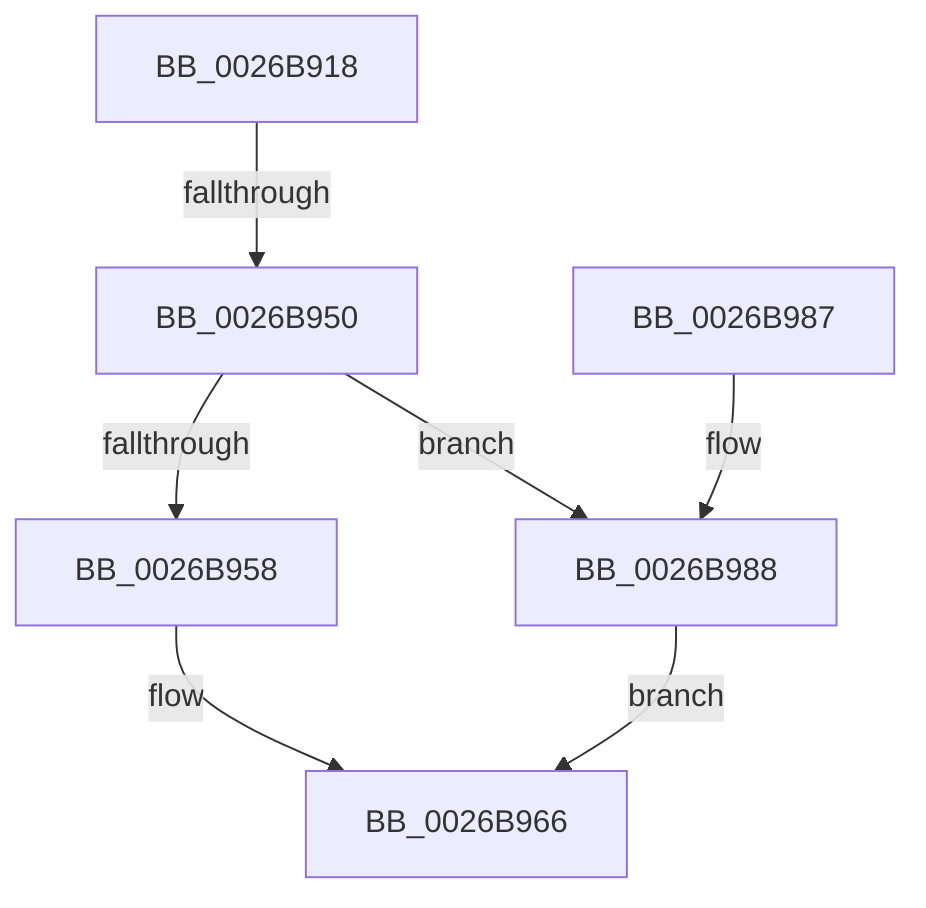

# SmStoreCopyHashCompressedBuffer

- RVA: `0x0026B918`–`0x0026B998` (길이 `128` bytes)
- VA: `0x000000014026B918`
- 실행 섹션: `.text`
- PDB 이름 있음: `예`; PDB Function 태그: `예`
- unwind 정보 RVA: `0x00065508`
- 디코드: `42`개 명령, `128/128` bytes 표시
- 미해석 바이트: `0` (있으면 어셈블리에 `.byte`로 보존)

> 이 문서는 커널 이미지의 기계어와 PDB 기호를 분석해 생성했습니다. 4번과 5번은 함수 원형과 자료형을 바이너리 사용 방식에서 추정한 C 해석이며 원본 소스 복구 결과는 아닙니다.

## 1. Dependencies

- 직접 호출 지점: **2**; 고유 호출 대상: **2**
- 직접 호출자로 확인된 함수: **1**
- RIP 상대 이미지 참조: **0**

### Outgoing calls
- `0x0026B961` → [memcpy](../6C/memcpy_function_006C6840.md) (function, `0x006C6840`)
- `0x0026B98E` → [wyhash](wyhash_function_00269FE4.md) (function, `0x00269FE4`)

### Direct callers
- [ST_STORE&lt;SM_TRAITS&gt;::StDmpSinglePageAdd](../20/ST_STORE_SM_TRAITS_StDmpSinglePageAdd_function_0020502C.md) at `0x00205176`

### Static image references
- 디코드된 RIP-relative 메모리 참조가 없습니다.

## 2. Other-region calls and transfers

- 다른 실행 섹션으로 향하는 call: **0**
- call이 아닌 외부 분기/꼬리 이동: **1**
  - `0x0026B94A` → [sub_006D99C0](../6D/Unknown_function_006D99C0.md) (`tail-transfer`)

## 3. Assembly (complete function range)

```asm
0026B918  48 89 5C 24 08                  mov qword ptr [rsp + 8], rbx
0026B91D  48 89 6C 24 10                  mov qword ptr [rsp + 0x10], rbp
0026B922  48 89 74 24 18                  mov qword ptr [rsp + 0x18], rsi
0026B927  57                              push rdi
0026B928  41 54                           push r12
0026B92A  41 55                           push r13
0026B92C  41 56                           push r14
0026B92E  41 57                           push r15
0026B930  48 83 EC 40                     sub rsp, 0x40
0026B934  33 FF                           xor edi, edi
0026B936  41 8B F0                        mov esi, r8d
0026B939  48 89 7C 24 20                  mov qword ptr [rsp + 0x20], rdi
0026B93E  48 8B EA                        mov rbp, rdx
0026B941  48 8B D9                        mov rbx, rcx
0026B944  44 8B F7                        mov r14d, edi
0026B947  45 85 C9                        test r9d, r9d
0026B94A  0F 85 70 E0 46 00               jne 0x1406d99c0
0026B950  48 8B D6                        mov rdx, rsi
0026B953  48 85 DB                        test rbx, rbx
0026B956  74 30                           je 0x14026b988
0026B958  4C 8B C2                        mov r8, rdx
0026B95B  48 8B CB                        mov rcx, rbx
0026B95E  48 8B D5                        mov rdx, rbp
0026B961  E8 DA AE 45 00                  call 0x1406c6840
0026B966  4C 8D 5C 24 40                  lea r11, [rsp + 0x40]
0026B96B  49 8B C6                        mov rax, r14
0026B96E  49 8B 5B 30                     mov rbx, qword ptr [r11 + 0x30]
0026B972  49 8B 6B 38                     mov rbp, qword ptr [r11 + 0x38]
0026B976  49 8B 73 40                     mov rsi, qword ptr [r11 + 0x40]
0026B97A  49 8B E3                        mov rsp, r11
0026B97D  41 5F                           pop r15
0026B97F  41 5E                           pop r14
0026B981  41 5D                           pop r13
0026B983  41 5C                           pop r12
0026B985  5F                              pop rdi
0026B986  C3                              ret
0026B987  CC                              int3
0026B988  45 33 C0                        xor r8d, r8d
0026B98B  48 8B CD                        mov rcx, rbp
0026B98E  E8 51 E6 FF FF                  call 0x140269fe4
0026B993  4C 8B F0                        mov r14, rax
0026B996  EB CE                           jmp 0x14026b966
```

## 4. C-style interpretation (structured pseudocode)

```c
__int64 __fastcall SmStoreCopyHashCompressedBuffer(__int64 a1, __int64 a2, int a3, int a4)
{
    __int64 result;
    __int64 v_rdi;
    __int64 v_rsp;
    unsigned __int64 v_stack_m28;
    unsigned __int64 v_stack_m48;
    unsigned __int64 v_stack_p10;
    unsigned __int64 v_stack_p18;
    unsigned __int64 v_stack_p8;

    v_stack_p8 = v_rbx;
    v_stack_p10 = v_rbp;
    v_stack_p18 = v_rsi;
    v_rsp = (v_rsp) - (64);
    v_rdi = 0;
    v_stack_m48 = 0;
    if (a1 == 0) goto loc_0026B988;
    result = memcpy(a1, a2, (unsigned int)(a3), a4);
loc_0026B966:
    return 0;
loc_0026B988:
    a3 = 0;
    result = wyhash(*(unsigned __int64 *)(v_stack_m28 + 56), a2, a3, a4);
    goto loc_0026B966;
}
```

## 5. (Beta) C Style

```c
int64_t SmStoreCopyHashCompressedBuffer(int64_t Arg1, int64_t Arg2, int32_t Arg3, int32_t Arg4)
{
    int64_t result;
    int64_t local_rdi;
    int64_t local_rsp;
    uint64_t v_stack_m28;
    uint64_t v_stack_m48;
    uint64_t v_stack_p10;
    uint64_t v_stack_p18;
    uint64_t v_stack_p8;

    v_stack_p8 = local_rbx;
    v_stack_p10 = local_rbp;
    v_stack_p18 = local_rsi;
    local_rsp = (local_rsp) - (64);
    local_rdi = 0;
    v_stack_m48 = 0;
    if (Arg1 == 0) goto loc_0026B988;
    result = memcpy(Arg1, Arg2, (uint32_t)(Arg3), Arg4);
loc_0026B966:
    return 0;
loc_0026B988:
    Arg3 = 0;
    result = wyhash(*(uint64_t *)(v_stack_m28 + 0x38), Arg2, Arg3, Arg4);
    goto loc_0026B966;
}
```

## 6. Execution-region graph

[열기: 2D/3D 그래프와 함수 탐색 컨트롤 패널](../../../control-panel.html?section=text&rva=0x0026B918&view=graph)

- 2D 그래프는 위에서 아래로 흐르고, 3D 그래프는 빈 공간을 드래그해 회전합니다. Shift+드래그는 이동, 휠은 확대·축소, 함수 노드 선택은 대상 보고서 이동입니다.

### Static fallback


