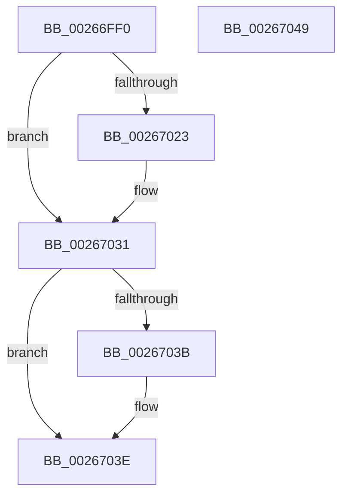

# StLockAcquireExclusive

- RVA: `0x00266FF0`–`0x0026704A` (길이 `90` bytes)
- VA: `0x0000000140266FF0`
- 실행 섹션: `.text`
- PDB 이름 있음: `예`; PDB Function 태그: `아니요`
- unwind 정보 RVA: `0x0005CAAC`
- 디코드: `26`개 명령, `90/90` bytes 표시
- 미해석 바이트: `0` (있으면 어셈블리에 `.byte`로 보존)

> 이 문서는 커널 이미지의 기계어와 PDB 기호를 분석해 생성했습니다. 4번과 5번은 함수 원형과 자료형을 바이너리 사용 방식에서 추정한 C 해석이며 원본 소스 복구 결과는 아닙니다.

## 1. Dependencies

- 직접 호출 지점: **2**; 고유 호출 대상: **2**
- 직접 호출자로 확인된 함수: **12**
- RIP 상대 이미지 참조: **0**

### Outgoing calls
- `0x00267013` → [KeAbPreAcquire](../21/KeAbPreAcquire_function_00210230.md) (function, `0x00210230`)
- `0x0026702C` → [ExfAcquirePushLockExclusiveEx](../20/ExfAcquirePushLockExclusiveEx_function_0020FC90.md) (function, `0x0020FC90`)

### Direct callers
- [ST_STORE&lt;SM_TRAITS&gt;::StDmPageRemove](../20/ST_STORE_SM_TRAITS_StDmPageRemove_function_002049A0.md) at `0x00204C2C`
- [ST_STORE&lt;SM_TRAITS&gt;::StDmPageRemove](../20/ST_STORE_SM_TRAITS_StDmPageRemove_function_002049A0.md) at `0x00204DDA`
- [ST_STORE&lt;SM_TRAITS&gt;::StDmPageRemove](../20/ST_STORE_SM_TRAITS_StDmPageRemove_function_002049A0.md) at `0x00204E92`
- [SMKM_STORE&lt;SM_TRAITS&gt;::SmStAcquireStoreLockExclusive](../20/SMKM_STORE_SM_TRAITS_SmStAcquireStoreLockExclusive_function_00206630.md) at `0x00206649`
- [SMKM_STORE_MGR&lt;SM_TRAITS&gt;::SmFeAddInitiate](SMKM_STORE_MGR_SM_TRAITS_SmFeAddInitiate_function_0026618C.md) at `0x0026621B`
- [SMKM_STORE_MGR&lt;SM_TRAITS&gt;::SmFeEvictComplete](SMKM_STORE_MGR_SM_TRAITS_SmFeEvictComplete_function_00266854.md) at `0x002668D3`
- [SMKM_STORE_MGR&lt;SM_TRAITS&gt;::SmFeStoreDelete](../3B/SMKM_STORE_MGR_SM_TRAITS_SmFeStoreDelete_function_003B12F0.md) at `0x003B1373`
- [ST_STORE&lt;SM_TRAITS&gt;::StDmCombinePageEntry](../41/ST_STORE_SM_TRAITS_StDmCombinePageEntry_function_00410D40.md) at `0x00410E2C`
- [ST_STORE&lt;SM_TRAITS&gt;::StDmCombinePageRecords](../4E/ST_STORE_SM_TRAITS_StDmCombinePageRecords_function_004EBC80.md) at `0x004EBD24`
- [sub_004EBF65](../4E/Unknown_function_004EBF65.md) at `0x004EBFBD`
- [SMKM_STORE_MGR&lt;SM_TRAITS&gt;::SmFeEmpty](../60/SMKM_STORE_MGR_SM_TRAITS_SmFeEmpty_function_0060C74C.md) at `0x0060C763`
- [SMKM_STORE_MGR&lt;SM_TRAITS&gt;::SmFeSetEvictFailed](../60/SMKM_STORE_MGR_SM_TRAITS_SmFeSetEvictFailed_function_0060C7A4.md) at `0x0060C81B`
- [ST_STORE&lt;SM_TRAITS&gt;::StSetDataMovementInProgress](../60/ST_STORE_SM_TRAITS_StSetDataMovementInProgress_function_0060E9BC.md) at `0x0060E9E0`
- [SMKM_STORE_MGR&lt;SM_TRAITS&gt;::SmFeStoreEvictKeys](../61/SMKM_STORE_MGR_SM_TRAITS_SmFeStoreEvictKeys_function_0061041C.md) at `0x0061049C`

### Static image references
- 디코드된 RIP-relative 메모리 참조가 없습니다.

## 2. Other-region calls and transfers

- 다른 실행 섹션으로 향하는 call: **0**
- 별도 외부 분기/꼬리 이동을 확인하지 못했습니다.

## 3. Assembly (complete function range)

```asm
00266FF0  48 89 5C 24 08                  mov qword ptr [rsp + 8], rbx
00266FF5  57                              push rdi
00266FF6  48 83 EC 20                     sub rsp, 0x20
00266FFA  65 48 8B 04 25 88 01 00 00      mov rax, qword ptr gs:[0x188]
00267003  45 33 C0                        xor r8d, r8d
00267006  33 D2                           xor edx, edx
00267008  48 8B F9                        mov rdi, rcx
0026700B  66 FF 88 E6 01 00 00            dec word ptr [rax + 0x1e6]
00267012  90                              nop
00267013  E8 18 92 FA FF                  call 0x140210230
00267018  F0 48 0F BA 2F 00               lock bts qword ptr [rdi], 0
0026701E  48 8B D8                        mov rbx, rax
00267021  73 0E                           jae 0x140267031
00267023  4C 8B C7                        mov r8, rdi
00267026  48 8B D0                        mov rdx, rax
00267029  48 8B CF                        mov rcx, rdi
0026702C  E8 5F 8C FA FF                  call 0x14020fc90
00267031  B8 01 00 00 00                  mov eax, 1
00267036  48 85 DB                        test rbx, rbx
00267039  74 03                           je 0x14026703e
0026703B  88 43 0A                        mov byte ptr [rbx + 0xa], al
0026703E  48 8B 5C 24 30                  mov rbx, qword ptr [rsp + 0x30]
00267043  48 83 C4 20                     add rsp, 0x20
00267047  5F                              pop rdi
00267048  C3                              ret
00267049  CC                              int3
```

## 4. C-style interpretation (structured pseudocode)

```c
__int64 __fastcall StLockAcquireExclusive(__int64 a1, int a2, int a3)
{
    __int64 result;
    __int64 v_rsp;
    unsigned __int64 v_stack_p8;

    v_stack_p8 = v_rbx;
    v_rsp = (v_rsp) - (32);
    a3 = 0;
    a2 = 0;
    result = KeAbPreAcquire(a1, a2, a3, a4);
    if (!(condition_is_above_or_equal)) {
        a3 = a1;
        a2 = result;
        a1 = a1;
        result = ExfAcquirePushLockExclusiveEx(a1, a2, a3, a4);
    }
    if (result != 0) {
        *(unsigned __int8 *)(result + 10) = 1;
    }
    v_rsp = (v_rsp) + (32);
    return 1;
}
```

## 5. (Beta) C Style

```c
int64_t StLockAcquireExclusive(void *Arg1, int32_t Arg2, int32_t Arg3)
{
    uint8_t *arg1 = (uint8_t *)Arg1;

    int64_t result;
    int64_t local_rsp;
    uint64_t v_stack_p8;

    v_stack_p8 = local_rbx;
    local_rsp = (local_rsp) - (32);
    Arg3 = 0;
    Arg2 = 0;
    result = KeAbPreAcquire(Arg1, Arg2, Arg3, a4);
    if (!(condition_is_above_or_equal)) {
        Arg3 = Arg1;
        Arg2 = result;
        Arg1 = Arg1;
        result = ExfAcquirePushLockExclusiveEx(Arg1, Arg2, Arg3, a4);
    }
    if (result != 0) {
        *(uint8_t *)(result + 0xA) = 1;
    }
    local_rsp = (local_rsp) + (32);
    return 1;
}
```

### 관측된 메모리 오프셋

구조체 형식이 확인되지 않은 접근은 인자 기준의 오프셋으로만 기록했습니다.

| 기준 인자 | 오프셋 표현 | 폭 (bit) | 접근 |
|---|---:|---:|---|
| `Arg1` | `+ 0x0` | `64` | `R/W` |

## 6. Execution-region graph

[열기: 2D/3D 그래프와 함수 탐색 컨트롤 패널](../../../control-panel.html?section=text&rva=0x00266FF0&view=graph)

- 2D 그래프는 위에서 아래로 흐르고, 3D 그래프는 빈 공간을 드래그해 회전합니다. Shift+드래그는 이동, 휠은 확대·축소, 함수 노드 선택은 대상 보고서 이동입니다.

### Static fallback


