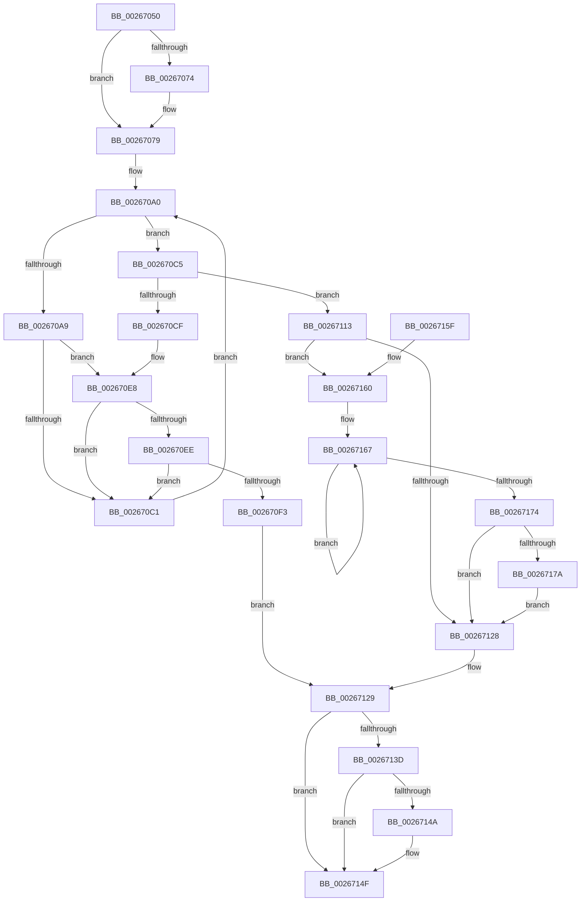

# StLockReleaseExclusive

- RVA: `0x00267050`–`0x00267181` (길이 `305` bytes)
- VA: `0x0000000140267050`
- 실행 섹션: `.text`
- PDB 이름 있음: `예`; PDB Function 태그: `아니요`
- unwind 정보 RVA: `0x00064F74`
- 디코드: `85`개 명령, `305/305` bytes 표시
- 미해석 바이트: `0` (있으면 어셈블리에 `.byte`로 보존)

> 이 문서는 커널 이미지의 기계어와 PDB 기호를 분석해 생성했습니다. 4번과 5번은 함수 원형과 자료형을 바이너리 사용 방식에서 추정한 C 해석이며 원본 소스 복구 결과는 아닙니다.

## 1. Dependencies

- 직접 호출 지점: **5**; 고유 호출 대상: **5**
- 직접 호출자로 확인된 함수: **12**
- RIP 상대 이미지 참조: **0**

### Outgoing calls
- `0x00267074` → [ExfTryToWakePushLock](ExfTryToWakePushLock_function_00265DD0.md) (function, `0x00265DD0`)
- `0x002670E2` → [KeBugCheckEx](../4F/KeBugCheckEx_function_004FD660.md) (function, `0x004FD660`)
- `0x0026710C` → [KiAbEntryFreeAndEnableInterrupts](KiAbEntryFreeAndEnableInterrupts_function_002622D0.md) (function, `0x002622D0`)
- `0x0026714A` → [KiCheckForKernelApcDelivery](../2E/KiCheckForKernelApcDelivery_function_002E2C80.md) (function, `0x002E2C80`)
- `0x0026717A` → [KiRemoveSystemWorkPriorityKick](KiRemoveSystemWorkPriorityKick_function_002631D0.md) (function, `0x002631D0`)

### Direct callers
- [ST_STORE&lt;SM_TRAITS&gt;::StDmPageRemove](../20/ST_STORE_SM_TRAITS_StDmPageRemove_function_002049A0.md) at `0x00204C99`
- [ST_STORE&lt;SM_TRAITS&gt;::StDmPageRemove](../20/ST_STORE_SM_TRAITS_StDmPageRemove_function_002049A0.md) at `0x00204CC5`
- [SMKM_STORE_MGR&lt;SM_TRAITS&gt;::SmFeAddInitiate](SMKM_STORE_MGR_SM_TRAITS_SmFeAddInitiate_function_0026618C.md) at `0x0026633A`
- [SMKM_STORE_MGR&lt;SM_TRAITS&gt;::SmFeEvictComplete](SMKM_STORE_MGR_SM_TRAITS_SmFeEvictComplete_function_00266854.md) at `0x00266980`
- [SMKM_STORE_MGR&lt;SM_TRAITS&gt;::SmFeStoreDelete](../3B/SMKM_STORE_MGR_SM_TRAITS_SmFeStoreDelete_function_003B12F0.md) at `0x003B1444`
- [ST_STORE&lt;SM_TRAITS&gt;::StDmCombinePageEntry](../41/ST_STORE_SM_TRAITS_StDmCombinePageEntry_function_00410D40.md) at `0x00410E59`
- [ST_STORE&lt;SM_TRAITS&gt;::StDmCombinePageRecords](../4E/ST_STORE_SM_TRAITS_StDmCombinePageRecords_function_004EBC80.md) at `0x004EBD7C`
- [sub_004EBF65](../4E/Unknown_function_004EBF65.md) at `0x004EBFF9`
- [SMKM_STORE_MGR&lt;SM_TRAITS&gt;::SmFeEmpty](../60/SMKM_STORE_MGR_SM_TRAITS_SmFeEmpty_function_0060C74C.md) at `0x0060C78D`
- [SMKM_STORE_MGR&lt;SM_TRAITS&gt;::SmFeSetEvictFailed](../60/SMKM_STORE_MGR_SM_TRAITS_SmFeSetEvictFailed_function_0060C7A4.md) at `0x0060C89D`
- [ST_STORE&lt;SM_TRAITS&gt;::StSetDataMovementInProgress](../60/ST_STORE_SM_TRAITS_StSetDataMovementInProgress_function_0060E9BC.md) at `0x0060EA13`
- [SMKM_STORE_MGR&lt;SM_TRAITS&gt;::SmFeStoreEvictKeys](../61/SMKM_STORE_MGR_SM_TRAITS_SmFeStoreEvictKeys_function_0061041C.md) at `0x00610557`
- [sub_006D8E6C](../6D/Unknown_function_006D8E6C.md) at `0x006D8EA2`

### Static image references
- 디코드된 RIP-relative 메모리 참조가 없습니다.

## 2. Other-region calls and transfers

- 다른 실행 섹션으로 향하는 call: **0**
- 별도 외부 분기/꼬리 이동을 확인하지 못했습니다.

## 3. Assembly (complete function range)

```asm
00267050  48 89 5C 24 08                  mov qword ptr [rsp + 8], rbx
00267055  48 89 74 24 10                  mov qword ptr [rsp + 0x10], rsi
0026705A  57                              push rdi
0026705B  48 83 EC 30                     sub rsp, 0x30
0026705F  48 8B D9                        mov rbx, rcx
00267062  48 C7 C0 FF FF FF FF            mov rax, 0xffffffffffffffff
00267069  F0 48 0F C1 01                  lock xadd qword ptr [rcx], rax
0026706E  24 06                           and al, 6
00267070  3C 02                           cmp al, 2
00267072  75 05                           jne 0x140267079
00267074  E8 57 ED FF FF                  call 0x140265dd0
00267079  65 4C 8B 1C 25 88 01 00 00      mov r11, qword ptr gs:[0x188]
00267082  FA                              cli
00267083  4D 8B 83 70 04 00 00            mov r8, qword ptr [r11 + 0x470]
0026708A  4C 8B CB                        mov r9, rbx
0026708D  48 BF FC FF FF FF FF FF FF 7F   movabs rdi, 0x7ffffffffffffffc
00267097  4C 23 CF                        and r9, rdi
0026709A  33 F6                           xor esi, esi
0026709C  8B C6                           mov eax, esi
0026709E  66 90                           nop
002670A0  41 0F B6 48 0C                  movzx ecx, byte ptr [r8 + 0xc]
002670A5  3B C1                           cmp eax, ecx
002670A7  73 1C                           jae 0x1402670c5
002670A9  8B C8                           mov ecx, eax
002670AB  4C 6B D1 58                     imul r10, rcx, 0x58
002670AF  4D 03 D0                        add r10, r8
002670B2  49 8B 52 10                     mov rdx, qword ptr [r10 + 0x10]
002670B6  48 8B CA                        mov rcx, rdx
002670B9  48 23 CF                        and rcx, rdi
002670BC  49 3B C9                        cmp rcx, r9
002670BF  74 27                           je 0x1402670e8
002670C1  FF C0                           inc eax
002670C3  EB DB                           jmp 0x1402670a0
002670C5  41 8B 43 78                     mov eax, dword ptr [r11 + 0x78]
002670C9  0F BA E0 10                     bt eax, 0x10
002670CD  72 44                           jb 0x140267113
002670CF  45 33 C9                        xor r9d, r9d
002670D2  48 89 74 24 20                  mov qword ptr [rsp + 0x20], rsi
002670D7  4C 8B C3                        mov r8, rbx
002670DA  49 8B D3                        mov rdx, r11
002670DD  B9 62 01 00 00                  mov ecx, 0x162
002670E2  E8 79 65 29 00                  call 0x1404fd660
002670E7  CC                              int3
002670E8  41 38 72 1A                     cmp byte ptr [r10 + 0x1a], sil
002670EC  74 D3                           je 0x1402670c1
002670EE  F6 C2 01                        test dl, 1
002670F1  75 CE                           jne 0x1402670c1
002670F3  41 B9 01 00 00 00               mov r9d, 1
002670F9  41 88 72 1A                     mov byte ptr [r10 + 0x1a], sil
002670FD  4C 8B C3                        mov r8, rbx
00267100  48 89 74 24 20                  mov qword ptr [rsp + 0x20], rsi
00267105  49 8B D3                        mov rdx, r11
00267108  49 8D 4A 10                     lea rcx, [r10 + 0x10]
0026710C  E8 BF B1 FF FF                  call 0x1402622d0
00267111  EB 16                           jmp 0x140267129
00267113  65 48 8B 0C 25 20 00 00 00      mov rcx, qword ptr gs:[0x20]
0026711C  4C 8B 81 B8 8E 00 00            mov r8, qword ptr [rcx + 0x8eb8]
00267123  4D 85 C0                        test r8, r8
00267126  75 38                           jne 0x140267160
00267128  FB                              sti
00267129  65 48 8B 0C 25 88 01 00 00      mov rcx, qword ptr gs:[0x188]
00267132  90                              nop
00267133  66 83 81 E6 01 00 00 01         add word ptr [rcx + 0x1e6], 1
0026713B  75 12                           jne 0x14026714f
0026713D  48 8D 81 98 00 00 00            lea rax, [rcx + 0x98]
00267144  90                              nop
00267145  48 39 00                        cmp qword ptr [rax], rax
00267148  74 05                           je 0x14026714f
0026714A  E8 31 BB 07 00                  call 0x1402e2c80
0026714F  48 8B 5C 24 40                  mov rbx, qword ptr [rsp + 0x40]
00267154  48 8B 74 24 48                  mov rsi, qword ptr [rsp + 0x48]
00267159  48 83 C4 30                     add rsp, 0x30
0026715D  5F                              pop rdi
0026715E  C3                              ret
0026715F  CC                              int3
00267160  41 0F 0D 08                     prefetchw byte ptr [r8]
00267164  41 8B 00                        mov eax, dword ptr [r8]
00267167  8B D0                           mov edx, eax
00267169  0F BA F2 15                     btr edx, 0x15
0026716D  F0 41 0F B1 10                  lock cmpxchg dword ptr [r8], edx
00267172  75 F3                           jne 0x140267167
00267174  0F BA E0 15                     bt eax, 0x15
00267178  73 AE                           jae 0x140267128
0026717A  E8 51 C0 FF FF                  call 0x1402631d0
0026717F  EB A7                           jmp 0x140267128
```

## 4. C-style interpretation (structured pseudocode)

```c
__int64 __fastcall StLockReleaseExclusive(__int64 a1)
{
    __int64 result;
    __int64 v_r10;
    __int64 v_rsi;
    __int64 v_rsp;
    unsigned __int64 v_stack_m18;
    unsigned __int64 v_stack_p10;
    unsigned __int64 v_stack_p8;

    v_stack_p8 = v_rbx;
    v_stack_p10 = v_rsi;
    v_rsp = (v_rsp) - (48);
    result = (unsigned __int8)((-1) & (6));
    if (((unsigned __int8)(result)) == 2) {
        result = ExfTryToWakePushLock(a1, a2, a3, a4);
    }
    a4 = (a1) & (v_rdi);
    v_rsi = 0;
loc_002670A0:
    if (0 >= ((unsigned int)(*(unsigned __int8 *)(*(unsigned __int64 *)(*(unsigned __int64 *)(gs_base + (0 + 392)) + 1136) + 12)))) goto loc_002670C5;
    v_r10 = (v_r10) * (0);
    v_r10 = (v_r10) + (*(unsigned __int64 *)(*(unsigned __int64 *)(gs_base + (0 + 392)) + 1136));
    a1 = (*(unsigned __int64 *)(v_r10 + 16)) & (v_rdi);
    if (a1 == a4) goto loc_002670E8;
loc_002670C1:
    result = (unsigned int)((0) + 1);
    goto loc_002670A0;
loc_002670C5:
    if (a1 < a4) goto loc_00267113;
    a4 = 0;
    v_stack_m18 = 0;
    result = KeBugCheckEx(354, *(unsigned __int64 *)(gs_base + (0 + 392)), a1, a4);
loc_002670E8:
    if ((*(unsigned __int8 *)(v_r10 + 26)) == 0) goto loc_002670C1;
    if ((((unsigned __int8)(*(unsigned __int64 *)(gs_base + (0 + 392)))) & (1)) != 0) goto loc_002670C1;
    *(unsigned __int8 *)(v_r10 + 26) = 0;
    v_stack_m18 = 0;
    result = KiAbEntryFreeAndEnableInterrupts(v_r10 + 16, *(unsigned __int64 *)(gs_base + (0 + 392)), a1, 1);
    goto loc_00267129;
loc_00267113:
    if (*(unsigned __int64 *)(*(unsigned __int64 *)(gs_base + (0 + 32)) + 36536) != 0) goto loc_00267160;
loc_00267128:
loc_00267129:
    if (*(unsigned __int64 *)(*(unsigned __int64 *)(gs_base + (0 + 32)) + 36536) != 0) goto loc_0026714F;
    result = *(unsigned __int64 *)(gs_base + (0 + 392)) + 152;
    if ((*(unsigned __int64 *)(*(unsigned __int64 *)(gs_base + (0 + 392)) + 152)) != (*(unsigned __int64 *)(gs_base + (0 + 392)) + 152)) {
        result = KiCheckForKernelApcDelivery(*(unsigned __int64 *)(gs_base + (0 + 392)), *(unsigned __int64 *)(gs_base + (0 + 392)), *(unsigned __int64 *)(*(unsigned __int64 *)(gs_base + (0 + 32)) + 36536), 1);
    }
    v_rsp = (v_rsp) + (48);
    return result;
loc_00267160:
loc_00267167:
    if (condition_is_not_equal) goto loc_00267167;
    if (condition_is_above_or_equal) goto loc_00267128;
    result = KiRemoveSystemWorkPriorityKick(*(unsigned __int64 *)(gs_base + (0 + 392)), (unsigned int)((unsigned int)((unsigned int)(*(unsigned int *)(*(unsigned __int64 *)(*(unsigned __int64 *)(gs_base + (0 + 32)) + 36536))))), *(unsigned __int64 *)(*(unsigned __int64 *)(gs_base + (0 + 32)) + 36536), 1);
    goto loc_00267128;
}
```

## 5. (Beta) C Style

```c
int64_t StLockReleaseExclusive(void *Arg1)
{
    uint8_t *arg1 = (uint8_t *)Arg1;

    int64_t result;
    int64_t local_r10;
    int64_t local_rsi;
    int64_t local_rsp;
    uint64_t v_stack_m18;
    uint64_t v_stack_p10;
    uint64_t v_stack_p8;

    v_stack_p8 = local_rbx;
    v_stack_p10 = local_rsi;
    local_rsp = (local_rsp) - (48);
    result = (uint8_t)((-1) & (6));
    if (((uint8_t)(result)) == 2) {
        result = ExfTryToWakePushLock(Arg1, a2, a3, a4);
    }
    a4 = (Arg1) & (local_rdi);
    local_rsi = 0;
loc_002670A0:
    if (0 >= ((uint32_t)(*(uint8_t *)(*(uint64_t *)(*(uint64_t *)(gs_base + (0 + 0x188)) + 0x470) + 0xC)))) goto loc_002670C5;
    local_r10 = (local_r10) * (0);
    local_r10 = (local_r10) + (*(uint64_t *)(*(uint64_t *)(gs_base + (0 + 0x188)) + 0x470));
    Arg1 = (*(uint64_t *)(local_r10 + 0x10)) & (local_rdi);
    if (Arg1 == a4) goto loc_002670E8;
loc_002670C1:
    result = (uint32_t)((0) + 1);
    goto loc_002670A0;
loc_002670C5:
    if (Arg1 < a4) goto loc_00267113;
    a4 = 0;
    v_stack_m18 = 0;
    result = KeBugCheckEx(354, *(uint64_t *)(gs_base + (0 + 0x188)), Arg1, a4);
loc_002670E8:
    if ((*(uint8_t *)(local_r10 + 0x1A)) == 0) goto loc_002670C1;
    if ((((uint8_t)(*(uint64_t *)(gs_base + (0 + 0x188)))) & (1)) != 0) goto loc_002670C1;
    *(uint8_t *)(local_r10 + 0x1A) = 0;
    v_stack_m18 = 0;
    result = KiAbEntryFreeAndEnableInterrupts(local_r10 + 16, *(uint64_t *)(gs_base + (0 + 0x188)), Arg1, 1);
    goto loc_00267129;
loc_00267113:
    if (*(uint64_t *)(*(uint64_t *)(gs_base + (0 + 0x20)) + 0x8EB8) != 0) goto loc_00267160;
loc_00267128:
loc_00267129:
    if (*(uint64_t *)(*(uint64_t *)(gs_base + (0 + 0x20)) + 0x8EB8) != 0) goto loc_0026714F;
    result = *(uint64_t *)(gs_base + (0 + 0x188)) + 152;
    if ((*(uint64_t *)(*(uint64_t *)(gs_base + (0 + 0x188)) + 0x98)) != (*(uint64_t *)(gs_base + (0 + 0x188)) + 152)) {
        result = KiCheckForKernelApcDelivery(*(uint64_t *)(gs_base + (0 + 0x188)), *(uint64_t *)(gs_base + (0 + 0x188)), *(uint64_t *)(*(uint64_t *)(gs_base + (0 + 0x20)) + 0x8EB8), 1);
    }
    local_rsp = (local_rsp) + (48);
    return result;
loc_00267160:
loc_00267167:
    if (condition_is_not_equal) goto loc_00267167;
    if (condition_is_above_or_equal) goto loc_00267128;
    result = KiRemoveSystemWorkPriorityKick(*(uint64_t *)(gs_base + (0 + 0x188)), (uint32_t)((uint32_t)((uint32_t)(*(uint32_t *)(*(uint64_t *)(*(uint64_t *)(gs_base + (0 + 0x20)) + 0x8EB8))))), *(uint64_t *)(*(uint64_t *)(gs_base + (0 + 0x20)) + 0x8EB8), 1);
    goto loc_00267128;
}
```

### 관측된 메모리 오프셋

구조체 형식이 확인되지 않은 접근은 인자 기준의 오프셋으로만 기록했습니다.

| 기준 인자 | 오프셋 표현 | 폭 (bit) | 접근 |
|---|---:|---:|---|
| `Arg1` | `+ 0x0` | `64` | `R/W` |

## 6. Execution-region graph

[열기: 2D/3D 그래프와 함수 탐색 컨트롤 패널](../../../control-panel.html?section=text&rva=0x00267050&view=graph)

- 2D 그래프는 위에서 아래로 흐르고, 3D 그래프는 빈 공간을 드래그해 회전합니다. Shift+드래그는 이동, 휠은 확대·축소, 함수 노드 선택은 대상 보고서 이동입니다.

### Static fallback


