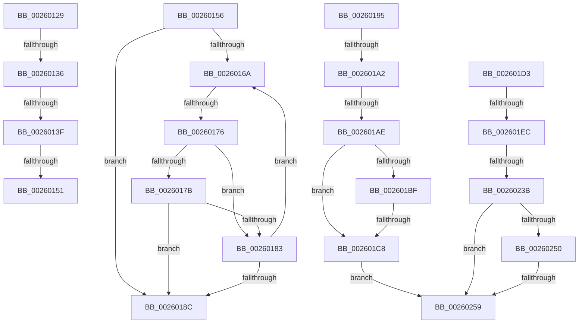

# sub_00260129

- RVA: `0x00260129`–`0x0026025E` (길이 `309` bytes)
- VA: `0x0000000140260129`
- 실행 섹션: `.text`
- PDB 이름 있음: `아니요`; PDB Function 태그: `아니요`
- unwind 정보 RVA: `0x00064370`
- 디코드: `78`개 명령, `309/309` bytes 표시
- 미해석 바이트: `0` (있으면 어셈블리에 `.byte`로 보존)

> 이 문서는 커널 이미지의 기계어와 PDB 기호를 분석해 생성했습니다. 4번과 5번은 함수 원형과 자료형을 바이너리 사용 방식에서 추정한 C 해석이며 원본 소스 복구 결과는 아닙니다.

## 1. Dependencies

- 직접 호출 지점: **1**; 고유 호출 대상: **1**
- 직접 호출자로 확인된 함수: **0**
- RIP 상대 이미지 참조: **1**

### Outgoing calls
- `0x00260214` → [KiAcquireKobjectLockSafe](../25/KiAcquireKobjectLockSafe_function_00251C90.md) (function, `0x00251C90`)

### Direct callers
- 이 함수 시작 RVA로 연결되는 직접 call은 확인되지 않았습니다. 간접 호출은 완전히 역산할 수 없습니다.

### Static image references
- `0x002601E0` → RVA `0x00FC6D20` (`ALMOSTRO`; read)

## 2. Other-region calls and transfers

- 다른 실행 섹션으로 향하는 call: **0**
- call이 아닌 외부 분기/꼬리 이동: **12**
  - `0x00260130` → [sub_0025FB5C + 0x29A](../25/Unknown_function_0025FB5C.md) (`tail-transfer`)
  - `0x00260139` → [sub_0025FB5C + 0x29A](../25/Unknown_function_0025FB5C.md) (`tail-transfer`)
  - `0x0026014B` → [sub_0025FB5C + 0x29A](../25/Unknown_function_0025FB5C.md) (`tail-transfer`)
  - `0x00260151` → [sub_00260366 + 0x18](Unknown_function_00260366.md) (`tail-transfer`)
  - `0x00260170` → [sub_00260366](Unknown_function_00260366.md) (`tail-transfer`)
  - `0x00260190` → [sub_0025FB5C + 0x2B0](../25/Unknown_function_0025FB5C.md) (`tail-transfer`)
  - `0x0026019C` → [sub_00260366 + 0x5FA](Unknown_function_00260366.md) (`tail-transfer`)
  - `0x002601A8` → [sub_00260366 + 0x5DA](Unknown_function_00260366.md) (`tail-transfer`)
  - `0x002601C2` → [sub_00260366 + 0x78C](Unknown_function_00260366.md) (`tail-transfer`)
  - `0x002601E6` → [sub_00260366 + 0x798](Unknown_function_00260366.md) (`tail-transfer`)
  - `0x00260235` → [sub_00260366 + 0x57F](Unknown_function_00260366.md) (`tail-transfer`)
  - `0x00260253` → [sub_00260366 + 0x536](Unknown_function_00260366.md) (`tail-transfer`)

## 3. Assembly (complete function range)

```asm
00260129  48 8B 53 10                     mov rdx, qword ptr [rbx + 0x10]
0026012D  48 85 D2                        test rdx, rdx
00260130  0F 84 C0 FC FF FF               je 0x14025fdf6
00260136  3B 42 08                        cmp eax, dword ptr [rdx + 8]
00260139  0F 83 B7 FC FF FF               jae 0x14025fdf6
0026013F  8B F8                           mov edi, eax
00260141  48 C1 E7 04                     shl rdi, 4
00260145  48 03 FA                        add rdi, rdx
00260148  4C 39 37                        cmp qword ptr [rdi], r14
0026014B  0F 85 A5 FC FF FF               jne 0x14025fdf6
00260151  E9 28 02 00 00                  jmp 0x14026037e
00260156  44 8B 47 08                     mov r8d, dword ptr [rdi + 8]
0026015A  49 C1 E0 04                     shl r8, 4
0026015E  4C 03 C7                        add r8, rdi
00260161  48 83 C7 10                     add rdi, 0x10
00260165  48 3B CA                        cmp rcx, rdx
00260168  73 22                           jae 0x14026018c
0026016A  48 8B 07                        mov rax, qword ptr [rdi]
0026016D  49 3B C6                        cmp rax, r14
00260170  0F 84 F0 01 00 00               je 0x140260366
00260176  48 85 C0                        test rax, rax
00260179  74 08                           je 0x140260183
0026017B  48 FF C1                        inc rcx
0026017E  48 3B CA                        cmp rcx, rdx
00260181  74 09                           je 0x14026018c
00260183  48 83 C7 10                     add rdi, 0x10
00260187  49 3B F8                        cmp rdi, r8
0026018A  75 DE                           jne 0x14026016a
0026018C  48 8B 7B 10                     mov rdi, qword ptr [rbx + 0x10]
00260190  E9 77 FC FF FF                  jmp 0x14025fe0c
00260195  48 8B 4B 28                     mov rcx, qword ptr [rbx + 0x28]
00260199  48 85 C9                        test rcx, rcx
0026019C  0F 84 BE 07 00 00               je 0x140260960
002601A2  48 8B 01                        mov rax, qword ptr [rcx]
002601A5  48 3B C1                        cmp rax, rcx
002601A8  0F 84 92 07 00 00               je 0x140260940
002601AE  48 89 43 28                     mov qword ptr [rbx + 0x28], rax
002601B2  48 8B 11                        mov rdx, qword ptr [rcx]
002601B5  48 8B 41 08                     mov rax, qword ptr [rcx + 8]
002601B9  48 39 4A 08                     cmp qword ptr [rdx + 8], rcx
002601BD  75 09                           jne 0x1402601c8
002601BF  48 39 08                        cmp qword ptr [rax], rcx
002601C2  0F 84 2A 09 00 00               je 0x140260af2
002601C8  41 BC 03 00 00 00               mov r12d, 3
002601CE  E9 86 00 00 00                  jmp 0x140260259
002601D3  44 0F 20 C0                     mov rax, cr8
002601D7  48 89 44 24 78                  mov qword ptr [rsp + 0x78], rax
002601DC  45 0F 22 C7                     mov cr8, r15
002601E0  39 35 3A 6B D6 00               cmp dword ptr [rip + 0xd66b3a], esi
002601E6  0F 85 12 09 00 00               jne 0x140260afe
002601EC  65 48 8B 04 25 20 00 00 00      mov rax, qword ptr gs:[0x20]
002601F5  48 89 45 80                     mov qword ptr [rbp - 0x80], rax
002601F9  48 8B 45 90                     mov rax, qword ptr [rbp - 0x70]
002601FD  48 8B 08                        mov rcx, qword ptr [rax]
00260200  48 89 45 98                     mov qword ptr [rbp - 0x68], rax
00260204  48 83 C0 18                     add rax, 0x18
00260208  48 89 4D 88                     mov qword ptr [rbp - 0x78], rcx
0026020C  48 8B C8                        mov rcx, rax
0026020F  48 89 44 24 70                  mov qword ptr [rsp + 0x70], rax
00260214  E8 77 1A FF FF                  call 0x140251c90
00260219  48 8B 45 98                     mov rax, qword ptr [rbp - 0x68]
0026021D  4C 8D 48 18                     lea r9, [rax + 0x18]
00260221  44 89 70 1C                     mov dword ptr [rax + 0x1c], r14d
00260225  49 8B 41 08                     mov rax, qword ptr [r9 + 8]
00260229  49 8D 49 08                     lea rcx, [r9 + 8]
0026022D  48 89 4C 24 38                  mov qword ptr [rsp + 0x38], rcx
00260232  48 3B C1                        cmp rax, rcx
00260235  0F 84 AA 06 00 00               je 0x1402608e5
0026023B  48 8B 10                        mov rdx, qword ptr [rax]
0026023E  48 8B C8                        mov rcx, rax
00260241  48 8B 40 08                     mov rax, qword ptr [rax + 8]
00260245  48 89 54 24 68                  mov qword ptr [rsp + 0x68], rdx
0026024A  48 39 4A 08                     cmp qword ptr [rdx + 8], rcx
0026024E  75 09                           jne 0x140260259
00260250  48 39 08                        cmp qword ptr [rax], rcx
00260253  0F 84 43 06 00 00               je 0x14026089c
00260259  49 8B CC                        mov rcx, r12
0026025C  CD 29                           int 0x29
```

## 4. C-style interpretation (structured pseudocode)

```c
__int64 __fastcall sub_00260129(__int64 a1)
{
    __int64 v_rdi;
    unsigned __int64 v_stack_p38;
    unsigned __int64 v_stack_p68;
    unsigned __int64 v_stack_p70;
    unsigned __int64 v_stack_p78;

    v_rdi = ((unsigned int)((unsigned int)(result))) << (4);
    v_rdi = (v_rdi) + (*(unsigned __int64 *)(v_rbx + 16));
}
```

## 5. (Beta) C Style

```c
int64_t sub_00260129(int64_t Arg1)
{
    int64_t local_rdi;
    uint64_t v_stack_p38;
    uint64_t v_stack_p68;
    uint64_t v_stack_p70;
    uint64_t v_stack_p78;

    local_rdi = ((uint32_t)((uint32_t)(result))) << (4);
    local_rdi = (local_rdi) + (*(uint64_t *)(local_rbx + 0x10));
}
```

## 6. Execution-region graph

[열기: 2D/3D 그래프와 함수 탐색 컨트롤 패널](../../../control-panel.html?section=text&rva=0x00260129&view=graph)

- 2D 그래프는 위에서 아래로 흐르고, 3D 그래프는 빈 공간을 드래그해 회전합니다. Shift+드래그는 이동, 휠은 확대·축소, 함수 노드 선택은 대상 보고서 이동입니다.

### Static fallback


