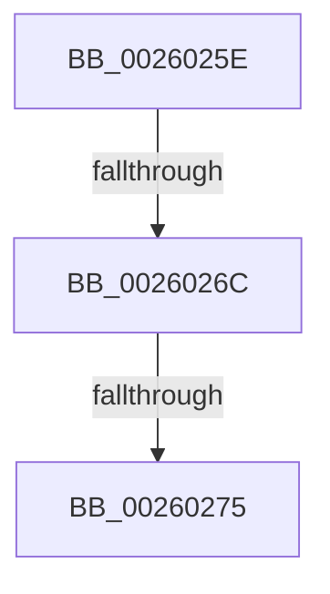

# sub_0026025E

- RVA: `0x0026025E`–`0x0026029A` (길이 `60` bytes)
- VA: `0x000000014026025E`
- 실행 섹션: `.text`
- PDB 이름 있음: `아니요`; PDB Function 태그: `아니요`
- unwind 정보 RVA: `0x00064384`
- 디코드: `15`개 명령, `60/60` bytes 표시
- 미해석 바이트: `0` (있으면 어셈블리에 `.byte`로 보존)

> 이 문서는 커널 이미지의 기계어와 PDB 기호를 분석해 생성했습니다. 4번과 5번은 함수 원형과 자료형을 바이너리 사용 방식에서 추정한 C 해석이며 원본 소스 복구 결과는 아닙니다.

## 1. Dependencies

- 직접 호출 지점: **2**; 고유 호출 대상: **2**
- 직접 호출자로 확인된 함수: **0**
- RIP 상대 이미지 참조: **0**

### Outgoing calls
- `0x00260285` → [KeBugCheckEx](../4F/KeBugCheckEx_function_004FD660.md) (function, `0x004FD660`)
- `0x00260290` → [KxWaitForLockOwnerShip](../25/KxWaitForLockOwnerShip_function_00257EB0.md) (function, `0x00257EB0`)

### Direct callers
- 이 함수 시작 RVA로 연결되는 직접 call은 확인되지 않았습니다. 간접 호출은 완전히 역산할 수 없습니다.

### Static image references
- 디코드된 RIP-relative 메모리 참조가 없습니다.

## 2. Other-region calls and transfers

- 다른 실행 섹션으로 향하는 call: **0**
- call이 아닌 외부 분기/꼬리 이동: **3**
  - `0x00260266` → [sub_0025FA63 + 0x85](../25/Unknown_function_0025FA63.md) (`tail-transfer`)
  - `0x0026026F` → [sub_0025FA63 + 0x85](../25/Unknown_function_0025FA63.md) (`tail-transfer`)
  - `0x00260295` → [sub_0025FA63 + 0x5F](../25/Unknown_function_0025FA63.md) (`tail-transfer`)

## 3. Assembly (complete function range)

```asm
0026025E  41 0F B6 C6                     movzx eax, r14b
00260262  24 03                           and al, 3
00260264  3C 03                           cmp al, 3
00260266  0F 84 7C F8 FF FF               je 0x14025fae8
0026026C  4D 3B F0                        cmp r14, r8
0026026F  0F 84 73 F8 FF FF               je 0x14025fae8
00260275  4D 8B CE                        mov r9, r14
00260278  48 89 74 24 20                  mov qword ptr [rsp + 0x20], rsi
0026027D  48 8B D3                        mov rdx, rbx
00260280  B9 6E 01 00 00                  mov ecx, 0x16e
00260285  E8 D6 D3 29 00                  call 0x1404fd660
0026028A  CC                              int3
0026028B  48 8D 4C 24 48                  lea rcx, [rsp + 0x48]
00260290  E8 1B 7C FF FF                  call 0x140257eb0
00260295  E9 28 F8 FF FF                  jmp 0x14025fac2
```

## 4. C-style interpretation (structured pseudocode)

```c
__int64 __fastcall sub_0026025E(__int64 a1, __int64 a2, __int64 a3, __int64 a4, __int64 a5, __int64 a6, __int64 a7, __int64 a8, __int64 a9)
{
    __int64 result;
    unsigned __int64 v_stack_p20;

    result = (unsigned __int8)(((unsigned __int8)(v_r14)) & (3));
    v_stack_p20 = v_rsi;
    result = KeBugCheckEx(366, v_rbx, a3, v_r14);
    result = KxWaitForLockOwnerShip(a9, v_rbx, a3, v_r14);
}
```

## 5. (Beta) C Style

```c
int64_t sub_0026025E(int64_t Arg1, int64_t Arg2, int64_t Arg3, int64_t Arg4, uint64_t Arg5, uint64_t Arg6, uint64_t Arg7, uint64_t Arg8, int64_t Arg9)
{
    int64_t result;
    uint64_t v_stack_p20;

    result = (uint8_t)(((uint8_t)(local_r14)) & (3));
    v_stack_p20 = local_rsi;
    result = KeBugCheckEx(366, local_rbx, Arg3, local_r14);
    result = KxWaitForLockOwnerShip(Arg9, local_rbx, Arg3, local_r14);
}
```

## 6. Execution-region graph

[열기: 2D/3D 그래프와 함수 탐색 컨트롤 패널](../../../control-panel.html?section=text&rva=0x0026025E&view=graph)

- 2D 그래프는 위에서 아래로 흐르고, 3D 그래프는 빈 공간을 드래그해 회전합니다. Shift+드래그는 이동, 휠은 확대·축소, 함수 노드 선택은 대상 보고서 이동입니다.

### Static fallback


