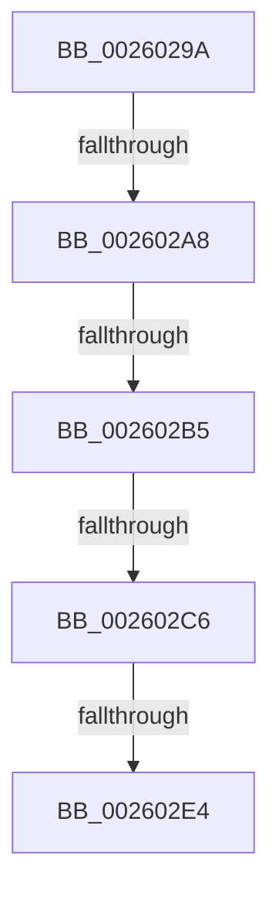

# sub_0026029A

- RVA: `0x0026029A`–`0x00260301` (길이 `103` bytes)
- VA: `0x000000014026029A`
- 실행 섹션: `.text`
- PDB 이름 있음: `아니요`; PDB Function 태그: `아니요`
- unwind 정보 RVA: `0x00064394`
- 디코드: `21`개 명령, `103/103` bytes 표시
- 미해석 바이트: `0` (있으면 어셈블리에 `.byte`로 보존)

> 이 문서는 커널 이미지의 기계어와 PDB 기호를 분석해 생성했습니다. 4번과 5번은 함수 원형과 자료형을 바이너리 사용 방식에서 추정한 C 해석이며 원본 소스 복구 결과는 아닙니다.

## 1. Dependencies

- 직접 호출 지점: **0**; 고유 호출 대상: **0**
- 직접 호출자로 확인된 함수: **0**
- RIP 상대 이미지 참조: **1**

### Outgoing calls
- 직접 디코드된 call 명령이 없습니다.

### Direct callers
- 이 함수 시작 RVA로 연결되는 직접 call은 확인되지 않았습니다. 간접 호출은 완전히 역산할 수 없습니다.

### Static image references
- `0x002602D6` → RVA `0x00E0EB10` (`.data`; read)

## 2. Other-region calls and transfers

- 다른 실행 섹션으로 향하는 call: **0**
- call이 아닌 외부 분기/꼬리 이동: **5**
  - `0x002602A2` → [sub_0026118A + 0x18F](Unknown_function_0026118A.md) (`tail-transfer`)
  - `0x002602AF` → [sub_00260366 + 0x86E](Unknown_function_00260366.md) (`tail-transfer`)
  - `0x002602C0` → [sub_0026118A + 0x1B9](Unknown_function_0026118A.md) (`tail-transfer`)
  - `0x002602DE` → [sub_00260366 + 0x891](Unknown_function_00260366.md) (`tail-transfer`)
  - `0x002602FF` → [sub_00260301 + 0x3E](Unknown_function_00260301.md) (`tail-transfer`)

## 3. Assembly (complete function range)

```asm
0026029A  48 8B 47 08                     mov rax, qword ptr [rdi + 8]
0026029E  48 83 F8 02                     cmp rax, 2
002602A2  0F 87 71 10 00 00               ja 0x140261319
002602A8  4C 8B CE                        mov r9, rsi
002602AB  48 83 3F 01                     cmp qword ptr [rdi], 1
002602AF  0F 87 1F 09 00 00               ja 0x140260bd4
002602B5  8B 4F 2C                        mov ecx, dword ptr [rdi + 0x2c]
002602B8  44 8B 54 24 40                  mov r10d, dword ptr [rsp + 0x40]
002602BD  44 3B D1                        cmp r10d, ecx
002602C0  0F 87 7D 10 00 00               ja 0x140261343
002602C6  41 8B 87 F0 8E 00 00            mov eax, dword ptr [r15 + 0x8ef0]
002602CD  33 D2                           xor edx, edx
002602CF  41 03 87 EC 8E 00 00            add eax, dword ptr [r15 + 0x8eec]
002602D6  F7 35 34 E8 BA 00               div dword ptr [rip + 0xbae834]
002602DC  85 D2                           test edx, edx
002602DE  0F 84 13 09 00 00               je 0x140260bf7
002602E4  89 77 1C                        mov dword ptr [rdi + 0x1c], esi
002602E7  4C 8B AC 24 68 01 00 00         mov r13, qword ptr [rsp + 0x168]
002602EF  4C 8B A4 24 60 01 00 00         mov r12, qword ptr [rsp + 0x160]
002602F7  4C 8B BC 24 20 01 00 00         mov r15, qword ptr [rsp + 0x120]
002602FF  EB 3E                           jmp 0x14026033f
```

## 4. C-style interpretation (structured pseudocode)

```c
__int64 __fastcall sub_0026029A(__int64 a1, int a2, __int64 a3, __int64 a4, __int64 a5, __int64 a6, __int64 a7, unsigned int a8, __int64 a9, __int64 a10, __int64 a11, __int64 a12, __int64 a13, __int64 a14, __int64 a15, __int64 a16, __int64 a17, __int64 a18, __int64 a19, __int64 a20, __int64 a21, __int64 a22, __int64 a23, __int64 a24, __int64 a25, __int64 a26, __int64 a27, __int64 a28, __int64 a29, __int64 a30, __int64 a31, __int64 a32, __int64 a33, __int64 a34, __int64 a35, __int64 a36, __int64 a37, __int64 a38, __int64 a39, __int64 a40, __int64 a41, __int64 a42, __int64 a43, __int64 a44, __int64 a45)
{
    __int64 result;

    a2 = 0;
    result = (unsigned int)(((unsigned int)(*(unsigned int *)(v_r15 + 36592))) + (*(unsigned int *)(v_r15 + 36588)));
    *(unsigned int *)(v_rdi + 28) = (unsigned int)(v_rsi);
}
```

## 5. (Beta) C Style

```c
int64_t sub_0026029A(int64_t Arg1, int32_t Arg2, int64_t Arg3, int64_t Arg4, uint64_t Arg5, uint64_t Arg6, uint64_t Arg7, uint32_t Arg8, uint64_t Arg9, uint64_t Arg10, uint64_t Arg11, uint64_t Arg12, uint64_t Arg13, uint64_t Arg14, uint64_t Arg15, uint64_t Arg16, uint64_t Arg17, uint64_t Arg18, uint64_t Arg19, uint64_t Arg20, uint64_t Arg21, uint64_t Arg22, uint64_t Arg23, uint64_t Arg24, uint64_t Arg25, uint64_t Arg26, uint64_t Arg27, uint64_t Arg28, uint64_t Arg29, uint64_t Arg30, uint64_t Arg31, uint64_t Arg32, uint64_t Arg33, uint64_t Arg34, uint64_t Arg35, int64_t Arg36, uint64_t Arg37, uint64_t Arg38, uint64_t Arg39, uint64_t Arg40, uint64_t Arg41, uint64_t Arg42, uint64_t Arg43, int64_t Arg44, int64_t Arg45)
{
    int64_t result;

    Arg2 = 0;
    result = (uint32_t)(((uint32_t)(*(uint32_t *)(local_r15 + 0x8EF0))) + (*(uint32_t *)(local_r15 + 0x8EEC)));
    *(uint32_t *)(local_rdi + 0x1C) = (uint32_t)(local_rsi);
}
```

## 6. Execution-region graph

[열기: 2D/3D 그래프와 함수 탐색 컨트롤 패널](../../../control-panel.html?section=text&rva=0x0026029A&view=graph)

- 2D 그래프는 위에서 아래로 흐르고, 3D 그래프는 빈 공간을 드래그해 회전합니다. Shift+드래그는 이동, 휠은 확대·축소, 함수 노드 선택은 대상 보고서 이동입니다.

### Static fallback


