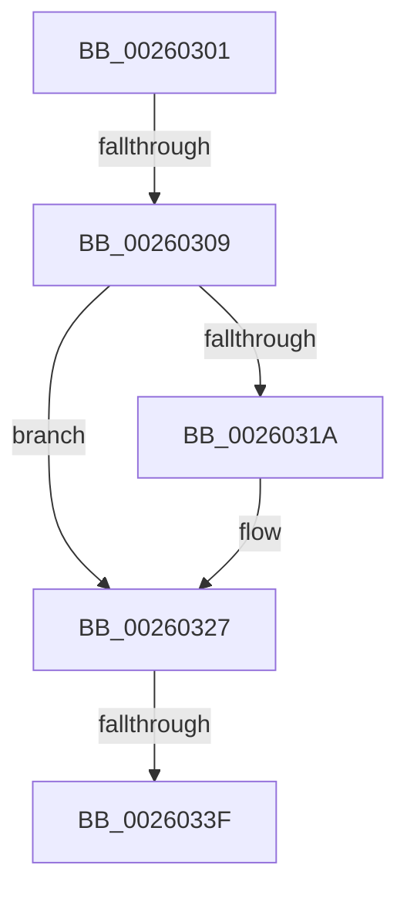

# sub_00260301

- RVA: `0x00260301`–`0x00260354` (길이 `83` bytes)
- VA: `0x0000000140260301`
- 실행 섹션: `.text`
- PDB 이름 있음: `아니요`; PDB Function 태그: `아니요`
- unwind 정보 RVA: `0x000643A8`
- 디코드: `21`개 명령, `83/83` bytes 표시
- 미해석 바이트: `0` (있으면 어셈블리에 `.byte`로 보존)

> 이 문서는 커널 이미지의 기계어와 PDB 기호를 분석해 생성했습니다. 4번과 5번은 함수 원형과 자료형을 바이너리 사용 방식에서 추정한 C 해석이며 원본 소스 복구 결과는 아닙니다.

## 1. Dependencies

- 직접 호출 지점: **2**; 고유 호출 대상: **2**
- 직접 호출자로 확인된 함수: **0**
- RIP 상대 이미지 참조: **1**

### Outgoing calls
- `0x00260322` → [KiLowerIrqlProcessIrqlFlags](../4F/KiLowerIrqlProcessIrqlFlags_function_004F5698.md) (function, `0x004F5698`)
- `0x00260335` → [ExReleaseFastResource](ExReleaseFastResource_function_002613D0.md) (function, `0x002613D0`)

### Direct callers
- 이 함수 시작 RVA로 연결되는 직접 call은 확인되지 않았습니다. 간접 호출은 완전히 역산할 수 없습니다.

### Static image references
- `0x00260311` → RVA `0x00FC6D20` (`ALMOSTRO`; read)

## 2. Other-region calls and transfers

- 다른 실행 섹션으로 향하는 call: **0**
- call이 아닌 외부 분기/꼬리 이동: **3**
  - `0x00260307` → [sub_00260355](Unknown_function_00260355.md) (`tail-transfer`)
  - `0x0026033D` → [sub_00260355 + 0x5](Unknown_function_00260355.md) (`tail-transfer`)
  - `0x0026034F` → [sub_002613A8](Unknown_function_002613A8.md) (`tail-transfer`)

## 3. Assembly (complete function range)

```asm
00260301  0F B6 47 25                     movzx eax, byte ptr [rdi + 0x25]
00260305  A8 02                           test al, 2
00260307  75 4C                           jne 0x140260355
00260309  24 FE                           and al, 0xfe
0026030B  41 B6 01                        mov r14b, 1
0026030E  88 47 25                        mov byte ptr [rdi + 0x25], al
00260311  83 3D 08 6A D6 00 00            cmp dword ptr [rip + 0xd66a08], 0
00260318  74 0D                           je 0x140260327
0026031A  44 0F 20 C1                     mov rcx, cr8
0026031E  40 0F B6 D6                     movzx edx, sil
00260322  E8 71 53 29 00                  call 0x1404f5698
00260327  40 0F B6 C6                     movzx eax, sil
0026032B  44 0F 22 C0                     mov cr8, rax
0026032F  48 8B D7                        mov rdx, rdi
00260332  48 8B CB                        mov rcx, rbx
00260335  E8 96 10 00 00                  call 0x1402613d0
0026033A  45 84 F6                        test r14b, r14b
0026033D  75 1B                           jne 0x14026035a
0026033F  48 8B BC 24 58 01 00 00         mov rdi, qword ptr [rsp + 0x158]
00260347  4C 8B B4 24 28 01 00 00         mov r14, qword ptr [rsp + 0x128]
0026034F  E9 54 10 00 00                  jmp 0x1402613a8
```

## 4. C-style interpretation (structured pseudocode)

```c
__int64 __fastcall sub_00260301(__int64 a1, __int64 a2, __int64 a3, __int64 a4, __int64 a5, __int64 a6, __int64 a7, __int64 a8, __int64 a9, __int64 a10, __int64 a11, __int64 a12, __int64 a13, __int64 a14, __int64 a15, __int64 a16, __int64 a17, __int64 a18, __int64 a19, __int64 a20, __int64 a21, __int64 a22, __int64 a23, __int64 a24, __int64 a25, __int64 a26, __int64 a27, __int64 a28, __int64 a29, __int64 a30, __int64 a31, __int64 a32, __int64 a33, __int64 a34, __int64 a35, __int64 a36, __int64 a37, __int64 a38, __int64 a39, __int64 a40, __int64 a41, __int64 a42, __int64 a43)
{
    __int64 result;

    result = (unsigned __int8)((*(unsigned __int8 *)(v_rdi + 37)) & (254));
    *(unsigned __int8 *)(v_rdi + 37) = (unsigned __int8)(result);
    if ((*(unsigned int *)(v_rip + 14051848)) != 0) {
        a1 = v_cr8;
        a2 = (unsigned __int8)(v_rsi);
        result = KiLowerIrqlProcessIrqlFlags(a1, a2, a3, a4);
    }
    result = ExReleaseFastResource(v_rbx, v_rdi, a3, a4);
}
```

## 5. (Beta) C Style

```c
int64_t sub_00260301(int64_t Arg1, int64_t Arg2, int64_t Arg3, int64_t Arg4, uint64_t Arg5, uint64_t Arg6, uint64_t Arg7, uint64_t Arg8, uint64_t Arg9, uint64_t Arg10, uint64_t Arg11, uint64_t Arg12, uint64_t Arg13, uint64_t Arg14, uint64_t Arg15, uint64_t Arg16, uint64_t Arg17, uint64_t Arg18, uint64_t Arg19, uint64_t Arg20, uint64_t Arg21, uint64_t Arg22, uint64_t Arg23, uint64_t Arg24, uint64_t Arg25, uint64_t Arg26, uint64_t Arg27, uint64_t Arg28, uint64_t Arg29, uint64_t Arg30, uint64_t Arg31, uint64_t Arg32, uint64_t Arg33, uint64_t Arg34, uint64_t Arg35, uint64_t Arg36, int64_t Arg37, uint64_t Arg38, uint64_t Arg39, uint64_t Arg40, uint64_t Arg41, uint64_t Arg42, int64_t Arg43)
{
    int64_t result;

    result = (uint8_t)((*(uint8_t *)(local_rdi + 0x25)) & (254));
    *(uint8_t *)(local_rdi + 0x25) = (uint8_t)(result);
    if ((*(uint32_t *)(v_rip + 0xD66A08)) != 0) {
        Arg1 = v_cr8;
        Arg2 = (uint8_t)(local_rsi);
        result = KiLowerIrqlProcessIrqlFlags(Arg1, Arg2, Arg3, Arg4);
    }
    result = ExReleaseFastResource(local_rbx, local_rdi, Arg3, Arg4);
}
```

## 6. Execution-region graph

[열기: 2D/3D 그래프와 함수 탐색 컨트롤 패널](../../../control-panel.html?section=text&rva=0x00260301&view=graph)

- 2D 그래프는 위에서 아래로 흐르고, 3D 그래프는 빈 공간을 드래그해 회전합니다. Shift+드래그는 이동, 휠은 확대·축소, 함수 노드 선택은 대상 보고서 이동입니다.

### Static fallback


