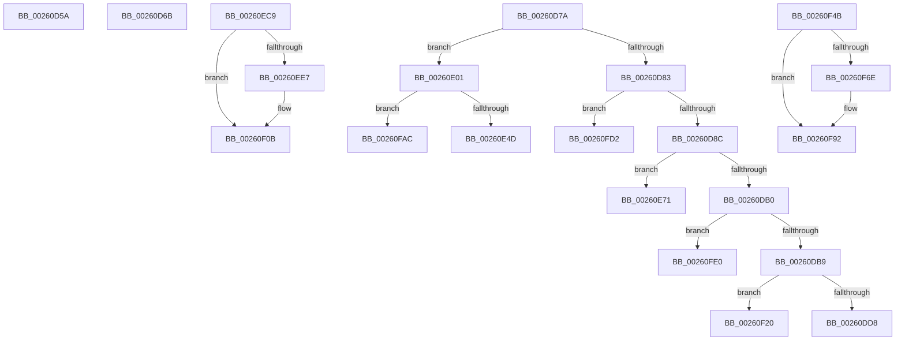

# sub_00260D5A

- RVA: `0x00260D5A`–`0x00260FEE` (길이 `660` bytes)
- VA: `0x0000000140260D5A`
- 실행 섹션: `.text`
- PDB 이름 있음: `아니요`; PDB Function 태그: `아니요`
- unwind 정보 RVA: `0x00064414`
- 디코드: `155`개 명령, `660/660` bytes 표시
- 미해석 바이트: `0` (있으면 어셈블리에 `.byte`로 보존)

> 이 문서는 커널 이미지의 기계어와 PDB 기호를 분석해 생성했습니다. 4번과 5번은 함수 원형과 자료형을 바이너리 사용 방식에서 추정한 C 해석이며 원본 소스 복구 결과는 아닙니다.

## 1. Dependencies

- 직접 호출 지점: **16**; 고유 호출 대상: **7**
- 직접 호출자로 확인된 함수: **0**
- RIP 상대 이미지 참조: **2**

### Outgoing calls
- `0x00260D9D` → [KeBugCheckEx](../4F/KeBugCheckEx_function_004FD660.md) (function, `0x004FD660`)
- `0x00260DCA` → [KeBugCheckEx](../4F/KeBugCheckEx_function_004FD660.md) (function, `0x004FD660`)
- `0x00260DE8` → [KiTryUnwaitThread](../35/KiTryUnwaitThread_function_003506D0.md) (function, `0x003506D0`)
- `0x00260E3E` → [KeBugCheckEx](../4F/KeBugCheckEx_function_004FD660.md) (function, `0x004FD660`)
- `0x00260E5D` → [KiTryUnwaitThread](../35/KiTryUnwaitThread_function_003506D0.md) (function, `0x003506D0`)
- `0x00260EAF` → [KeBugCheckEx](../4F/KeBugCheckEx_function_004FD660.md) (function, `0x004FD660`)
- `0x00260EDA` → [ExAllocatePool2](../../poolcode/B8/ExAllocatePool2_function_00B820F0.md) (function, `0x00B820F0`)
- `0x00260EF5` → [RtlCaptureStackBackTrace](../2F/RtlCaptureStackBackTrace_function_002F9FF0.md) (function, `0x002F9FF0`)
- `0x00260F12` → [KeAcquireSpinLockRaiseToDpc](../20/KeAcquireSpinLockRaiseToDpc_function_00208470.md) (function, `0x00208470`)
- `0x00260F32` → [KeInsertQueueDpc](../20/KeInsertQueueDpc_function_00207C50.md) (function, `0x00207C50`)
- `0x00260F5C` → [ExAllocatePool2](../../poolcode/B8/ExAllocatePool2_function_00B820F0.md) (function, `0x00B820F0`)
- `0x00260F7C` → [RtlCaptureStackBackTrace](../2F/RtlCaptureStackBackTrace_function_002F9FF0.md) (function, `0x002F9FF0`)
- `0x00260F99` → [KeAcquireSpinLockRaiseToDpc](../20/KeAcquireSpinLockRaiseToDpc_function_00208470.md) (function, `0x00208470`)
- `0x00260FBE` → [KeInsertQueueDpc](../20/KeInsertQueueDpc_function_00207C50.md) (function, `0x00207C50`)
- `0x00260FD6` → [ObpDeferObjectDeletion](../3A/ObpDeferObjectDeletion_function_003A2394.md) (function, `0x003A2394`)
- `0x00260FE4` → [ObpDeferObjectDeletion](../3A/ObpDeferObjectDeletion_function_003A2394.md) (function, `0x003A2394`)

### Direct callers
- 이 함수 시작 RVA로 연결되는 직접 call은 확인되지 않았습니다. 간접 호출은 완전히 역산할 수 없습니다.

### Static image references
- `0x00260E0C` → RVA `0x00000000` (`image boundary/outside`; read)
- `0x00260E2C` → RVA `0x00FC6E4C` (`ALMOSTRO`; read)

## 2. Other-region calls and transfers

- 다른 실행 섹션으로 향하는 call: **2**
  - `0x00260EDA` → [ExAllocatePool2](../../poolcode/B8/ExAllocatePool2_function_00B820F0.md) (`.text` → `POOLCODE`)
  - `0x00260F5C` → [ExAllocatePool2](../../poolcode/B8/ExAllocatePool2_function_00B820F0.md) (`.text` → `POOLCODE`)
- call이 아닌 외부 분기/꼬리 이동: **11**
  - `0x00260D66` → [sub_00260366 + 0x72C](Unknown_function_00260366.md) (`tail-transfer`)
  - `0x00260D75` → [sub_00260366 + 0x723](Unknown_function_00260366.md) (`tail-transfer`)
  - `0x00260DFC` → [sub_00260129 + 0x109](Unknown_function_00260129.md) (`tail-transfer`)
  - `0x00260E6C` → [sub_00260366 + 0x689](Unknown_function_00260366.md) (`tail-transfer`)
  - `0x00260EC4` → [sub_00260366 + 0x124](Unknown_function_00260366.md) (`tail-transfer`)
  - `0x00260F1B` → [sub_0025FB5C + 0x64](../25/Unknown_function_0025FB5C.md) (`tail-transfer`)
  - `0x00260F46` → [sub_00260129 + 0x109](Unknown_function_00260129.md) (`tail-transfer`)
  - `0x00260FA7` → [sub_00260366 + 0x7D](Unknown_function_00260366.md) (`tail-transfer`)
  - `0x00260FCD` → [sub_00260366 + 0x689](Unknown_function_00260366.md) (`tail-transfer`)
  - `0x00260FDB` → [sub_0025FB5C + 0xDB](../25/Unknown_function_0025FB5C.md) (`tail-transfer`)
  - `0x00260FE9` → [sub_00260366 + 0xF7](Unknown_function_00260366.md) (`tail-transfer`)

## 3. Assembly (complete function range)

```asm
00260D5A  83 FF 01                        cmp edi, 1
00260D5D  B8 01 00 00 00                  mov eax, 1
00260D62  44 0F 44 C8                     cmove r9d, eax
00260D66  E9 27 FD FF FF                  jmp 0x140260a92
00260D6B  41 3B C1                        cmp eax, r9d
00260D6E  41 8B FF                        mov edi, r15d
00260D71  44 0F 4F C8                     cmovg r9d, eax
00260D75  E9 0F FD FF FF                  jmp 0x140260a89
00260D7A  48 8B 4F D8                     mov rcx, qword ptr [rdi - 0x28]
00260D7E  48 85 C9                        test rcx, rcx
00260D81  75 7E                           jne 0x140260e01
00260D83  48 85 C0                        test rax, rax
00260D86  0F 89 46 02 00 00               jns 0x140260fd2
00260D8C  33 D2                           xor edx, edx
00260D8E  48 89 44 24 20                  mov qword ptr [rsp + 0x20], rax
00260D93  44 8D 49 04                     lea r9d, [rcx + 4]
00260D97  4C 8B C7                        mov r8, rdi
00260D9A  8D 4A 18                        lea ecx, [rdx + 0x18]
00260D9D  E8 BE C8 29 00                  call 0x1404fd660
00260DA2  CC                              int3
00260DA3  49 8B 4E D8                     mov rcx, qword ptr [r14 - 0x28]
00260DA7  48 85 C9                        test rcx, rcx
00260DAA  0F 85 C1 00 00 00               jne 0x140260e71
00260DB0  48 85 C0                        test rax, rax
00260DB3  0F 89 27 02 00 00               jns 0x140260fe0
00260DB9  33 D2                           xor edx, edx
00260DBB  48 89 44 24 20                  mov qword ptr [rsp + 0x20], rax
00260DC0  44 8D 49 04                     lea r9d, [rcx + 4]
00260DC4  4D 8B C6                        mov r8, r14
00260DC7  8D 4A 18                        lea ecx, [rdx + 0x18]
00260DCA  E8 91 C8 29 00                  call 0x1404fd660
00260DCF  CC                              int3
00260DD0  3C 04                           cmp al, 4
00260DD2  0F 84 48 01 00 00               je 0x140260f20
00260DD8  48 8B D1                        mov rdx, rcx
00260DDB  45 33 C9                        xor r9d, r9d
00260DDE  48 8B 4D 80                     mov rcx, qword ptr [rbp - 0x80]
00260DE2  41 B8 00 01 00 00               mov r8d, 0x100
00260DE8  E8 E3 F8 0E 00                  call 0x1403506d0
00260DED  48 8B 44 24 68                  mov rax, qword ptr [rsp + 0x68]
00260DF2  48 8B 4C 24 38                  mov rcx, qword ptr [rsp + 0x38]
00260DF7  4C 8B 4C 24 70                  mov r9, qword ptr [rsp + 0x70]
00260DFC  E9 31 F4 FF FF                  jmp 0x140260232
00260E01  41 B9 03 00 00 00               mov r9d, 3
00260E07  48 89 4C 24 20                  mov qword ptr [rsp + 0x20], rcx
00260E0C  4C 8D 15 ED F1 D9 FF            lea r10, [rip - 0x260e13]
00260E13  4C 8B C7                        mov r8, rdi
00260E16  48 8D 47 D0                     lea rax, [rdi - 0x30]
00260E1A  48 C1 E8 08                     shr rax, 8
00260E1E  0F B6 D0                        movzx edx, al
00260E21  41 8D 49 15                     lea ecx, [r9 + 0x15]
00260E25  0F B6 47 E8                     movzx eax, byte ptr [rdi - 0x18]
00260E29  48 33 D0                        xor rdx, rax
00260E2C  0F B6 05 19 60 D6 00            movzx eax, byte ptr [rip + 0xd66019]
00260E33  48 33 D0                        xor rdx, rax
00260E36  49 8B 94 D2 00 78 FC 00         mov rdx, qword ptr [r10 + rdx*8 + 0xfc7800]
00260E3E  E8 1D C8 29 00                  call 0x1404fd660
00260E43  CC                              int3
00260E44  80 F9 04                        cmp cl, 4
00260E47  0F 84 5F 01 00 00               je 0x140260fac
00260E4D  48 8B 4D 80                     mov rcx, qword ptr [rbp - 0x80]
00260E51  45 33 C9                        xor r9d, r9d
00260E54  41 B8 00 01 00 00               mov r8d, 0x100
00260E5A  48 8B D0                        mov rdx, rax
00260E5D  E8 6E F8 0E 00                  call 0x1403506d0
00260E62  48 8B 44 24 60                  mov rax, qword ptr [rsp + 0x60]
00260E67  4C 8B 4C 24 38                  mov r9, qword ptr [rsp + 0x38]
00260E6C  E9 7E FB FF FF                  jmp 0x1402609ef
00260E71  41 B9 03 00 00 00               mov r9d, 3
00260E77  48 89 4C 24 20                  mov qword ptr [rsp + 0x20], rcx
00260E7C  4C 8D 15 7D F1 D9 FF            lea r10, [rip - 0x260e83]
00260E83  4D 8B C6                        mov r8, r14
00260E86  49 8D 46 D0                     lea rax, [r14 - 0x30]
00260E8A  48 C1 E8 08                     shr rax, 8
00260E8E  0F B6 D0                        movzx edx, al
00260E91  41 8D 49 15                     lea ecx, [r9 + 0x15]
00260E95  41 0F B6 46 E8                  movzx eax, byte ptr [r14 - 0x18]
00260E9A  48 33 D0                        xor rdx, rax
00260E9D  0F B6 05 A8 5F D6 00            movzx eax, byte ptr [rip + 0xd65fa8]
00260EA4  48 33 D0                        xor rdx, rax
00260EA7  49 8B 94 D2 00 78 FC 00         mov rdx, qword ptr [r10 + rdx*8 + 0xfc7800]
00260EAF  E8 AC C7 29 00                  call 0x1404fd660
00260EB4  CC                              int3
00260EB5  48 8B 43 20                     mov rax, qword ptr [rbx + 0x20]
00260EB9  48 89 73 20                     mov qword ptr [rbx + 0x20], rsi
00260EBD  48 89 45 A0                     mov qword ptr [rbp - 0x60], rax
00260EC1  89 73 48                        mov dword ptr [rbx + 0x48], esi
00260EC4  E9 C1 F5 FF FF                  jmp 0x14026048a
00260EC9  BA 70 00 00 00                  mov edx, 0x70
00260ECE  41 B8 42 6F 6F 73               mov r8d, 0x736f6f42
00260ED4  41 B6 01                        mov r14b, 1
00260ED7  8D 4A D0                        lea ecx, [rdx - 0x30]
00260EDA  E8 11 12 92 00                  call 0x140b820f0
00260EDF  4C 8B E8                        mov r13, rax
00260EE2  48 85 C0                        test rax, rax
00260EE5  74 24                           je 0x140260f0b
00260EE7  45 33 C9                        xor r9d, r9d
00260EEA  4C 8D 40 10                     lea r8, [rax + 0x10]
00260EEE  41 8D 51 0A                     lea edx, [r9 + 0xa]
00260EF2  8D 4A F7                        lea ecx, [rdx - 9]
00260EF5  E8 F6 90 09 00                  call 0x1402f9ff0
00260EFA  65 48 8B 0C 25 88 01 00 00      mov rcx, qword ptr gs:[0x188]
00260F03  49 89 4D 60                     mov qword ptr [r13 + 0x60], rcx
00260F07  49 89 75 68                     mov qword ptr [r13 + 0x68], rsi
00260F0B  48 8D 8F 10 06 00 00            lea rcx, [rdi + 0x610]
00260F12  E8 59 75 FA FF                  call 0x140208470
00260F17  44 0F B6 E0                     movzx r12d, al
00260F1B  E9 A0 EC FF FF                  jmp 0x14025fbc0
00260F20  C6 41 11 05                     mov byte ptr [rcx + 0x11], 5
00260F24  4C 8B C1                        mov r8, rcx
00260F27  41 89 71 04                     mov dword ptr [r9 + 4], esi
00260F2B  49 8B D1                        mov rdx, r9
00260F2E  48 8B 49 18                     mov rcx, qword ptr [rcx + 0x18]
00260F32  E8 19 6D FA FF                  call 0x140207c50
00260F37  48 8B 44 24 68                  mov rax, qword ptr [rsp + 0x68]
00260F3C  48 8B 4C 24 38                  mov rcx, qword ptr [rsp + 0x38]
00260F41  4C 8B 4C 24 70                  mov r9, qword ptr [rsp + 0x70]
00260F46  E9 E7 F2 FF FF                  jmp 0x140260232
00260F4B  BA 70 00 00 00                  mov edx, 0x70
00260F50  41 B8 42 6F 6F 73               mov r8d, 0x736f6f42
00260F56  41 B4 01                        mov r12b, 1
00260F59  8D 4A D0                        lea ecx, [rdx - 0x30]
00260F5C  E8 8F 11 92 00                  call 0x140b820f0
00260F61  48 89 44 24 78                  mov qword ptr [rsp + 0x78], rax
00260F66  4C 8B E8                        mov r13, rax
00260F69  48 85 C0                        test rax, rax
00260F6C  74 24                           je 0x140260f92
00260F6E  45 33 C9                        xor r9d, r9d
00260F71  4C 8D 40 10                     lea r8, [rax + 0x10]
00260F75  41 8D 51 0A                     lea edx, [r9 + 0xa]
00260F79  8D 4A F7                        lea ecx, [rdx - 9]
00260F7C  E8 6F 90 09 00                  call 0x1402f9ff0
00260F81  65 48 8B 0C 25 88 01 00 00      mov rcx, qword ptr gs:[0x188]
00260F8A  49 89 4D 60                     mov qword ptr [r13 + 0x60], rcx
00260F8E  49 89 75 68                     mov qword ptr [r13 + 0x68], rsi
00260F92  49 8D 8E 10 06 00 00            lea rcx, [r14 + 0x610]
00260F99  E8 D2 74 FA FF                  call 0x140208470
00260F9E  44 0F B6 E8                     movzx r13d, al
00260FA2  48 8B 44 24 78                  mov rax, qword ptr [rsp + 0x78]
00260FA7  E9 37 F4 FF FF                  jmp 0x1402603e3
00260FAC  C6 40 11 05                     mov byte ptr [rax + 0x11], 5
00260FB0  4C 8B C0                        mov r8, rax
00260FB3  41 89 71 04                     mov dword ptr [r9 + 4], esi
00260FB7  49 8B D1                        mov rdx, r9
00260FBA  48 8B 48 18                     mov rcx, qword ptr [rax + 0x18]
00260FBE  E8 8D 6C FA FF                  call 0x140207c50
00260FC3  48 8B 44 24 60                  mov rax, qword ptr [rsp + 0x60]
00260FC8  4C 8B 4C 24 38                  mov r9, qword ptr [rsp + 0x38]
00260FCD  E9 1D FA FF FF                  jmp 0x1402609ef
00260FD2  48 8D 4F D0                     lea rcx, [rdi - 0x30]
00260FD6  E8 B9 13 14 00                  call 0x1403a2394
00260FDB  E9 57 EC FF FF                  jmp 0x14025fc37
00260FE0  49 8D 4E D0                     lea rcx, [r14 - 0x30]
00260FE4  E8 AB 13 14 00                  call 0x1403a2394
00260FE9  E9 6F F4 FF FF                  jmp 0x14026045d
```

## 4. C-style interpretation (structured pseudocode)

```c
__int64 __fastcall sub_00260D5A(__int64 a1, int a2)
{
    unsigned __int64 v_stack_p20;
    unsigned __int64 v_stack_p38;
    unsigned __int64 v_stack_p60;
    unsigned __int64 v_stack_p68;
    unsigned __int64 v_stack_p70;
    unsigned __int64 v_stack_p78;

    if (((unsigned int)(v_rdi)) == 1) { a4 = 1; }
}
```

## 5. (Beta) C Style

```c
int64_t sub_00260D5A(int64_t Arg1, int32_t Arg2)
{
    uint64_t v_stack_p20;
    uint64_t v_stack_p38;
    uint64_t v_stack_p60;
    uint64_t v_stack_p68;
    uint64_t v_stack_p70;
    uint64_t v_stack_p78;

    if (((uint32_t)(local_rdi)) == 1) { a4 = 1; }
}
```

## 6. Execution-region graph

[열기: 2D/3D 그래프와 함수 탐색 컨트롤 패널](../../../control-panel.html?section=text&rva=0x00260D5A&view=graph)

- 2D 그래프는 위에서 아래로 흐르고, 3D 그래프는 빈 공간을 드래그해 회전합니다. Shift+드래그는 이동, 휠은 확대·축소, 함수 노드 선택은 대상 보고서 이동입니다.

### Static fallback


