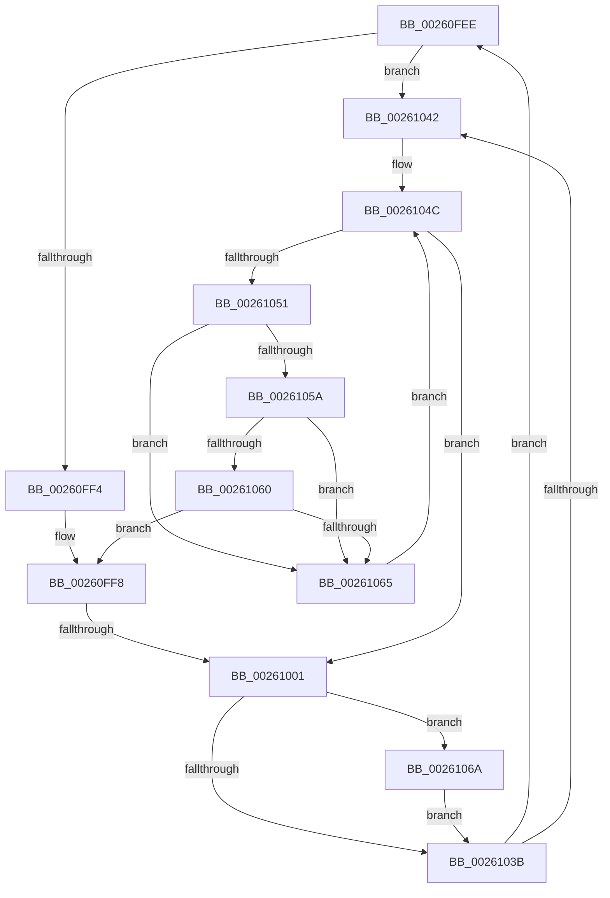

# sub_00260FEE

- RVA: `0x00260FEE`–`0x00261078` (길이 `138` bytes)
- VA: `0x0000000140260FEE`
- 실행 섹션: `.text`
- PDB 이름 있음: `아니요`; PDB Function 태그: `아니요`
- unwind 정보 RVA: `0x00064438`
- 디코드: `39`개 명령, `138/138` bytes 표시
- 미해석 바이트: `0` (있으면 어셈블리에 `.byte`로 보존)

> 이 문서는 커널 이미지의 기계어와 PDB 기호를 분석해 생성했습니다. 4번과 5번은 함수 원형과 자료형을 바이너리 사용 방식에서 추정한 C 해석이며 원본 소스 복구 결과는 아닙니다.

## 1. Dependencies

- 직접 호출 지점: **2**; 고유 호출 대상: **2**
- 직접 호출자로 확인된 함수: **0**
- RIP 상대 이미지 참조: **1**

### Outgoing calls
- `0x00261016` → [KeBugCheckEx](../4F/KeBugCheckEx_function_004FD660.md) (function, `0x004FD660`)
- `0x00261071` → [KiRaiseIrqlProcessIrqlFlags](../4F/KiRaiseIrqlProcessIrqlFlags_function_004F56FC.md) (function, `0x004F56FC`)

### Direct callers
- 이 함수 시작 RVA로 연결되는 직접 call은 확인되지 않았습니다. 간접 호출은 완전히 역산할 수 없습니다.

### Static image references
- `0x00261032` → RVA `0x00FC6D20` (`ALMOSTRO`; read)

## 2. Other-region calls and transfers

- 다른 실행 섹션으로 향하는 call: **0**
- call이 아닌 외부 분기/꼬리 이동: **1**
  - `0x00260FFB` → [sub_00260301](Unknown_function_00260301.md) (`tail-transfer`)

## 3. Assembly (complete function range)

```asm
00260FEE  4C 39 73 50                     cmp qword ptr [rbx + 0x50], r14
00260FF2  75 4E                           jne 0x140261042
00260FF4  48 8D 7B 40                     lea rdi, [rbx + 0x40]
00260FF8  48 85 FF                        test rdi, rdi
00260FFB  0F 85 00 F3 FF FF               jne 0x140260301
00261001  33 F6                           xor esi, esi
00261003  45 33 C9                        xor r9d, r9d
00261006  4D 8B C6                        mov r8, r14
00261009  48 89 74 24 20                  mov qword ptr [rsp + 0x20], rsi
0026100E  48 8B D3                        mov rdx, rbx
00261011  B9 E3 00 00 00                  mov ecx, 0xe3
00261016  E8 45 C6 29 00                  call 0x1404fd660
0026101B  CC                              int3
0026101C  65 4C 8B 34 25 88 01 00 00      mov r14, qword ptr gs:[0x188]
00261025  44 0F 20 C6                     mov rsi, cr8
00261029  B8 02 00 00 00                  mov eax, 2
0026102E  44 0F 22 C0                     mov cr8, rax
00261032  83 3D E7 5C D6 00 00            cmp dword ptr [rip + 0xd65ce7], 0
00261039  75 2F                           jne 0x14026106a
0026103B  48 8B 03                        mov rax, qword ptr [rbx]
0026103E  A8 01                           test al, 1
00261040  75 AC                           jne 0x140260fee
00261042  49 8D 86 B8 06 00 00            lea rax, [r14 + 0x6b8]
00261049  48 8B 38                        mov rdi, qword ptr [rax]
0026104C  48 3B F8                        cmp rdi, rax
0026104F  74 B0                           je 0x140261001
00261051  0F B6 4F 25                     movzx ecx, byte ptr [rdi + 0x25]
00261055  F6 C1 02                        test cl, 2
00261058  75 0B                           jne 0x140261065
0026105A  48 39 5F 18                     cmp qword ptr [rdi + 0x18], rbx
0026105E  75 05                           jne 0x140261065
00261060  F6 C1 01                        test cl, 1
00261063  75 93                           jne 0x140260ff8
00261065  48 8B 3F                        mov rdi, qword ptr [rdi]
00261068  EB E2                           jmp 0x14026104c
0026106A  0F B6 D0                        movzx edx, al
0026106D  40 0F B6 CE                     movzx ecx, sil
00261071  E8 86 46 29 00                  call 0x1404f56fc
00261076  EB C3                           jmp 0x14026103b
```

## 4. C-style interpretation (structured pseudocode)

```c
__int64 __fastcall sub_00260FEE(__int64 a1, __int64 a2, __int64 a3, int a4)
{
    __int64 result;
    __int64 v_rsi;
    unsigned __int64 v_stack_p20;

    if ((*(unsigned __int64 *)(v_rbx + 80)) != v_r14) goto loc_00261042;
loc_00260FF8:
loc_00261001:
    v_rsi = 0;
    a4 = 0;
    v_stack_p20 = 0;
    result = KeBugCheckEx(227, v_rbx, v_r14, a4);
    if ((*(unsigned int *)(v_rip + 14048487)) != 0) goto loc_0026106A;
loc_0026103B:
    if ((((unsigned __int8)(*(unsigned __int64 *)(v_rbx))) & (1)) != 0) goto loc_00260FEE;
loc_00261042:
loc_0026104C:
    if ((*(unsigned __int64 *)(*(unsigned __int64 *)(gs_base + (0 + 392)) + 1720)) == (*(unsigned __int64 *)(gs_base + (0 + 392)) + 1720)) goto loc_00261001;
    if ((((unsigned __int8)(*(unsigned __int8 *)(*(unsigned __int64 *)(*(unsigned __int64 *)(gs_base + (0 + 392)) + 1720) + 37))) & (2)) != 0) goto loc_00261065;
    if ((*(unsigned __int64 *)(*(unsigned __int64 *)(*(unsigned __int64 *)(gs_base + (0 + 392)) + 1720) + 24)) != v_rbx) goto loc_00261065;
    if ((((unsigned __int8)(*(unsigned __int8 *)(*(unsigned __int64 *)(*(unsigned __int64 *)(gs_base + (0 + 392)) + 1720) + 37))) & (1)) != 0) goto loc_00260FF8;
loc_00261065:
    goto loc_0026104C;
loc_0026106A:
    result = KiRaiseIrqlProcessIrqlFlags((unsigned __int8)(v_cr8), (unsigned __int8)(*(unsigned __int64 *)(gs_base + (0 + 392)) + 1720), v_r14, a4);
    goto loc_0026103B;
}
```

## 5. (Beta) C Style

```c
int64_t sub_00260FEE(int64_t Arg1, int64_t Arg2, int64_t Arg3, int32_t Arg4)
{
    int64_t result;
    int64_t local_rsi;
    uint64_t v_stack_p20;

    if ((*(uint64_t *)(local_rbx + 0x50)) != local_r14) goto loc_00261042;
loc_00260FF8:
loc_00261001:
    local_rsi = 0;
    Arg4 = 0;
    v_stack_p20 = 0;
    result = KeBugCheckEx(227, local_rbx, local_r14, Arg4);
    if ((*(uint32_t *)(v_rip + 0xD65CE7)) != 0) goto loc_0026106A;
loc_0026103B:
    if ((((uint8_t)(*(uint64_t *)(local_rbx))) & (1)) != 0) goto loc_00260FEE;
loc_00261042:
loc_0026104C:
    if ((*(uint64_t *)(*(uint64_t *)(gs_base + (0 + 0x188)) + 0x6B8)) == (*(uint64_t *)(gs_base + (0 + 0x188)) + 1720)) goto loc_00261001;
    if ((((uint8_t)(*(uint8_t *)(*(uint64_t *)(*(uint64_t *)(gs_base + (0 + 0x188)) + 0x6B8) + 0x25))) & (2)) != 0) goto loc_00261065;
    if ((*(uint64_t *)(*(uint64_t *)(*(uint64_t *)(gs_base + (0 + 0x188)) + 0x6B8) + 0x18)) != local_rbx) goto loc_00261065;
    if ((((uint8_t)(*(uint8_t *)(*(uint64_t *)(*(uint64_t *)(gs_base + (0 + 0x188)) + 0x6B8) + 0x25))) & (1)) != 0) goto loc_00260FF8;
loc_00261065:
    goto loc_0026104C;
loc_0026106A:
    result = KiRaiseIrqlProcessIrqlFlags((uint8_t)(v_cr8), (uint8_t)(*(uint64_t *)(gs_base + (0 + 0x188)) + 1720), local_r14, Arg4);
    goto loc_0026103B;
}
```

## 6. Execution-region graph

[열기: 2D/3D 그래프와 함수 탐색 컨트롤 패널](../../../control-panel.html?section=text&rva=0x00260FEE&view=graph)

- 2D 그래프는 위에서 아래로 흐르고, 3D 그래프는 빈 공간을 드래그해 회전합니다. Shift+드래그는 이동, 휠은 확대·축소, 함수 노드 선택은 대상 보고서 이동입니다.

### Static fallback


