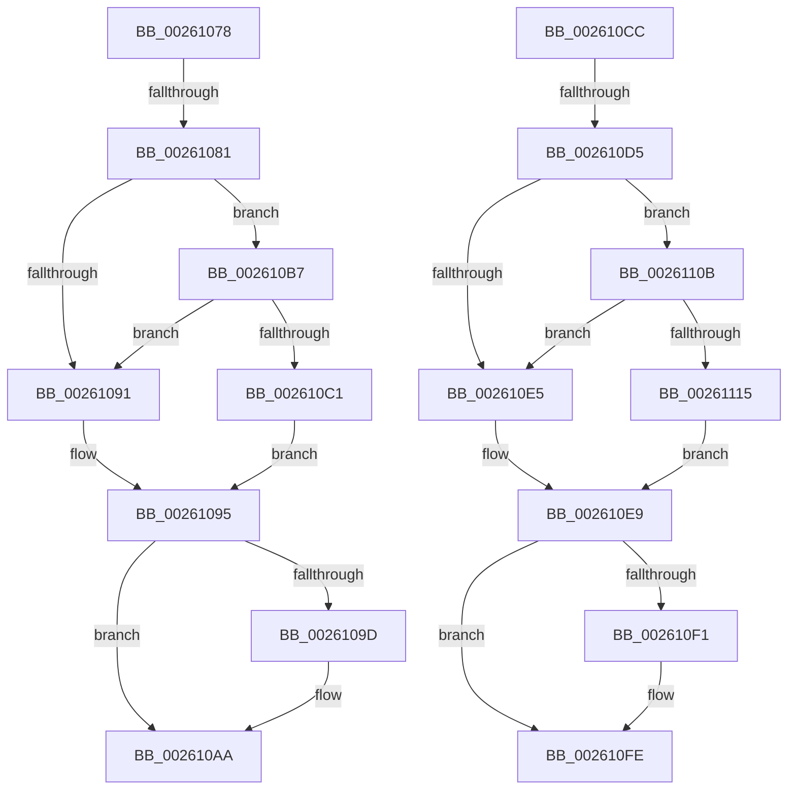

# sub_00261078

- RVA: `0x00261078`–`0x00261120` (길이 `168` bytes)
- VA: `0x0000000140261078`
- 실행 섹션: `.text`
- PDB 이름 있음: `아니요`; PDB Function 태그: `아니요`
- unwind 정보 RVA: `0x00064450`
- 디코드: `40`개 명령, `168/168` bytes 표시
- 미해석 바이트: `0` (있으면 어셈블리에 `.byte`로 보존)

> 이 문서는 커널 이미지의 기계어와 PDB 기호를 분석해 생성했습니다. 4번과 5번은 함수 원형과 자료형을 바이너리 사용 방식에서 추정한 C 해석이며 원본 소스 복구 결과는 아닙니다.

## 1. Dependencies

- 직접 호출 지점: **4**; 고유 호출 대상: **2**
- 직접 호출자로 확인된 함수: **0**
- RIP 상대 이미지 참조: **3**

### Outgoing calls
- `0x002610A5` → [KiLowerIrqlProcessIrqlFlags](../4F/KiLowerIrqlProcessIrqlFlags_function_004F5698.md) (function, `0x004F5698`)
- `0x002610C5` → [KiReleaseSpinLockInstrumented](../39/KiReleaseSpinLockInstrumented_function_00392EF0.md) (function, `0x00392EF0`)
- `0x002610F9` → [KiLowerIrqlProcessIrqlFlags](../4F/KiLowerIrqlProcessIrqlFlags_function_004F5698.md) (function, `0x004F5698`)
- `0x00261119` → [KiReleaseSpinLockInstrumented](../39/KiReleaseSpinLockInstrumented_function_00392EF0.md) (function, `0x00392EF0`)

### Direct callers
- 이 함수 시작 RVA로 연결되는 직접 call은 확인되지 않았습니다. 간접 호출은 완전히 역산할 수 없습니다.

### Static image references
- `0x00261081` → RVA `0x00FC6B06` (`ALMOSTRO`; read)
- `0x00261095` → RVA `0x00FC6D20` (`ALMOSTRO`; read)
- `0x002610B7` → RVA `0x00F0DE58` (`.data`; read)

## 2. Other-region calls and transfers

- 다른 실행 섹션으로 향하는 call: **0**
- call이 아닌 외부 분기/꼬리 이동: **4**
  - `0x0026107B` → [sub_0025FB5C + 0x80](../25/Unknown_function_0025FB5C.md) (`tail-transfer`)
  - `0x002610B2` → [sub_0025FB5C + 0x80](../25/Unknown_function_0025FB5C.md) (`tail-transfer`)
  - `0x002610CF` → [sub_00260366 + 0x9B](Unknown_function_00260366.md) (`tail-transfer`)
  - `0x00261106` → [sub_00260366 + 0x9B](Unknown_function_00260366.md) (`tail-transfer`)

## 3. Assembly (complete function range)

```asm
00261078  45 84 F6                        test r14b, r14b
0026107B  0F 84 5B EB FF FF               je 0x14025fbdc
00261081  F6 05 7E 5A D6 00 01            test byte ptr [rip + 0xd65a7e], 1
00261088  48 8D 8F 10 06 00 00            lea rcx, [rdi + 0x610]
0026108F  75 26                           jne 0x1402610b7
00261091  F0 48 21 31                     lock and qword ptr [rcx], rsi
00261095  39 35 85 5C D6 00               cmp dword ptr [rip + 0xd65c85], esi
0026109B  74 0D                           je 0x1402610aa
0026109D  44 0F 20 C1                     mov rcx, cr8
002610A1  41 0F B6 D4                     movzx edx, r12b
002610A5  E8 EE 45 29 00                  call 0x1404f5698
002610AA  41 0F B6 C4                     movzx eax, r12b
002610AE  44 0F 22 C0                     mov cr8, rax
002610B2  E9 25 EB FF FF                  jmp 0x14025fbdc
002610B7  8B 05 9B CD CA 00               mov eax, dword ptr [rip + 0xcacd9b]
002610BD  85 C0                           test eax, eax
002610BF  75 D0                           jne 0x140261091
002610C1  48 8B 55 48                     mov rdx, qword ptr [rbp + 0x48]
002610C5  E8 26 1E 13 00                  call 0x140392ef0
002610CA  EB C9                           jmp 0x140261095
002610CC  45 84 E4                        test r12b, r12b
002610CF  0F 84 2C F3 FF FF               je 0x140260401
002610D5  F6 05 2A 5A D6 00 01            test byte ptr [rip + 0xd65a2a], 1
002610DC  49 8D 8E 10 06 00 00            lea rcx, [r14 + 0x610]
002610E3  75 26                           jne 0x14026110b
002610E5  F0 48 21 31                     lock and qword ptr [rcx], rsi
002610E9  39 35 31 5C D6 00               cmp dword ptr [rip + 0xd65c31], esi
002610EF  74 0D                           je 0x1402610fe
002610F1  44 0F 20 C1                     mov rcx, cr8
002610F5  41 0F B6 D5                     movzx edx, r13b
002610F9  E8 9A 45 29 00                  call 0x1404f5698
002610FE  41 0F B6 C5                     movzx eax, r13b
00261102  44 0F 22 C0                     mov cr8, rax
00261106  E9 F6 F2 FF FF                  jmp 0x140260401
0026110B  8B 05 47 CD CA 00               mov eax, dword ptr [rip + 0xcacd47]
00261111  85 C0                           test eax, eax
00261113  75 D0                           jne 0x1402610e5
00261115  48 8B 55 48                     mov rdx, qword ptr [rbp + 0x48]
00261119  E8 D2 1D 13 00                  call 0x140392ef0
0026111E  EB C9                           jmp 0x1402610e9
```

## 4. C-style interpretation (structured pseudocode)

```c
__int64 __fastcall sub_00261078(void)
{
    __int64 result;

    if (((*(unsigned __int8 *)(v_rip + 14047870)) & (1)) != 0) goto loc_002610B7;
loc_00261091:
loc_00261095:
    if ((*(unsigned int *)(v_rip + 14048389)) != ((unsigned int)(v_rsi))) {
        a1 = v_cr8;
        a2 = (unsigned __int8)(v_r12);
        result = KiLowerIrqlProcessIrqlFlags(a1, a2, a3, a4);
    }
loc_002610B7:
    if ((unsigned int)((unsigned int)(*(unsigned int *)(v_rip + 13290907))) != 0) goto loc_00261091;
    result = KiReleaseSpinLockInstrumented(a1, *(unsigned __int64 *)(v_rbp + 72), a3, a4);
    goto loc_00261095;
}
```

## 5. (Beta) C Style

```c
void sub_00261078(void)
{
    int64_t result;

    if (((*(uint8_t *)(v_rip + 0xD65A7E)) & (1)) != 0) goto loc_002610B7;
loc_00261091:
loc_00261095:
    if ((*(uint32_t *)(v_rip + 0xD65C85)) != ((uint32_t)(local_rsi))) {
        a1 = v_cr8;
        a2 = (uint8_t)(local_r12);
        result = KiLowerIrqlProcessIrqlFlags(a1, a2, a3, a4);
    }
loc_002610B7:
    if ((uint32_t)((uint32_t)(*(uint32_t *)(v_rip + 0xCACD9B))) != 0) goto loc_00261091;
    result = KiReleaseSpinLockInstrumented(a1, *(uint64_t *)(local_rbp + 0x48), a3, a4);
    goto loc_00261095;
}
```

## 6. Execution-region graph

[열기: 2D/3D 그래프와 함수 탐색 컨트롤 패널](../../../control-panel.html?section=text&rva=0x00261078&view=graph)

- 2D 그래프는 위에서 아래로 흐르고, 3D 그래프는 빈 공간을 드래그해 회전합니다. Shift+드래그는 이동, 휠은 확대·축소, 함수 노드 선택은 대상 보고서 이동입니다.

### Static fallback


