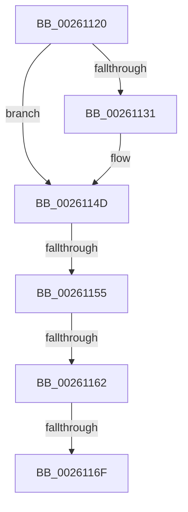

# sub_00261120

- RVA: `0x00261120`–`0x0026118A` (길이 `106` bytes)
- VA: `0x0000000140261120`
- 실행 섹션: `.text`
- PDB 이름 있음: `아니요`; PDB Function 태그: `아니요`
- unwind 정보 RVA: `0x00064474`
- 디코드: `26`개 명령, `106/106` bytes 표시
- 미해석 바이트: `0` (있으면 어셈블리에 `.byte`로 보존)

> 이 문서는 커널 이미지의 기계어와 PDB 기호를 분석해 생성했습니다. 4번과 5번은 함수 원형과 자료형을 바이너리 사용 방식에서 추정한 C 해석이며 원본 소스 복구 결과는 아닙니다.

## 1. Dependencies

- 직접 호출 지점: **2**; 고유 호출 대상: **1**
- 직접 호출자로 확인된 함수: **0**
- RIP 상대 이미지 참조: **0**

### Outgoing calls
- `0x00261147` → [KeBugCheckEx](../4F/KeBugCheckEx_function_004FD660.md) (function, `0x004FD660`)
- `0x00261184` → [KeBugCheckEx](../4F/KeBugCheckEx_function_004FD660.md) (function, `0x004FD660`)

### Direct callers
- 이 함수 시작 RVA로 연결되는 직접 call은 확인되지 않았습니다. 간접 호출은 완전히 역산할 수 없습니다.

### Static image references
- 디코드된 RIP-relative 메모리 참조가 없습니다.

## 2. Other-region calls and transfers

- 다른 실행 섹션으로 향하는 call: **0**
- call이 아닌 외부 분기/꼬리 이동: **3**
  - `0x0026114F` → [sub_00260FEE + 0x2E](Unknown_function_00260FEE.md) (`tail-transfer`)
  - `0x0026115C` → [sub_00260FEE + 0x2E](Unknown_function_00260FEE.md) (`tail-transfer`)
  - `0x00261169` → [sub_00260FEE + 0x2E](Unknown_function_00260FEE.md) (`tail-transfer`)

## 3. Assembly (complete function range)

```asm
00261120  44 0F 20 C0                     mov rax, cr8
00261124  65 48 8B 0C 25 88 01 00 00      mov rcx, qword ptr gs:[0x188]
0026112D  3C 02                           cmp al, 2
0026112F  76 1C                           jbe 0x14026114d
00261131  33 F6                           xor esi, esi
00261133  44 0F B6 C0                     movzx r8d, al
00261137  33 D2                           xor edx, edx
00261139  48 89 74 24 20                  mov qword ptr [rsp + 0x20], rsi
0026113E  B9 C6 01 00 00                  mov ecx, 0x1c6
00261143  44 8D 4E 02                     lea r9d, [rsi + 2]
00261147  E8 14 C5 29 00                  call 0x1404fd660
0026114C  CC                              int3
0026114D  3C 01                           cmp al, 1
0026114F  0F 83 C7 FE FF FF               jae 0x14026101c
00261155  F7 41 74 00 04 00 00            test dword ptr [rcx + 0x74], 0x400
0026115C  0F 85 BA FE FF FF               jne 0x14026101c
00261162  83 B9 E4 01 00 00 00            cmp dword ptr [rcx + 0x1e4], 0
00261169  0F 85 AD FE FF FF               jne 0x14026101c
0026116F  33 F6                           xor esi, esi
00261171  45 33 C9                        xor r9d, r9d
00261174  45 33 C0                        xor r8d, r8d
00261177  48 89 74 24 20                  mov qword ptr [rsp + 0x20], rsi
0026117C  B9 C6 01 00 00                  mov ecx, 0x1c6
00261181  8D 56 07                        lea edx, [rsi + 7]
00261184  E8 D7 C4 29 00                  call 0x1404fd660
00261189  CC                              int3
```

## 4. C-style interpretation (structured pseudocode)

```c
__int64 __fastcall sub_00261120(__int64 a1, int a2)
{
    __int64 result;
    __int64 v_rsi;
    unsigned __int64 v_stack_p20;

    result = v_cr8;
    if (((unsigned __int8)(v_cr8)) >= = 2) {
        v_rsi = 0;
        a3 = (unsigned __int8)(v_cr8);
        a2 = 0;
        v_stack_p20 = 0;
        a1 = 454;
        a4 = v_rsi + 2;
        result = KeBugCheckEx(a1, a2, a3, a4);
    }
    v_rsi = 0;
    a4 = 0;
    a3 = 0;
    v_stack_p20 = 0;
    result = KeBugCheckEx(454, v_rsi + 7, a3, a4);
    return result;
}
```

## 5. (Beta) C Style

```c
int64_t sub_00261120(int64_t Arg1, int32_t Arg2)
{
    int64_t result;
    int64_t local_rsi;
    uint64_t v_stack_p20;

    result = v_cr8;
    if (((uint8_t)(v_cr8)) >= = 2) {
        local_rsi = 0;
        a3 = (uint8_t)(v_cr8);
        Arg2 = 0;
        v_stack_p20 = 0;
        Arg1 = 454;
        a4 = local_rsi + 2;
        result = KeBugCheckEx(Arg1, Arg2, a3, a4);
    }
    local_rsi = 0;
    a4 = 0;
    a3 = 0;
    v_stack_p20 = 0;
    result = KeBugCheckEx(454, local_rsi + 7, a3, a4);
    return result;
}
```

## 6. Execution-region graph

[열기: 2D/3D 그래프와 함수 탐색 컨트롤 패널](../../../control-panel.html?section=text&rva=0x00261120&view=graph)

- 2D 그래프는 위에서 아래로 흐르고, 3D 그래프는 빈 공간을 드래그해 회전합니다. Shift+드래그는 이동, 휠은 확대·축소, 함수 노드 선택은 대상 보고서 이동입니다.

### Static fallback


