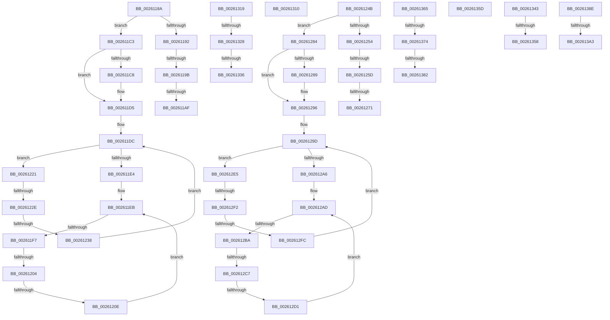

# sub_0026118A

- RVA: `0x0026118A`–`0x002613A8` (길이 `542` bytes)
- VA: `0x000000014026118A`
- 실행 섹션: `.text`
- PDB 이름 있음: `아니요`; PDB Function 태그: `아니요`
- unwind 정보 RVA: `0x0006448C`
- 디코드: `128`개 명령, `542/542` bytes 표시
- 미해석 바이트: `0` (있으면 어셈블리에 `.byte`로 보존)

> 이 문서는 커널 이미지의 기계어와 PDB 기호를 분석해 생성했습니다. 4번과 5번은 함수 원형과 자료형을 바이너리 사용 방식에서 추정한 C 해석이며 원본 소스 복구 결과는 아닙니다.

## 1. Dependencies

- 직접 호출 지점: **6**; 고유 호출 대상: **1**
- 직접 호출자로 확인된 함수: **0**
- RIP 상대 이미지 참조: **1**

### Outgoing calls
- `0x002611D0` → [ExFreePoolWithTag](../../poolcode/B8/ExFreePoolWithTag_function_00B82870.md) (function, `0x00B82870`)
- `0x0026121A` → [ExFreePoolWithTag](../../poolcode/B8/ExFreePoolWithTag_function_00B82870.md) (function, `0x00B82870`)
- `0x00261244` → [ExFreePoolWithTag](../../poolcode/B8/ExFreePoolWithTag_function_00B82870.md) (function, `0x00B82870`)
- `0x00261291` → [ExFreePoolWithTag](../../poolcode/B8/ExFreePoolWithTag_function_00B82870.md) (function, `0x00B82870`)
- `0x002612DE` → [ExFreePoolWithTag](../../poolcode/B8/ExFreePoolWithTag_function_00B82870.md) (function, `0x00B82870`)
- `0x00261309` → [ExFreePoolWithTag](../../poolcode/B8/ExFreePoolWithTag_function_00B82870.md) (function, `0x00B82870`)

### Direct callers
- 이 함수 시작 RVA로 연결되는 직접 call은 확인되지 않았습니다. 간접 호출은 완전히 역산할 수 없습니다.

### Static image references
- `0x0026134A` → RVA `0x00E0EB18` (`.data`; read)

## 2. Other-region calls and transfers

- 다른 실행 섹션으로 향하는 call: **6**
  - `0x002611D0` → [ExFreePoolWithTag](../../poolcode/B8/ExFreePoolWithTag_function_00B82870.md) (`.text` → `POOLCODE`)
  - `0x0026121A` → [ExFreePoolWithTag](../../poolcode/B8/ExFreePoolWithTag_function_00B82870.md) (`.text` → `POOLCODE`)
  - `0x00261244` → [ExFreePoolWithTag](../../poolcode/B8/ExFreePoolWithTag_function_00B82870.md) (`.text` → `POOLCODE`)
  - `0x00261291` → [ExFreePoolWithTag](../../poolcode/B8/ExFreePoolWithTag_function_00B82870.md) (`.text` → `POOLCODE`)
  - `0x002612DE` → [ExFreePoolWithTag](../../poolcode/B8/ExFreePoolWithTag_function_00B82870.md) (`.text` → `POOLCODE`)
  - `0x00261309` → [ExFreePoolWithTag](../../poolcode/B8/ExFreePoolWithTag_function_00B82870.md) (`.text` → `POOLCODE`)
- call이 아닌 외부 분기/꼬리 이동: **28**
  - `0x00261195` → [sub_00261078 + 0x9](Unknown_function_00261078.md) (`tail-transfer`)
  - `0x002611A9` → [sub_00260129 + 0x9F](Unknown_function_00260129.md) (`tail-transfer`)
  - `0x002611BE` → [sub_00261078 + 0x9](Unknown_function_00261078.md) (`tail-transfer`)
  - `0x002611F1` → [sub_00261078 + 0x9](Unknown_function_00261078.md) (`tail-transfer`)
  - `0x002611FE` → [sub_00260129 + 0x9F](Unknown_function_00260129.md) (`tail-transfer`)
  - `0x00261208` → [sub_00260129 + 0x9F](Unknown_function_00260129.md) (`tail-transfer`)
  - `0x00261228` → [sub_00260129 + 0x9F](Unknown_function_00260129.md) (`tail-transfer`)
  - `0x00261232` → [sub_00260129 + 0x9F](Unknown_function_00260129.md) (`tail-transfer`)
  - `0x00261257` → [sub_00261078 + 0x5D](Unknown_function_00261078.md) (`tail-transfer`)
  - `0x0026126B` → [sub_00260129 + 0x9F](Unknown_function_00260129.md) (`tail-transfer`)
  - `0x0026127F` → [sub_00261078 + 0x5D](Unknown_function_00261078.md) (`tail-transfer`)
  - `0x002612B4` → [sub_00261078 + 0x5D](Unknown_function_00261078.md) (`tail-transfer`)
  - `0x002612C1` → [sub_00260129 + 0x9F](Unknown_function_00260129.md) (`tail-transfer`)
  - `0x002612CB` → [sub_00260129 + 0x9F](Unknown_function_00260129.md) (`tail-transfer`)
  - `0x002612EC` → [sub_00260129 + 0x9F](Unknown_function_00260129.md) (`tail-transfer`)
  - `0x002612F6` → [sub_00260129 + 0x9F](Unknown_function_00260129.md) (`tail-transfer`)
  - `0x00261314` → [sub_0025FB5C + 0x4CC](../25/Unknown_function_0025FB5C.md) (`tail-transfer`)
  - `0x00261322` → [sub_0026029A + 0xE](Unknown_function_0026029A.md) (`tail-transfer`)
  - `0x00261330` → [sub_0026029A + 0xE](Unknown_function_0026029A.md) (`tail-transfer`)
  - `0x0026133E` → [sub_0026029A + 0x11](Unknown_function_0026029A.md) (`tail-transfer`)
  - `0x00261352` → [sub_00260366 + 0x891](Unknown_function_00260366.md) (`tail-transfer`)
  - `0x00261358` → [sub_0026029A + 0x2C](Unknown_function_0026029A.md) (`tail-transfer`)
  - `0x00261360` → [sub_00260366 + 0x412](Unknown_function_00260366.md) (`tail-transfer`)
  - `0x0026136E` → [sub_00260366 + 0x431](Unknown_function_00260366.md) (`tail-transfer`)
  - `0x0026137C` → [sub_00260366 + 0x431](Unknown_function_00260366.md) (`tail-transfer`)
  - `0x00261389` → [sub_00260366 + 0x434](Unknown_function_00260366.md) (`tail-transfer`)
  - `0x0026139D` → [sub_00260366 + 0x995](Unknown_function_00260366.md) (`tail-transfer`)
  - `0x002613A3` → [sub_00260366 + 0x44F](Unknown_function_00260366.md) (`tail-transfer`)

## 3. Assembly (complete function range)

```asm
0026118A  39 B7 E0 05 00 00               cmp dword ptr [rdi + 0x5e0], esi
00261190  74 31                           je 0x1402611c3
00261192  4D 85 ED                        test r13, r13
00261195  0F 84 E6 FE FF FF               je 0x140261081
0026119B  48 8D 87 00 06 00 00            lea rax, [rdi + 0x600]
002611A2  48 8B 48 08                     mov rcx, qword ptr [rax + 8]
002611A6  48 39 01                        cmp qword ptr [rcx], rax
002611A9  0F 85 19 F0 FF FF               jne 0x1402601c8
002611AF  49 89 45 00                     mov qword ptr [r13], rax
002611B3  49 89 4D 08                     mov qword ptr [r13 + 8], rcx
002611B7  4C 89 29                        mov qword ptr [rcx], r13
002611BA  4C 89 68 08                     mov qword ptr [rax + 8], r13
002611BE  E9 BE FE FF FF                  jmp 0x140261081
002611C3  4D 85 ED                        test r13, r13
002611C6  74 0D                           je 0x1402611d5
002611C8  BA 42 6F 6F 73                  mov edx, 0x736f6f42
002611CD  49 8B CD                        mov rcx, r13
002611D0  E8 9B 16 92 00                  call 0x140b82870
002611D5  4C 8D B7 F0 05 00 00            lea r14, [rdi + 0x5f0]
002611DC  49 8B 0E                        mov rcx, qword ptr [r14]
002611DF  49 3B CE                        cmp rcx, r14
002611E2  75 3D                           jne 0x140261221
002611E4  4C 8D B7 00 06 00 00            lea r14, [rdi + 0x600]
002611EB  49 8B 0E                        mov rcx, qword ptr [r14]
002611EE  49 3B CE                        cmp rcx, r14
002611F1  0F 84 8A FE FF FF               je 0x140261081
002611F7  48 8B 01                        mov rax, qword ptr [rcx]
002611FA  4C 39 71 08                     cmp qword ptr [rcx + 8], r14
002611FE  0F 85 C4 EF FF FF               jne 0x1402601c8
00261204  48 39 48 08                     cmp qword ptr [rax + 8], rcx
00261208  0F 85 BA EF FF FF               jne 0x1402601c8
0026120E  49 89 06                        mov qword ptr [r14], rax
00261211  BA 42 6F 6F 73                  mov edx, 0x736f6f42
00261216  4C 89 70 08                     mov qword ptr [rax + 8], r14
0026121A  E8 51 16 92 00                  call 0x140b82870
0026121F  EB CA                           jmp 0x1402611eb
00261221  48 8B 01                        mov rax, qword ptr [rcx]
00261224  4C 39 71 08                     cmp qword ptr [rcx + 8], r14
00261228  0F 85 9A EF FF FF               jne 0x1402601c8
0026122E  48 39 48 08                     cmp qword ptr [rax + 8], rcx
00261232  0F 85 90 EF FF FF               jne 0x1402601c8
00261238  49 89 06                        mov qword ptr [r14], rax
0026123B  BA 42 6F 6F 73                  mov edx, 0x736f6f42
00261240  4C 89 70 08                     mov qword ptr [rax + 8], r14
00261244  E8 27 16 92 00                  call 0x140b82870
00261249  EB 91                           jmp 0x1402611dc
0026124B  41 39 B6 E0 05 00 00            cmp dword ptr [r14 + 0x5e0], esi
00261252  74 30                           je 0x140261284
00261254  48 85 C0                        test rax, rax
00261257  0F 84 78 FE FF FF               je 0x1402610d5
0026125D  49 8D 8E 00 06 00 00            lea rcx, [r14 + 0x600]
00261264  48 8B 51 08                     mov rdx, qword ptr [rcx + 8]
00261268  48 39 0A                        cmp qword ptr [rdx], rcx
0026126B  0F 85 57 EF FF FF               jne 0x1402601c8
00261271  48 89 08                        mov qword ptr [rax], rcx
00261274  48 89 50 08                     mov qword ptr [rax + 8], rdx
00261278  48 89 02                        mov qword ptr [rdx], rax
0026127B  48 89 41 08                     mov qword ptr [rcx + 8], rax
0026127F  E9 51 FE FF FF                  jmp 0x1402610d5
00261284  48 85 C0                        test rax, rax
00261287  74 0D                           je 0x140261296
00261289  BA 42 6F 6F 73                  mov edx, 0x736f6f42
0026128E  48 8B C8                        mov rcx, rax
00261291  E8 DA 15 92 00                  call 0x140b82870
00261296  4D 8D A6 F0 05 00 00            lea r12, [r14 + 0x5f0]
0026129D  49 8B 0C 24                     mov rcx, qword ptr [r12]
002612A1  49 3B CC                        cmp rcx, r12
002612A4  75 3F                           jne 0x1402612e5
002612A6  4D 8D A6 00 06 00 00            lea r12, [r14 + 0x600]
002612AD  49 8B 0C 24                     mov rcx, qword ptr [r12]
002612B1  49 3B CC                        cmp rcx, r12
002612B4  0F 84 1B FE FF FF               je 0x1402610d5
002612BA  48 8B 01                        mov rax, qword ptr [rcx]
002612BD  4C 39 61 08                     cmp qword ptr [rcx + 8], r12
002612C1  0F 85 01 EF FF FF               jne 0x1402601c8
002612C7  48 39 48 08                     cmp qword ptr [rax + 8], rcx
002612CB  0F 85 F7 EE FF FF               jne 0x1402601c8
002612D1  49 89 04 24                     mov qword ptr [r12], rax
002612D5  BA 42 6F 6F 73                  mov edx, 0x736f6f42
002612DA  4C 89 60 08                     mov qword ptr [rax + 8], r12
002612DE  E8 8D 15 92 00                  call 0x140b82870
002612E3  EB C8                           jmp 0x1402612ad
002612E5  48 8B 01                        mov rax, qword ptr [rcx]
002612E8  4C 39 61 08                     cmp qword ptr [rcx + 8], r12
002612EC  0F 85 D6 EE FF FF               jne 0x1402601c8
002612F2  48 39 48 08                     cmp qword ptr [rax + 8], rcx
002612F6  0F 85 CC EE FF FF               jne 0x1402601c8
002612FC  49 89 04 24                     mov qword ptr [r12], rax
00261300  BA 42 6F 6F 73                  mov edx, 0x736f6f42
00261305  4C 89 60 08                     mov qword ptr [rax + 8], r12
00261309  E8 62 15 92 00                  call 0x140b82870
0026130E  EB 8D                           jmp 0x14026129d
00261310  44 89 6F 24                     mov dword ptr [rdi + 0x24], r13d
00261314  E9 0F ED FF FF                  jmp 0x140260028
00261319  0F B7 4C 24 70                  movzx ecx, word ptr [rsp + 0x70]
0026131E  66 39 4F 18                     cmp word ptr [rdi + 0x18], cx
00261322  0F 85 80 EF FF FF               jne 0x1402602a8
00261328  0F B6 4C 24 30                  movzx ecx, byte ptr [rsp + 0x30]
0026132D  38 4F 1A                        cmp byte ptr [rdi + 0x1a], cl
00261330  0F 85 72 EF FF FF               jne 0x1402602a8
00261336  4C 8B 4C 24 78                  mov r9, qword ptr [rsp + 0x78]
0026133B  4C 2B C8                        sub r9, rax
0026133E  E9 68 EF FF FF                  jmp 0x1402602ab
00261343  33 D2                           xor edx, edx
00261345  41 8B C2                        mov eax, r10d
00261348  2B C1                           sub eax, ecx
0026134A  F7 35 C8 D7 BA 00               div dword ptr [rip + 0xbad7c8]
00261350  85 D2                           test edx, edx
00261352  0F 84 9F F8 FF FF               je 0x140260bf7
00261358  E9 69 EF FF FF                  jmp 0x1402602c6
0026135D  89 47 24                        mov dword ptr [rdi + 0x24], eax
00261360  E9 13 F4 FF FF                  jmp 0x140260778
00261365  0F B7 4C 24 70                  movzx ecx, word ptr [rsp + 0x70]
0026136A  66 39 4F 18                     cmp word ptr [rdi + 0x18], cx
0026136E  0F 85 23 F4 FF FF               jne 0x140260797
00261374  0F B6 4C 24 30                  movzx ecx, byte ptr [rsp + 0x30]
00261379  38 4F 1A                        cmp byte ptr [rdi + 0x1a], cl
0026137C  0F 85 15 F4 FF FF               jne 0x140260797
00261382  4C 8B 4D 88                     mov r9, qword ptr [rbp - 0x78]
00261386  4C 2B C8                        sub r9, rax
00261389  E9 0C F4 FF FF                  jmp 0x14026079a
0026138E  33 D2                           xor edx, edx
00261390  41 8B C2                        mov eax, r10d
00261393  2B C1                           sub eax, ecx
00261395  F7 35 7D D7 BA 00               div dword ptr [rip + 0xbad77d]
0026139B  85 D2                           test edx, edx
0026139D  0F 84 58 F9 FF FF               je 0x140260cfb
002613A3  E9 0D F4 FF FF                  jmp 0x1402607b5
```

## 4. C-style interpretation (structured pseudocode)

```c
__int64 __fastcall sub_0026118A(void)
{
    __int64 result;
    unsigned __int8 v_stack_p30;
    unsigned __int16 v_stack_p70;
    unsigned __int64 v_stack_p78;

    if ((*(unsigned int *)(v_rdi + 1504)) == ((unsigned int)(v_rsi))) goto loc_002611C3;
    *(unsigned __int64 *)(v_r13) = v_rdi + 1536;
    *(unsigned __int64 *)(v_r13 + 8) = *(unsigned __int64 *)(v_rdi + 1536 + 8);
    *(unsigned __int64 *)(*(unsigned __int64 *)(v_rdi + 1536 + 8)) = v_r13;
    *(unsigned __int64 *)(v_rdi + 1536 + 8) = v_r13;
loc_002611C3:
    result = v_rdi + 1536;
    if (v_r13 != 0) {
        a2 = 0x736F6F42ULL;
        a1 = v_r13;
        result = ExFreePoolWithTag(a1, a2, a3, a4);
    }
loc_002611DC:
    if ((*(unsigned __int64 *)(v_rdi + 1520)) != (v_rdi + 1520)) goto loc_00261221;
loc_002611EB:
    *(unsigned __int64 *)(v_rdi + 1536) = *(unsigned __int64 *)(*(unsigned __int64 *)(v_rdi + 1536));
    *(unsigned __int64 *)(*(unsigned __int64 *)(*(unsigned __int64 *)(v_rdi + 1536)) + 8) = v_rdi + 1536;
    result = ExFreePoolWithTag(*(unsigned __int64 *)(v_rdi + 1536), (unsigned int)(0x736F6F42ULL), a3, a4);
    goto loc_002611EB;
loc_00261221:
    *(unsigned __int64 *)(v_rdi + 1536) = *(unsigned __int64 *)(*(unsigned __int64 *)(v_rdi + 1536));
    *(unsigned __int64 *)(*(unsigned __int64 *)(*(unsigned __int64 *)(v_rdi + 1536)) + 8) = v_rdi + 1536;
    result = ExFreePoolWithTag(*(unsigned __int64 *)(v_rdi + 1536), (unsigned int)(0x736F6F42ULL), a3, a4);
    goto loc_002611DC;
}
```

## 5. (Beta) C Style

```c
void sub_0026118A(void)
{
    int64_t result;
    uint8_t v_stack_p30;
    uint16_t v_stack_p70;
    uint64_t v_stack_p78;

    if ((*(uint32_t *)(local_rdi + 0x5E0)) == ((uint32_t)(local_rsi))) goto loc_002611C3;
    *(uint64_t *)(local_r13) = local_rdi + 1536;
    *(uint64_t *)(local_r13 + 0x8) = *(uint64_t *)(local_rdi + 0x600 + 0x8);
    *(uint64_t *)(*(uint64_t *)(local_rdi + 0x600 + 0x8)) = local_r13;
    *(uint64_t *)(local_rdi + 0x600 + 0x8) = local_r13;
loc_002611C3:
    result = local_rdi + 1536;
    if (local_r13 != 0) {
        a2 = 0x736F6F42ULL;
        a1 = local_r13;
        result = ExFreePoolWithTag(a1, a2, a3, a4);
    }
loc_002611DC:
    if ((*(uint64_t *)(local_rdi + 0x5F0)) != (local_rdi + 1520)) goto loc_00261221;
loc_002611EB:
    *(uint64_t *)(local_rdi + 0x600) = *(uint64_t *)(*(uint64_t *)(local_rdi + 0x600));
    *(uint64_t *)(*(uint64_t *)(*(uint64_t *)(local_rdi + 0x600)) + 0x8) = local_rdi + 1536;
    result = ExFreePoolWithTag(*(uint64_t *)(local_rdi + 0x600), (uint32_t)(0x736F6F42ULL), a3, a4);
    goto loc_002611EB;
loc_00261221:
    *(uint64_t *)(local_rdi + 0x600) = *(uint64_t *)(*(uint64_t *)(local_rdi + 0x600));
    *(uint64_t *)(*(uint64_t *)(*(uint64_t *)(local_rdi + 0x600)) + 0x8) = local_rdi + 1536;
    result = ExFreePoolWithTag(*(uint64_t *)(local_rdi + 0x600), (uint32_t)(0x736F6F42ULL), a3, a4);
    goto loc_002611DC;
}
```

## 6. Execution-region graph

[열기: 2D/3D 그래프와 함수 탐색 컨트롤 패널](../../../control-panel.html?section=text&rva=0x0026118A&view=graph)

- 2D 그래프는 위에서 아래로 흐르고, 3D 그래프는 빈 공간을 드래그해 회전합니다. Shift+드래그는 이동, 휠은 확대·축소, 함수 노드 선택은 대상 보고서 이동입니다.

### Static fallback


