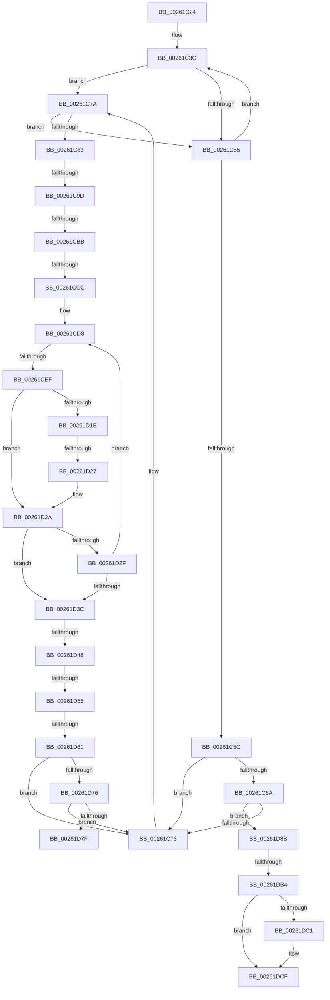

# sub_00261C24

- RVA: `0x00261C24`–`0x00261DF3` (길이 `463` bytes)
- VA: `0x0000000140261C24`
- 실행 섹션: `.text`
- PDB 이름 있음: `아니요`; PDB Function 태그: `아니요`
- unwind 정보 RVA: `0x000644EC`
- 디코드: `119`개 명령, `463/463` bytes 표시
- 미해석 바이트: `0` (있으면 어셈블리에 `.byte`로 보존)

> 이 문서는 커널 이미지의 기계어와 PDB 기호를 분석해 생성했습니다. 4번과 5번은 함수 원형과 자료형을 바이너리 사용 방식에서 추정한 C 해석이며 원본 소스 복구 결과는 아닙니다.

## 1. Dependencies

- 직접 호출 지점: **1**; 고유 호출 대상: **1**
- 직접 호출자로 확인된 함수: **0**
- RIP 상대 이미지 참조: **2**

### Outgoing calls
- `0x00261DC6` → [KeAbPostReleaseEx](KeAbPostReleaseEx_function_00262210.md) (function, `0x00262210`)

### Direct callers
- 이 함수 시작 RVA로 연결되는 직접 call은 확인되지 않았습니다. 간접 호출은 완전히 역산할 수 없습니다.

### Static image references
- `0x00261C90` → RVA `0x00FC6D20` (`ALMOSTRO`; read)
- `0x00261CAE` → RVA `0x00FC6B06` (`ALMOSTRO`; read)

## 2. Other-region calls and transfers

- 다른 실행 섹션으로 향하는 call: **0**
- call이 아닌 외부 분기/꼬리 이동: **10**
  - `0x00261C97` → [sub_00261DFE + 0x1B6](Unknown_function_00261DFE.md) (`tail-transfer`)
  - `0x00261CB5` → [sub_00261DFE](Unknown_function_00261DFE.md) (`tail-transfer`)
  - `0x00261CC6` → [sub_00261DFE + 0x314](Unknown_function_00261DFE.md) (`tail-transfer`)
  - `0x00261CE9` → [sub_00261DFE + 0x20](Unknown_function_00261DFE.md) (`tail-transfer`)
  - `0x00261D21` → [sub_00261DFE + 0x35F](Unknown_function_00261DFE.md) (`tail-transfer`)
  - `0x00261D42` → [sub_00261DFE + 0x350](Unknown_function_00261DFE.md) (`tail-transfer`)
  - `0x00261D4F` → [sub_00261DFE + 0x34B](Unknown_function_00261DFE.md) (`tail-transfer`)
  - `0x00261D5B` → [sub_00261DFE + 0x30](Unknown_function_00261DFE.md) (`tail-transfer`)
  - `0x00261D86` → [sub_00261DFE + 0x34](Unknown_function_00261DFE.md) (`tail-transfer`)
  - `0x00261DAE` → [sub_00261DFE + 0x18E](Unknown_function_00261DFE.md) (`tail-transfer`)

## 3. Assembly (complete function range)

```asm
00261C24  49 89 6B 08                     mov qword ptr [r11 + 8], rbp
00261C28  49 89 7B E8                     mov qword ptr [r11 - 0x18], rdi
00261C2C  4D 89 63 E0                     mov qword ptr [r11 - 0x20], r12
00261C30  4D 89 6B D8                     mov qword ptr [r11 - 0x28], r13
00261C34  4D 89 73 D0                     mov qword ptr [r11 - 0x30], r14
00261C38  4D 89 7B C8                     mov qword ptr [r11 - 0x38], r15
00261C3C  48 8B C8                        mov rcx, rax
00261C3F  48 83 E1 FC                     and rcx, 0xfffffffffffffffc
00261C43  48 FF C9                        dec rcx
00261C46  48 33 C8                        xor rcx, rax
00261C49  48 83 E1 FC                     and rcx, 0xfffffffffffffffc
00261C4D  48 33 C8                        xor rcx, rax
00261C50  F6 C1 02                        test cl, 2
00261C53  75 25                           jne 0x140261c7a
00261C55  F0 48 0F B1 0E                  lock cmpxchg qword ptr [rsi], rcx
00261C5A  75 E0                           jne 0x140261c3c
00261C5C  FA                              cli
00261C5D  48 8B 0A                        mov rcx, qword ptr [rdx]
00261C60  48 8B 42 08                     mov rax, qword ptr [rdx + 8]
00261C64  48 39 59 08                     cmp qword ptr [rcx + 8], rbx
00261C68  75 09                           jne 0x140261c73
00261C6A  48 39 18                        cmp qword ptr [rax], rbx
00261C6D  0F 84 18 01 00 00               je 0x140261d8b
00261C73  B9 03 00 00 00                  mov ecx, 3
00261C78  CD 29                           int 0x29
00261C7A  48 F7 C1 FC FF FF FF            test rcx, -4
00261C81  7F D2                           jg 0x140261c55
00261C83  45 0F 20 C4                     mov r12, cr8
00261C87  B8 02 00 00 00                  mov eax, 2
00261C8C  44 0F 22 C0                     mov cr8, rax
00261C90  83 3D 89 50 D6 00 00            cmp dword ptr [rip + 0xd65089], 0
00261C97  0F 85 17 03 00 00               jne 0x140261fb4
00261C9D  33 ED                           xor ebp, ebp
00261C9F  48 8D 4E 30                     lea rcx, [rsi + 0x30]
00261CA3  48 89 4C 24 48                  mov qword ptr [rsp + 0x48], rcx
00261CA8  48 89 6C 24 40                  mov qword ptr [rsp + 0x40], rbp
00261CAD  90                              nop
00261CAE  F6 05 51 4E D6 00 21            test byte ptr [rip + 0xd64e51], 0x21
00261CB5  0F 85 43 01 00 00               jne 0x140261dfe
00261CBB  48 8D 54 24 40                  lea rdx, [rsp + 0x40]
00261CC0  48 87 11                        xchg qword ptr [rcx], rdx
00261CC3  48 85 D2                        test rdx, rdx
00261CC6  0F 85 46 04 00 00               jne 0x140262112
00261CCC  0F 0D 0E                        prefetchw byte ptr [rsi]
00261CCF  48 8B 16                        mov rdx, qword ptr [rsi]
00261CD2  41 BD 01 00 00 00               mov r13d, 1
00261CD8  4C 8B 4E 10                     mov r9, qword ptr [rsi + 0x10]
00261CDC  4C 8B C2                        mov r8, rdx
00261CDF  49 C1 F8 02                     sar r8, 2
00261CE3  49 FF C8                        dec r8
00261CE6  4D 85 C9                        test r9, r9
00261CE9  0F 84 2F 01 00 00               je 0x140261e1e
00261CEF  41 8B C5                        mov eax, r13d
00261CF2  44 8B F8                        mov r15d, eax
00261CF5  48 8B CA                        mov rcx, rdx
00261CF8  48 83 E1 FD                     and rcx, 0xfffffffffffffffd
00261CFC  48 03 C0                        add rax, rax
00261CFF  48 0B C1                        or rax, rcx
00261D02  48 8B C8                        mov rcx, rax
00261D05  48 83 E1 FC                     and rcx, 0xfffffffffffffffc
00261D09  48 FF C9                        dec rcx
00261D0C  48 33 C8                        xor rcx, rax
00261D0F  48 83 E1 FC                     and rcx, 0xfffffffffffffffc
00261D13  48 33 C8                        xor rcx, rax
00261D16  4C 8B D1                        mov r10, rcx
00261D19  4D 3B C5                        cmp r8, r13
00261D1C  73 0C                           jae 0x140261d2a
00261D1E  4D 85 C9                        test r9, r9
00261D21  0F 84 36 04 00 00               je 0x14026215d
00261D27  49 0B CD                        or rcx, r13
00261D2A  48 3B CA                        cmp rcx, rdx
00261D2D  74 0D                           je 0x140261d3c
00261D2F  48 8B C2                        mov rax, rdx
00261D32  F0 48 0F B1 0E                  lock cmpxchg qword ptr [rsi], rcx
00261D37  48 8B D0                        mov rdx, rax
00261D3A  75 9C                           jne 0x140261cd8
00261D3C  4C 8B F5                        mov r14, rbp
00261D3F  4D 3B C5                        cmp r8, r13
00261D42  0F 83 06 04 00 00               jae 0x14026214e
00261D48  48 8B 4E 10                     mov rcx, qword ptr [rsi + 0x10]
00261D4C  48 85 C9                        test rcx, rcx
00261D4F  0F 84 F4 03 00 00               je 0x140262149
00261D55  48 8B 11                        mov rdx, qword ptr [rcx]
00261D58  48 3B D1                        cmp rdx, rcx
00261D5B  0F 84 CD 00 00 00               je 0x140261e2e
00261D61  48 89 56 10                     mov qword ptr [rsi + 0x10], rdx
00261D65  4C 8B 01                        mov r8, qword ptr [rcx]
00261D68  48 8B 51 08                     mov rdx, qword ptr [rcx + 8]
00261D6C  49 39 48 08                     cmp qword ptr [r8 + 8], rcx
00261D70  0F 85 FD FE FF FF               jne 0x140261c73
00261D76  48 39 0A                        cmp qword ptr [rdx], rcx
00261D79  0F 85 F4 FE FF FF               jne 0x140261c73
00261D7F  4C 89 02                        mov qword ptr [rdx], r8
00261D82  49 89 50 08                     mov qword ptr [r8 + 8], rdx
00261D86  E9 A7 00 00 00                  jmp 0x140261e32
00261D8B  48 89 08                        mov qword ptr [rax], rcx
00261D8E  33 ED                           xor ebp, ebp
00261D90  48 89 41 08                     mov qword ptr [rcx + 8], rax
00261D94  48 89 2A                        mov qword ptr [rdx], rbp
00261D97  48 89 6A 08                     mov qword ptr [rdx + 8], rbp
00261D9B  65 48 8B 0C 25 20 00 00 00      mov rcx, qword ptr gs:[0x20]
00261DA4  4C 8B 81 B8 8E 00 00            mov r8, qword ptr [rcx + 0x8eb8]
00261DAB  4D 85 C0                        test r8, r8
00261DAE  0F 85 D8 01 00 00               jne 0x140261f8c
00261DB4  FB                              sti
00261DB5  48 89 6B 18                     mov qword ptr [rbx + 0x18], rbp
00261DB9  0F B6 43 24                     movzx eax, byte ptr [rbx + 0x24]
00261DBD  84 C0                           test al, al
00261DBF  74 0E                           je 0x140261dcf
00261DC1  8B D0                           mov edx, eax
00261DC3  48 8B CE                        mov rcx, rsi
00261DC6  E8 45 04 00 00                  call 0x140262210
00261DCB  40 88 6B 24                     mov byte ptr [rbx + 0x24], bpl
00261DCF  4C 8B 74 24 68                  mov r14, qword ptr [rsp + 0x68]
00261DD4  4C 8B 6C 24 70                  mov r13, qword ptr [rsp + 0x70]
00261DD9  4C 8B 64 24 78                  mov r12, qword ptr [rsp + 0x78]
00261DDE  48 8B BC 24 80 00 00 00         mov rdi, qword ptr [rsp + 0x80]
00261DE6  48 8B AC 24 A0 00 00 00         mov rbp, qword ptr [rsp + 0xa0]
00261DEE  4C 8B 7C 24 60                  mov r15, qword ptr [rsp + 0x60]
```

## 4. C-style interpretation (structured pseudocode)

```c
__int64 __fastcall sub_00261C24(__int64 a1, __int64 a2, __int64 a3, __int64 a4, __int64 a5, __int64 a6, __int64 a7, __int64 a8, __int64 a9, __int64 a10, __int64 a11, __int64 a12, __int64 a13, __int64 a14, __int64 a15, __int64 a16, __int64 a17, __int64 a18, __int64 a19, __int64 a20)
{
    __int64 result;
    __int64 v_rbp;
    unsigned __int64 v_stack_p40;
    unsigned __int64 v_stack_p48;

    *(unsigned __int64 *)(v_r11 + 8) = v_rbp;
    *(unsigned __int64 *)(v_r11 - 24) = v_rdi;
    *(unsigned __int64 *)(v_r11 - 32) = v_r12;
    *(unsigned __int64 *)(v_r11 - 40) = v_r13;
    *(unsigned __int64 *)(v_r11 - 48) = v_r14;
    *(unsigned __int64 *)(v_r11 - 56) = v_r15;
loc_00261C3C:
    a1 = (result) & (-4);
    a1 = (a1) - 1;
    a1 = (a1) ^ (result);
    a1 = (a1) & (-4);
    a1 = (a1) ^ (result);
    if ((((unsigned __int8)(a1)) & (2)) != 0) goto loc_00261C7A;
loc_00261C55:
    if ((((unsigned __int8)(a1)) & (2)) != 0) goto loc_00261C3C;
    if ((*(unsigned __int64 *)(*(unsigned __int64 *)(a2) + 8)) != v_rbx) goto loc_00261C73;
    if ((*(unsigned __int64 *)(*(unsigned __int64 *)(a2 + 8))) == v_rbx) goto loc_00261D8B;
loc_00261C73:
loc_00261C7A:
    if (condition_is_greater) goto loc_00261C55;
    v_rbp = 0;
    v_stack_p48 = v_rsi + 48;
    v_stack_p40 = 0;
loc_00261CD8:
    a3 = (*(unsigned __int64 *)(v_rsi)) >> (2);
    a3 = (a3) - 1;
    a1 = (*(unsigned __int64 *)(v_rsi)) & (-3);
    result = (1) + (1);
    result = (result) | (a1);
    a1 = (result) & (-4);
    a1 = (a1) - 1;
    a1 = (a1) ^ (result);
    a1 = (a1) & (-4);
    a1 = (a1) ^ (result);
    if (a3 >= 1) goto loc_00261D2A;
    a1 = (a1) | (1);
loc_00261D2A:
    if (a1 == (*(unsigned __int64 *)(v_rsi))) goto loc_00261D3C;
    if (a1 != (*(unsigned __int64 *)(v_rsi))) goto loc_00261CD8;
loc_00261D3C:
    *(unsigned __int64 *)(v_rsi + 16) = *(unsigned __int64 *)(*(unsigned __int64 *)(v_rsi + 16));
    if ((*(unsigned __int64 *)(*(unsigned __int64 *)(*(unsigned __int64 *)(v_rsi + 16)) + 8)) != (*(unsigned __int64 *)(v_rsi + 16))) goto loc_00261C73;
    if ((*(unsigned __int64 *)(*(unsigned __int64 *)(*(unsigned __int64 *)(v_rsi + 16) + 8))) != (*(unsigned __int64 *)(v_rsi + 16))) goto loc_00261C73;
    *(unsigned __int64 *)(*(unsigned __int64 *)(*(unsigned __int64 *)(v_rsi + 16) + 8)) = *(unsigned __int64 *)(*(unsigned __int64 *)(v_rsi + 16));
    *(unsigned __int64 *)(*(unsigned __int64 *)(*(unsigned __int64 *)(v_rsi + 16)) + 8) = *(unsigned __int64 *)(*(unsigned __int64 *)(v_rsi + 16) + 8);
loc_00261D8B:
    *(unsigned __int64 *)(*(unsigned __int64 *)(v_rsi)) = *(unsigned __int64 *)(v_rsi + 16);
    v_rbp = 0;
    *(unsigned __int64 *)(*(unsigned __int64 *)(v_rsi + 16) + 8) = *(unsigned __int64 *)(v_rsi);
    *(unsigned __int64 *)(*(unsigned __int64 *)(*(unsigned __int64 *)(v_rsi + 16) + 8)) = 0;
    *(unsigned __int64 *)(*(unsigned __int64 *)(*(unsigned __int64 *)(v_rsi + 16) + 8) + 8) = 0;
    *(unsigned __int64 *)(v_rbx + 24) = 0;
    result = *(unsigned __int8 *)(v_rbx + 36);
    if ((unsigned __int8)(*(unsigned __int8 *)(v_rbx + 36)) != 0) {
        a2 = (unsigned int)(*(unsigned __int8 *)(v_rbx + 36));
        a1 = v_rsi;
        result = KeAbPostReleaseEx(a1, a2, *(unsigned __int64 *)(*(unsigned __int64 *)(gs_base + (0 + 32)) + 36536), *(unsigned __int64 *)(v_rsi + 16));
        *(unsigned __int8 *)(v_rbx + 36) = 0;
    }
    return result;
}
```

## 5. (Beta) C Style

```c
int64_t sub_00261C24(int64_t Arg1, int64_t Arg2, int64_t Arg3, int64_t Arg4, uint64_t Arg5, uint64_t Arg6, uint64_t Arg7, int64_t Arg8, uint64_t Arg9, uint64_t Arg10, uint64_t Arg11, int64_t Arg12, int64_t Arg13, int64_t Arg14, int64_t Arg15, int64_t Arg16, uint64_t Arg17, uint64_t Arg18, uint64_t Arg19, int64_t Arg20)
{
    int64_t result;
    int64_t local_rbp;
    uint64_t v_stack_p40;
    uint64_t v_stack_p48;

    *(uint64_t *)(local_r11 + 0x8) = local_rbp;
    *(uint64_t *)(local_r11 - 0x18) = local_rdi;
    *(uint64_t *)(local_r11 - 0x20) = local_r12;
    *(uint64_t *)(local_r11 - 0x28) = local_r13;
    *(uint64_t *)(local_r11 - 0x30) = local_r14;
    *(uint64_t *)(local_r11 - 0x38) = local_r15;
loc_00261C3C:
    Arg1 = (result) & (-4);
    Arg1 = (Arg1) - 1;
    Arg1 = (Arg1) ^ (result);
    Arg1 = (Arg1) & (-4);
    Arg1 = (Arg1) ^ (result);
    if ((((uint8_t)(Arg1)) & (2)) != 0) goto loc_00261C7A;
loc_00261C55:
    if ((((uint8_t)(Arg1)) & (2)) != 0) goto loc_00261C3C;
    if ((*(uint64_t *)(*(uint64_t *)(Arg2) + 0x8)) != local_rbx) goto loc_00261C73;
    if ((*(uint64_t *)(*(uint64_t *)(Arg2 + 0x8))) == local_rbx) goto loc_00261D8B;
loc_00261C73:
loc_00261C7A:
    if (condition_is_greater) goto loc_00261C55;
    local_rbp = 0;
    v_stack_p48 = local_rsi + 48;
    v_stack_p40 = 0;
loc_00261CD8:
    Arg3 = (*(uint64_t *)(local_rsi)) >> (2);
    Arg3 = (Arg3) - 1;
    Arg1 = (*(uint64_t *)(local_rsi)) & (-3);
    result = (1) + (1);
    result = (result) | (Arg1);
    Arg1 = (result) & (-4);
    Arg1 = (Arg1) - 1;
    Arg1 = (Arg1) ^ (result);
    Arg1 = (Arg1) & (-4);
    Arg1 = (Arg1) ^ (result);
    if (Arg3 >= 1) goto loc_00261D2A;
    Arg1 = (Arg1) | (1);
loc_00261D2A:
    if (Arg1 == (*(uint64_t *)(local_rsi))) goto loc_00261D3C;
    if (Arg1 != (*(uint64_t *)(local_rsi))) goto loc_00261CD8;
loc_00261D3C:
    *(uint64_t *)(local_rsi + 0x10) = *(uint64_t *)(*(uint64_t *)(local_rsi + 0x10));
    if ((*(uint64_t *)(*(uint64_t *)(*(uint64_t *)(local_rsi + 0x10)) + 0x8)) != (*(uint64_t *)(local_rsi + 0x10))) goto loc_00261C73;
    if ((*(uint64_t *)(*(uint64_t *)(*(uint64_t *)(local_rsi + 0x10) + 0x8))) != (*(uint64_t *)(local_rsi + 0x10))) goto loc_00261C73;
    *(uint64_t *)(*(uint64_t *)(*(uint64_t *)(local_rsi + 0x10) + 0x8)) = *(uint64_t *)(*(uint64_t *)(local_rsi + 0x10));
    *(uint64_t *)(*(uint64_t *)(*(uint64_t *)(local_rsi + 0x10)) + 0x8) = *(uint64_t *)(*(uint64_t *)(local_rsi + 0x10) + 0x8);
loc_00261D8B:
    *(uint64_t *)(*(uint64_t *)(local_rsi)) = *(uint64_t *)(local_rsi + 0x10);
    local_rbp = 0;
    *(uint64_t *)(*(uint64_t *)(local_rsi + 0x10) + 0x8) = *(uint64_t *)(local_rsi);
    *(uint64_t *)(*(uint64_t *)(*(uint64_t *)(local_rsi + 0x10) + 0x8)) = 0;
    *(uint64_t *)(*(uint64_t *)(*(uint64_t *)(local_rsi + 0x10) + 0x8) + 0x8) = 0;
    *(uint64_t *)(local_rbx + 0x18) = 0;
    result = *(uint8_t *)(local_rbx + 0x24);
    if ((uint8_t)(*(uint8_t *)(local_rbx + 0x24)) != 0) {
        Arg2 = (uint32_t)(*(uint8_t *)(local_rbx + 0x24));
        Arg1 = local_rsi;
        result = KeAbPostReleaseEx(Arg1, Arg2, *(uint64_t *)(*(uint64_t *)(gs_base + (0 + 0x20)) + 0x8EB8), *(uint64_t *)(local_rsi + 0x10));
        *(uint8_t *)(local_rbx + 0x24) = 0;
    }
    return result;
}
```

## 6. Execution-region graph

[열기: 2D/3D 그래프와 함수 탐색 컨트롤 패널](../../../control-panel.html?section=text&rva=0x00261C24&view=graph)

- 2D 그래프는 위에서 아래로 흐르고, 3D 그래프는 빈 공간을 드래그해 회전합니다. Shift+드래그는 이동, 휠은 확대·축소, 함수 노드 선택은 대상 보고서 이동입니다.

### Static fallback


