# sub_00261DFE

- RVA: `0x00261DFE`–`0x002621FD` (길이 `1,023` bytes)
- VA: `0x0000000140261DFE`
- 실행 섹션: `.text`
- PDB 이름 있음: `아니요`; PDB Function 태그: `아니요`
- unwind 정보 RVA: `0x00064528`
- 디코드: `242`개 명령, `1,023/1,023` bytes 표시
- 미해석 바이트: `0` (있으면 어셈블리에 `.byte`로 보존)

> 이 문서는 커널 이미지의 기계어와 PDB 기호를 분석해 생성했습니다. 4번과 5번은 함수 원형과 자료형을 바이너리 사용 방식에서 추정한 C 해석이며 원본 소스 복구 결과는 아닙니다.

## 1. Dependencies

- 직접 호출 지점: **19**; 고유 호출 대상: **16**
- 직접 호출자로 확인된 함수: **0**
- RIP 상대 이미지 참조: **4**

### Outgoing calls
- `0x00261E14` → [KiAcquireQueuedSpinLockInstrumented](../27/KiAcquireQueuedSpinLockInstrumented_function_00275850.md) (function, `0x00275850`)
- `0x00261E86` → [KxWaitForLockChainValid](../21/KxWaitForLockChainValid_function_00217AA0.md) (function, `0x00217AA0`)
- `0x00261EB8` → [KeDisableInterrupts](../21/KeDisableInterrupts_function_00217BE0.md) (function, `0x00217BE0`)
- `0x00261EC7` → [KiHaltOnAddressWakeEntireList](../21/KiHaltOnAddressWakeEntireList_function_00217AF4.md) (function, `0x00217AF4`)
- `0x00261F08` → [KiReleaseQueuedSpinLockInstrumented](../21/KiReleaseQueuedSpinLockInstrumented_function_002179F0.md) (function, `0x002179F0`)
- `0x00261F7A` → [KiLowerIrqlProcessIrqlFlags](../4F/KiLowerIrqlProcessIrqlFlags_function_004F5698.md) (function, `0x004F5698`)
- `0x00261FAA` → [KiRemoveSystemWorkPriorityKick](KiRemoveSystemWorkPriorityKick_function_002631D0.md) (function, `0x002631D0`)
- `0x00261FBB` → [KiRaiseIrqlProcessIrqlFlags](../4F/KiRaiseIrqlProcessIrqlFlags_function_004F56FC.md) (function, `0x004F56FC`)
- `0x0026203E` → [KiAbConvertWaiterToOwnerEntry](../21/KiAbConvertWaiterToOwnerEntry_function_00219430.md) (function, `0x00219430`)
- `0x00262047` → [KiAcquireKobjectLockSafe](../25/KiAcquireKobjectLockSafe_function_00251C90.md) (function, `0x00251C90`)
- `0x002620A7` → [KiTryUnwaitThread](../35/KiTryUnwaitThread_function_003506D0.md) (function, `0x003506D0`)
- `0x002620E9` → [KiRemoveBoostThread](../21/KiRemoveBoostThread_function_00219128.md) (function, `0x00219128`)
- `0x00262108` → [KiExitDispatcher](../25/KiExitDispatcher_function_00251CF0.md) (function, `0x00251CF0`)
- `0x00262117` → [KxWaitForLockOwnerShip](../25/KxWaitForLockOwnerShip_function_00257EB0.md) (function, `0x00257EB0`)
- `0x0026213F` → [KiRemoveSystemWorkPriorityKick](KiRemoveSystemWorkPriorityKick_function_002631D0.md) (function, `0x002631D0`)
- `0x00262181` → [KiRaiseIrqlProcessIrqlFlags](../4F/KiRaiseIrqlProcessIrqlFlags_function_004F56FC.md) (function, `0x004F56FC`)
- `0x0026219B` → [KiInsertQueueInternal](../21/KiInsertQueueInternal_function_00219B30.md) (function, `0x00219B30`)
- `0x002621D6` → [KiTryUnwaitThread](../35/KiTryUnwaitThread_function_003506D0.md) (function, `0x003506D0`)
- `0x002621F3` → [KeInsertQueueDpc](../20/KeInsertQueueDpc_function_00207C50.md) (function, `0x00207C50`)

### Direct callers
- 이 함수 시작 RVA로 연결되는 직접 call은 확인되지 않았습니다. 간접 호출은 완전히 역산할 수 없습니다.

### Static image references
- `0x00261DFE` → RVA `0x00F0DE58` (`.data`; read)
- `0x00261E48` → RVA `0x00FC6B06` (`ALMOSTRO`; reference)
- `0x00261EAD` → RVA `0x00F21B20` (`.data`; read)
- `0x00261F6A` → RVA `0x00FC6D20` (`ALMOSTRO`; read)

## 2. Other-region calls and transfers

- 다른 실행 섹션으로 향하는 call: **0**
- call이 아닌 외부 분기/꼬리 이동: **15**
  - `0x00261E06` → [sub_00261C24 + 0x97](Unknown_function_00261C24.md) (`tail-transfer`)
  - `0x00261E19` → [sub_00261C24 + 0xA8](Unknown_function_00261C24.md) (`tail-transfer`)
  - `0x00261E21` → [sub_00261C24 + 0xCB](Unknown_function_00261C24.md) (`tail-transfer`)
  - `0x00261E29` → [sub_00261C24 + 0xCE](Unknown_function_00261C24.md) (`tail-transfer`)
  - `0x00261F49` → [sub_00261C24 + 0x4F](Unknown_function_00261C24.md) (`tail-transfer`)
  - `0x00261F52` → [sub_00261C24 + 0x4F](Unknown_function_00261C24.md) (`tail-transfer`)
  - `0x00261F87` → [sub_00261C24 + 0x195](Unknown_function_00261C24.md) (`tail-transfer`)
  - `0x00261FA4` → [sub_00261C24 + 0x190](Unknown_function_00261C24.md) (`tail-transfer`)
  - `0x00261FAF` → [sub_00261C24 + 0x190](Unknown_function_00261C24.md) (`tail-transfer`)
  - `0x00261FC0` → [sub_00261C24 + 0x79](Unknown_function_00261C24.md) (`tail-transfer`)
  - `0x00262071` → [sub_00261C24 + 0x4F](Unknown_function_00261C24.md) (`tail-transfer`)
  - `0x0026207A` → [sub_00261C24 + 0x4F](Unknown_function_00261C24.md) (`tail-transfer`)
  - `0x0026211C` → [sub_00261C24 + 0xA8](Unknown_function_00261C24.md) (`tail-transfer`)
  - `0x00262162` → [sub_00261C24 + 0x106](Unknown_function_00261C24.md) (`tail-transfer`)
  - `0x00262176` → [sub_00261C24 + 0x106](Unknown_function_00261C24.md) (`tail-transfer`)

## 3. Assembly (complete function range)

```asm
00261DFE  8B 05 54 C0 CA 00               mov eax, dword ptr [rip + 0xcac054]
00261E04  85 C0                           test eax, eax
00261E06  0F 85 AF FE FF FF               jne 0x140261cbb
00261E0C  48 8B D1                        mov rdx, rcx
00261E0F  48 8D 4C 24 40                  lea rcx, [rsp + 0x40]
00261E14  E8 37 3A 01 00                  call 0x140275850
00261E19  E9 AE FE FF FF                  jmp 0x140261ccc
00261E1E  39 6E 38                        cmp dword ptr [rsi + 0x38], ebp
00261E21  0F 87 C8 FE FF FF               ja 0x140261cef
00261E27  8B C5                           mov eax, ebp
00261E29  E9 C4 FE FF FF                  jmp 0x140261cf2
00261E2E  48 89 6E 10                     mov qword ptr [rsi + 0x10], rbp
00261E32  4C 8B 71 10                     mov r14, qword ptr [rcx + 0x10]
00261E36  48 89 49 08                     mov qword ptr [rcx + 8], rcx
00261E3A  48 89 09                        mov qword ptr [rcx], rcx
00261E3D  48 89 8C 24 B0 00 00 00         mov qword ptr [rsp + 0xb0], rcx
00261E45  45 03 FF                        add r15d, r15d
00261E48  44 84 2D B7 4C D6 00            test byte ptr [rip + 0xd64cb7], r13b
00261E4F  0F 85 98 00 00 00               jne 0x140261eed
00261E55  0F 0D 4C 24 40                  prefetchw byte ptr [rsp + 0x40]
00261E5A  48 8B 44 24 40                  mov rax, qword ptr [rsp + 0x40]
00261E5F  48 85 C0                        test rax, rax
00261E62  75 27                           jne 0x140261e8b
00261E64  48 8B 4C 24 48                  mov rcx, qword ptr [rsp + 0x48]
00261E69  48 8D 44 24 40                  lea rax, [rsp + 0x40]
00261E6E  F0 48 0F B1 29                  lock cmpxchg qword ptr [rcx], rbp
00261E73  48 8D 4C 24 40                  lea rcx, [rsp + 0x40]
00261E78  48 3B C1                        cmp rax, rcx
00261E7B  0F 84 8C 00 00 00               je 0x140261f0d
00261E81  48 8D 4C 24 40                  lea rcx, [rsp + 0x40]
00261E86  E8 15 5C FB FF                  call 0x140217aa0
00261E8B  4C 8D 40 08                     lea r8, [rax + 8]
00261E8F  48 89 6C 24 40                  mov qword ptr [rsp + 0x40], rbp
00261E94  48 8B 4C 24 48                  mov rcx, qword ptr [rsp + 0x48]
00261E99  48 8B C1                        mov rax, rcx
00261E9C  49 87 00                        xchg qword ptr [r8], rax
00261E9F  32 C1                           xor al, cl
00261EA1  A8 04                           test al, 4
00261EA3  74 68                           je 0x140261f0d
00261EA5  F0 09 2C 24                     lock or dword ptr [rsp], ebp
00261EA9  49 C1 E8 05                     shr r8, 5
00261EAD  4C 8D 0D 6C FC CB 00            lea r9, [rip + 0xcbfc6c]
00261EB4  41 83 E0 7F                     and r8d, 0x7f
00261EB8  E8 23 5D FB FF                  call 0x140217be0
00261EBD  48 8B D5                        mov rdx, rbp
00261EC0  0F B6 F8                        movzx edi, al
00261EC3  4B 87 14 C1                     xchg qword ptr [r9 + r8*8], rdx
00261EC7  E8 28 5C FB FF                  call 0x140217af4
00261ECC  40 84 FF                        test dil, dil
00261ECF  74 3C                           je 0x140261f0d
00261ED1  65 48 8B 0C 25 20 00 00 00      mov rcx, qword ptr gs:[0x20]
00261EDA  4C 8B 81 B8 8E 00 00            mov r8, qword ptr [rcx + 0x8eb8]
00261EE1  4D 85 C0                        test r8, r8
00261EE4  0F 85 37 02 00 00               jne 0x140262121
00261EEA  FB                              sti
00261EEB  EB 20                           jmp 0x140261f0d
00261EED  8B 05 65 BF CA 00               mov eax, dword ptr [rip + 0xcabf65]
00261EF3  85 C0                           test eax, eax
00261EF5  0F 85 5A FF FF FF               jne 0x140261e55
00261EFB  48 8B 94 24 98 00 00 00         mov rdx, qword ptr [rsp + 0x98]
00261F03  48 8D 4C 24 40                  lea rcx, [rsp + 0x40]
00261F08  E8 E3 5A FB FF                  call 0x1402179f0
00261F0D  4D 85 F6                        test r14, r14
00261F10  B9 03 00 00 00                  mov ecx, 3
00261F15  41 8B C7                        mov eax, r15d
00261F18  41 0F 44 CD                     cmove ecx, r13d
00261F1C  83 E0 02                        and eax, 2
00261F1F  4D 85 F6                        test r14, r14
00261F22  8B F9                           mov edi, ecx
00261F24  41 0F 44 C7                     cmove eax, r15d
00261F28  83 CF 04                        or edi, 4
00261F2B  85 C0                           test eax, eax
00261F2D  0F 44 F9                        cmove edi, ecx
00261F30  48 39 AC 24 B0 00 00 00         cmp qword ptr [rsp + 0xb0], rbp
00261F38  0F 85 87 00 00 00               jne 0x140261fc5
00261F3E  48 8B 0B                        mov rcx, qword ptr [rbx]
00261F41  48 8B 43 08                     mov rax, qword ptr [rbx + 8]
00261F45  48 39 59 08                     cmp qword ptr [rcx + 8], rbx
00261F49  0F 85 24 FD FF FF               jne 0x140261c73
00261F4F  48 39 18                        cmp qword ptr [rax], rbx
00261F52  0F 85 1B FD FF FF               jne 0x140261c73
00261F58  48 89 08                        mov qword ptr [rax], rcx
00261F5B  48 89 41 08                     mov qword ptr [rcx + 8], rax
00261F5F  48 89 2B                        mov qword ptr [rbx], rbp
00261F62  48 89 6B 08                     mov qword ptr [rbx + 8], rbp
00261F66  48 89 6B 18                     mov qword ptr [rbx + 0x18], rbp
00261F6A  39 2D B0 4D D6 00               cmp dword ptr [rip + 0xd64db0], ebp
00261F70  74 0D                           je 0x140261f7f
00261F72  44 0F 20 C1                     mov rcx, cr8
00261F76  41 0F B6 D4                     movzx edx, r12b
00261F7A  E8 19 37 29 00                  call 0x1404f5698
00261F7F  41 0F B6 C4                     movzx eax, r12b
00261F83  44 0F 22 C0                     mov cr8, rax
00261F87  E9 2D FE FF FF                  jmp 0x140261db9
00261F8C  41 0F 0D 08                     prefetchw byte ptr [r8]
00261F90  41 8B 00                        mov eax, dword ptr [r8]
00261F93  8B D0                           mov edx, eax
00261F95  0F BA F2 15                     btr edx, 0x15
00261F99  F0 41 0F B1 10                  lock cmpxchg dword ptr [r8], edx
00261F9E  75 F3                           jne 0x140261f93
00261FA0  0F BA E0 15                     bt eax, 0x15
00261FA4  0F 83 0A FE FF FF               jae 0x140261db4
00261FAA  E8 21 12 00 00                  call 0x1402631d0
00261FAF  E9 00 FE FF FF                  jmp 0x140261db4
00261FB4  0F B6 D0                        movzx edx, al
00261FB7  41 0F B6 CC                     movzx ecx, r12b
00261FBB  E8 3C 37 29 00                  call 0x1404f56fc
00261FC0  E9 D8 FC FF FF                  jmp 0x140261c9d
00261FC5  44 0F 20 C0                     mov rax, cr8
00261FC9  48 89 44 24 38                  mov qword ptr [rsp + 0x38], rax
00261FCE  B9 02 00 00 00                  mov ecx, 2
00261FD3  44 0F 22 C1                     mov cr8, rcx
00261FD7  39 2D 43 4D D6 00               cmp dword ptr [rip + 0xd64d43], ebp
00261FDD  0F 85 98 01 00 00               jne 0x14026217b
00261FE3  65 48 8B 04 25 20 00 00 00      mov rax, qword ptr gs:[0x20]
00261FEC  8B CF                           mov ecx, edi
00261FEE  83 E1 04                        and ecx, 4
00261FF1  48 89 84 24 B8 00 00 00         mov qword ptr [rsp + 0xb8], rax
00261FF9  48 8B 84 24 B0 00 00 00         mov rax, qword ptr [rsp + 0xb0]
00262001  89 8C 24 A8 00 00 00            mov dword ptr [rsp + 0xa8], ecx
00262008  4C 8D 28                        lea r13, [rax]
0026200B  48 8B 00                        mov rax, qword ptr [rax]
0026200E  48 89 44 24 30                  mov qword ptr [rsp + 0x30], rax
00262013  85 C9                           test ecx, ecx
00262015  74 2C                           je 0x140262043
00262017  49 8B 55 30                     mov rdx, qword ptr [r13 + 0x30]
0026201B  48 85 D2                        test rdx, rdx
0026201E  74 23                           je 0x140262043
00262020  48 8B 02                        mov rax, qword ptr [rdx]
00262023  48 8B CA                        mov rcx, rdx
00262026  0F B6 42 08                     movzx eax, byte ptr [rdx + 8]
0026202A  83 E0 3F                        and eax, 0x3f
0026202D  4C 6B C0 58                     imul r8, rax, 0x58
00262031  49 2B C8                        sub rcx, r8
00262034  41 B8 01 00 00 00               mov r8d, 1
0026203A  48 8B 49 F0                     mov rcx, qword ptr [rcx - 0x10]
0026203E  E8 ED 73 FB FF                  call 0x140219430
00262043  49 8D 4D 18                     lea rcx, [r13 + 0x18]
00262047  E8 44 FC FE FF                  call 0x140251c90
0026204C  4D 8D 7D 20                     lea r15, [r13 + 0x20]
00262050  41 C7 45 1C 01 00 00 00         mov dword ptr [r13 + 0x1c], 1
00262058  4D 8B 37                        mov r14, qword ptr [r15]
0026205B  4D 3B F7                        cmp r14, r15
0026205E  74 57                           je 0x1402620b7
00262060  49 8B 0E                        mov rcx, qword ptr [r14]
00262063  49 8B C6                        mov rax, r14
00262066  4C 8B F1                        mov r14, rcx
00262069  48 8B 50 08                     mov rdx, qword ptr [rax + 8]
0026206D  48 39 41 08                     cmp qword ptr [rcx + 8], rax
00262071  0F 85 FC FB FF FF               jne 0x140261c73
00262077  48 39 02                        cmp qword ptr [rdx], rax
0026207A  0F 85 F3 FB FF FF               jne 0x140261c73
00262080  48 89 0A                        mov qword ptr [rdx], rcx
00262083  48 89 51 08                     mov qword ptr [rcx + 8], rdx
00262087  0F B6 48 10                     movzx ecx, byte ptr [rax + 0x10]
0026208B  80 F9 01                        cmp cl, 1
0026208E  0F 85 F7 00 00 00               jne 0x14026218b
00262094  44 0F B7 40 12                  movzx r8d, word ptr [rax + 0x12]
00262099  45 33 C9                        xor r9d, r9d
0026209C  48 8B 8C 24 B8 00 00 00         mov rcx, qword ptr [rsp + 0xb8]
002620A4  48 8B D0                        mov rdx, rax
002620A7  E8 24 E6 0E 00                  call 0x1403506d0
002620AC  84 C0                           test al, al
002620AE  74 AB                           je 0x14026205b
002620B0  41 83 6D 1C 01                  sub dword ptr [r13 + 0x1c], 1
002620B5  75 A4                           jne 0x14026205b
002620B7  F0 41 81 65 18 7F FF FF FF      lock and dword ptr [r13 + 0x18], 0xffffff7f
002620C0  48 8B 44 24 30                  mov rax, qword ptr [rsp + 0x30]
002620C5  8B 8C 24 A8 00 00 00            mov ecx, dword ptr [rsp + 0xa8]
002620CC  48 3B 84 24 B0 00 00 00         cmp rax, qword ptr [rsp + 0xb0]
002620D4  0F 85 2E FF FF FF               jne 0x140262008
002620DA  4C 8B B4 24 B8 00 00 00         mov r14, qword ptr [rsp + 0xb8]
002620E2  49 8B CE                        mov rcx, r14
002620E5  49 8B 56 08                     mov rdx, qword ptr [r14 + 8]
002620E9  E8 3A 70 FB FF                  call 0x140219128
002620EE  48 8B 44 24 38                  mov rax, qword ptr [rsp + 0x38]
002620F3  33 D2                           xor edx, edx
002620F5  D1 EF                           shr edi, 1
002620F7  49 8B CE                        mov rcx, r14
002620FA  83 E7 01                        and edi, 1
002620FD  88 44 24 20                     mov byte ptr [rsp + 0x20], al
00262101  44 8B CF                        mov r9d, edi
00262104  44 8D 42 01                     lea r8d, [rdx + 1]
00262108  E8 E3 FB FE FF                  call 0x140251cf0
0026210D  E9 2C FE FF FF                  jmp 0x140261f3e
00262112  48 8D 4C 24 40                  lea rcx, [rsp + 0x40]
00262117  E8 94 5D FF FF                  call 0x140257eb0
0026211C  E9 AB FB FF FF                  jmp 0x140261ccc
00262121  41 0F 0D 08                     prefetchw byte ptr [r8]
00262125  41 8B 00                        mov eax, dword ptr [r8]
00262128  8B D0                           mov edx, eax
0026212A  0F BA F2 15                     btr edx, 0x15
0026212E  F0 41 0F B1 10                  lock cmpxchg dword ptr [r8], edx
00262133  75 F3                           jne 0x140262128
00262135  0F BA E0 15                     bt eax, 0x15
00262139  0F 83 AB FD FF FF               jae 0x140261eea
0026213F  E8 8C 10 00 00                  call 0x1402631d0
00262144  E9 A1 FD FF FF                  jmp 0x140261eea
00262149  39 6E 38                        cmp dword ptr [rsi + 0x38], ebp
0026214C  75 57                           jne 0x1402621a5
0026214E  33 C0                           xor eax, eax
00262150  48 89 84 24 B0 00 00 00         mov qword ptr [rsp + 0xb0], rax
00262158  E9 E8 FC FF FF                  jmp 0x140261e45
0026215D  8B 46 38                        mov eax, dword ptr [rsi + 0x38]
00262160  85 C0                           test eax, eax
00262162  0F 84 C2 FB FF FF               je 0x140261d2a
00262168  48 8D 0C 81                     lea rcx, [rcx + rax*4]
0026216C  49 33 CA                        xor rcx, r10
0026216F  48 83 E1 FC                     and rcx, 0xfffffffffffffffc
00262173  49 33 CA                        xor rcx, r10
00262176  E9 AF FB FF FF                  jmp 0x140261d2a
0026217B  0F B6 D1                        movzx edx, cl
0026217E  0F B6 C8                        movzx ecx, al
00262181  E8 76 35 29 00                  call 0x1404f56fc
00262186  E9 58 FE FF FF                  jmp 0x140261fe3
0026218B  80 F9 02                        cmp cl, 2
0026218E  75 2D                           jne 0x1402621bd
00262190  C6 40 11 05                     mov byte ptr [rax + 0x11], 5
00262194  48 8B D0                        mov rdx, rax
00262197  48 8B 48 18                     mov rcx, qword ptr [rax + 0x18]
0026219B  E8 90 79 FB FF                  call 0x140219b30
002621A0  E9 0B FF FF FF                  jmp 0x1402620b0
002621A5  48 8B 46 08                     mov rax, qword ptr [rsi + 8]
002621A9  48 89 6E 08                     mov qword ptr [rsi + 8], rbp
002621AD  48 89 84 24 B0 00 00 00         mov qword ptr [rsp + 0xb0], rax
002621B5  89 6E 38                        mov dword ptr [rsi + 0x38], ebp
002621B8  E9 88 FC FF FF                  jmp 0x140261e45
002621BD  80 F9 04                        cmp cl, 4
002621C0  74 1E                           je 0x1402621e0
002621C2  48 8B 8C 24 B8 00 00 00         mov rcx, qword ptr [rsp + 0xb8]
002621CA  45 33 C9                        xor r9d, r9d
002621CD  41 B8 00 01 00 00               mov r8d, 0x100
002621D3  48 8B D0                        mov rdx, rax
002621D6  E8 F5 E4 0E 00                  call 0x1403506d0
002621DB  E9 7B FE FF FF                  jmp 0x14026205b
002621E0  C6 40 11 05                     mov byte ptr [rax + 0x11], 5
002621E4  49 8D 55 18                     lea rdx, [r13 + 0x18]
002621E8  41 89 6D 1C                     mov dword ptr [r13 + 0x1c], ebp
002621EC  4C 8B C0                        mov r8, rax
002621EF  48 8B 48 18                     mov rcx, qword ptr [rax + 0x18]
002621F3  E8 58 5A FA FF                  call 0x140207c50
002621F8  E9 5E FE FF FF                  jmp 0x14026205b
```

## 4. C-style interpretation (structured pseudocode)

```c
__int64 __fastcall sub_00261DFE(__int64 a1, __int64 a2, __int64 a3, __int64 a4, __int64 a5, __int64 a6, __int64 a7, __int64 a8)
{
    __int64 result;
    unsigned int v_stack_p0;
    unsigned __int8 v_stack_p20;
    unsigned __int64 v_stack_p30;
    unsigned __int64 v_stack_p38;
    unsigned __int8 v_stack_p40;
    unsigned __int64 v_stack_p48;
    unsigned __int64 v_stack_p98;
    unsigned int v_stack_pA8;
    unsigned __int64 v_stack_pB0;
    unsigned __int64 v_stack_pB8;

    result = KiAcquireQueuedSpinLockInstrumented(a8, a1, a3, a4);
}
```

## 5. (Beta) C Style

```c
int64_t sub_00261DFE(int64_t Arg1, int64_t Arg2, int64_t Arg3, int64_t Arg4, uint64_t Arg5, uint64_t Arg6, uint64_t Arg7, int64_t Arg8)
{
    int64_t result;
    uint32_t v_stack_p0;
    uint8_t v_stack_p20;
    uint64_t v_stack_p30;
    uint64_t v_stack_p38;
    uint8_t v_stack_p40;
    uint64_t v_stack_p48;
    uint64_t v_stack_p98;
    uint32_t v_stack_pA8;
    uint64_t v_stack_pB0;
    uint64_t v_stack_pB8;

    result = KiAcquireQueuedSpinLockInstrumented(Arg8, Arg1, Arg3, Arg4);
}
```

## 6. Execution-region graph

[열기: 2D/3D 그래프와 함수 탐색 컨트롤 패널](../../../control-panel.html?section=text&rva=0x00261DFE&view=graph)

- 2D 그래프는 위에서 아래로 흐르고, 3D 그래프는 빈 공간을 드래그해 회전합니다. Shift+드래그는 이동, 휠은 확대·축소, 함수 노드 선택은 대상 보고서 이동입니다.

### Static fallback

```mermaid
flowchart TD
  bb_00261DFE[BB_00261DFE]
  bb_00261E0C[BB_00261E0C]
  bb_00261E1E[BB_00261E1E]
  bb_00261E27[BB_00261E27]
  bb_00261E2E[BB_00261E2E]
  bb_00261E45[BB_00261E45]
  bb_00261E55[BB_00261E55]
  bb_00261E64[BB_00261E64]
  bb_00261E81[BB_00261E81]
  bb_00261E8B[BB_00261E8B]
  bb_00261EA5[BB_00261EA5]
  bb_00261ED1[BB_00261ED1]
  bb_00261EEA[BB_00261EEA]
  bb_00261EED[BB_00261EED]
  bb_00261EFB[BB_00261EFB]
  bb_00261F0D[BB_00261F0D]
  bb_00261F3E[BB_00261F3E]
  bb_00261F4F[BB_00261F4F]
  bb_00261F58[BB_00261F58]
  bb_00261F72[BB_00261F72]
  bb_00261F7F[BB_00261F7F]
  bb_00261F8C[BB_00261F8C]
  bb_00261F93[BB_00261F93]
  bb_00261FA0[BB_00261FA0]
  bb_00261FAA[BB_00261FAA]
  bb_00261FB4[BB_00261FB4]
  bb_00261FC5[BB_00261FC5]
  bb_00261FE3[BB_00261FE3]
  bb_00262008[BB_00262008]
  bb_00262017[BB_00262017]
  bb_00262020[BB_00262020]
  bb_00262043[BB_00262043]
  bb_0026205B[BB_0026205B]
  bb_00262060[BB_00262060]
  bb_00262077[BB_00262077]
  bb_00262080[BB_00262080]
  bb_00262094[BB_00262094]
  bb_002620B0[BB_002620B0]
  bb_002620B7[BB_002620B7]
  bb_002620DA[BB_002620DA]
  bb_00262112[BB_00262112]
  bb_00262121[BB_00262121]
  bb_00262128[BB_00262128]
  bb_00262135[BB_00262135]
  bb_0026213F[BB_0026213F]
  bb_00262149[BB_00262149]
  bb_0026214E[BB_0026214E]
  bb_0026215D[BB_0026215D]
  bb_00262168[BB_00262168]
  bb_0026217B[BB_0026217B]
  bb_0026218B[BB_0026218B]
  bb_00262190[BB_00262190]
  bb_002621A5[BB_002621A5]
  bb_002621BD[BB_002621BD]
  bb_002621C2[BB_002621C2]
  bb_002621E0[BB_002621E0]
  bb_00261DFE -->|fallthrough| bb_00261E0C
  bb_00261E1E -->|fallthrough| bb_00261E27
  bb_00261E2E -->|flow| bb_00261E45
  bb_00261E45 -->|branch| bb_00261EED
  bb_00261E45 -->|fallthrough| bb_00261E55
  bb_00261E55 -->|branch| bb_00261E8B
  bb_00261E55 -->|fallthrough| bb_00261E64
  bb_00261E64 -->|branch| bb_00261F0D
  bb_00261E64 -->|fallthrough| bb_00261E81
  bb_00261E81 -->|flow| bb_00261E8B
  bb_00261E8B -->|branch| bb_00261F0D
  bb_00261E8B -->|fallthrough| bb_00261EA5
  bb_00261EA5 -->|branch| bb_00261F0D
  bb_00261EA5 -->|fallthrough| bb_00261ED1
  bb_00261ED1 -->|branch| bb_00262121
  bb_00261ED1 -->|fallthrough| bb_00261EEA
  bb_00261EEA -->|branch| bb_00261F0D
  bb_00261EED -->|branch| bb_00261E55
  bb_00261EED -->|fallthrough| bb_00261EFB
  bb_00261EFB -->|flow| bb_00261F0D
  bb_00261F0D -->|branch| bb_00261FC5
  bb_00261F0D -->|fallthrough| bb_00261F3E
  bb_00261F3E -->|fallthrough| bb_00261F4F
  bb_00261F4F -->|fallthrough| bb_00261F58
  bb_00261F58 -->|branch| bb_00261F7F
  bb_00261F58 -->|fallthrough| bb_00261F72
  bb_00261F72 -->|flow| bb_00261F7F
  bb_00261F8C -->|flow| bb_00261F93
  bb_00261F93 -->|branch| bb_00261F93
  bb_00261F93 -->|fallthrough| bb_00261FA0
  bb_00261FA0 -->|fallthrough| bb_00261FAA
  bb_00261FC5 -->|branch| bb_0026217B
  bb_00261FC5 -->|fallthrough| bb_00261FE3
  bb_00261FE3 -->|flow| bb_00262008
  bb_00262008 -->|branch| bb_00262043
  bb_00262008 -->|fallthrough| bb_00262017
  bb_00262017 -->|branch| bb_00262043
  bb_00262017 -->|fallthrough| bb_00262020
  bb_00262020 -->|flow| bb_00262043
  bb_00262043 -->|flow| bb_0026205B
  bb_0026205B -->|branch| bb_002620B7
  bb_0026205B -->|fallthrough| bb_00262060
  bb_00262060 -->|fallthrough| bb_00262077
  bb_00262077 -->|fallthrough| bb_00262080
  bb_00262080 -->|branch| bb_0026218B
  bb_00262080 -->|fallthrough| bb_00262094
  bb_00262094 -->|branch| bb_0026205B
  bb_00262094 -->|fallthrough| bb_002620B0
  bb_002620B0 -->|branch| bb_0026205B
  bb_002620B0 -->|fallthrough| bb_002620B7
  bb_002620B7 -->|branch| bb_00262008
  bb_002620B7 -->|fallthrough| bb_002620DA
  bb_002620DA -->|branch| bb_00261F3E
  bb_00262121 -->|flow| bb_00262128
  bb_00262128 -->|branch| bb_00262128
  bb_00262128 -->|fallthrough| bb_00262135
  bb_00262135 -->|branch| bb_00261EEA
  bb_00262135 -->|fallthrough| bb_0026213F
  bb_0026213F -->|branch| bb_00261EEA
  bb_00262149 -->|branch| bb_002621A5
  bb_00262149 -->|fallthrough| bb_0026214E
  bb_0026214E -->|branch| bb_00261E45
  bb_0026215D -->|fallthrough| bb_00262168
  bb_0026217B -->|branch| bb_00261FE3
  bb_0026218B -->|branch| bb_002621BD
  bb_0026218B -->|fallthrough| bb_00262190
  bb_00262190 -->|branch| bb_002620B0
  bb_002621A5 -->|branch| bb_00261E45
  bb_002621BD -->|branch| bb_002621E0
  bb_002621BD -->|fallthrough| bb_002621C2
  bb_002621C2 -->|branch| bb_0026205B
  bb_002621E0 -->|branch| bb_0026205B
```


