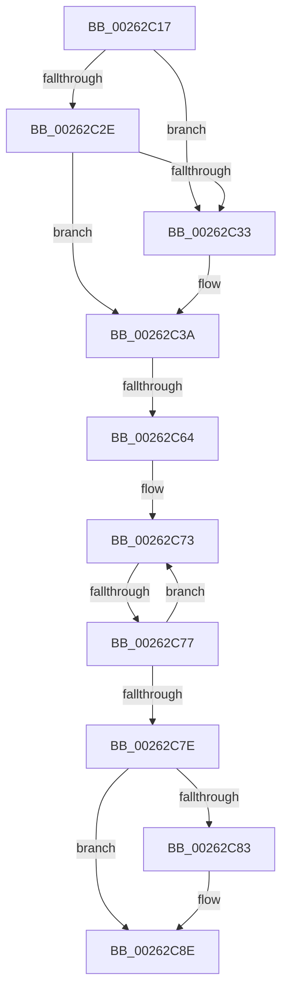

# sub_00262C17

- RVA: `0x00262C17`–`0x00262C98` (길이 `129` bytes)
- VA: `0x0000000140262C17`
- 실행 섹션: `.text`
- PDB 이름 있음: `아니요`; PDB Function 태그: `아니요`
- unwind 정보 RVA: `0x00064590`
- 디코드: `37`개 명령, `129/129` bytes 표시
- 미해석 바이트: `0` (있으면 어셈블리에 `.byte`로 보존)

> 이 문서는 커널 이미지의 기계어와 PDB 기호를 분석해 생성했습니다. 4번과 5번은 함수 원형과 자료형을 바이너리 사용 방식에서 추정한 C 해석이며 원본 소스 복구 결과는 아닙니다.

## 1. Dependencies

- 직접 호출 지점: **1**; 고유 호출 대상: **1**
- 직접 호출자로 확인된 함수: **0**
- RIP 상대 이미지 참조: **0**

### Outgoing calls
- `0x00262C89` → [KeAbPostReleaseEx](KeAbPostReleaseEx_function_00262210.md) (function, `0x00262210`)

### Direct callers
- 이 함수 시작 RVA로 연결되는 직접 call은 확인되지 않았습니다. 간접 호출은 완전히 역산할 수 없습니다.

### Static image references
- 디코드된 RIP-relative 메모리 참조가 없습니다.

## 2. Other-region calls and transfers

- 다른 실행 섹션으로 향하는 call: **0**
- call이 아닌 외부 분기/꼬리 이동: **2**
  - `0x00262C62` → [sub_00262CBC](Unknown_function_00262CBC.md) (`tail-transfer`)
  - `0x00262C75` → [sub_00262C9F](Unknown_function_00262C9F.md) (`tail-transfer`)

## 3. Assembly (complete function range)

```asm
00262C17  48 89 7C 24 38                  mov qword ptr [rsp + 0x38], rdi
00262C1C  0F B6 79 64                     movzx edi, byte ptr [rcx + 0x64]
00262C20  FA                              cli
00262C21  48 8B 10                        mov rdx, qword ptr [rax]
00262C24  48 8B 48 08                     mov rcx, qword ptr [rax + 8]
00262C28  48 39 42 08                     cmp qword ptr [rdx + 8], rax
00262C2C  75 05                           jne 0x140262c33
00262C2E  48 39 01                        cmp qword ptr [rcx], rax
00262C31  74 07                           je 0x140262c3a
00262C33  B9 03 00 00 00                  mov ecx, 3
00262C38  CD 29                           int 0x29
00262C3A  48 89 11                        mov qword ptr [rcx], rdx
00262C3D  48 89 4A 08                     mov qword ptr [rdx + 8], rcx
00262C41  48 89 74 24 30                  mov qword ptr [rsp + 0x30], rsi
00262C46  33 F6                           xor esi, esi
00262C48  48 89 30                        mov qword ptr [rax], rsi
00262C4B  48 89 70 08                     mov qword ptr [rax + 8], rsi
00262C4F  65 48 8B 0C 25 20 00 00 00      mov rcx, qword ptr gs:[0x20]
00262C58  4C 8B 81 B8 8E 00 00            mov r8, qword ptr [rcx + 0x8eb8]
00262C5F  4D 85 C0                        test r8, r8
00262C62  75 58                           jne 0x140262cbc
00262C64  FB                              sti
00262C65  48 89 73 50                     mov qword ptr [rbx + 0x50], rsi
00262C69  40 88 73 64                     mov byte ptr [rbx + 0x64], sil
00262C6D  0F 0D 0B                        prefetchw byte ptr [rbx]
00262C70  48 8B 03                        mov rax, qword ptr [rbx]
00262C73  A8 02                           test al, 2
00262C75  75 28                           jne 0x140262c9f
00262C77  F0 48 0F B1 33                  lock cmpxchg qword ptr [rbx], rsi
00262C7C  75 F5                           jne 0x140262c73
00262C7E  40 84 FF                        test dil, dil
00262C81  74 0B                           je 0x140262c8e
00262C83  48 8B D7                        mov rdx, rdi
00262C86  48 8B CB                        mov rcx, rbx
00262C89  E8 82 F5 FF FF                  call 0x140262210
00262C8E  48 8B 74 24 30                  mov rsi, qword ptr [rsp + 0x30]
00262C93  48 8B 7C 24 38                  mov rdi, qword ptr [rsp + 0x38]
```

## 4. C-style interpretation (structured pseudocode)

```c
__int64 __fastcall sub_00262C17(__int64 a1, __int64 a2, __int64 a3, __int64 a4, __int64 a5, __int64 a6, __int64 a7)
{
    __int64 result;
    __int64 v_rsi;
    unsigned __int64 v_stack_p30;
    unsigned __int64 v_stack_p38;

    v_stack_p38 = v_rdi;
    if ((*(unsigned __int64 *)(*(unsigned __int64 *)(result) + 8)) != result) goto loc_00262C33;
    if ((*(unsigned __int64 *)(*(unsigned __int64 *)(result + 8))) != result) {
        a1 = 3;
    }
    *(unsigned __int64 *)(a1) = *(unsigned __int64 *)(result);
    *(unsigned __int64 *)(*(unsigned __int64 *)(result) + 8) = a1;
    v_stack_p30 = v_rsi;
    v_rsi = 0;
    *(unsigned __int64 *)(result) = 0;
    *(unsigned __int64 *)(result + 8) = 0;
    *(unsigned __int64 *)(v_rbx + 80) = 0;
    *(unsigned __int8 *)(v_rbx + 100) = 0;
loc_00262C73:
    if ((((unsigned __int8)(*(unsigned __int64 *)(v_rbx))) & (2)) != 0) goto loc_00262C73;
    result = *(unsigned __int64 *)(v_rbx);
    if ((unsigned __int8)(*(unsigned __int8 *)(a1 + 100)) != 0) {
        a2 = *(unsigned __int8 *)(a1 + 100);
        a1 = v_rbx;
        result = KeAbPostReleaseEx(a1, a2, *(unsigned __int64 *)(*(unsigned __int64 *)(gs_base + (0 + 32)) + 36536), a4);
    }
    return result;
}
```

## 5. (Beta) C Style

```c
int64_t sub_00262C17(void *Arg1, int64_t Arg2, int64_t Arg3, int64_t Arg4, uint64_t Arg5, int64_t Arg6, int64_t Arg7)
{
    uint8_t *arg1 = (uint8_t *)Arg1;

    int64_t result;
    int64_t local_rsi;
    uint64_t v_stack_p30;
    uint64_t v_stack_p38;

    v_stack_p38 = local_rdi;
    if ((*(uint64_t *)(*(uint64_t *)(result) + 0x8)) != result) goto loc_00262C33;
    if ((*(uint64_t *)(*(uint64_t *)(result + 0x8))) != result) {
        Arg1 = 3;
    }
    *(uint64_t *)(arg1) = *(uint64_t *)(result);
    *(void **)(*(uint64_t *)(result) + 0x8) = Arg1;
    v_stack_p30 = local_rsi;
    local_rsi = 0;
    *(uint64_t *)(result) = 0;
    *(uint64_t *)(result + 0x8) = 0;
    *(uint64_t *)(local_rbx + 0x50) = 0;
    *(uint8_t *)(local_rbx + 0x64) = 0;
loc_00262C73:
    if ((((uint8_t)(*(uint64_t *)(local_rbx))) & (2)) != 0) goto loc_00262C73;
    result = *(uint64_t *)(local_rbx);
    if ((uint8_t)(*(uint8_t *)(arg1 + 0x64)) != 0) {
        Arg2 = *(uint8_t *)(arg1 + 0x64);
        Arg1 = local_rbx;
        result = KeAbPostReleaseEx(Arg1, Arg2, *(uint64_t *)(*(uint64_t *)(gs_base + (0 + 0x20)) + 0x8EB8), Arg4);
    }
    return result;
}
```

### 관측된 메모리 오프셋

구조체 형식이 확인되지 않은 접근은 인자 기준의 오프셋으로만 기록했습니다.

| 기준 인자 | 오프셋 표현 | 폭 (bit) | 접근 |
|---|---:|---:|---|
| `Arg1` | `+ 0x64` | `8` | `R` |

## 6. Execution-region graph

[열기: 2D/3D 그래프와 함수 탐색 컨트롤 패널](../../../control-panel.html?section=text&rva=0x00262C17&view=graph)

- 2D 그래프는 위에서 아래로 흐르고, 3D 그래프는 빈 공간을 드래그해 회전합니다. Shift+드래그는 이동, 휠은 확대·축소, 함수 노드 선택은 대상 보고서 이동입니다.

### Static fallback


