# sub_00262D5A

- RVA: `0x00262D5A`–`0x00262F2A` (길이 `464` bytes)
- VA: `0x0000000140262D5A`
- 실행 섹션: `.text`
- PDB 이름 있음: `아니요`; PDB Function 태그: `아니요`
- unwind 정보 RVA: `0x00064610`
- 디코드: `120`개 명령, `464/464` bytes 표시
- 미해석 바이트: `0` (있으면 어셈블리에 `.byte`로 보존)

> 이 문서는 커널 이미지의 기계어와 PDB 기호를 분석해 생성했습니다. 4번과 5번은 함수 원형과 자료형을 바이너리 사용 방식에서 추정한 C 해석이며 원본 소스 복구 결과는 아닙니다.

## 1. Dependencies

- 직접 호출 지점: **5**; 고유 호출 대상: **5**
- 직접 호출자로 확인된 함수: **0**
- RIP 상대 이미지 참조: **3**

### Outgoing calls
- `0x00262E69` → [KxWaitForLockChainValid](../21/KxWaitForLockChainValid_function_00217AA0.md) (function, `0x00217AA0`)
- `0x00262E88` → [KeWakeAddressAll](../21/KeWakeAddressAll_function_00217C20.md) (function, `0x00217C20`)
- `0x00262EA6` → [KiReleaseQueuedSpinLockInstrumented](../21/KiReleaseQueuedSpinLockInstrumented_function_002179F0.md) (function, `0x002179F0`)
- `0x00262EF1` → [KiLowerIrqlProcessIrqlFlags](../4F/KiLowerIrqlProcessIrqlFlags_function_004F5698.md) (function, `0x004F5698`)
- `0x00262F0A` → [KeAbPostReleaseEx](KeAbPostReleaseEx_function_00262210.md) (function, `0x00262210`)

### Direct callers
- 이 함수 시작 RVA로 연결되는 직접 call은 확인되지 않았습니다. 간접 호출은 완전히 역산할 수 없습니다.

### Static image references
- `0x00262E33` → RVA `0x00FC6B06` (`ALMOSTRO`; read)
- `0x00262E8F` → RVA `0x00F0DE58` (`.data`; read)
- `0x00262EE0` → RVA `0x00FC6D20` (`ALMOSTRO`; read)

## 2. Other-region calls and transfers

- 다른 실행 섹션으로 향하는 call: **0**
- call이 아닌 외부 분기/꼬리 이동: **7**
  - `0x00262D72` → [sub_002630C6 + 0x84](Unknown_function_002630C6.md) (`tail-transfer`)
  - `0x00262D86` → [sub_00262F4A](Unknown_function_00262F4A.md) (`tail-transfer`)
  - `0x00262D9D` → [sub_002630C6](Unknown_function_002630C6.md) (`tail-transfer`)
  - `0x00262DBF` → [sub_00262F80](Unknown_function_00262F80.md) (`tail-transfer`)
  - `0x00262E0A` → [sub_002630C6 + 0x41](Unknown_function_002630C6.md) (`tail-transfer`)
  - `0x00262E1B` → [sub_00262F4A + 0x10](Unknown_function_00262F4A.md) (`tail-transfer`)
  - `0x00262ECA` → [sub_00262F80 + 0xC](Unknown_function_00262F80.md) (`tail-transfer`)

## 3. Assembly (complete function range)

```asm
00262D5A  4C 89 64 24 68                  mov qword ptr [rsp + 0x68], r12
00262D5F  4C 89 6C 24 60                  mov qword ptr [rsp + 0x60], r13
00262D64  4C 89 7C 24 58                  mov qword ptr [rsp + 0x58], r15
00262D69  0F 0D 0B                        prefetchw byte ptr [rbx]
00262D6C  48 8B 03                        mov rax, qword ptr [rbx]
00262D6F  41 84 C6                        test r14b, al
00262D72  0F 84 D2 03 00 00               je 0x14026314a
00262D78  48 8B 4B 10                     mov rcx, qword ptr [rbx + 0x10]
00262D7C  48 8D 53 38                     lea rdx, [rbx + 0x38]
00262D80  4C 8B D5                        mov r10, rbp
00262D83  48 85 C9                        test rcx, rcx
00262D86  0F 84 BE 01 00 00               je 0x140262f4a
00262D8C  41 BB 01 00 00 00               mov r11d, 1
00262D92  44 8B 0A                        mov r9d, dword ptr [rdx]
00262D95  45 85 C9                        test r9d, r9d
00262D98  75 32                           jne 0x140262dcc
00262D9A  48 85 C9                        test rcx, rcx
00262D9D  0F 84 23 03 00 00               je 0x1402630c6
00262DA3  4C 8B 01                        mov r8, qword ptr [rcx]
00262DA6  4C 3B C1                        cmp r8, rcx
00262DA9  74 35                           je 0x140262de0
00262DAB  4C 89 43 10                     mov qword ptr [rbx + 0x10], r8
00262DAF  4C 8B 09                        mov r9, qword ptr [rcx]
00262DB2  4C 8B 41 08                     mov r8, qword ptr [rcx + 8]
00262DB6  49 39 49 08                     cmp qword ptr [r9 + 8], rcx
00262DBA  75 09                           jne 0x140262dc5
00262DBC  49 39 08                        cmp qword ptr [r8], rcx
00262DBF  0F 84 BB 01 00 00               je 0x140262f80
00262DC5  B9 03 00 00 00                  mov ecx, 3
00262DCA  CD 29                           int 0x29
00262DCC  48 8B 43 08                     mov rax, qword ptr [rbx + 8]
00262DD0  48 89 6B 08                     mov qword ptr [rbx + 8], rbp
00262DD4  48 89 84 24 B0 00 00 00         mov qword ptr [rsp + 0xb0], rax
00262DDC  89 2A                           mov dword ptr [rdx], ebp
00262DDE  EB 1D                           jmp 0x140262dfd
00262DE0  48 89 6B 10                     mov qword ptr [rbx + 0x10], rbp
00262DE4  4C 8B 51 10                     mov r10, qword ptr [rcx + 0x10]
00262DE8  41 B9 01 00 00 00               mov r9d, 1
00262DEE  48 89 49 08                     mov qword ptr [rcx + 8], rcx
00262DF2  48 89 09                        mov qword ptr [rcx], rcx
00262DF5  48 89 8C 24 B0 00 00 00         mov qword ptr [rsp + 0xb0], rcx
00262DFD  47 8D 04 1B                     lea r8d, [r11 + r11]
00262E01  0F 0D 0B                        prefetchw byte ptr [rbx]
00262E04  48 8B 03                        mov rax, qword ptr [rbx]
00262E07  4D 85 D2                        test r10, r10
00262E0A  0F 84 F7 02 00 00               je 0x140263107
00262E10  41 83 C8 01                     or r8d, 1
00262E14  41 8B F8                        mov edi, r8d
00262E17  48 39 6B 10                     cmp qword ptr [rbx + 0x10], rbp
00262E1B  0F 84 39 01 00 00               je 0x140262f5a
00262E21  48 8B C8                        mov rcx, rax
00262E24  49 0B CE                        or rcx, r14
00262E27  48 3B C8                        cmp rcx, rax
00262E2A  74 07                           je 0x140262e33
00262E2C  F0 48 0F B1 0B                  lock cmpxchg qword ptr [rbx], rcx
00262E31  75 E4                           jne 0x140262e17
00262E33  F6 05 CC 3C D6 00 01            test byte ptr [rip + 0xd63ccc], 1
00262E3A  75 53                           jne 0x140262e8f
00262E3C  0F 0D 4C 24 38                  prefetchw byte ptr [rsp + 0x38]
00262E41  48 8B 44 24 38                  mov rax, qword ptr [rsp + 0x38]
00262E46  48 85 C0                        test rax, rax
00262E49  75 23                           jne 0x140262e6e
00262E4B  48 8B 4C 24 40                  mov rcx, qword ptr [rsp + 0x40]
00262E50  48 8D 44 24 38                  lea rax, [rsp + 0x38]
00262E55  F0 48 0F B1 29                  lock cmpxchg qword ptr [rcx], rbp
00262E5A  48 8D 4C 24 38                  lea rcx, [rsp + 0x38]
00262E5F  48 3B C1                        cmp rax, rcx
00262E62  74 47                           je 0x140262eab
00262E64  48 8D 4C 24 38                  lea rcx, [rsp + 0x38]
00262E69  E8 32 4C FB FF                  call 0x140217aa0
00262E6E  48 8D 48 08                     lea rcx, [rax + 8]
00262E72  48 89 6C 24 38                  mov qword ptr [rsp + 0x38], rbp
00262E77  48 8B 54 24 40                  mov rdx, qword ptr [rsp + 0x40]
00262E7C  48 8B C2                        mov rax, rdx
00262E7F  48 87 01                        xchg qword ptr [rcx], rax
00262E82  32 C2                           xor al, dl
00262E84  A8 04                           test al, 4
00262E86  74 23                           je 0x140262eab
00262E88  E8 93 4D FB FF                  call 0x140217c20
00262E8D  EB 1C                           jmp 0x140262eab
00262E8F  8B 05 C3 AF CA 00               mov eax, dword ptr [rip + 0xcaafc3]
00262E95  85 C0                           test eax, eax
00262E97  75 A3                           jne 0x140262e3c
00262E99  48 8B 94 24 98 00 00 00         mov rdx, qword ptr [rsp + 0x98]
00262EA1  48 8D 4C 24 38                  lea rcx, [rsp + 0x38]
00262EA6  E8 45 4B FB FF                  call 0x1402179f0
00262EAB  8B C7                           mov eax, edi
00262EAD  83 E0 01                        and eax, 1
00262EB0  8D 04 45 01 00 00 00            lea eax, [rax*2 + 1]
00262EB7  8B F0                           mov esi, eax
00262EB9  83 CE 04                        or esi, 4
00262EBC  41 84 FE                        test r14b, dil
00262EBF  0F 44 F0                        cmove esi, eax
00262EC2  48 39 AC 24 B0 00 00 00         cmp qword ptr [rsp + 0xb0], rbp
00262ECA  0F 85 BC 00 00 00               jne 0x140262f8c
00262ED0  0F B6 B4 24 A8 00 00 00         movzx esi, byte ptr [rsp + 0xa8]
00262ED8  48 8B BC 24 B8 00 00 00         mov rdi, qword ptr [rsp + 0xb8]
00262EE0  83 3D 39 3E D6 00 00            cmp dword ptr [rip + 0xd63e39], 0
00262EE7  74 0D                           je 0x140262ef6
00262EE9  44 0F 20 C1                     mov rcx, cr8
00262EED  40 0F B6 D7                     movzx edx, dil
00262EF1  E8 A2 27 29 00                  call 0x1404f5698
00262EF6  40 0F B6 C7                     movzx eax, dil
00262EFA  44 0F 22 C0                     mov cr8, rax
00262EFE  40 84 F6                        test sil, sil
00262F01  74 0C                           je 0x140262f0f
00262F03  40 0F B6 D6                     movzx edx, sil
00262F07  48 8B CB                        mov rcx, rbx
00262F0A  E8 01 F3 FF FF                  call 0x140262210
00262F0F  4C 8B 7C 24 58                  mov r15, qword ptr [rsp + 0x58]
00262F14  4C 8B 6C 24 60                  mov r13, qword ptr [rsp + 0x60]
00262F19  4C 8B 64 24 68                  mov r12, qword ptr [rsp + 0x68]
00262F1E  48 83 C4 70                     add rsp, 0x70
00262F22  41 5E                           pop r14
00262F24  5F                              pop rdi
00262F25  5E                              pop rsi
00262F26  5D                              pop rbp
00262F27  5B                              pop rbx
00262F28  C3                              ret
00262F29  CC                              int3
```

## 4. C-style interpretation (structured pseudocode)

```c
__int64 __fastcall sub_00262D5A(__int64 a1, __int64 a2, __int64 a3, __int64 a4, __int64 a5, __int64 a6, unsigned __int8 a7, __int64 a8, __int64 a9, __int64 a10, __int64 a11, __int64 a12, __int64 a13, __int64 a14, __int64 a15, __int64 a16, __int64 a17, __int64 a18, __int64 a19, __int64 a20, unsigned __int8 a21, __int64 a22, __int64 a23)
{
    __int64 result;
    __int64 v_rsi;
    __int64 v_rsp;
    unsigned __int64 v_stack_p38;
    unsigned __int64 v_stack_p58;
    unsigned __int64 v_stack_p60;
    unsigned __int64 v_stack_p68;
    unsigned __int64 v_stack_pB0;

    v_stack_p68 = v_r12;
    v_stack_p60 = v_r13;
    v_stack_p58 = v_r15;
    if ((unsigned int)((unsigned int)(*(unsigned int *)(v_rbx + 56))) != 0) goto loc_00262DCC;
    if ((*(unsigned __int64 *)(*(unsigned __int64 *)(v_rbx + 16))) == (*(unsigned __int64 *)(v_rbx + 16))) goto loc_00262DE0;
    *(unsigned __int64 *)(v_rbx + 16) = *(unsigned __int64 *)(*(unsigned __int64 *)(v_rbx + 16));
    if ((*(unsigned __int64 *)(*(unsigned __int64 *)(*(unsigned __int64 *)(v_rbx + 16)) + 8)) != (*(unsigned __int64 *)(v_rbx + 16))) goto loc_00262DC5;
loc_00262DC5:
loc_00262DCC:
    *(unsigned __int64 *)(v_rbx + 8) = v_rbp;
    v_stack_pB0 = *(unsigned __int64 *)(v_rbx + 8);
    *(unsigned int *)(v_rbx + 56) = (unsigned int)(v_rbp);
    goto loc_00262DFD;
loc_00262DE0:
    *(unsigned __int64 *)(v_rbx + 16) = v_rbp;
    *(unsigned __int64 *)(3 + 8) = 3;
    *(unsigned __int64 *)(3) = 3;
    v_stack_pB0 = 3;
loc_00262DFD:
    a3 = (unsigned int)((1 + 1 * 1) | (1));
loc_00262E17:
    a1 = (*(unsigned __int64 *)(v_rbx)) | (v_r14);
    if (a1 == (*(unsigned __int64 *)(v_rbx))) goto loc_00262E33;
    if (a1 != (*(unsigned __int64 *)(v_rbx))) goto loc_00262E17;
loc_00262E33:
    if (((*(unsigned __int8 *)(v_rip + 14040268)) & (1)) != 0) goto loc_00262E8F;
loc_00262E3C:
    if (a7 != 0) goto loc_00262E6E;
    if (a7 == a7) goto loc_00262EAB;
    result = KxWaitForLockChainValid(a7, v_rbx + 56, a3, 1);
loc_00262E6E:
    v_stack_p38 = v_rbp;
    result = (unsigned __int8)((a8) ^ ((unsigned __int8)(a8)));
    if ((((unsigned __int8)(result)) & (4)) == 0) goto loc_00262EAB;
    result = KeWakeAddressAll(result + 8, a8, a3, 1);
    goto loc_00262EAB;
loc_00262E8F:
    if ((unsigned int)((unsigned int)(*(unsigned int *)(v_rip + 13283267))) != 0) goto loc_00262E3C;
    result = KiReleaseQueuedSpinLockInstrumented(a7, a19, a3, 1);
loc_00262EAB:
    result = (unsigned int)(((unsigned int)((unsigned int)((unsigned int)((unsigned int)(a3))))) & (1));
    v_rsi = (unsigned int)(((unsigned int)((unsigned int)(result * 2 + 1))) | (4));
    if ((((unsigned __int8)(v_r14)) & ((unsigned __int8)((unsigned int)((unsigned int)(a3))))) == 0) { v_rsi = (unsigned int)(result * 2 + 1); }
    result = result * 2 + 1;
    if ((*(unsigned int *)(v_rip + 14040633)) != 0) {
        a1 = v_cr8;
        a2 = (unsigned __int8)(a23);
        result = KiLowerIrqlProcessIrqlFlags(a1, a2, a3, 1);
    }
    result = (unsigned __int8)(a23);
    if (a21 != 0) {
        a2 = a21;
        a1 = v_rbx;
        result = KeAbPostReleaseEx(a1, a2, a3, 1);
    }
    v_rsp = (v_rsp) + (112);
    return result;
}
```

## 5. (Beta) C Style

```c
int64_t sub_00262D5A(int64_t Arg1, int64_t Arg2, int64_t Arg3, int64_t Arg4, uint64_t Arg5, uint64_t Arg6, uint8_t Arg7, void *Arg8, uint64_t Arg9, uint64_t Arg10, int64_t Arg11, int64_t Arg12, int64_t Arg13, uint64_t Arg14, uint64_t Arg15, uint64_t Arg16, uint64_t Arg17, uint64_t Arg18, int64_t Arg19, uint64_t Arg20, uint8_t Arg21, int64_t Arg22, int64_t Arg23)
{
    uint8_t *arg8 = (uint8_t *)Arg8;

    int64_t result;
    int64_t local_rsi;
    int64_t local_rsp;
    uint64_t v_stack_p38;
    uint64_t v_stack_p58;
    uint64_t v_stack_p60;
    uint64_t v_stack_p68;
    uint64_t v_stack_pB0;

    v_stack_p68 = local_r12;
    v_stack_p60 = local_r13;
    v_stack_p58 = local_r15;
    if ((uint32_t)((uint32_t)(*(uint32_t *)(local_rbx + 0x38))) != 0) goto loc_00262DCC;
    if ((*(uint64_t *)(*(uint64_t *)(local_rbx + 0x10))) == (*(uint64_t *)(local_rbx + 0x10))) goto loc_00262DE0;
    *(uint64_t *)(local_rbx + 0x10) = *(uint64_t *)(*(uint64_t *)(local_rbx + 0x10));
    if ((*(uint64_t *)(*(uint64_t *)(*(uint64_t *)(local_rbx + 0x10)) + 0x8)) != (*(uint64_t *)(local_rbx + 0x10))) goto loc_00262DC5;
loc_00262DC5:
loc_00262DCC:
    *(uint64_t *)(local_rbx + 0x8) = local_rbp;
    v_stack_pB0 = *(uint64_t *)(local_rbx + 0x8);
    *(uint32_t *)(local_rbx + 0x38) = (uint32_t)(local_rbp);
    goto loc_00262DFD;
loc_00262DE0:
    *(uint64_t *)(local_rbx + 0x10) = local_rbp;
    *(uint64_t *)(3 + 0x8) = 3;
    *(uint64_t *)(3) = 3;
    v_stack_pB0 = 3;
loc_00262DFD:
    Arg3 = (uint32_t)((1 + 1 * 1) | (1));
loc_00262E17:
    Arg1 = (*(uint64_t *)(local_rbx)) | (local_r14);
    if (Arg1 == (*(uint64_t *)(local_rbx))) goto loc_00262E33;
    if (Arg1 != (*(uint64_t *)(local_rbx))) goto loc_00262E17;
loc_00262E33:
    if (((*(uint8_t *)(v_rip + 0xD63CCC)) & (1)) != 0) goto loc_00262E8F;
loc_00262E3C:
    if (Arg7 != 0) goto loc_00262E6E;
    if (Arg7 == Arg7) goto loc_00262EAB;
    result = KxWaitForLockChainValid(Arg7, local_rbx + 56, Arg3, 1);
loc_00262E6E:
    v_stack_p38 = local_rbp;
    result = (uint8_t)((Arg8) ^ ((uint8_t)(Arg8)));
    if ((((uint8_t)(result)) & (4)) == 0) goto loc_00262EAB;
    result = KeWakeAddressAll(result + 8, Arg8, Arg3, 1);
    goto loc_00262EAB;
loc_00262E8F:
    if ((uint32_t)((uint32_t)(*(uint32_t *)(v_rip + 0xCAAFC3))) != 0) goto loc_00262E3C;
    result = KiReleaseQueuedSpinLockInstrumented(Arg7, Arg19, Arg3, 1);
loc_00262EAB:
    result = (uint32_t)(((uint32_t)((uint32_t)((uint32_t)((uint32_t)(Arg3))))) & (1));
    local_rsi = (uint32_t)(((uint32_t)((uint32_t)(result * 2 + 1))) | (4));
    if ((((uint8_t)(local_r14)) & ((uint8_t)((uint32_t)((uint32_t)(Arg3))))) == 0) { local_rsi = (uint32_t)(result * 2 + 1); }
    result = result * 2 + 1;
    if ((*(uint32_t *)(v_rip + 0xD63E39)) != 0) {
        Arg1 = v_cr8;
        Arg2 = (uint8_t)(Arg23);
        result = KiLowerIrqlProcessIrqlFlags(Arg1, Arg2, Arg3, 1);
    }
    result = (uint8_t)(Arg23);
    if (Arg21 != 0) {
        Arg2 = Arg21;
        Arg1 = local_rbx;
        result = KeAbPostReleaseEx(Arg1, Arg2, Arg3, 1);
    }
    local_rsp = (local_rsp) + (112);
    return result;
}
```

### 관측된 메모리 오프셋

구조체 형식이 확인되지 않은 접근은 인자 기준의 오프셋으로만 기록했습니다.

| 기준 인자 | 오프셋 표현 | 폭 (bit) | 접근 |
|---|---:|---:|---|
| `Arg8` | `+ 0x0` | `64` | `R` |

## 6. Execution-region graph

[열기: 2D/3D 그래프와 함수 탐색 컨트롤 패널](../../../control-panel.html?section=text&rva=0x00262D5A&view=graph)

- 2D 그래프는 위에서 아래로 흐르고, 3D 그래프는 빈 공간을 드래그해 회전합니다. Shift+드래그는 이동, 휠은 확대·축소, 함수 노드 선택은 대상 보고서 이동입니다.

### Static fallback

```mermaid
flowchart TD
  bb_00262D5A[BB_00262D5A]
  bb_00262D78[BB_00262D78]
  bb_00262D8C[BB_00262D8C]
  bb_00262D9A[BB_00262D9A]
  bb_00262DA3[BB_00262DA3]
  bb_00262DAB[BB_00262DAB]
  bb_00262DBC[BB_00262DBC]
  bb_00262DC5[BB_00262DC5]
  bb_00262DCC[BB_00262DCC]
  bb_00262DE0[BB_00262DE0]
  bb_00262DFD[BB_00262DFD]
  bb_00262E10[BB_00262E10]
  bb_00262E17[BB_00262E17]
  bb_00262E21[BB_00262E21]
  bb_00262E2C[BB_00262E2C]
  bb_00262E33[BB_00262E33]
  bb_00262E3C[BB_00262E3C]
  bb_00262E4B[BB_00262E4B]
  bb_00262E64[BB_00262E64]
  bb_00262E6E[BB_00262E6E]
  bb_00262E88[BB_00262E88]
  bb_00262E8F[BB_00262E8F]
  bb_00262E99[BB_00262E99]
  bb_00262EAB[BB_00262EAB]
  bb_00262ED0[BB_00262ED0]
  bb_00262EE9[BB_00262EE9]
  bb_00262EF6[BB_00262EF6]
  bb_00262F03[BB_00262F03]
  bb_00262F0F[BB_00262F0F]
  bb_00262F29[BB_00262F29]
  bb_00262D5A -->|fallthrough| bb_00262D78
  bb_00262D78 -->|fallthrough| bb_00262D8C
  bb_00262D8C -->|branch| bb_00262DCC
  bb_00262D8C -->|fallthrough| bb_00262D9A
  bb_00262D9A -->|fallthrough| bb_00262DA3
  bb_00262DA3 -->|branch| bb_00262DE0
  bb_00262DA3 -->|fallthrough| bb_00262DAB
  bb_00262DAB -->|branch| bb_00262DC5
  bb_00262DAB -->|fallthrough| bb_00262DBC
  bb_00262DBC -->|fallthrough| bb_00262DC5
  bb_00262DC5 -->|flow| bb_00262DCC
  bb_00262DCC -->|branch| bb_00262DFD
  bb_00262DE0 -->|flow| bb_00262DFD
  bb_00262DFD -->|fallthrough| bb_00262E10
  bb_00262E10 -->|flow| bb_00262E17
  bb_00262E17 -->|fallthrough| bb_00262E21
  bb_00262E21 -->|branch| bb_00262E33
  bb_00262E21 -->|fallthrough| bb_00262E2C
  bb_00262E2C -->|branch| bb_00262E17
  bb_00262E2C -->|fallthrough| bb_00262E33
  bb_00262E33 -->|branch| bb_00262E8F
  bb_00262E33 -->|fallthrough| bb_00262E3C
  bb_00262E3C -->|branch| bb_00262E6E
  bb_00262E3C -->|fallthrough| bb_00262E4B
  bb_00262E4B -->|branch| bb_00262EAB
  bb_00262E4B -->|fallthrough| bb_00262E64
  bb_00262E64 -->|flow| bb_00262E6E
  bb_00262E6E -->|branch| bb_00262EAB
  bb_00262E6E -->|fallthrough| bb_00262E88
  bb_00262E88 -->|branch| bb_00262EAB
  bb_00262E8F -->|branch| bb_00262E3C
  bb_00262E8F -->|fallthrough| bb_00262E99
  bb_00262E99 -->|flow| bb_00262EAB
  bb_00262EAB -->|fallthrough| bb_00262ED0
  bb_00262ED0 -->|branch| bb_00262EF6
  bb_00262ED0 -->|fallthrough| bb_00262EE9
  bb_00262EE9 -->|flow| bb_00262EF6
  bb_00262EF6 -->|branch| bb_00262F0F
  bb_00262EF6 -->|fallthrough| bb_00262F03
  bb_00262F03 -->|flow| bb_00262F0F
```


