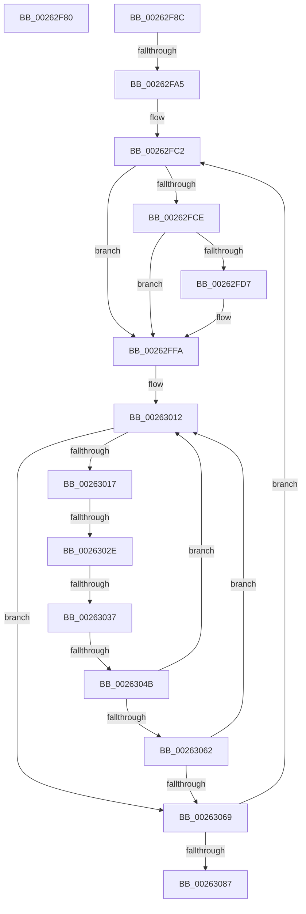

# sub_00262F80

- RVA: `0x00262F80`–`0x002630B7` (길이 `311` bytes)
- VA: `0x0000000140262F80`
- 실행 섹션: `.text`
- PDB 이름 있음: `아니요`; PDB Function 태그: `아니요`
- unwind 정보 RVA: `0x0006466C`
- 디코드: `75`개 명령, `311/311` bytes 표시
- 미해석 바이트: `0` (있으면 어셈블리에 `.byte`로 보존)

> 이 문서는 커널 이미지의 기계어와 PDB 기호를 분석해 생성했습니다. 4번과 5번은 함수 원형과 자료형을 바이너리 사용 방식에서 추정한 C 해석이며 원본 소스 복구 결과는 아닙니다.

## 1. Dependencies

- 직접 호출 지점: **5**; 고유 호출 대상: **5**
- 직접 호출자로 확인된 함수: **0**
- RIP 상대 이미지 참조: **1**

### Outgoing calls
- `0x00262FF5` → [KiAbConvertWaiterToOwnerEntry](../21/KiAbConvertWaiterToOwnerEntry_function_00219430.md) (function, `0x00219430`)
- `0x00262FFE` → [KiAcquireKobjectLockSafe](../25/KiAcquireKobjectLockSafe_function_00251C90.md) (function, `0x00251C90`)
- `0x00263059` → [KiTryUnwaitThread](../35/KiTryUnwaitThread_function_003506D0.md) (function, `0x003506D0`)
- `0x0026308E` → [KiRemoveBoostThread](../21/KiRemoveBoostThread_function_00219128.md) (function, `0x00219128`)
- `0x002630AD` → [KiExitDispatcher](../25/KiExitDispatcher_function_00251CF0.md) (function, `0x00251CF0`)

### Direct callers
- 이 함수 시작 RVA로 연결되는 직접 call은 확인되지 않았습니다. 간접 호출은 완전히 역산할 수 없습니다.

### Static image references
- `0x00262F99` → RVA `0x00FC6D20` (`ALMOSTRO`; read)

## 2. Other-region calls and transfers

- 다른 실행 섹션으로 향하는 call: **0**
- call이 아닌 외부 분기/꼬리 이동: **6**
  - `0x00262F87` → [sub_00262D5A + 0x8A](Unknown_function_00262D5A.md) (`tail-transfer`)
  - `0x00262F9F` → [sub_002630C6 + 0x12](Unknown_function_002630C6.md) (`tail-transfer`)
  - `0x00263028` → [sub_00262D5A + 0x6B](Unknown_function_00262D5A.md) (`tail-transfer`)
  - `0x00263031` → [sub_00262D5A + 0x6B](Unknown_function_00262D5A.md) (`tail-transfer`)
  - `0x00263045` → [sub_002630C6 + 0x23](Unknown_function_002630C6.md) (`tail-transfer`)
  - `0x002630B2` → [sub_00262D5A + 0x176](Unknown_function_00262D5A.md) (`tail-transfer`)

## 3. Assembly (complete function range)

```asm
00262F80  4D 89 08                        mov qword ptr [r8], r9
00262F83  4D 89 41 08                     mov qword ptr [r9 + 8], r8
00262F87  E9 58 FE FF FF                  jmp 0x140262de4
00262F8C  44 0F 20 C0                     mov rax, cr8
00262F90  48 89 44 24 30                  mov qword ptr [rsp + 0x30], rax
00262F95  45 0F 22 C6                     mov cr8, r14
00262F99  39 2D 81 3D D6 00               cmp dword ptr [rip + 0xd63d81], ebp
00262F9F  0F 85 33 01 00 00               jne 0x1402630d8
00262FA5  65 48 8B 2C 25 20 00 00 00      mov rbp, qword ptr gs:[0x20]
00262FAE  8B C6                           mov eax, esi
00262FB0  4C 8B A4 24 B0 00 00 00         mov r12, qword ptr [rsp + 0xb0]
00262FB8  83 E0 04                        and eax, 4
00262FBB  89 84 24 A0 00 00 00            mov dword ptr [rsp + 0xa0], eax
00262FC2  4D 8D 3C 24                     lea r15, [r12]
00262FC6  4D 8B 24 24                     mov r12, qword ptr [r12]
00262FCA  85 C0                           test eax, eax
00262FCC  74 2C                           je 0x140262ffa
00262FCE  49 8B 57 30                     mov rdx, qword ptr [r15 + 0x30]
00262FD2  48 85 D2                        test rdx, rdx
00262FD5  74 23                           je 0x140262ffa
00262FD7  48 8B 02                        mov rax, qword ptr [rdx]
00262FDA  48 8B CA                        mov rcx, rdx
00262FDD  0F B6 42 08                     movzx eax, byte ptr [rdx + 8]
00262FE1  83 E0 3F                        and eax, 0x3f
00262FE4  4C 6B C0 58                     imul r8, rax, 0x58
00262FE8  49 2B C8                        sub rcx, r8
00262FEB  41 B8 01 00 00 00               mov r8d, 1
00262FF1  48 8B 49 F0                     mov rcx, qword ptr [rcx - 0x10]
00262FF5  E8 36 64 FB FF                  call 0x140219430
00262FFA  49 8D 4F 18                     lea rcx, [r15 + 0x18]
00262FFE  E8 8D EC FE FF                  call 0x140251c90
00263003  4D 8D 77 20                     lea r14, [r15 + 0x20]
00263007  41 C7 47 1C 01 00 00 00         mov dword ptr [r15 + 0x1c], 1
0026300F  49 8B 3E                        mov rdi, qword ptr [r14]
00263012  49 3B FE                        cmp rdi, r14
00263015  74 52                           je 0x140263069
00263017  48 8B 17                        mov rdx, qword ptr [rdi]
0026301A  48 8B C7                        mov rax, rdi
0026301D  48 8B FA                        mov rdi, rdx
00263020  48 8B 48 08                     mov rcx, qword ptr [rax + 8]
00263024  48 39 42 08                     cmp qword ptr [rdx + 8], rax
00263028  0F 85 97 FD FF FF               jne 0x140262dc5
0026302E  48 39 01                        cmp qword ptr [rcx], rax
00263031  0F 85 8E FD FF FF               jne 0x140262dc5
00263037  48 89 11                        mov qword ptr [rcx], rdx
0026303A  48 89 4A 08                     mov qword ptr [rdx + 8], rcx
0026303E  0F B6 48 10                     movzx ecx, byte ptr [rax + 0x10]
00263042  80 F9 01                        cmp cl, 1
00263045  0F 85 9E 00 00 00               jne 0x1402630e9
0026304B  44 0F B7 40 12                  movzx r8d, word ptr [rax + 0x12]
00263050  45 33 C9                        xor r9d, r9d
00263053  48 8B D0                        mov rdx, rax
00263056  48 8B CD                        mov rcx, rbp
00263059  E8 72 D6 0E 00                  call 0x1403506d0
0026305E  84 C0                           test al, al
00263060  74 B0                           je 0x140263012
00263062  41 83 6F 1C 01                  sub dword ptr [r15 + 0x1c], 1
00263067  75 A9                           jne 0x140263012
00263069  F0 41 81 67 18 7F FF FF FF      lock and dword ptr [r15 + 0x18], 0xffffff7f
00263072  8B 84 24 A0 00 00 00            mov eax, dword ptr [rsp + 0xa0]
00263079  4C 3B A4 24 B0 00 00 00         cmp r12, qword ptr [rsp + 0xb0]
00263081  0F 85 3B FF FF FF               jne 0x140262fc2
00263087  48 8B 55 08                     mov rdx, qword ptr [rbp + 8]
0026308B  48 8B CD                        mov rcx, rbp
0026308E  E8 95 60 FB FF                  call 0x140219128
00263093  48 8B 44 24 30                  mov rax, qword ptr [rsp + 0x30]
00263098  33 D2                           xor edx, edx
0026309A  D1 EE                           shr esi, 1
0026309C  48 8B CD                        mov rcx, rbp
0026309F  83 E6 01                        and esi, 1
002630A2  88 44 24 20                     mov byte ptr [rsp + 0x20], al
002630A6  44 8B CE                        mov r9d, esi
002630A9  44 8D 42 01                     lea r8d, [rdx + 1]
002630AD  E8 3E EC FE FF                  call 0x140251cf0
002630B2  E9 19 FE FF FF                  jmp 0x140262ed0
```

## 4. C-style interpretation (structured pseudocode)

```c
__int64 __fastcall sub_00262F80(__int64 a1, __int64 a2, __int64 a3, __int64 a4)
{
    unsigned __int8 v_stack_p20;
    unsigned __int64 v_stack_p30;
    unsigned int v_stack_pA0;
    unsigned __int64 v_stack_pB0;

    *(unsigned __int64 *)(a3) = a4;
    *(unsigned __int64 *)(a4 + 8) = a3;
}
```

## 5. (Beta) C Style

```c
int64_t sub_00262F80(int64_t Arg1, int64_t Arg2, void *Arg3, void *Arg4)
{
    uint8_t *arg3 = (uint8_t *)Arg3;
    uint8_t *arg4 = (uint8_t *)Arg4;

    uint8_t v_stack_p20;
    uint64_t v_stack_p30;
    uint32_t v_stack_pA0;
    uint64_t v_stack_pB0;

    *(void **)(arg3) = Arg4;
    *(void **)(arg4 + 0x8) = Arg3;
}
```

### 관측된 메모리 오프셋

구조체 형식이 확인되지 않은 접근은 인자 기준의 오프셋으로만 기록했습니다.

| 기준 인자 | 오프셋 표현 | 폭 (bit) | 접근 |
|---|---:|---:|---|
| `Arg3` | `+ 0x0` | `64` | `W` |
| `Arg4` | `+ 0x8` | `64` | `W` |

## 6. Execution-region graph

[열기: 2D/3D 그래프와 함수 탐색 컨트롤 패널](../../../control-panel.html?section=text&rva=0x00262F80&view=graph)

- 2D 그래프는 위에서 아래로 흐르고, 3D 그래프는 빈 공간을 드래그해 회전합니다. Shift+드래그는 이동, 휠은 확대·축소, 함수 노드 선택은 대상 보고서 이동입니다.

### Static fallback


