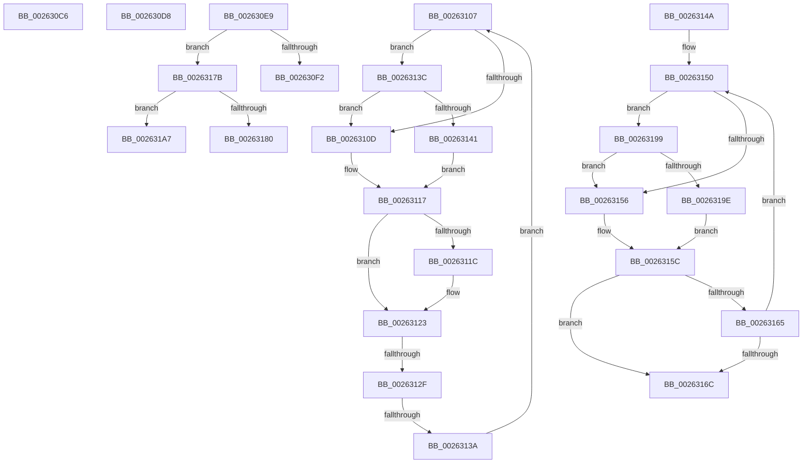

# sub_002630C6

- RVA: `0x002630C6`–`0x002631C8` (길이 `258` bytes)
- VA: `0x00000001402630C6`
- 실행 섹션: `.text`
- PDB 이름 있음: `아니요`; PDB Function 태그: `아니요`
- unwind 정보 RVA: `0x00064698`
- 디코드: `69`개 명령, `258/258` bytes 표시
- 미해석 바이트: `0` (있으면 어셈블리에 `.byte`로 보존)

> 이 문서는 커널 이미지의 기계어와 PDB 기호를 분석해 생성했습니다. 4번과 5번은 함수 원형과 자료형을 바이너리 사용 방식에서 추정한 C 해석이며 원본 소스 복구 결과는 아닙니다.

## 1. Dependencies

- 직접 호출 지점: **5**; 고유 호출 대상: **5**
- 직접 호출자로 확인된 함수: **0**
- RIP 상대 이미지 참조: **0**

### Outgoing calls
- `0x002630DF` → [KiRaiseIrqlProcessIrqlFlags](../4F/KiRaiseIrqlProcessIrqlFlags_function_004F56FC.md) (function, `0x004F56FC`)
- `0x002630FD` → [KiInsertQueueInternal](../21/KiInsertQueueInternal_function_00219B30.md) (function, `0x00219B30`)
- `0x00263171` → [KeReleaseInStackQueuedSpinLockFromDpcLevel](../21/KeReleaseInStackQueuedSpinLockFromDpcLevel_function_002171B0.md) (function, `0x002171B0`)
- `0x0026318F` → [KiTryUnwaitThread](../35/KiTryUnwaitThread_function_003506D0.md) (function, `0x003506D0`)
- `0x002631BE` → [KeInsertQueueDpc](../20/KeInsertQueueDpc_function_00207C50.md) (function, `0x00207C50`)

### Direct callers
- 이 함수 시작 RVA로 연결되는 직접 call은 확인되지 않았습니다. 간접 호출은 완전히 역산할 수 없습니다.

### Static image references
- 디코드된 RIP-relative 메모리 참조가 없습니다.

## 2. Other-region calls and transfers

- 다른 실행 섹션으로 향하는 call: **0**
- call이 아닌 외부 분기/꼬리 이동: **8**
  - `0x002630D3` → [sub_00262D5A + 0xA3](Unknown_function_00262D5A.md) (`tail-transfer`)
  - `0x002630E4` → [sub_00262F80 + 0x25](Unknown_function_00262F80.md) (`tail-transfer`)
  - `0x00263102` → [sub_00262F80 + 0xE2](Unknown_function_00262F80.md) (`tail-transfer`)
  - `0x00263129` → [sub_00262D5A + 0xD9](Unknown_function_00262D5A.md) (`tail-transfer`)
  - `0x00263134` → [sub_00262D5A + 0xD9](Unknown_function_00262D5A.md) (`tail-transfer`)
  - `0x00263176` → [sub_00262D5A + 0x186](Unknown_function_00262D5A.md) (`tail-transfer`)
  - `0x00263194` → [sub_00262F80 + 0x92](Unknown_function_00262F80.md) (`tail-transfer`)
  - `0x002631C3` → [sub_00262F80 + 0x92](Unknown_function_00262F80.md) (`tail-transfer`)

## 3. Assembly (complete function range)

```asm
002630C6  33 C0                           xor eax, eax
002630C8  44 8B CD                        mov r9d, ebp
002630CB  48 89 84 24 B0 00 00 00         mov qword ptr [rsp + 0xb0], rax
002630D3  E9 25 FD FF FF                  jmp 0x140262dfd
002630D8  41 0F B6 D6                     movzx edx, r14b
002630DC  0F B6 C8                        movzx ecx, al
002630DF  E8 18 26 29 00                  call 0x1404f56fc
002630E4  E9 BC FE FF FF                  jmp 0x140262fa5
002630E9  80 F9 02                        cmp cl, 2
002630EC  0F 85 89 00 00 00               jne 0x14026317b
002630F2  C6 40 11 05                     mov byte ptr [rax + 0x11], 5
002630F6  48 8B D0                        mov rdx, rax
002630F9  48 8B 48 18                     mov rcx, qword ptr [rax + 0x18]
002630FD  E8 2E 6A FB FF                  call 0x140219b30
00263102  E9 5B FF FF FF                  jmp 0x140263062
00263107  48 39 6B 10                     cmp qword ptr [rbx + 0x10], rbp
0026310B  74 2F                           je 0x14026313c
0026310D  48 8B C8                        mov rcx, rax
00263110  49 0B CE                        or rcx, r14
00263113  48 83 E1 FE                     and rcx, 0xfffffffffffffffe
00263117  45 85 C9                        test r9d, r9d
0026311A  74 07                           je 0x140263123
0026311C  49 63 D1                        movsxd rdx, r9d
0026311F  48 8D 0C 91                     lea rcx, [rcx + rdx*4]
00263123  41 8B F8                        mov edi, r8d
00263126  48 3B C8                        cmp rcx, rax
00263129  0F 84 04 FD FF FF               je 0x140262e33
0026312F  F0 48 0F B1 0B                  lock cmpxchg qword ptr [rbx], rcx
00263134  0F 84 F9 FC FF FF               je 0x140262e33
0026313A  EB CB                           jmp 0x140263107
0026313C  39 6B 38                        cmp dword ptr [rbx + 0x38], ebp
0026313F  77 CC                           ja 0x14026310d
00263141  48 8B C8                        mov rcx, rax
00263144  48 83 E1 FC                     and rcx, 0xfffffffffffffffc
00263148  EB CD                           jmp 0x140263117
0026314A  0F 0D 0B                        prefetchw byte ptr [rbx]
0026314D  48 8B 03                        mov rax, qword ptr [rbx]
00263150  48 39 6B 10                     cmp qword ptr [rbx + 0x10], rbp
00263154  74 43                           je 0x140263199
00263156  48 8B C8                        mov rcx, rax
00263159  49 0B CE                        or rcx, r14
0026315C  48 83 E1 FE                     and rcx, 0xfffffffffffffffe
00263160  48 3B C8                        cmp rcx, rax
00263163  74 07                           je 0x14026316c
00263165  F0 48 0F B1 0B                  lock cmpxchg qword ptr [rbx], rcx
0026316A  75 E4                           jne 0x140263150
0026316C  48 8D 4C 24 38                  lea rcx, [rsp + 0x38]
00263171  E8 3A 40 FB FF                  call 0x1402171b0
00263176  E9 65 FD FF FF                  jmp 0x140262ee0
0026317B  80 F9 04                        cmp cl, 4
0026317E  74 27                           je 0x1402631a7
00263180  45 33 C9                        xor r9d, r9d
00263183  41 B8 00 01 00 00               mov r8d, 0x100
00263189  48 8B D0                        mov rdx, rax
0026318C  48 8B CD                        mov rcx, rbp
0026318F  E8 3C D5 0E 00                  call 0x1403506d0
00263194  E9 79 FE FF FF                  jmp 0x140263012
00263199  39 6B 38                        cmp dword ptr [rbx + 0x38], ebp
0026319C  77 B8                           ja 0x140263156
0026319E  48 8B C8                        mov rcx, rax
002631A1  48 83 E1 FD                     and rcx, 0xfffffffffffffffd
002631A5  EB B5                           jmp 0x14026315c
002631A7  C6 40 11 05                     mov byte ptr [rax + 0x11], 5
002631AB  49 8D 57 18                     lea rdx, [r15 + 0x18]
002631AF  41 C7 47 1C 00 00 00 00         mov dword ptr [r15 + 0x1c], 0
002631B7  4C 8B C0                        mov r8, rax
002631BA  48 8B 48 18                     mov rcx, qword ptr [rax + 0x18]
002631BE  E8 8D 4A FA FF                  call 0x140207c50
002631C3  E9 4A FE FF FF                  jmp 0x140263012
```

## 4. C-style interpretation (structured pseudocode)

```c
__int64 __fastcall sub_002630C6(__int64 a1, __int64 a2, int a3)
{
    __int64 result;
    unsigned __int64 v_stack_p38;
    unsigned __int64 v_stack_pB0;

    result = 0;
    v_stack_pB0 = 0;
}
```

## 5. (Beta) C Style

```c
int64_t sub_002630C6(int64_t Arg1, int64_t Arg2, int32_t Arg3)
{
    int64_t result;
    uint64_t v_stack_p38;
    uint64_t v_stack_pB0;

    result = 0;
    v_stack_pB0 = 0;
}
```

## 6. Execution-region graph

[열기: 2D/3D 그래프와 함수 탐색 컨트롤 패널](../../../control-panel.html?section=text&rva=0x002630C6&view=graph)

- 2D 그래프는 위에서 아래로 흐르고, 3D 그래프는 빈 공간을 드래그해 회전합니다. Shift+드래그는 이동, 휠은 확대·축소, 함수 노드 선택은 대상 보고서 이동입니다.

### Static fallback


