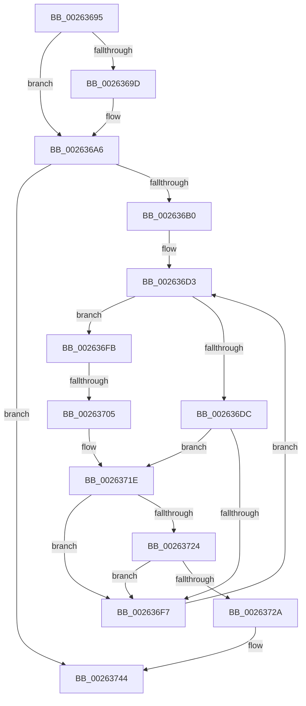

# sub_00263695

- RVA: `0x00263695`–`0x0026374E` (길이 `185` bytes)
- VA: `0x0000000140263695`
- 실행 섹션: `.text`
- PDB 이름 있음: `아니요`; PDB Function 태그: `아니요`
- unwind 정보 RVA: `0x000646F0`
- 디코드: `49`개 명령, `185/185` bytes 표시
- 미해석 바이트: `0` (있으면 어셈블리에 `.byte`로 보존)

> 이 문서는 커널 이미지의 기계어와 PDB 기호를 분석해 생성했습니다. 4번과 5번은 함수 원형과 자료형을 바이너리 사용 방식에서 추정한 C 해석이며 원본 소스 복구 결과는 아닙니다.

## 1. Dependencies

- 직접 호출 지점: **2**; 고유 호출 대상: **2**
- 직접 호출자로 확인된 함수: **0**
- RIP 상대 이미지 참조: **0**

### Outgoing calls
- `0x00263718` → [KeBugCheckEx](../4F/KeBugCheckEx_function_004FD660.md) (function, `0x004FD660`)
- `0x0026373F` → [KiAbEntryFreeAndEnableInterrupts](KiAbEntryFreeAndEnableInterrupts_function_002622D0.md) (function, `0x002622D0`)

### Direct callers
- 이 함수 시작 RVA로 연결되는 직접 call은 확인되지 않았습니다. 간접 호출은 완전히 역산할 수 없습니다.

### Static image references
- 디코드된 RIP-relative 메모리 참조가 없습니다.

## 2. Other-region calls and transfers

- 다른 실행 섹션으로 향하는 call: **0**
- call이 아닌 외부 분기/꼬리 이동: **1**
  - `0x00263703` → [sub_00263756](Unknown_function_00263756.md) (`tail-transfer`)

## 3. Assembly (complete function range)

```asm
00263695  81 FF 00 00 00 80               cmp edi, 0x80000000
0026369B  73 09                           jae 0x1402636a6
0026369D  81 C7 00 00 10 00               add edi, 0x100000
002636A3  89 7B 0C                        mov dword ptr [rbx + 0xc], edi
002636A6  40 F6 C6 02                     test sil, 2
002636AA  0F 85 94 00 00 00               jne 0x140263744
002636B0  65 4C 8B 14 25 88 01 00 00      mov r10, qword ptr gs:[0x188]
002636B9  FA                              cli
002636BA  4D 8B 82 70 04 00 00            mov r8, qword ptr [r10 + 0x470]
002636C1  4C 8B CB                        mov r9, rbx
002636C4  48 BF FC FF FF FF FF FF FF 7F   movabs rdi, 0x7ffffffffffffffc
002636CE  8B D5                           mov edx, ebp
002636D0  4C 23 CF                        and r9, rdi
002636D3  41 0F B6 40 0C                  movzx eax, byte ptr [r8 + 0xc]
002636D8  3B D0                           cmp edx, eax
002636DA  73 1F                           jae 0x1402636fb
002636DC  8B C2                           mov eax, edx
002636DE  48 6B C8 58                     imul rcx, rax, 0x58
002636E2  48 83 C1 10                     add rcx, 0x10
002636E6  49 03 C8                        add rcx, r8
002636E9  4C 8B 19                        mov r11, qword ptr [rcx]
002636EC  49 8B C3                        mov rax, r11
002636EF  48 23 C7                        and rax, rdi
002636F2  49 3B C1                        cmp rax, r9
002636F5  74 27                           je 0x14026371e
002636F7  FF C2                           inc edx
002636F9  EB D8                           jmp 0x1402636d3
002636FB  41 8B 42 78                     mov eax, dword ptr [r10 + 0x78]
002636FF  0F BA E0 10                     bt eax, 0x10
00263703  72 51                           jb 0x140263756
00263705  45 33 C9                        xor r9d, r9d
00263708  48 89 6C 24 20                  mov qword ptr [rsp + 0x20], rbp
0026370D  4C 8B C3                        mov r8, rbx
00263710  49 8B D2                        mov rdx, r10
00263713  B9 62 01 00 00                  mov ecx, 0x162
00263718  E8 43 9F 29 00                  call 0x1404fd660
0026371D  CC                              int3
0026371E  40 38 69 0A                     cmp byte ptr [rcx + 0xa], bpl
00263722  74 D3                           je 0x1402636f7
00263724  41 F6 C3 01                     test r11b, 1
00263728  75 CD                           jne 0x1402636f7
0026372A  41 B9 01 00 00 00               mov r9d, 1
00263730  40 88 69 0A                     mov byte ptr [rcx + 0xa], bpl
00263734  4C 8B C3                        mov r8, rbx
00263737  48 89 6C 24 20                  mov qword ptr [rsp + 0x20], rbp
0026373C  49 8B D2                        mov rdx, r10
0026373F  E8 8C EB FF FF                  call 0x1402622d0
00263744  48 8B 7C 24 30                  mov rdi, qword ptr [rsp + 0x30]
00263749  48 8B 5C 24 50                  mov rbx, qword ptr [rsp + 0x50]
```

## 4. C-style interpretation (structured pseudocode)

```c
__int64 __fastcall sub_00263695(__int64 a1, __int64 a2, __int64 a3, __int64 a4, __int64 a5, __int64 a6, __int64 a7, __int64 a8, __int64 a9, __int64 a10)
{
    __int64 result;
    __int64 v_rdi;
    unsigned __int64 v_stack_p20;

    if (((unsigned int)(v_rdi)) < 0x80000000ULL) {
        v_rdi = (unsigned int)((v_rdi) + (0x100000ULL));
        *(unsigned int *)(v_rbx + 12) = (unsigned int)(v_rdi);
    }
    if ((((unsigned __int8)(v_rsi)) & (2)) != 0) goto loc_00263744;
    a4 = (v_rbx) & (v_rdi);
loc_002636D3:
    if (((unsigned int)((unsigned int)((unsigned int)(v_rbp)))) >= ((unsigned int)(*(unsigned __int8 *)(*(unsigned __int64 *)(*(unsigned __int64 *)(gs_base + (0 + 392)) + 1136) + 12)))) goto loc_002636FB;
    a1 = (a1) * ((unsigned int)((unsigned int)((unsigned int)((unsigned int)(v_rbp)))));
    a1 = (a1) + (16);
    a1 = (a1) + (*(unsigned __int64 *)(*(unsigned __int64 *)(gs_base + (0 + 392)) + 1136));
    result = (*(unsigned __int64 *)(a1)) & (v_rdi);
    if (result == a4) goto loc_0026371E;
loc_002636F7:
    a2 = (unsigned int)(((unsigned int)((unsigned int)(v_rbp))) + 1);
    goto loc_002636D3;
loc_002636FB:
    a4 = 0;
    v_stack_p20 = v_rbp;
    result = KeBugCheckEx(354, *(unsigned __int64 *)(gs_base + (0 + 392)), v_rbx, a4);
loc_0026371E:
    if ((*(unsigned __int8 *)(354 + 10)) == ((unsigned __int8)(v_rbp))) goto loc_002636F7;
    if ((((unsigned __int8)(*(unsigned __int64 *)(a1))) & (1)) != 0) goto loc_002636F7;
    *(unsigned __int8 *)(354 + 10) = (unsigned __int8)(v_rbp);
    v_stack_p20 = v_rbp;
    result = KiAbEntryFreeAndEnableInterrupts(354, *(unsigned __int64 *)(gs_base + (0 + 392)), v_rbx, 1);
loc_00263744:
    return result;
}
```

## 5. (Beta) C Style

```c
int64_t sub_00263695(int64_t Arg1, int64_t Arg2, int64_t Arg3, int64_t Arg4, uint64_t Arg5, int64_t Arg6, uint64_t Arg7, uint64_t Arg8, uint64_t Arg9, int64_t Arg10)
{
    int64_t result;
    int64_t local_rdi;
    uint64_t v_stack_p20;

    if (((uint32_t)(local_rdi)) < 0x80000000ULL) {
        local_rdi = (uint32_t)((local_rdi) + (0x100000ULL));
        *(uint32_t *)(local_rbx + 0xC) = (uint32_t)(local_rdi);
    }
    if ((((uint8_t)(local_rsi)) & (2)) != 0) goto loc_00263744;
    Arg4 = (local_rbx) & (local_rdi);
loc_002636D3:
    if (((uint32_t)((uint32_t)((uint32_t)(local_rbp)))) >= ((uint32_t)(*(uint8_t *)(*(uint64_t *)(*(uint64_t *)(gs_base + (0 + 0x188)) + 0x470) + 0xC)))) goto loc_002636FB;
    Arg1 = (Arg1) * ((uint32_t)((uint32_t)((uint32_t)((uint32_t)(local_rbp)))));
    Arg1 = (Arg1) + (16);
    Arg1 = (Arg1) + (*(uint64_t *)(*(uint64_t *)(gs_base + (0 + 0x188)) + 0x470));
    result = (*(uint64_t *)(Arg1)) & (local_rdi);
    if (result == Arg4) goto loc_0026371E;
loc_002636F7:
    Arg2 = (uint32_t)(((uint32_t)((uint32_t)(local_rbp))) + 1);
    goto loc_002636D3;
loc_002636FB:
    Arg4 = 0;
    v_stack_p20 = local_rbp;
    result = KeBugCheckEx(354, *(uint64_t *)(gs_base + (0 + 0x188)), local_rbx, Arg4);
loc_0026371E:
    if ((*(uint8_t *)(354 + 0xA)) == ((uint8_t)(local_rbp))) goto loc_002636F7;
    if ((((uint8_t)(*(uint64_t *)(Arg1))) & (1)) != 0) goto loc_002636F7;
    *(uint8_t *)(354 + 0xA) = (uint8_t)(local_rbp);
    v_stack_p20 = local_rbp;
    result = KiAbEntryFreeAndEnableInterrupts(354, *(uint64_t *)(gs_base + (0 + 0x188)), local_rbx, 1);
loc_00263744:
    return result;
}
```

## 6. Execution-region graph

[열기: 2D/3D 그래프와 함수 탐색 컨트롤 패널](../../../control-panel.html?section=text&rva=0x00263695&view=graph)

- 2D 그래프는 위에서 아래로 흐르고, 3D 그래프는 빈 공간을 드래그해 회전합니다. Shift+드래그는 이동, 휠은 확대·축소, 함수 노드 선택은 대상 보고서 이동입니다.

### Static fallback


