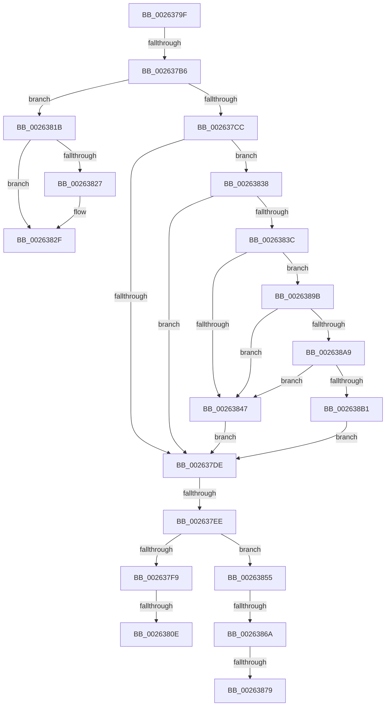

# sub_0026379F

- RVA: `0x0026379F`–`0x002638BE` (길이 `287` bytes)
- VA: `0x000000014026379F`
- 실행 섹션: `.text`
- PDB 이름 있음: `아니요`; PDB Function 태그: `아니요`
- unwind 정보 RVA: `0x00064760`
- 디코드: `72`개 명령, `287/287` bytes 표시
- 미해석 바이트: `0` (있으면 어셈블리에 `.byte`로 보존)

> 이 문서는 커널 이미지의 기계어와 PDB 기호를 분석해 생성했습니다. 4번과 5번은 함수 원형과 자료형을 바이너리 사용 방식에서 추정한 C 해석이며 원본 소스 복구 결과는 아닙니다.

## 1. Dependencies

- 직접 호출 지점: **4**; 고유 호출 대상: **3**
- 직접 호출자로 확인된 함수: **0**
- RIP 상대 이미지 참조: **3**

### Outgoing calls
- `0x002637FB` → [ExfReleasePushLockSharedEx](../47/ExfReleasePushLockSharedEx_function_00471AD0.md) (function, `0x00471AD0`)
- `0x0026382A` → [ExfReleasePushLockShared](ExfReleasePushLockShared_function_00263440.md) (function, `0x00263440`)
- `0x0026385A` → [ExfReleasePushLockSharedEx](../47/ExfReleasePushLockSharedEx_function_00471AD0.md) (function, `0x00471AD0`)
- `0x002638B4` → [ExpTryExpandAutoExpandPushLock](../4D/ExpTryExpandAutoExpandPushLock_function_004DF4F8.md) (function, `0x004DF4F8`)

### Direct callers
- 이 함수 시작 RVA로 연결되는 직접 call은 확인되지 않았습니다. 간접 호출은 완전히 역산할 수 없습니다.

### Static image references
- `0x002637EE` → RVA `0x00FC51E8` (`ALMOSTRO`; reference)
- `0x0026383F` → RVA `0x00FC5148` (`ALMOSTRO`; read)
- `0x00263879` → RVA `0x00FC5016` (`ALMOSTRO`; read)

## 2. Other-region calls and transfers

- 다른 실행 섹션으로 향하는 call: **0**
- call이 아닌 외부 분기/꼬리 이동: **8**
  - `0x002637B0` → [ExReleaseAutoExpandPushLockShared + 0x1C](ExReleaseAutoExpandPushLockShared_function_00263660.md) (`tail-transfer`)
  - `0x002637E8` → [sub_00263695](Unknown_function_00263695.md) (`tail-transfer`)
  - `0x00263808` → [sub_00263695 + 0x11](Unknown_function_00263695.md) (`tail-transfer`)
  - `0x00263816` → [sub_00263695 + 0x11](Unknown_function_00263695.md) (`tail-transfer`)
  - `0x00263833` → [sub_00263695 + 0x11](Unknown_function_00263695.md) (`tail-transfer`)
  - `0x00263864` → [sub_00263695 + 0x11](Unknown_function_00263695.md) (`tail-transfer`)
  - `0x00263873` → [sub_00263695 + 0x11](Unknown_function_00263695.md) (`tail-transfer`)
  - `0x00263896` → [sub_00263695](Unknown_function_00263695.md) (`tail-transfer`)

## 3. Assembly (complete function range)

```asm
0026379F  F6 C1 02                        test cl, 2
002637A2  41 0F 95 C0                     setne r8b
002637A6  40 F6 C6 02                     test sil, 2
002637AA  0F 95 C0                        setne al
002637AD  44 84 C0                        test al, r8b
002637B0  0F 85 C6 FE FF FF               jne 0x14026367c
002637B6  48 89 5C 24 50                  mov qword ptr [rsp + 0x50], rbx
002637BB  48 8B D9                        mov rbx, rcx
002637BE  48 83 E3 FC                     and rbx, 0xfffffffffffffffc
002637C2  48 89 7C 24 30                  mov qword ptr [rsp + 0x30], rdi
002637C7  F6 C1 01                        test cl, 1
002637CA  74 4F                           je 0x14026381b
002637CC  8B 43 08                        mov eax, dword ptr [rbx + 8]
002637CF  0F 0D 4B 0C                     prefetchw byte ptr [rbx + 0xc]
002637D3  8B 7B 0C                        mov edi, dword ptr [rbx + 0xc]
002637D6  81 FF 00 00 00 80               cmp edi, 0x80000000
002637DC  73 5A                           jae 0x140263838
002637DE  B8 11 00 00 00                  mov eax, 0x11
002637E3  F0 48 0F B1 2B                  lock cmpxchg qword ptr [rbx], rbp
002637E8  0F 84 A7 FE FF FF               je 0x140263695
002637EE  85 3D F4 19 D6 00               test dword ptr [rip + 0xd619f4], edi
002637F4  48 8B CB                        mov rcx, rbx
002637F7  74 5C                           je 0x140263855
002637F9  33 D2                           xor edx, edx
002637FB  E8 D0 E2 20 00                  call 0x140471ad0
00263800  8B 43 0C                        mov eax, dword ptr [rbx + 0xc]
00263803  3D 00 00 00 80                  cmp eax, 0x80000000
00263808  0F 83 98 FE FF FF               jae 0x1402636a6
0026380E  05 00 00 10 00                  add eax, 0x100000
00263813  89 43 0C                        mov dword ptr [rbx + 0xc], eax
00263816  E9 8B FE FF FF                  jmp 0x1402636a6
0026381B  B8 11 00 00 00                  mov eax, 0x11
00263820  F0 48 0F B1 2B                  lock cmpxchg qword ptr [rbx], rbp
00263825  74 08                           je 0x14026382f
00263827  48 8B CB                        mov rcx, rbx
0026382A  E8 11 FC FF FF                  call 0x140263440
0026382F  48 8B 5B 08                     mov rbx, qword ptr [rbx + 8]
00263833  E9 6E FE FF FF                  jmp 0x1402636a6
00263838  A8 03                           test al, 3
0026383A  75 A2                           jne 0x1402637de
0026383C  0F B7 C7                        movzx eax, di
0026383F  3B 05 03 19 D6 00               cmp eax, dword ptr [rip + 0xd61903]
00263845  73 54                           jae 0x14026389b
00263847  C1 EF 02                        shr edi, 2
0026384A  81 E7 FF 3F F3 3F               and edi, 0x3ff33fff
00263850  89 7B 0C                        mov dword ptr [rbx + 0xc], edi
00263853  EB 89                           jmp 0x1402637de
00263855  48 8D 54 24 60                  lea rdx, [rsp + 0x60]
0026385A  E8 71 E2 20 00                  call 0x140471ad0
0026385F  48 39 6C 24 60                  cmp qword ptr [rsp + 0x60], rbp
00263864  0F 84 3C FE FF FF               je 0x1402636a6
0026386A  8B 7B 0C                        mov edi, dword ptr [rbx + 0xc]
0026386D  81 FF 00 00 00 80               cmp edi, 0x80000000
00263873  0F 83 2D FE FF FF               jae 0x1402636a6
00263879  0F B6 0D 96 17 D6 00            movzx ecx, byte ptr [rip + 0xd61796]
00263880  48 8B 44 24 60                  mov rax, qword ptr [rsp + 0x60]
00263885  48 D3 E8                        shr rax, cl
00263888  B9 FF 01 00 00                  mov ecx, 0x1ff
0026388D  48 3B C1                        cmp rax, rcx
00263890  48 0F 47 C1                     cmova rax, rcx
00263894  03 F8                           add edi, eax
00263896  E9 FA FD FF FF                  jmp 0x140263695
0026389B  8B C7                           mov eax, edi
0026389D  25 00 00 0F 00                  and eax, 0xf0000
002638A2  3D 00 00 0F 00                  cmp eax, 0xf0000
002638A7  73 9E                           jae 0x140263847
002638A9  44 0F 20 C0                     mov rax, cr8
002638AD  3C 02                           cmp al, 2
002638AF  73 96                           jae 0x140263847
002638B1  48 8B CB                        mov rcx, rbx
002638B4  E8 3F BC 27 00                  call 0x1404df4f8
002638B9  E9 20 FF FF FF                  jmp 0x1402637de
```

## 4. C-style interpretation (structured pseudocode)

```c
__int64 __fastcall sub_0026379F(__int64 a1, int a2, __int64 a3, __int64 a4, __int64 a5, __int64 a6, __int64 a7, __int64 a8, __int64 a9, __int64 a10, __int64 a11, __int64 a12)
{
    __int64 result;
    __int64 v_rbx;
    __int64 v_rdi;
    unsigned __int64 v_stack_p30;
    unsigned __int64 v_stack_p50;

    a3 = ((((unsigned __int8)(a1)) & (2)) != 0) ? 1 : 0;
    result = ((((unsigned __int8)(v_rsi)) & (2)) != 0) ? 1 : 0;
    v_stack_p50 = v_rbx;
    v_rbx = (a1) & (-4);
    v_stack_p30 = v_rdi;
    if ((((unsigned __int8)(a1)) & (1)) == 0) goto loc_0026381B;
    if (((unsigned int)((unsigned int)(*(unsigned int *)(v_rbx + 12)))) >= 0x80000000ULL) goto loc_00263838;
loc_002637DE:
    if (((*(unsigned int *)(v_rip + 14031348)) & ((unsigned int)((unsigned int)(*(unsigned int *)(v_rbx + 12))))) == 0) goto loc_00263855;
    a2 = 0;
    result = ExfReleasePushLockSharedEx(v_rbx, a2, a3, a4);
    result = (unsigned int)(((unsigned int)(*(unsigned int *)(v_rbx + 12))) + (0x100000ULL));
    *(unsigned int *)(v_rbx + 12) = (unsigned int)(result);
loc_0026381B:
    result = 17;
    if (!(condition_is_equal)) {
        a1 = v_rbx;
        result = ExfReleasePushLockShared(a1, a2, a3, a4);
    }
loc_00263838:
    if ((((unsigned __int8)(result)) & (3)) != 0) goto loc_002637DE;
    if (((unsigned int)((unsigned __int16)((unsigned int)(*(unsigned int *)(v_rbx + 12))))) >= (*(unsigned int *)(v_rip + 14031107))) goto loc_0026389B;
loc_00263847:
    v_rdi = (unsigned int)(((unsigned int)(*(unsigned int *)(v_rbx + 12))) >> (2));
    v_rdi = (unsigned int)((v_rdi) & (0x3FF33FFFULL));
    *(unsigned int *)(*(unsigned __int64 *)(v_rbx + 8) + 12) = (unsigned int)(v_rdi);
    goto loc_002637DE;
loc_00263855:
    result = ExfReleasePushLockSharedEx(a1, a12, a3, a4);
    result = (a12) >> ((unsigned __int8)(*(unsigned __int8 *)(v_rip + 14030742)));
    if (result > 511) { result = 511; }
    v_rdi = (unsigned int)(((unsigned int)(*(unsigned int *)(*(unsigned __int64 *)(v_rbx + 8) + 12))) + ((unsigned int)(result)));
loc_0026389B:
    result = (unsigned int)(((unsigned int)((unsigned int)(v_rdi))) & (0xF0000ULL));
    if (((unsigned int)(result)) >= 0xF0000ULL) goto loc_00263847;
    if (((unsigned __int8)(v_cr8)) >= 2) goto loc_00263847;
    result = ExpTryExpandAutoExpandPushLock(*(unsigned __int64 *)(v_rbx + 8), a12, a3, a4);
    goto loc_002637DE;
}
```

## 5. (Beta) C Style

```c
int64_t sub_0026379F(int64_t Arg1, int32_t Arg2, int64_t Arg3, int64_t Arg4, uint64_t Arg5, uint64_t Arg6, uint64_t Arg7, uint64_t Arg8, uint64_t Arg9, uint64_t Arg10, uint64_t Arg11, int64_t Arg12)
{
    int64_t result;
    int64_t local_rbx;
    int64_t local_rdi;
    uint64_t v_stack_p30;
    uint64_t v_stack_p50;

    Arg3 = ((((uint8_t)(Arg1)) & (2)) != 0) ? 1 : 0;
    result = ((((uint8_t)(local_rsi)) & (2)) != 0) ? 1 : 0;
    v_stack_p50 = local_rbx;
    local_rbx = (Arg1) & (-4);
    v_stack_p30 = local_rdi;
    if ((((uint8_t)(Arg1)) & (1)) == 0) goto loc_0026381B;
    if (((uint32_t)((uint32_t)(*(uint32_t *)(local_rbx + 0xC)))) >= 0x80000000ULL) goto loc_00263838;
loc_002637DE:
    if (((*(uint32_t *)(v_rip + 0xD619F4)) & ((uint32_t)((uint32_t)(*(uint32_t *)(local_rbx + 0xC))))) == 0) goto loc_00263855;
    Arg2 = 0;
    result = ExfReleasePushLockSharedEx(local_rbx, Arg2, Arg3, Arg4);
    result = (uint32_t)(((uint32_t)(*(uint32_t *)(local_rbx + 0xC))) + (0x100000ULL));
    *(uint32_t *)(local_rbx + 0xC) = (uint32_t)(result);
loc_0026381B:
    result = 17;
    if (!(condition_is_equal)) {
        Arg1 = local_rbx;
        result = ExfReleasePushLockShared(Arg1, Arg2, Arg3, Arg4);
    }
loc_00263838:
    if ((((uint8_t)(result)) & (3)) != 0) goto loc_002637DE;
    if (((uint32_t)((uint16_t)((uint32_t)(*(uint32_t *)(local_rbx + 0xC))))) >= (*(uint32_t *)(v_rip + 0xD61903))) goto loc_0026389B;
loc_00263847:
    local_rdi = (uint32_t)(((uint32_t)(*(uint32_t *)(local_rbx + 0xC))) >> (2));
    local_rdi = (uint32_t)((local_rdi) & (0x3FF33FFFULL));
    *(uint32_t *)(*(uint64_t *)(local_rbx + 0x8) + 0xC) = (uint32_t)(local_rdi);
    goto loc_002637DE;
loc_00263855:
    result = ExfReleasePushLockSharedEx(Arg1, Arg12, Arg3, Arg4);
    result = (Arg12) >> ((uint8_t)(*(uint8_t *)(v_rip + 0xD61796)));
    if (result > 511) { result = 511; }
    local_rdi = (uint32_t)(((uint32_t)(*(uint32_t *)(*(uint64_t *)(local_rbx + 0x8) + 0xC))) + ((uint32_t)(result)));
loc_0026389B:
    result = (uint32_t)(((uint32_t)((uint32_t)(local_rdi))) & (0xF0000ULL));
    if (((uint32_t)(result)) >= 0xF0000ULL) goto loc_00263847;
    if (((uint8_t)(v_cr8)) >= 2) goto loc_00263847;
    result = ExpTryExpandAutoExpandPushLock(*(uint64_t *)(local_rbx + 0x8), Arg12, Arg3, Arg4);
    goto loc_002637DE;
}
```

## 6. Execution-region graph

[열기: 2D/3D 그래프와 함수 탐색 컨트롤 패널](../../../control-panel.html?section=text&rva=0x0026379F&view=graph)

- 2D 그래프는 위에서 아래로 흐르고, 3D 그래프는 빈 공간을 드래그해 회전합니다. Shift+드래그는 이동, 휠은 확대·축소, 함수 노드 선택은 대상 보고서 이동입니다.

### Static fallback


