# sub_00263D49

- RVA: `0x00263D49`–`0x00263E6C` (길이 `291` bytes)
- VA: `0x0000000140263D49`
- 실행 섹션: `.text`
- PDB 이름 있음: `아니요`; PDB Function 태그: `아니요`
- unwind 정보 RVA: `0x000647D0`
- 디코드: `77`개 명령, `291/291` bytes 표시
- 미해석 바이트: `0` (있으면 어셈블리에 `.byte`로 보존)

> 이 문서는 커널 이미지의 기계어와 PDB 기호를 분석해 생성했습니다. 4번과 5번은 함수 원형과 자료형을 바이너리 사용 방식에서 추정한 C 해석이며 원본 소스 복구 결과는 아닙니다.

## 1. Dependencies

- 직접 호출 지점: **5**; 고유 호출 대상: **5**
- 직접 호출자로 확인된 함수: **0**
- RIP 상대 이미지 참조: **0**

### Outgoing calls
- `0x00263DE8` → [KeBugCheckEx](../4F/KeBugCheckEx_function_004FD660.md) (function, `0x004FD660`)
- `0x00263DF1` → [ExfReleasePushLock](ExfReleasePushLock_function_002638D0.md) (function, `0x002638D0`)
- `0x00263E19` → [KiAbEntryFreeAndEnableInterrupts](KiAbEntryFreeAndEnableInterrupts_function_002622D0.md) (function, `0x002622D0`)
- `0x00263E44` → [ObDereferenceObjectDeferDeleteWithTag](ObDereferenceObjectDeferDeleteWithTag_function_00263EA0.md) (function, `0x00263EA0`)
- `0x00263E5D` → [KeLeaveCriticalRegionThread](../25/KeLeaveCriticalRegionThread_function_0025EFF0.md) (function, `0x0025EFF0`)

### Direct callers
- 이 함수 시작 RVA로 연결되는 직접 call은 확인되지 않았습니다. 간접 호출은 완전히 역산할 수 없습니다.

### Static image references
- 디코드된 RIP-relative 메모리 참조가 없습니다.

## 2. Other-region calls and transfers

- 다른 실행 섹션으로 향하는 call: **0**
- call이 아닌 외부 분기/꼬리 이동: **1**
  - `0x00263E33` → [sub_00263E78](Unknown_function_00263E78.md) (`tail-transfer`)

## 3. Assembly (complete function range)

```asm
00263D49  48 89 6C 24 40                  mov qword ptr [rsp + 0x40], rbp
00263D4E  48 81 C7 28 01 00 00            add rdi, 0x128
00263D55  48 89 74 24 48                  mov qword ptr [rsp + 0x48], rsi
00263D5A  0F 0D 0F                        prefetchw byte ptr [rdi]
00263D5D  48 8B 07                        mov rax, qword ptr [rdi]
00263D60  33 F6                           xor esi, esi
00263D62  48 8B C8                        mov rcx, rax
00263D65  48 83 E1 F0                     and rcx, 0xfffffffffffffff0
00263D69  48 83 F9 10                     cmp rcx, 0x10
00263D6D  48 8D 50 F0                     lea rdx, [rax - 0x10]
00263D71  48 0F 46 D6                     cmovbe rdx, rsi
00263D75  A8 02                           test al, 2
00263D77  75 75                           jne 0x140263dee
00263D79  F0 48 0F B1 17                  lock cmpxchg qword ptr [rdi], rdx
00263D7E  75 6E                           jne 0x140263dee
00263D80  65 4C 8B 14 25 88 01 00 00      mov r10, qword ptr gs:[0x188]
00263D89  FA                              cli
00263D8A  4D 8B 82 70 04 00 00            mov r8, qword ptr [r10 + 0x470]
00263D91  4C 8B CF                        mov r9, rdi
00263D94  48 BD FC FF FF FF FF FF FF 7F   movabs rbp, 0x7ffffffffffffffc
00263D9E  8B D6                           mov edx, esi
00263DA0  4C 23 CD                        and r9, rbp
00263DA3  41 0F B6 40 0C                  movzx eax, byte ptr [r8 + 0xc]
00263DA8  3B D0                           cmp edx, eax
00263DAA  73 1F                           jae 0x140263dcb
00263DAC  8B C2                           mov eax, edx
00263DAE  48 6B C8 58                     imul rcx, rax, 0x58
00263DB2  48 83 C1 10                     add rcx, 0x10
00263DB6  49 03 C8                        add rcx, r8
00263DB9  4C 8B 19                        mov r11, qword ptr [rcx]
00263DBC  49 8B C3                        mov rax, r11
00263DBF  48 23 C5                        and rax, rbp
00263DC2  49 3B C1                        cmp rax, r9
00263DC5  74 31                           je 0x140263df8
00263DC7  FF C2                           inc edx
00263DC9  EB D8                           jmp 0x140263da3
00263DCB  41 8B 42 78                     mov eax, dword ptr [r10 + 0x78]
00263DCF  0F BA E0 10                     bt eax, 0x10
00263DD3  72 4B                           jb 0x140263e20
00263DD5  45 33 C9                        xor r9d, r9d
00263DD8  48 89 74 24 20                  mov qword ptr [rsp + 0x20], rsi
00263DDD  4C 8B C7                        mov r8, rdi
00263DE0  49 8B D2                        mov rdx, r10
00263DE3  B9 62 01 00 00                  mov ecx, 0x162
00263DE8  E8 73 98 29 00                  call 0x1404fd660
00263DED  CC                              int3
00263DEE  48 8B CF                        mov rcx, rdi
00263DF1  E8 DA FA FF FF                  call 0x1402638d0
00263DF6  EB 88                           jmp 0x140263d80
00263DF8  40 38 71 0A                     cmp byte ptr [rcx + 0xa], sil
00263DFC  74 C9                           je 0x140263dc7
00263DFE  41 F6 C3 01                     test r11b, 1
00263E02  75 C3                           jne 0x140263dc7
00263E04  41 B9 01 00 00 00               mov r9d, 1
00263E0A  40 88 71 0A                     mov byte ptr [rcx + 0xa], sil
00263E0E  4C 8B C7                        mov r8, rdi
00263E11  48 89 74 24 20                  mov qword ptr [rsp + 0x20], rsi
00263E16  49 8B D2                        mov rdx, r10
00263E19  E8 B2 E4 FF FF                  call 0x1402622d0
00263E1E  EB 16                           jmp 0x140263e36
00263E20  65 48 8B 0C 25 20 00 00 00      mov rcx, qword ptr gs:[0x20]
00263E29  4C 8B 81 B8 8E 00 00            mov r8, qword ptr [rcx + 0x8eb8]
00263E30  4D 85 C0                        test r8, r8
00263E33  75 43                           jne 0x140263e78
00263E35  FB                              sti
00263E36  40 38 73 16                     cmp byte ptr [rbx + 0x16], sil
00263E3A  74 11                           je 0x140263e4d
00263E3C  48 8B 0B                        mov rcx, qword ptr [rbx]
00263E3F  BA 4F 62 4C 55                  mov edx, 0x554c624f
00263E44  E8 57 00 00 00                  call 0x140263ea0
00263E49  40 88 73 16                     mov byte ptr [rbx + 0x16], sil
00263E4D  48 89 33                        mov qword ptr [rbx], rsi
00263E50  40 88 73 15                     mov byte ptr [rbx + 0x15], sil
00263E54  65 48 8B 0C 25 88 01 00 00      mov rcx, qword ptr gs:[0x188]
00263E5D  E8 8E B1 FF FF                  call 0x14025eff0
00263E62  48 8B 6C 24 40                  mov rbp, qword ptr [rsp + 0x40]
00263E67  48 8B 74 24 48                  mov rsi, qword ptr [rsp + 0x48]
```

## 4. C-style interpretation (structured pseudocode)

```c
__int64 __fastcall sub_00263D49(__int64 a1, __int64 a2, __int64 a3, __int64 a4, __int64 a5, __int64 a6, __int64 a7, __int64 a8, __int64 a9)
{
    __int64 result;
    __int64 v_rdi;
    __int64 v_rsi;
    unsigned __int64 v_stack_p20;
    unsigned __int64 v_stack_p40;
    unsigned __int64 v_stack_p48;

    v_stack_p40 = v_rbp;
    v_rdi = (v_rdi) + (296);
    v_stack_p48 = v_rsi;
    v_rsi = 0;
    a1 = (*(unsigned __int64 *)(v_rdi)) & (-16);
    a2 = *(unsigned __int64 *)(v_rdi) - 16;
    if (a1 <= 16) { a2 = 0; }
    if ((((unsigned __int8)(*(unsigned __int64 *)(v_rdi))) & (2)) != 0) goto loc_00263DEE;
    if ((((unsigned __int8)(*(unsigned __int64 *)(v_rdi))) & (2)) != 0) goto loc_00263DEE;
loc_00263D80:
    a4 = (v_rdi) & (v_rbp);
loc_00263DA3:
    if (0 >= ((unsigned int)(*(unsigned __int8 *)(*(unsigned __int64 *)(*(unsigned __int64 *)(gs_base + (0 + 392)) + 1136) + 12)))) goto loc_00263DCB;
    a1 = (a1) * (0);
    a1 = (a1) + (16);
    a1 = (a1) + (*(unsigned __int64 *)(*(unsigned __int64 *)(gs_base + (0 + 392)) + 1136));
    result = (*(unsigned __int64 *)(a1)) & (v_rbp);
    if (result == a4) goto loc_00263DF8;
loc_00263DC7:
    a2 = (unsigned int)((0) + 1);
    goto loc_00263DA3;
loc_00263DCB:
    if (result < a4) goto loc_00263E20;
    a4 = 0;
    v_stack_p20 = 0;
    result = KeBugCheckEx(354, *(unsigned __int64 *)(gs_base + (0 + 392)), v_rdi, a4);
loc_00263DEE:
    result = ExfReleasePushLock(v_rdi, *(unsigned __int64 *)(gs_base + (0 + 392)), v_rdi, a4);
    goto loc_00263D80;
loc_00263DF8:
    if ((*(unsigned __int8 *)(v_rdi + 10)) == 0) goto loc_00263DC7;
    if ((((unsigned __int8)(*(unsigned __int64 *)(a1))) & (1)) != 0) goto loc_00263DC7;
    *(unsigned __int8 *)(v_rdi + 10) = 0;
    v_stack_p20 = 0;
    result = KiAbEntryFreeAndEnableInterrupts(v_rdi, *(unsigned __int64 *)(gs_base + (0 + 392)), v_rdi, 1);
    goto loc_00263E36;
loc_00263E20:
loc_00263E36:
    if ((*(unsigned __int8 *)(v_rbx + 22)) != 0) {
        a1 = *(unsigned __int64 *)(v_rbx);
        a2 = 0x554C624FULL;
        result = ObDereferenceObjectDeferDeleteWithTag(a1, a2, *(unsigned __int64 *)(*(unsigned __int64 *)(gs_base + (0 + 32)) + 36536), 1);
        *(unsigned __int8 *)(v_rbx + 22) = 0;
    }
    *(unsigned __int64 *)(v_rbx) = 0;
    *(unsigned __int8 *)(v_rbx + 21) = 0;
    result = KeLeaveCriticalRegionThread(*(unsigned __int64 *)(gs_base + (0 + 392)), a2, *(unsigned __int64 *)(*(unsigned __int64 *)(gs_base + (0 + 32)) + 36536), 1);
    return result;
}
```

## 5. (Beta) C Style

```c
int64_t sub_00263D49(int64_t Arg1, int64_t Arg2, int64_t Arg3, int64_t Arg4, uint64_t Arg5, uint64_t Arg6, uint64_t Arg7, int64_t Arg8, int64_t Arg9)
{
    int64_t result;
    int64_t local_rdi;
    int64_t local_rsi;
    uint64_t v_stack_p20;
    uint64_t v_stack_p40;
    uint64_t v_stack_p48;

    v_stack_p40 = local_rbp;
    local_rdi = (local_rdi) + (296);
    v_stack_p48 = local_rsi;
    local_rsi = 0;
    Arg1 = (*(uint64_t *)(local_rdi)) & (-16);
    Arg2 = *(uint64_t *)(local_rdi) - 16;
    if (Arg1 <= 16) { Arg2 = 0; }
    if ((((uint8_t)(*(uint64_t *)(local_rdi))) & (2)) != 0) goto loc_00263DEE;
    if ((((uint8_t)(*(uint64_t *)(local_rdi))) & (2)) != 0) goto loc_00263DEE;
loc_00263D80:
    Arg4 = (local_rdi) & (local_rbp);
loc_00263DA3:
    if (0 >= ((uint32_t)(*(uint8_t *)(*(uint64_t *)(*(uint64_t *)(gs_base + (0 + 0x188)) + 0x470) + 0xC)))) goto loc_00263DCB;
    Arg1 = (Arg1) * (0);
    Arg1 = (Arg1) + (16);
    Arg1 = (Arg1) + (*(uint64_t *)(*(uint64_t *)(gs_base + (0 + 0x188)) + 0x470));
    result = (*(uint64_t *)(Arg1)) & (local_rbp);
    if (result == Arg4) goto loc_00263DF8;
loc_00263DC7:
    Arg2 = (uint32_t)((0) + 1);
    goto loc_00263DA3;
loc_00263DCB:
    if (result < Arg4) goto loc_00263E20;
    Arg4 = 0;
    v_stack_p20 = 0;
    result = KeBugCheckEx(354, *(uint64_t *)(gs_base + (0 + 0x188)), local_rdi, Arg4);
loc_00263DEE:
    result = ExfReleasePushLock(local_rdi, *(uint64_t *)(gs_base + (0 + 0x188)), local_rdi, Arg4);
    goto loc_00263D80;
loc_00263DF8:
    if ((*(uint8_t *)(local_rdi + 0xA)) == 0) goto loc_00263DC7;
    if ((((uint8_t)(*(uint64_t *)(Arg1))) & (1)) != 0) goto loc_00263DC7;
    *(uint8_t *)(local_rdi + 0xA) = 0;
    v_stack_p20 = 0;
    result = KiAbEntryFreeAndEnableInterrupts(local_rdi, *(uint64_t *)(gs_base + (0 + 0x188)), local_rdi, 1);
    goto loc_00263E36;
loc_00263E20:
loc_00263E36:
    if ((*(uint8_t *)(local_rbx + 0x16)) != 0) {
        Arg1 = *(uint64_t *)(local_rbx);
        Arg2 = 0x554C624FULL;
        result = ObDereferenceObjectDeferDeleteWithTag(Arg1, Arg2, *(uint64_t *)(*(uint64_t *)(gs_base + (0 + 0x20)) + 0x8EB8), 1);
        *(uint8_t *)(local_rbx + 0x16) = 0;
    }
    *(uint64_t *)(local_rbx) = 0;
    *(uint8_t *)(local_rbx + 0x15) = 0;
    result = KeLeaveCriticalRegionThread(*(uint64_t *)(gs_base + (0 + 0x188)), Arg2, *(uint64_t *)(*(uint64_t *)(gs_base + (0 + 0x20)) + 0x8EB8), 1);
    return result;
}
```

## 6. Execution-region graph

[열기: 2D/3D 그래프와 함수 탐색 컨트롤 패널](../../../control-panel.html?section=text&rva=0x00263D49&view=graph)

- 2D 그래프는 위에서 아래로 흐르고, 3D 그래프는 빈 공간을 드래그해 회전합니다. Shift+드래그는 이동, 휠은 확대·축소, 함수 노드 선택은 대상 보고서 이동입니다.

### Static fallback

```mermaid
flowchart TD
  bb_00263D49[BB_00263D49]
  bb_00263D79[BB_00263D79]
  bb_00263D80[BB_00263D80]
  bb_00263DA3[BB_00263DA3]
  bb_00263DAC[BB_00263DAC]
  bb_00263DC7[BB_00263DC7]
  bb_00263DCB[BB_00263DCB]
  bb_00263DD5[BB_00263DD5]
  bb_00263DEE[BB_00263DEE]
  bb_00263DF8[BB_00263DF8]
  bb_00263DFE[BB_00263DFE]
  bb_00263E04[BB_00263E04]
  bb_00263E20[BB_00263E20]
  bb_00263E35[BB_00263E35]
  bb_00263E36[BB_00263E36]
  bb_00263E3C[BB_00263E3C]
  bb_00263E4D[BB_00263E4D]
  bb_00263D49 -->|branch| bb_00263DEE
  bb_00263D49 -->|fallthrough| bb_00263D79
  bb_00263D79 -->|branch| bb_00263DEE
  bb_00263D79 -->|fallthrough| bb_00263D80
  bb_00263D80 -->|flow| bb_00263DA3
  bb_00263DA3 -->|branch| bb_00263DCB
  bb_00263DA3 -->|fallthrough| bb_00263DAC
  bb_00263DAC -->|branch| bb_00263DF8
  bb_00263DAC -->|fallthrough| bb_00263DC7
  bb_00263DC7 -->|branch| bb_00263DA3
  bb_00263DCB -->|branch| bb_00263E20
  bb_00263DCB -->|fallthrough| bb_00263DD5
  bb_00263DD5 -->|flow| bb_00263DEE
  bb_00263DEE -->|branch| bb_00263D80
  bb_00263DF8 -->|branch| bb_00263DC7
  bb_00263DF8 -->|fallthrough| bb_00263DFE
  bb_00263DFE -->|branch| bb_00263DC7
  bb_00263DFE -->|fallthrough| bb_00263E04
  bb_00263E04 -->|branch| bb_00263E36
  bb_00263E20 -->|fallthrough| bb_00263E35
  bb_00263E35 -->|flow| bb_00263E36
  bb_00263E36 -->|branch| bb_00263E4D
  bb_00263E36 -->|fallthrough| bb_00263E3C
  bb_00263E3C -->|flow| bb_00263E4D
```


