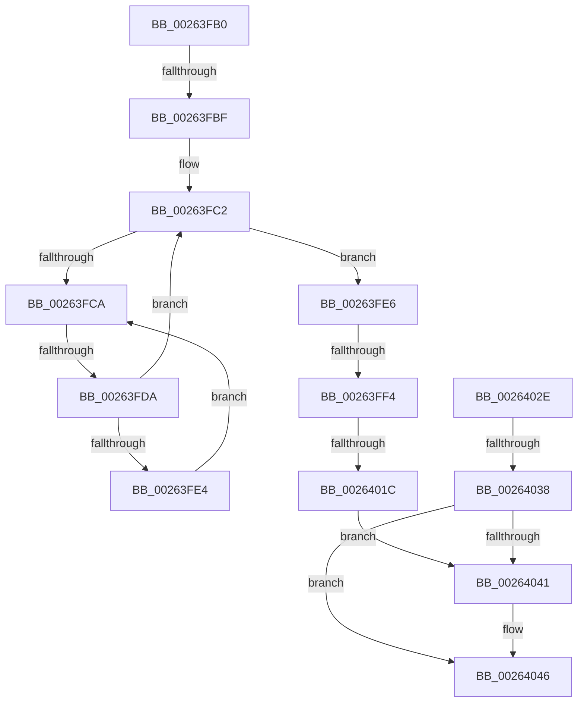

# sub_00263FB0

- RVA: `0x00263FB0`–`0x0026404D` (길이 `157` bytes)
- VA: `0x0000000140263FB0`
- 실행 섹션: `.text`
- PDB 이름 있음: `아니요`; PDB Function 태그: `아니요`
- unwind 정보 RVA: `0x00064838`
- 디코드: `42`개 명령, `157/157` bytes 표시
- 미해석 바이트: `0` (있으면 어셈블리에 `.byte`로 보존)

> 이 문서는 커널 이미지의 기계어와 PDB 기호를 분석해 생성했습니다. 4번과 5번은 함수 원형과 자료형을 바이너리 사용 방식에서 추정한 C 해석이며 원본 소스 복구 결과는 아닙니다.

## 1. Dependencies

- 직접 호출 지점: **0**; 고유 호출 대상: **0**
- 직접 호출자로 확인된 함수: **0**
- RIP 상대 이미지 참조: **1**

### Outgoing calls
- 직접 디코드된 call 명령이 없습니다.

### Direct callers
- 이 함수 시작 RVA로 연결되는 직접 call은 확인되지 않았습니다. 간접 호출은 완전히 역산할 수 없습니다.

### Static image references
- `0x00263FCD` → RVA `0x00FC52AC` (`ALMOSTRO`; reference)

## 2. Other-region calls and transfers

- 다른 실행 섹션으로 향하는 call: **0**
- call이 아닌 외부 분기/꼬리 이동: **5**
  - `0x00263FB9` → [sub_00264063](Unknown_function_00264063.md) (`tail-transfer`)
  - `0x00263FD4` → [sub_00264063 + 0x11F](Unknown_function_00264063.md) (`tail-transfer`)
  - `0x00263FEE` → [sub_00264063 + 0x11](Unknown_function_00264063.md) (`tail-transfer`)
  - `0x00264016` → [sub_00264063 + 0xB4](Unknown_function_00264063.md) (`tail-transfer`)
  - `0x00264036` → [sub_00264063 + 0x22](Unknown_function_00264063.md) (`tail-transfer`)

## 3. Assembly (complete function range)

```asm
00263FB0  4C 89 74 24 30                  mov qword ptr [rsp + 0x30], r14
00263FB5  48 83 F8 01                     cmp rax, 1
00263FB9  0F 85 A4 00 00 00               jne 0x140264063
00263FBF  45 33 F6                        xor r14d, r14d
00263FC2  F0 48 0F BA 2B 00               lock bts qword ptr [rbx], 0
00263FC8  73 1C                           jae 0x140263fe6
00263FCA  41 FF C6                        inc r14d
00263FCD  44 85 35 D8 12 D6 00            test dword ptr [rip + 0xd612d8], r14d
00263FD4  0F 84 A8 01 00 00               je 0x140264182
00263FDA  F3 90                           pause
00263FDC  48 8B 03                        mov rax, qword ptr [rbx]
00263FDF  48 85 C0                        test rax, rax
00263FE2  74 DE                           je 0x140263fc2
00263FE4  EB E4                           jmp 0x140263fca
00263FE6  48 8B 43 10                     mov rax, qword ptr [rbx + 0x10]
00263FEA  48 83 F8 01                     cmp rax, 1
00263FEE  0F 85 80 00 00 00               jne 0x140264074
00263FF4  48 89 6B 10                     mov qword ptr [rbx + 0x10], rbp
00263FF8  0F B6 43 1A                     movzx eax, byte ptr [rbx + 0x1a]
00263FFC  41 BE 01 00 00 00               mov r14d, 1
00264002  0F B6 4B 19                     movzx ecx, byte ptr [rbx + 0x19]
00264006  FE C0                           inc al
00264008  0F B6 D0                        movzx edx, al
0026400B  0F B6 43 18                     movzx eax, byte ptr [rbx + 0x18]
0026400F  03 CA                           add ecx, edx
00264011  88 53 1A                        mov byte ptr [rbx + 0x1a], dl
00264014  3B C1                           cmp eax, ecx
00264016  0F 85 FB 00 00 00               jne 0x140264117
0026401C  48 8B 43 10                     mov rax, qword ptr [rbx + 0x10]
00264020  48 89 43 08                     mov qword ptr [rbx + 8], rax
00264024  C6 43 1A 00                     mov byte ptr [rbx + 0x1a], 0
00264028  4C 89 73 10                     mov qword ptr [rbx + 0x10], r14
0026402C  EB 13                           jmp 0x140264041
0026402E  41 0F B6 D6                     movzx edx, r14b
00264032  48 39 6B 08                     cmp qword ptr [rbx + 8], rbp
00264036  75 4D                           jne 0x140264085
00264038  C6 44 1E 1C 00                  mov byte ptr [rsi + rbx + 0x1c], 0
0026403D  84 D2                           test dl, dl
0026403F  74 05                           je 0x140264046
00264041  F0 48 83 23 00                  lock and qword ptr [rbx], 0
00264046  33 C0                           xor eax, eax
00264048  4C 8B 74 24 30                  mov r14, qword ptr [rsp + 0x30]
```

## 4. C-style interpretation (structured pseudocode)

```c
__int64 __fastcall sub_00263FB0(__int64 a1, __int64 a2, __int64 a3, __int64 a4, __int64 a5, __int64 a6)
{
    __int64 result;
    __int64 v_r14;
    unsigned __int64 v_stack_p30;

    v_stack_p30 = v_r14;
    v_r14 = 0;
loc_00263FC2:
    if (condition_is_above_or_equal) goto loc_00263FE6;
loc_00263FCA:
    v_r14 = (unsigned int)((v_r14) + 1);
    if (*(unsigned __int64 *)(v_rbx) == 0) goto loc_00263FC2;
    goto loc_00263FCA;
loc_00263FE6:
    *(unsigned __int64 *)(v_rbx + 16) = v_rbp;
    result = (unsigned __int8)((*(unsigned __int8 *)(v_rbx + 26)) + 1);
    a1 = (unsigned int)((*(unsigned __int8 *)(v_rbx + 25)) + ((unsigned int)((unsigned __int8)(result))));
    *(unsigned __int8 *)(v_rbx + 26) = (unsigned __int8)((unsigned __int8)(result));
    *(unsigned __int64 *)(v_rbx + 8) = *(unsigned __int64 *)(v_rbx + 16);
    *(unsigned __int8 *)(v_rbx + 26) = 0;
    *(unsigned __int64 *)(v_rbx + 16) = 1;
    goto loc_00264041;
loc_00264041:
loc_00264046:
    result = 0;
    return result;
}
```

## 5. (Beta) C Style

```c
int64_t sub_00263FB0(int64_t Arg1, int64_t Arg2, int64_t Arg3, int64_t Arg4, uint64_t Arg5, int64_t Arg6)
{
    int64_t result;
    int64_t local_r14;
    uint64_t v_stack_p30;

    v_stack_p30 = local_r14;
    local_r14 = 0;
loc_00263FC2:
    if (condition_is_above_or_equal) goto loc_00263FE6;
loc_00263FCA:
    local_r14 = (uint32_t)((local_r14) + 1);
    if (*(uint64_t *)(local_rbx) == 0) goto loc_00263FC2;
    goto loc_00263FCA;
loc_00263FE6:
    *(uint64_t *)(local_rbx + 0x10) = local_rbp;
    result = (uint8_t)((*(uint8_t *)(local_rbx + 0x1A)) + 1);
    Arg1 = (uint32_t)((*(uint8_t *)(local_rbx + 0x19)) + ((uint32_t)((uint8_t)(result))));
    *(uint8_t *)(local_rbx + 0x1A) = (uint8_t)((uint8_t)(result));
    *(uint64_t *)(local_rbx + 0x8) = *(uint64_t *)(local_rbx + 0x10);
    *(uint8_t *)(local_rbx + 0x1A) = 0;
    *(uint64_t *)(local_rbx + 0x10) = 1;
    goto loc_00264041;
loc_00264041:
loc_00264046:
    result = 0;
    return result;
}
```

## 6. Execution-region graph

[열기: 2D/3D 그래프와 함수 탐색 컨트롤 패널](../../../control-panel.html?section=text&rva=0x00263FB0&view=graph)

- 2D 그래프는 위에서 아래로 흐르고, 3D 그래프는 빈 공간을 드래그해 회전합니다. Shift+드래그는 이동, 휠은 확대·축소, 함수 노드 선택은 대상 보고서 이동입니다.

### Static fallback


