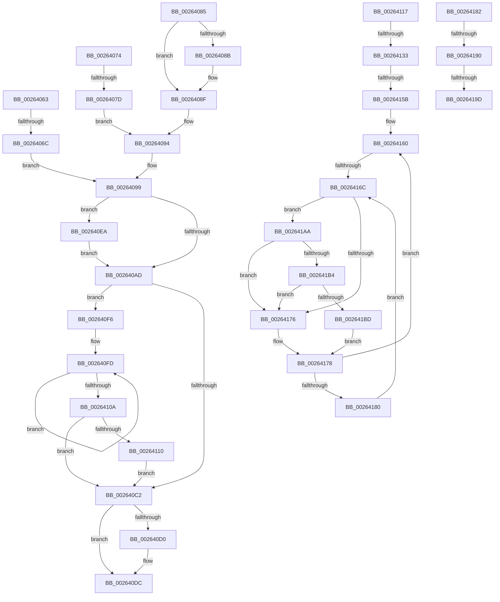

# sub_00264063

- RVA: `0x00264063`–`0x002641C6` (길이 `355` bytes)
- VA: `0x0000000140264063`
- 실행 섹션: `.text`
- PDB 이름 있음: `아니요`; PDB Function 태그: `아니요`
- unwind 정보 RVA: `0x00064860`
- 디코드: `97`개 명령, `355/355` bytes 표시
- 미해석 바이트: `0` (있으면 어셈블리에 `.byte`로 보존)

> 이 문서는 커널 이미지의 기계어와 PDB 기호를 분석해 생성했습니다. 4번과 5번은 함수 원형과 자료형을 바이너리 사용 방식에서 추정한 C 해석이며 원본 소스 복구 결과는 아닙니다.

## 1. Dependencies

- 직접 호출 지점: **7**; 고유 호출 대상: **5**
- 직접 호출자로 확인된 함수: **0**
- RIP 상대 이미지 참조: **3**

### Outgoing calls
- `0x002640D7` → [KiLowerIrqlProcessIrqlFlags](../4F/KiLowerIrqlProcessIrqlFlags_function_004F5698.md) (function, `0x004F5698`)
- `0x002640EF` → [KiRaiseIrqlProcessIrqlFlags](../4F/KiRaiseIrqlProcessIrqlFlags_function_004F56FC.md) (function, `0x004F56FC`)
- `0x00264110` → [KiRemoveSystemWorkPriorityKick](KiRemoveSystemWorkPriorityKick_function_002631D0.md) (function, `0x002631D0`)
- `0x00264190` → [KiCheckVpBackingLongSpinWaitHypercall](../30/KiCheckVpBackingLongSpinWaitHypercall_function_0030F490.md) (function, `0x0030F490`)
- `0x002641A0` → [HvlNotifyLongSpinWait](../30/HvlNotifyLongSpinWait_function_0030F460.md) (function, `0x0030F460`)
- `0x002641B4` → [KiCheckVpBackingLongSpinWaitHypercall](../30/KiCheckVpBackingLongSpinWaitHypercall_function_0030F490.md) (function, `0x0030F490`)
- `0x002641BF` → [HvlNotifyLongSpinWait](../30/HvlNotifyLongSpinWait_function_0030F460.md) (function, `0x0030F460`)

### Direct callers
- 이 함수 시작 RVA로 연결되는 직접 call은 확인되지 않았습니다. 간접 호출은 완전히 역산할 수 없습니다.

### Static image references
- `0x002640A4` → RVA `0x00FC6D20` (`ALMOSTRO`; read)
- `0x0026416E` → RVA `0x00FC52AC` (`ALMOSTRO`; reference)
- `0x00264182` → RVA `0x00FC6AB8` (`ALMOSTRO`; read)

## 2. Other-region calls and transfers

- 다른 실행 섹션으로 향하는 call: **0**
- call이 아닌 외부 분기/꼬리 이동: **9**
  - `0x00264066` → [sub_00263FB0 + 0xF](Unknown_function_00263FB0.md) (`tail-transfer`)
  - `0x00264077` → [sub_00263FB0 + 0x48](Unknown_function_00263FB0.md) (`tail-transfer`)
  - `0x002640E5` → [sub_00263FB0 + 0x98](Unknown_function_00263FB0.md) (`tail-transfer`)
  - `0x0026412D` → [sub_00263FB0 + 0x88](Unknown_function_00263FB0.md) (`tail-transfer`)
  - `0x00264159` → [sub_002641D1](Unknown_function_002641D1.md) (`tail-transfer`)
  - `0x00264166` → [sub_00263FB0 + 0x7E](Unknown_function_00263FB0.md) (`tail-transfer`)
  - `0x0026418A` → [sub_00263FB0 + 0x2A](Unknown_function_00263FB0.md) (`tail-transfer`)
  - `0x00264197` → [sub_00263FB0 + 0x2A](Unknown_function_00263FB0.md) (`tail-transfer`)
  - `0x002641A5` → [sub_00263FB0 + 0x2C](Unknown_function_00263FB0.md) (`tail-transfer`)

## 3. Assembly (complete function range)

```asm
00264063  48 3B C5                        cmp rax, rbp
00264066  0F 84 53 FF FF FF               je 0x140263fbf
0026406C  41 BE 01 00 00 00               mov r14d, 1
00264072  EB 25                           jmp 0x140264099
00264074  48 3B C5                        cmp rax, rbp
00264077  0F 84 7B FF FF FF               je 0x140263ff8
0026407D  41 BE 01 00 00 00               mov r14d, 1
00264083  EB 0F                           jmp 0x140264094
00264085  80 43 1A FF                     add byte ptr [rbx + 0x1a], 0xff
00264089  75 04                           jne 0x14026408f
0026408B  4C 89 73 10                     mov qword ptr [rbx + 0x10], r14
0026408F  C6 44 1E 1C 00                  mov byte ptr [rsi + rbx + 0x1c], 0
00264094  F0 48 83 23 00                  lock and qword ptr [rbx], 0
00264099  41 8B FE                        mov edi, r14d
0026409C  44 0F 20 C3                     mov rbx, cr8
002640A0  45 0F 22 C6                     mov cr8, r14
002640A4  83 3D 75 2C D6 00 00            cmp dword ptr [rip + 0xd62c75], 0
002640AB  75 3D                           jne 0x1402640ea
002640AD  65 48 8B 0C 25 20 00 00 00      mov rcx, qword ptr gs:[0x20]
002640B6  4C 8B 81 B8 8E 00 00            mov r8, qword ptr [rcx + 0x8eb8]
002640BD  4D 85 C0                        test r8, r8
002640C0  75 34                           jne 0x1402640f6
002640C2  FB                              sti
002640C3  90                              nop
002640C4  F3 90                           pause
002640C6  FA                              cli
002640C7  83 3D 52 2C D6 00 00            cmp dword ptr [rip + 0xd62c52], 0
002640CE  74 0C                           je 0x1402640dc
002640D0  44 0F 20 C1                     mov rcx, cr8
002640D4  0F B6 D3                        movzx edx, bl
002640D7  E8 BC 15 29 00                  call 0x1404f5698
002640DC  0F B6 CB                        movzx ecx, bl
002640DF  44 0F 22 C1                     mov cr8, rcx
002640E3  8B C7                           mov eax, edi
002640E5  E9 5E FF FF FF                  jmp 0x140264048
002640EA  B2 01                           mov dl, 1
002640EC  0F B6 CB                        movzx ecx, bl
002640EF  E8 08 16 29 00                  call 0x1404f56fc
002640F4  EB B7                           jmp 0x1402640ad
002640F6  41 0F 0D 08                     prefetchw byte ptr [r8]
002640FA  41 8B 00                        mov eax, dword ptr [r8]
002640FD  8B D0                           mov edx, eax
002640FF  0F BA F2 15                     btr edx, 0x15
00264103  F0 41 0F B1 10                  lock cmpxchg dword ptr [r8], edx
00264108  75 F3                           jne 0x1402640fd
0026410A  0F BA E0 15                     bt eax, 0x15
0026410E  73 B2                           jae 0x1402640c2
00264110  E8 BB F0 FF FF                  call 0x1402631d0
00264115  EB AB                           jmp 0x1402640c2
00264117  C6 44 1E 1C 02                  mov byte ptr [rsi + rbx + 0x1c], 2
0026411C  F0 48 83 23 00                  lock and qword ptr [rbx], 0
00264121  32 D2                           xor dl, dl
00264123  45 33 C0                        xor r8d, r8d
00264126  48 8B 43 08                     mov rax, qword ptr [rbx + 8]
0026412A  48 3B C5                        cmp rax, rbp
0026412D  0F 84 05 FF FF FF               je 0x140264038
00264133  F3 90                           pause
00264135  48 8B 4F 10                     mov rcx, qword ptr [rdi + 0x10]
00264139  41 FF C0                        inc r8d
0026413C  41 81 F8 88 13 00 00            cmp r8d, 0x1388
00264143  0F 97 C0                        seta al
00264146  48 85 C9                        test rcx, rcx
00264149  44 0F B6 C8                     movzx r9d, al
0026414D  8B 87 BC 38 00 00               mov eax, dword ptr [rdi + 0x38bc]
00264153  45 0F 45 CE                     cmovne r9d, r14d
00264157  85 C0                           test eax, eax
00264159  74 76                           je 0x1402641d1
0026415B  33 FF                           xor edi, edi
0026415D  0F 1F 00                        nop dword ptr [rax]
00264160  F0 48 0F BA 2B 00               lock bts qword ptr [rbx], 0
00264166  0F 83 C2 FE FF FF               jae 0x14026402e
0026416C  FF C7                           inc edi
0026416E  85 3D 38 11 D6 00               test dword ptr [rip + 0xd61138], edi
00264174  74 34                           je 0x1402641aa
00264176  F3 90                           pause
00264178  48 8B 03                        mov rax, qword ptr [rbx]
0026417B  48 85 C0                        test rax, rax
0026417E  74 E0                           je 0x140264160
00264180  EB EA                           jmp 0x14026416c
00264182  8B 05 30 29 D6 00               mov eax, dword ptr [rip + 0xd62930]
00264188  A8 40                           test al, 0x40
0026418A  0F 84 4A FE FF FF               je 0x140263fda
00264190  E8 FB B2 0A 00                  call 0x14030f490
00264195  84 C0                           test al, al
00264197  0F 84 3D FE FF FF               je 0x140263fda
0026419D  41 8B CE                        mov ecx, r14d
002641A0  E8 BB B2 0A 00                  call 0x14030f460
002641A5  E9 32 FE FF FF                  jmp 0x140263fdc
002641AA  8B 05 08 29 D6 00               mov eax, dword ptr [rip + 0xd62908]
002641B0  A8 40                           test al, 0x40
002641B2  74 C2                           je 0x140264176
002641B4  E8 D7 B2 0A 00                  call 0x14030f490
002641B9  84 C0                           test al, al
002641BB  74 B9                           je 0x140264176
002641BD  8B CF                           mov ecx, edi
002641BF  E8 9C B2 0A 00                  call 0x14030f460
002641C4  EB B2                           jmp 0x140264178
```

## 4. C-style interpretation (structured pseudocode)

```c
__int64 __fastcall sub_00264063(void)
{
    __int64 result;

    goto loc_00264099;
loc_00264099:
    if ((*(unsigned int *)(v_rip + 14036085)) != 0) goto loc_002640EA;
loc_002640AD:
    if (*(unsigned __int64 *)(*(unsigned __int64 *)(gs_base + (0 + 32)) + 36536) != 0) goto loc_002640F6;
loc_002640C2:
    if ((*(unsigned int *)(v_rip + 14036050)) != 0) {
        a1 = 1;
        a2 = (unsigned __int8)(v_cr8);
        result = KiLowerIrqlProcessIrqlFlags(a1, a2, *(unsigned __int64 *)(*(unsigned __int64 *)(gs_base + (0 + 32)) + 36536), a4);
    }
loc_002640EA:
    result = KiRaiseIrqlProcessIrqlFlags((unsigned __int8)(v_cr8), 1, *(unsigned __int64 *)(*(unsigned __int64 *)(gs_base + (0 + 32)) + 36536), a4);
    goto loc_002640AD;
loc_002640F6:
loc_002640FD:
    if ((*(unsigned int *)(v_rip + 14036050)) != 0) goto loc_002640FD;
    if ((*(unsigned int *)(v_rip + 14036050)) >= 0) goto loc_002640C2;
    result = KiRemoveSystemWorkPriorityKick((unsigned __int8)(v_cr8), (unsigned int)((unsigned int)((unsigned int)(*(unsigned int *)(*(unsigned __int64 *)(*(unsigned __int64 *)(gs_base + (0 + 32)) + 36536))))), *(unsigned __int64 *)(*(unsigned __int64 *)(gs_base + (0 + 32)) + 36536), a4);
    goto loc_002640C2;
}
```

## 5. (Beta) C Style

```c
void sub_00264063(void)
{
    int64_t result;

    goto loc_00264099;
loc_00264099:
    if ((*(uint32_t *)(v_rip + 0xD62C75)) != 0) goto loc_002640EA;
loc_002640AD:
    if (*(uint64_t *)(*(uint64_t *)(gs_base + (0 + 0x20)) + 0x8EB8) != 0) goto loc_002640F6;
loc_002640C2:
    if ((*(uint32_t *)(v_rip + 0xD62C52)) != 0) {
        a1 = 1;
        a2 = (uint8_t)(v_cr8);
        result = KiLowerIrqlProcessIrqlFlags(a1, a2, *(uint64_t *)(*(uint64_t *)(gs_base + (0 + 0x20)) + 0x8EB8), a4);
    }
loc_002640EA:
    result = KiRaiseIrqlProcessIrqlFlags((uint8_t)(v_cr8), 1, *(uint64_t *)(*(uint64_t *)(gs_base + (0 + 0x20)) + 0x8EB8), a4);
    goto loc_002640AD;
loc_002640F6:
loc_002640FD:
    if ((*(uint32_t *)(v_rip + 0xD62C52)) != 0) goto loc_002640FD;
    if ((*(uint32_t *)(v_rip + 0xD62C52)) >= 0) goto loc_002640C2;
    result = KiRemoveSystemWorkPriorityKick((uint8_t)(v_cr8), (uint32_t)((uint32_t)((uint32_t)(*(uint32_t *)(*(uint64_t *)(*(uint64_t *)(gs_base + (0 + 0x20)) + 0x8EB8))))), *(uint64_t *)(*(uint64_t *)(gs_base + (0 + 0x20)) + 0x8EB8), a4);
    goto loc_002640C2;
}
```

## 6. Execution-region graph

[열기: 2D/3D 그래프와 함수 탐색 컨트롤 패널](../../../control-panel.html?section=text&rva=0x00264063&view=graph)

- 2D 그래프는 위에서 아래로 흐르고, 3D 그래프는 빈 공간을 드래그해 회전합니다. Shift+드래그는 이동, 휠은 확대·축소, 함수 노드 선택은 대상 보고서 이동입니다.

### Static fallback


