# sub_00264587

- RVA: `0x00264587`–`0x00264797` (길이 `528` bytes)
- VA: `0x0000000140264587`
- 실행 섹션: `.text`
- PDB 이름 있음: `아니요`; PDB Function 태그: `아니요`
- unwind 정보 RVA: `0x000648DC`
- 디코드: `133`개 명령, `528/528` bytes 표시
- 미해석 바이트: `0` (있으면 어셈블리에 `.byte`로 보존)

> 이 문서는 커널 이미지의 기계어와 PDB 기호를 분석해 생성했습니다. 4번과 5번은 함수 원형과 자료형을 바이너리 사용 방식에서 추정한 C 해석이며 원본 소스 복구 결과는 아닙니다.

## 1. Dependencies

- 직접 호출 지점: **5**; 고유 호출 대상: **5**
- 직접 호출자로 확인된 함수: **0**
- RIP 상대 이미지 참조: **3**

### Outgoing calls
- `0x002645BE` → [ExAcquireAutoExpandPushLockExclusive](ExAcquireAutoExpandPushLockExclusive_function_00264B70.md) (function, `0x00264B70`)
- `0x00264602` → [ExpWaitForSpinLockExclusiveAndAcquire](../32/ExpWaitForSpinLockExclusiveAndAcquire_function_003239A0.md) (function, `0x003239A0`)
- `0x0026474C` → [KiLowerIrqlProcessIrqlFlags](../4F/KiLowerIrqlProcessIrqlFlags_function_004F5698.md) (function, `0x004F5698`)
- `0x00264770` → [ExReleaseAutoExpandPushLockExclusive](ExReleaseAutoExpandPushLockExclusive_function_00264DE0.md) (function, `0x00264DE0`)
- `0x0026478D` → [KiCheckForKernelApcDelivery](../2E/KiCheckForKernelApcDelivery_function_002E2C80.md) (function, `0x002E2C80`)

### Direct callers
- 이 함수 시작 RVA로 연결되는 직접 call은 확인되지 않았습니다. 간접 호출은 완전히 역산할 수 없습니다.

### Static image references
- `0x002645D7` → RVA `0x00FC6D20` (`ALMOSTRO`; read)
- `0x002645E4` → RVA `0x00FC6B06` (`ALMOSTRO`; read)
- `0x00264628` → RVA `0x00FC52AC` (`ALMOSTRO`; reference)

## 2. Other-region calls and transfers

- 다른 실행 섹션으로 향하는 call: **0**
- call이 아닌 외부 분기/꼬리 이동: **7**
  - `0x002645DE` → [sub_002647A9 + 0x64](Unknown_function_002647A9.md) (`tail-transfer`)
  - `0x002645EB` → [sub_002647A9 + 0x12](Unknown_function_002647A9.md) (`tail-transfer`)
  - `0x0026462E` → [sub_002647A9 + 0x10A](Unknown_function_002647A9.md) (`tail-transfer`)
  - `0x002646C1` → [sub_002647A9 + 0xFE](Unknown_function_002647A9.md) (`tail-transfer`)
  - `0x00264711` → [sub_002647A9 + 0x31](Unknown_function_002647A9.md) (`tail-transfer`)
  - `0x00264729` → [sub_002647A9](Unknown_function_002647A9.md) (`tail-transfer`)
  - `0x00264732` → [sub_002648E7](Unknown_function_002648E7.md) (`tail-transfer`)

## 3. Assembly (complete function range)

```asm
00264587  4C 89 7C 24 68                  mov qword ptr [rsp + 0x68], r15
0026458C  48 8B 88 B8 00 00 00            mov rcx, qword ptr [rax + 0xb8]
00264593  48 8B 85 B8 00 00 00            mov rax, qword ptr [rbp + 0xb8]
0026459A  4C 8B B9 10 04 00 00            mov r15, qword ptr [rcx + 0x410]
002645A1  48 8B 88 10 04 00 00            mov rcx, qword ptr [rax + 0x410]
002645A8  49 81 C7 00 03 00 00            add r15, 0x300
002645AF  66 FF 8D E6 01 00 00            dec word ptr [rbp + 0x1e6]
002645B6  48 81 C1 58 04 00 00            add rcx, 0x458
002645BD  90                              nop
002645BE  E8 AD 05 00 00                  call 0x140264b70
002645C3  49 8D 9F 68 01 00 00            lea rbx, [r15 + 0x168]
002645CA  45 0F 20 C6                     mov r14, cr8
002645CE  B8 02 00 00 00                  mov eax, 2
002645D3  44 0F 22 C0                     mov cr8, rax
002645D7  44 39 25 42 27 D6 00            cmp dword ptr [rip + 0xd62742], r12d
002645DE  0F 85 29 02 00 00               jne 0x14026480d
002645E4  F6 05 1B 25 D6 00 21            test byte ptr [rip + 0xd6251b], 0x21
002645EB  0F 85 CA 01 00 00               jne 0x1402647bb
002645F1  F0 0F BA 2B 1F                  lock bts dword ptr [rbx], 0x1f
002645F6  41 8B FC                        mov edi, r12d
002645F9  73 0E                           jae 0x140264609
002645FB  41 0F B6 D6                     movzx edx, r14b
002645FF  48 8B CB                        mov rcx, rbx
00264602  E8 99 F3 0B 00                  call 0x1403239a0
00264607  8B F8                           mov edi, eax
00264609  8B 13                           mov edx, dword ptr [rbx]
0026460B  8B CA                           mov ecx, edx
0026460D  0F BA F1 1E                     btr ecx, 0x1e
00264611  81 F9 00 00 00 80               cmp ecx, 0x80000000
00264617  74 2C                           je 0x140264645
00264619  0F BA E2 1E                     bt edx, 0x1e
0026461D  72 07                           jb 0x140264626
0026461F  F0 81 0B 00 00 00 40            lock or dword ptr [rbx], 0x40000000
00264626  FF C7                           inc edi
00264628  85 3D 7E 0C D6 00               test dword ptr [rip + 0xd60c7e], edi
0026462E  0F 84 7F 02 00 00               je 0x1402648b3
00264634  F3 90                           pause
00264636  8B 13                           mov edx, dword ptr [rbx]
00264638  8B C2                           mov eax, edx
0026463A  0F BA F0 1E                     btr eax, 0x1e
0026463E  3D 00 00 00 80                  cmp eax, 0x80000000
00264643  75 D4                           jne 0x140264619
00264645  48 8B 46 18                     mov rax, qword ptr [rsi + 0x18]
00264649  45 32 D2                        xor r10b, r10b
0026464C  4D 8B 87 50 01 00 00            mov r8, qword ptr [r15 + 0x150]
00264653  44 0F B6 48 20                  movzx r9d, byte ptr [rax + 0x20]
00264658  8B 40 18                        mov eax, dword ptr [rax + 0x18]
0026465B  49 C1 E1 20                     shl r9, 0x20
0026465F  4C 0B C8                        or r9, rax
00264662  4D 85 C0                        test r8, r8
00264665  74 4C                           je 0x1402646b3
00264667  66 0F 1F 84 00 00 00 00 00      nop word ptr [rax + rax]
00264670  49 8B 40 18                     mov rax, qword ptr [r8 + 0x18]
00264674  0F B6 50 21                     movzx edx, byte ptr [rax + 0x21]
00264678  8B 48 1C                        mov ecx, dword ptr [rax + 0x1c]
0026467B  48 C1 E2 20                     shl rdx, 0x20
0026467F  48 0B D1                        or rdx, rcx
00264682  4C 3B CA                        cmp r9, rdx
00264685  77 20                           ja 0x1402646a7
00264687  0F B6 50 20                     movzx edx, byte ptr [rax + 0x20]
0026468B  8B 48 18                        mov ecx, dword ptr [rax + 0x18]
0026468E  48 C1 E2 20                     shl rdx, 0x20
00264692  48 0B D1                        or rdx, rcx
00264695  4C 3B CA                        cmp r9, rdx
00264698  73 0D                           jae 0x1402646a7
0026469A  49 8B 00                        mov rax, qword ptr [r8]
0026469D  48 85 C0                        test rax, rax
002646A0  74 11                           je 0x1402646b3
002646A2  4C 8B C0                        mov r8, rax
002646A5  EB C9                           jmp 0x140264670
002646A7  49 8B 40 08                     mov rax, qword ptr [r8 + 8]
002646AB  48 85 C0                        test rax, rax
002646AE  75 F2                           jne 0x1402646a2
002646B0  41 B2 01                        mov r10b, 1
002646B3  4C 89 26                        mov qword ptr [rsi], r12
002646B6  4C 89 66 08                     mov qword ptr [rsi + 8], r12
002646BA  4C 89 46 10                     mov qword ptr [rsi + 0x10], r8
002646BE  4D 85 C0                        test r8, r8
002646C1  0F 84 E0 01 00 00               je 0x1402648a7
002646C7  41 0F B6 C2                     movzx eax, r10b
002646CB  49 89 34 C0                     mov qword ptr [r8 + rax*8], rsi
002646CF  41 0F B6 50 10                  movzx edx, byte ptr [r8 + 0x10]
002646D4  41 0F B6 CA                     movzx ecx, r10b
002646D8  02 C9                           add cl, cl
002646DA  44 0F B6 CA                     movzx r9d, dl
002646DE  FE C9                           dec cl
002646E0  0F B6 C1                        movzx eax, cl
002646E3  24 03                           and al, 3
002646E5  41 80 E1 03                     and r9b, 3
002646E9  75 23                           jne 0x14026470e
002646EB  49 8B F0                        mov rsi, r8
002646EE  0F B6 C2                        movzx eax, dl
002646F1  32 C1                           xor al, cl
002646F3  24 03                           and al, 3
002646F5  32 C2                           xor al, dl
002646F7  41 88 40 10                     mov byte ptr [r8 + 0x10], al
002646FB  4D 8B 40 10                     mov r8, qword ptr [r8 + 0x10]
002646FF  49 83 E0 FC                     and r8, 0xfffffffffffffffc
00264703  74 19                           je 0x14026471e
00264705  49 39 30                        cmp qword ptr [r8], rsi
00264708  41 0F 95 C2                     setne r10b
0026470C  EB C1                           jmp 0x1402646cf
0026470E  44 3A C8                        cmp r9b, al
00264711  0F 84 C3 00 00 00               je 0x1402647da
00264717  80 E2 FC                        and dl, 0xfc
0026471A  41 88 50 10                     mov byte ptr [r8 + 0x10], dl
0026471E  49 8D 8F 68 01 00 00            lea rcx, [r15 + 0x168]
00264725  41 80 FE 11                     cmp r14b, 0x11
00264729  74 7E                           je 0x1402647a9
0026472B  F6 05 D4 23 D6 00 01            test byte ptr [rip + 0xd623d4], 1
00264732  0F 85 AF 01 00 00               jne 0x1402648e7
00264738  44 89 21                        mov dword ptr [rcx], r12d
0026473B  44 39 25 DE 25 D6 00            cmp dword ptr [rip + 0xd625de], r12d
00264742  74 0D                           je 0x140264751
00264744  44 0F 20 C1                     mov rcx, cr8
00264748  41 0F B6 D6                     movzx edx, r14b
0026474C  E8 47 0F 29 00                  call 0x1404f5698
00264751  41 0F B6 C6                     movzx eax, r14b
00264755  44 0F 22 C0                     mov cr8, rax
00264759  48 8B 85 B8 00 00 00            mov rax, qword ptr [rbp + 0xb8]
00264760  33 D2                           xor edx, edx
00264762  48 8B 88 10 04 00 00            mov rcx, qword ptr [rax + 0x410]
00264769  48 81 C1 58 04 00 00            add rcx, 0x458
00264770  E8 6B 06 00 00                  call 0x140264de0
00264775  90                              nop
00264776  66 83 85 E6 01 00 00 01         add word ptr [rbp + 0x1e6], 1
0026477E  75 12                           jne 0x140264792
00264780  48 8D 85 98 00 00 00            lea rax, [rbp + 0x98]
00264787  90                              nop
00264788  48 39 00                        cmp qword ptr [rax], rax
0026478B  74 05                           je 0x140264792
0026478D  E8 EE E4 07 00                  call 0x1402e2c80
00264792  4C 8B 7C 24 68                  mov r15, qword ptr [rsp + 0x68]
```

## 4. C-style interpretation (structured pseudocode)

```c
__int64 __fastcall sub_00264587(__int64 a1, __int64 a2, __int64 a3, __int64 a4, __int64 a5, __int64 a6, __int64 a7, __int64 a8, __int64 a9, __int64 a10, __int64 a11, __int64 a12, __int64 a13)
{
    __int64 result;
    __int64 v_r10;
    __int64 v_r15;
    __int64 v_rdi;
    unsigned __int64 v_stack_p68;

    v_stack_p68 = v_r15;
    v_r15 = (*(unsigned __int64 *)(*(unsigned __int64 *)(result + 184) + 1040)) + (768);
    a1 = (*(unsigned __int64 *)(*(unsigned __int64 *)(v_rbp + 184) + 1040)) + (0x458ULL);
    result = ExAcquireAutoExpandPushLockExclusive(a1, a2, a3, a4);
    result = 2;
    v_rdi = (unsigned int)((unsigned int)(v_r12));
    if (!(condition_is_above_or_equal)) {
        a2 = (unsigned __int8)(v_cr8);
        a1 = v_r15 + 360;
        result = ExpWaitForSpinLockExclusiveAndAcquire(a1, a2, a3, a4);
        v_rdi = (unsigned int)(result);
    }
    if (((unsigned int)((unsigned int)((unsigned int)((unsigned int)(*(unsigned int *)(v_r15 + 360)))))) == 0x80000000ULL) goto loc_00264645;
loc_00264619:
    if (((unsigned int)((unsigned int)((unsigned int)((unsigned int)(*(unsigned int *)(v_r15 + 360)))))) >= 0x80000000ULL) {
    }
    v_rdi = (unsigned int)((v_rdi) + 1);
    if (((unsigned int)((unsigned int)((unsigned int)((unsigned int)(*(unsigned int *)(v_r15 + 360)))))) != 0x80000000ULL) goto loc_00264619;
loc_00264645:
    v_r10 = 0;
    a4 = (*(unsigned __int8 *)(*(unsigned __int64 *)(v_rsi + 24) + 32)) << (32);
    a4 = (a4) | ((unsigned int)(*(unsigned int *)(*(unsigned __int64 *)(v_rsi + 24) + 24)));
    if (*(unsigned __int64 *)(v_r15 + 336) == 0) goto loc_002646B3;
loc_00264670:
    a2 = (*(unsigned __int8 *)(*(unsigned __int64 *)(*(unsigned __int64 *)(v_r15 + 336) + 24) + 33)) << (32);
    a2 = (a2) | ((unsigned int)(*(unsigned int *)(*(unsigned __int64 *)(*(unsigned __int64 *)(v_r15 + 336) + 24) + 28)));
    if (a4 > a2) goto loc_002646A7;
    a2 = (*(unsigned __int8 *)(*(unsigned __int64 *)(*(unsigned __int64 *)(v_r15 + 336) + 24) + 32)) << (32);
    a2 = (a2) | ((unsigned int)(*(unsigned int *)(*(unsigned __int64 *)(*(unsigned __int64 *)(v_r15 + 336) + 24) + 24)));
    if (a4 >= a2) goto loc_002646A7;
    if (*(unsigned __int64 *)(*(unsigned __int64 *)(v_r15 + 336)) == 0) goto loc_002646B3;
loc_002646A2:
    goto loc_00264670;
loc_002646A7:
    if (*(unsigned __int64 *)(*(unsigned __int64 *)(*(unsigned __int64 *)(v_r15 + 336)) + 8) != 0) goto loc_002646A2;
loc_002646B3:
    *(unsigned __int64 *)(v_rsi) = v_r12;
    *(unsigned __int64 *)(v_rsi + 8) = v_r12;
    *(unsigned __int64 *)(v_rsi + 16) = *(unsigned __int64 *)(*(unsigned __int64 *)(v_r15 + 336));
    *(unsigned __int64 *)(*(unsigned __int64 *)(*(unsigned __int64 *)(v_r15 + 336)) + 1 * 8) = v_rsi;
loc_002646CF:
    a1 = (unsigned __int8)((1) + (1));
    a1 = (unsigned __int8)((a1) - 1);
    result = (unsigned __int8)(((unsigned __int8)(a1)) & (3));
    a4 = (unsigned __int8)(((unsigned __int8)(*(unsigned __int8 *)(*(unsigned __int64 *)(*(unsigned __int64 *)(v_r15 + 336)) + 16))) & (3));
    if (condition_is_not_equal) goto loc_0026470E;
    result = (unsigned __int8)(((unsigned __int8)(*(unsigned __int8 *)(*(unsigned __int64 *)(*(unsigned __int64 *)(v_r15 + 336)) + 16))) ^ ((unsigned __int8)(a1)));
    result = (unsigned __int8)((result) & (3));
    result = (unsigned __int8)((result) ^ ((unsigned __int8)(*(unsigned __int8 *)(*(unsigned __int64 *)(*(unsigned __int64 *)(v_r15 + 336)) + 16))));
    *(unsigned __int8 *)(*(unsigned __int64 *)(*(unsigned __int64 *)(v_r15 + 336)) + 16) = (unsigned __int8)(result);
    a3 = (*(unsigned __int64 *)(*(unsigned __int64 *)(*(unsigned __int64 *)(v_r15 + 336)) + 16)) & (-4);
    if (condition_is_equal) goto loc_0026471E;
    v_r10 = ((*(unsigned __int64 *)(a3)) != (*(unsigned __int64 *)(*(unsigned __int64 *)(v_r15 + 336)))) ? 1 : 0;
    goto loc_002646CF;
loc_0026470E:
    a2 = (unsigned __int8)((*(unsigned __int8 *)(*(unsigned __int64 *)(*(unsigned __int64 *)(v_r15 + 336)) + 16)) & (252));
    *(unsigned __int8 *)(a3 + 16) = (unsigned __int8)(a2);
loc_0026471E:
    *(unsigned int *)(v_r15 + 360) = (unsigned int)(v_r12);
    if ((*(unsigned int *)(v_rip + 14034398)) != ((unsigned int)(v_r12))) {
        a1 = 2;
        a2 = (unsigned __int8)(v_cr8);
        result = KiLowerIrqlProcessIrqlFlags(a1, a2, a3, a4);
    }
    a2 = 0;
    a1 = (*(unsigned __int64 *)(*(unsigned __int64 *)(v_rbp + 184) + 1040)) + (0x458ULL);
    result = ExReleaseAutoExpandPushLockExclusive(a1, a2, a3, a4);
    if (condition_is_not_equal) goto loc_00264792;
    result = v_rbp + 152;
    if ((*(unsigned __int64 *)(v_rbp + 152)) != (v_rbp + 152)) {
        result = KiCheckForKernelApcDelivery(a1, a2, a3, a4);
    }
    return result;
}
```

## 5. (Beta) C Style

```c
int64_t sub_00264587(int64_t Arg1, int64_t Arg2, int64_t Arg3, int64_t Arg4, uint64_t Arg5, uint64_t Arg6, uint64_t Arg7, uint64_t Arg8, uint64_t Arg9, uint64_t Arg10, uint64_t Arg11, uint64_t Arg12, int64_t Arg13)
{
    int64_t result;
    int64_t local_r10;
    int64_t local_r15;
    int64_t local_rdi;
    uint64_t v_stack_p68;

    v_stack_p68 = local_r15;
    local_r15 = (*(uint64_t *)(*(uint64_t *)(result + 0xB8) + 0x410)) + (768);
    Arg1 = (*(uint64_t *)(*(uint64_t *)(local_rbp + 0xB8) + 0x410)) + (0x458ULL);
    result = ExAcquireAutoExpandPushLockExclusive(Arg1, Arg2, Arg3, Arg4);
    result = 2;
    local_rdi = (uint32_t)((uint32_t)(local_r12));
    if (!(condition_is_above_or_equal)) {
        Arg2 = (uint8_t)(v_cr8);
        Arg1 = local_r15 + 360;
        result = ExpWaitForSpinLockExclusiveAndAcquire(Arg1, Arg2, Arg3, Arg4);
        local_rdi = (uint32_t)(result);
    }
    if (((uint32_t)((uint32_t)((uint32_t)((uint32_t)(*(uint32_t *)(local_r15 + 0x168)))))) == 0x80000000ULL) goto loc_00264645;
loc_00264619:
    if (((uint32_t)((uint32_t)((uint32_t)((uint32_t)(*(uint32_t *)(local_r15 + 0x168)))))) >= 0x80000000ULL) {
    }
    local_rdi = (uint32_t)((local_rdi) + 1);
    if (((uint32_t)((uint32_t)((uint32_t)((uint32_t)(*(uint32_t *)(local_r15 + 0x168)))))) != 0x80000000ULL) goto loc_00264619;
loc_00264645:
    local_r10 = 0;
    Arg4 = (*(uint8_t *)(*(uint64_t *)(local_rsi + 0x18) + 0x20)) << (32);
    Arg4 = (Arg4) | ((uint32_t)(*(uint32_t *)(*(uint64_t *)(local_rsi + 0x18) + 0x18)));
    if (*(uint64_t *)(local_r15 + 0x150) == 0) goto loc_002646B3;
loc_00264670:
    Arg2 = (*(uint8_t *)(*(uint64_t *)(*(uint64_t *)(local_r15 + 0x150) + 0x18) + 0x21)) << (32);
    Arg2 = (Arg2) | ((uint32_t)(*(uint32_t *)(*(uint64_t *)(*(uint64_t *)(local_r15 + 0x150) + 0x18) + 0x1C)));
    if (Arg4 > Arg2) goto loc_002646A7;
    Arg2 = (*(uint8_t *)(*(uint64_t *)(*(uint64_t *)(local_r15 + 0x150) + 0x18) + 0x20)) << (32);
    Arg2 = (Arg2) | ((uint32_t)(*(uint32_t *)(*(uint64_t *)(*(uint64_t *)(local_r15 + 0x150) + 0x18) + 0x18)));
    if (Arg4 >= Arg2) goto loc_002646A7;
    if (*(uint64_t *)(*(uint64_t *)(local_r15 + 0x150)) == 0) goto loc_002646B3;
loc_002646A2:
    goto loc_00264670;
loc_002646A7:
    if (*(uint64_t *)(*(uint64_t *)(*(uint64_t *)(local_r15 + 0x150)) + 0x8) != 0) goto loc_002646A2;
loc_002646B3:
    *(uint64_t *)(local_rsi) = local_r12;
    *(uint64_t *)(local_rsi + 0x8) = local_r12;
    *(uint64_t *)(local_rsi + 0x10) = *(uint64_t *)(*(uint64_t *)(local_r15 + 0x150));
    *(uint64_t *)(*(uint64_t *)(*(uint64_t *)(local_r15 + 0x150)) + 0x1 * 8) = local_rsi;
loc_002646CF:
    Arg1 = (uint8_t)((1) + (1));
    Arg1 = (uint8_t)((Arg1) - 1);
    result = (uint8_t)(((uint8_t)(Arg1)) & (3));
    Arg4 = (uint8_t)(((uint8_t)(*(uint8_t *)(*(uint64_t *)(*(uint64_t *)(local_r15 + 0x150)) + 0x10))) & (3));
    if (condition_is_not_equal) goto loc_0026470E;
    result = (uint8_t)(((uint8_t)(*(uint8_t *)(*(uint64_t *)(*(uint64_t *)(local_r15 + 0x150)) + 0x10))) ^ ((uint8_t)(Arg1)));
    result = (uint8_t)((result) & (3));
    result = (uint8_t)((result) ^ ((uint8_t)(*(uint8_t *)(*(uint64_t *)(*(uint64_t *)(local_r15 + 0x150)) + 0x10))));
    *(uint8_t *)(*(uint64_t *)(*(uint64_t *)(local_r15 + 0x150)) + 0x10) = (uint8_t)(result);
    Arg3 = (*(uint64_t *)(*(uint64_t *)(*(uint64_t *)(local_r15 + 0x150)) + 0x10)) & (-4);
    if (condition_is_equal) goto loc_0026471E;
    local_r10 = ((*(uint64_t *)(Arg3)) != (*(uint64_t *)(*(uint64_t *)(local_r15 + 0x150)))) ? 1 : 0;
    goto loc_002646CF;
loc_0026470E:
    Arg2 = (uint8_t)((*(uint8_t *)(*(uint64_t *)(*(uint64_t *)(local_r15 + 0x150)) + 0x10)) & (252));
    *(uint8_t *)(Arg3 + 0x10) = (uint8_t)(Arg2);
loc_0026471E:
    *(uint32_t *)(local_r15 + 0x168) = (uint32_t)(local_r12);
    if ((*(uint32_t *)(v_rip + 0xD625DE)) != ((uint32_t)(local_r12))) {
        Arg1 = 2;
        Arg2 = (uint8_t)(v_cr8);
        result = KiLowerIrqlProcessIrqlFlags(Arg1, Arg2, Arg3, Arg4);
    }
    Arg2 = 0;
    Arg1 = (*(uint64_t *)(*(uint64_t *)(local_rbp + 0xB8) + 0x410)) + (0x458ULL);
    result = ExReleaseAutoExpandPushLockExclusive(Arg1, Arg2, Arg3, Arg4);
    if (condition_is_not_equal) goto loc_00264792;
    result = local_rbp + 152;
    if ((*(uint64_t *)(local_rbp + 0x98)) != (local_rbp + 152)) {
        result = KiCheckForKernelApcDelivery(Arg1, Arg2, Arg3, Arg4);
    }
    return result;
}
```

## 6. Execution-region graph

[열기: 2D/3D 그래프와 함수 탐색 컨트롤 패널](../../../control-panel.html?section=text&rva=0x00264587&view=graph)

- 2D 그래프는 위에서 아래로 흐르고, 3D 그래프는 빈 공간을 드래그해 회전합니다. Shift+드래그는 이동, 휠은 확대·축소, 함수 노드 선택은 대상 보고서 이동입니다.

### Static fallback

```mermaid
flowchart TD
  bb_00264587[BB_00264587]
  bb_002645E4[BB_002645E4]
  bb_002645F1[BB_002645F1]
  bb_002645FB[BB_002645FB]
  bb_00264609[BB_00264609]
  bb_00264619[BB_00264619]
  bb_0026461F[BB_0026461F]
  bb_00264626[BB_00264626]
  bb_00264634[BB_00264634]
  bb_00264645[BB_00264645]
  bb_00264667[BB_00264667]
  bb_00264670[BB_00264670]
  bb_00264687[BB_00264687]
  bb_0026469A[BB_0026469A]
  bb_002646A2[BB_002646A2]
  bb_002646A7[BB_002646A7]
  bb_002646B0[BB_002646B0]
  bb_002646B3[BB_002646B3]
  bb_002646C7[BB_002646C7]
  bb_002646CF[BB_002646CF]
  bb_002646EB[BB_002646EB]
  bb_00264705[BB_00264705]
  bb_0026470E[BB_0026470E]
  bb_00264717[BB_00264717]
  bb_0026471E[BB_0026471E]
  bb_0026472B[BB_0026472B]
  bb_00264738[BB_00264738]
  bb_00264744[BB_00264744]
  bb_00264751[BB_00264751]
  bb_00264780[BB_00264780]
  bb_0026478D[BB_0026478D]
  bb_00264792[BB_00264792]
  bb_00264587 -->|fallthrough| bb_002645E4
  bb_002645E4 -->|fallthrough| bb_002645F1
  bb_002645F1 -->|branch| bb_00264609
  bb_002645F1 -->|fallthrough| bb_002645FB
  bb_002645FB -->|flow| bb_00264609
  bb_00264609 -->|branch| bb_00264645
  bb_00264609 -->|fallthrough| bb_00264619
  bb_00264619 -->|branch| bb_00264626
  bb_00264619 -->|fallthrough| bb_0026461F
  bb_0026461F -->|flow| bb_00264626
  bb_00264626 -->|fallthrough| bb_00264634
  bb_00264634 -->|branch| bb_00264619
  bb_00264634 -->|fallthrough| bb_00264645
  bb_00264645 -->|branch| bb_002646B3
  bb_00264645 -->|fallthrough| bb_00264667
  bb_00264667 -->|flow| bb_00264670
  bb_00264670 -->|branch| bb_002646A7
  bb_00264670 -->|fallthrough| bb_00264687
  bb_00264687 -->|branch| bb_002646A7
  bb_00264687 -->|fallthrough| bb_0026469A
  bb_0026469A -->|branch| bb_002646B3
  bb_0026469A -->|fallthrough| bb_002646A2
  bb_002646A2 -->|branch| bb_00264670
  bb_002646A7 -->|branch| bb_002646A2
  bb_002646A7 -->|fallthrough| bb_002646B0
  bb_002646B0 -->|flow| bb_002646B3
  bb_002646B3 -->|fallthrough| bb_002646C7
  bb_002646C7 -->|flow| bb_002646CF
  bb_002646CF -->|branch| bb_0026470E
  bb_002646CF -->|fallthrough| bb_002646EB
  bb_002646EB -->|branch| bb_0026471E
  bb_002646EB -->|fallthrough| bb_00264705
  bb_00264705 -->|branch| bb_002646CF
  bb_0026470E -->|fallthrough| bb_00264717
  bb_00264717 -->|flow| bb_0026471E
  bb_0026471E -->|fallthrough| bb_0026472B
  bb_0026472B -->|fallthrough| bb_00264738
  bb_00264738 -->|branch| bb_00264751
  bb_00264738 -->|fallthrough| bb_00264744
  bb_00264744 -->|flow| bb_00264751
  bb_00264751 -->|branch| bb_00264792
  bb_00264751 -->|fallthrough| bb_00264780
  bb_00264780 -->|branch| bb_00264792
  bb_00264780 -->|fallthrough| bb_0026478D
  bb_0026478D -->|flow| bb_00264792
```


