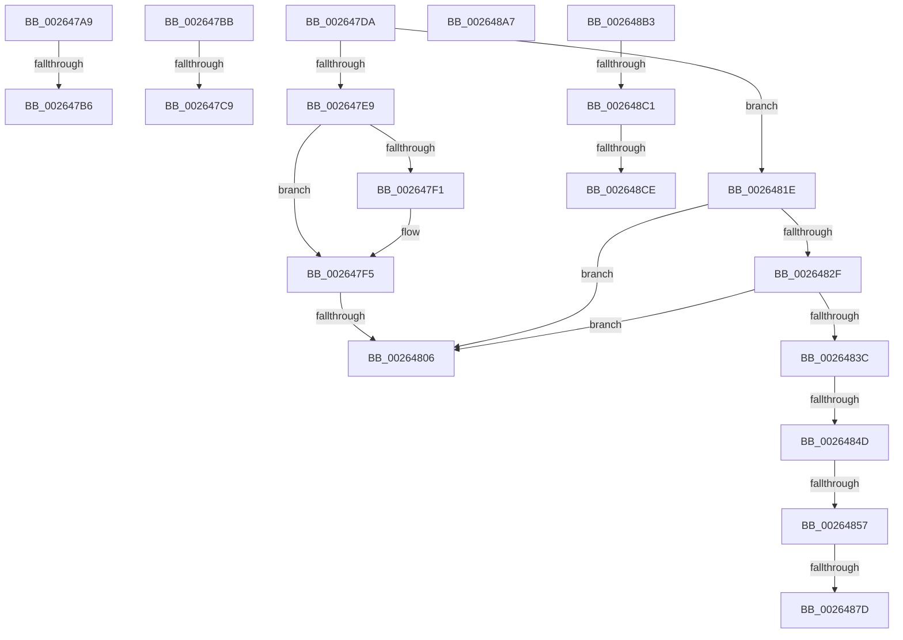

# sub_002647A9

- RVA: `0x002647A9`–`0x002648DA` (길이 `305` bytes)
- VA: `0x00000001402647A9`
- 실행 섹션: `.text`
- PDB 이름 있음: `아니요`; PDB Function 태그: `아니요`
- unwind 정보 RVA: `0x00064904`
- 디코드: `77`개 명령, `305/305` bytes 표시
- 미해석 바이트: `0` (있으면 어셈블리에 `.byte`로 보존)

> 이 문서는 커널 이미지의 기계어와 PDB 기호를 분석해 생성했습니다. 4번과 5번은 함수 원형과 자료형을 바이너리 사용 방식에서 추정한 C 해석이며 원본 소스 복구 결과는 아닙니다.

## 1. Dependencies

- 직접 호출 지점: **4**; 고유 호출 대상: **4**
- 직접 호출자로 확인된 함수: **0**
- RIP 상대 이미지 참조: **3**

### Outgoing calls
- `0x002647D0` → [ExpAcquireSpinLockExclusiveAtDpcLevelInstrumented](../32/ExpAcquireSpinLockExclusiveAtDpcLevelInstrumented_function_00323A70.md) (function, `0x00323A70`)
- `0x00264814` → [KiRaiseIrqlProcessIrqlFlags](../4F/KiRaiseIrqlProcessIrqlFlags_function_004F56FC.md) (function, `0x004F56FC`)
- `0x002648C1` → [KiCheckVpBackingLongSpinWaitHypercall](../30/KiCheckVpBackingLongSpinWaitHypercall_function_0030F490.md) (function, `0x0030F490`)
- `0x002648D0` → [HvlNotifyLongSpinWait](../30/HvlNotifyLongSpinWait_function_0030F460.md) (function, `0x0030F460`)

### Direct callers
- 이 함수 시작 RVA로 연결되는 직접 call은 확인되지 않았습니다. 간접 호출은 완전히 역산할 수 없습니다.

### Static image references
- `0x002647A9` → RVA `0x00FC6B06` (`ALMOSTRO`; read)
- `0x002647BB` → RVA `0x00F0DE58` (`.data`; read)
- `0x002648B3` → RVA `0x00FC6AB8` (`ALMOSTRO`; read)

## 2. Other-region calls and transfers

- 다른 실행 섹션으로 향하는 call: **0**
- call이 아닌 외부 분기/꼬리 이동: **14**
  - `0x002647B0` → [sub_002648E7 + 0x1D](Unknown_function_002648E7.md) (`tail-transfer`)
  - `0x002647B9` → [sub_00264587 + 0x1D2](Unknown_function_00264587.md) (`tail-transfer`)
  - `0x002647C3` → [sub_00264587 + 0x6A](Unknown_function_00264587.md) (`tail-transfer`)
  - `0x002647D5` → [sub_00264587 + 0xBE](Unknown_function_00264587.md) (`tail-transfer`)
  - `0x00264800` → [sub_00264949](Unknown_function_00264949.md) (`tail-transfer`)
  - `0x00264819` → [sub_00264587 + 0x5D](Unknown_function_00264587.md) (`tail-transfer`)
  - `0x00264847` → [sub_00264949 + 0x200](Unknown_function_00264949.md) (`tail-transfer`)
  - `0x00264851` → [sub_00264949 + 0x1EF](Unknown_function_00264949.md) (`tail-transfer`)
  - `0x00264877` → [sub_00264949 + 0x1CB](Unknown_function_00264949.md) (`tail-transfer`)
  - `0x002648A2` → [sub_00264587 + 0x197](Unknown_function_00264587.md) (`tail-transfer`)
  - `0x002648AE` → [sub_00264587 + 0x197](Unknown_function_00264587.md) (`tail-transfer`)
  - `0x002648BB` → [sub_00264587 + 0xAD](Unknown_function_00264587.md) (`tail-transfer`)
  - `0x002648C8` → [sub_00264587 + 0xAD](Unknown_function_00264587.md) (`tail-transfer`)
  - `0x002648D5` → [sub_00264587 + 0xAF](Unknown_function_00264587.md) (`tail-transfer`)

## 3. Assembly (complete function range)

```asm
002647A9  F6 05 56 23 D6 00 01            test byte ptr [rip + 0xd62356], 1
002647B0  0F 85 4E 01 00 00               jne 0x140264904
002647B6  44 89 21                        mov dword ptr [rcx], r12d
002647B9  EB 9E                           jmp 0x140264759
002647BB  8B 05 97 96 CA 00               mov eax, dword ptr [rip + 0xca9697]
002647C1  85 C0                           test eax, eax
002647C3  0F 85 28 FE FF FF               jne 0x1402645f1
002647C9  41 0F B6 D6                     movzx edx, r14b
002647CD  48 8B CB                        mov rcx, rbx
002647D0  E8 9B F2 0B 00                  call 0x140323a70
002647D5  E9 6B FE FF FF                  jmp 0x140264645
002647DA  0F B6 46 10                     movzx eax, byte ptr [rsi + 0x10]
002647DE  24 03                           and al, 3
002647E0  45 0F B6 DA                     movzx r11d, r10b
002647E4  41 3A C1                        cmp al, r9b
002647E7  74 35                           je 0x14026481e
002647E9  4C 8B 16                        mov r10, qword ptr [rsi]
002647EC  45 85 DB                        test r11d, r11d
002647EF  75 04                           jne 0x1402647f5
002647F1  4C 8B 56 08                     mov r10, qword ptr [rsi + 8]
002647F5  49 8B 42 10                     mov rax, qword ptr [r10 + 0x10]
002647F9  48 83 E0 FC                     and rax, 0xfffffffffffffffc
002647FD  48 3B C6                        cmp rax, rsi
00264800  0F 84 43 01 00 00               je 0x140264949
00264806  B9 1D 00 00 00                  mov ecx, 0x1d
0026480B  CD 29                           int 0x29
0026480D  0F B6 D0                        movzx edx, al
00264810  41 0F B6 CE                     movzx ecx, r14b
00264814  E8 E3 0E 29 00                  call 0x1404f56fc
00264819  E9 C6 FD FF FF                  jmp 0x1402645e4
0026481E  48 8B 46 10                     mov rax, qword ptr [rsi + 0x10]
00264822  41 83 F3 01                     xor r11d, 1
00264826  48 83 E0 FC                     and rax, 0xfffffffffffffffc
0026482A  49 3B C0                        cmp rax, r8
0026482D  75 D7                           jne 0x140264806
0026482F  41 8B C3                        mov eax, r11d
00264832  48 83 F0 01                     xor rax, 1
00264836  49 39 34 C0                     cmp qword ptr [r8 + rax*8], rsi
0026483A  75 CA                           jne 0x140264806
0026483C  49 8B 48 10                     mov rcx, qword ptr [r8 + 0x10]
00264840  48 8B D1                        mov rdx, rcx
00264843  48 83 E2 FC                     and rdx, 0xfffffffffffffffc
00264847  0F 84 FC 02 00 00               je 0x140264b49
0026484D  4C 39 42 08                     cmp qword ptr [rdx + 8], r8
00264851  0F 85 E1 02 00 00               jne 0x140264b38
00264857  48 89 72 08                     mov qword ptr [rdx + 8], rsi
0026485B  48 8B 46 10                     mov rax, qword ptr [rsi + 0x10]
0026485F  4A 8D 14 DE                     lea rdx, [rsi + r11*8]
00264863  48 33 C8                        xor rcx, rax
00264866  48 83 E1 FC                     and rcx, 0xfffffffffffffffc
0026486A  48 33 C8                        xor rcx, rax
0026486D  48 89 4E 10                     mov qword ptr [rsi + 0x10], rcx
00264871  48 8B 0A                        mov rcx, qword ptr [rdx]
00264874  48 85 C9                        test rcx, rcx
00264877  0F 85 97 02 00 00               jne 0x140264b14
0026487D  41 8B C3                        mov eax, r11d
00264880  48 83 F0 01                     xor rax, 1
00264884  49 89 0C C0                     mov qword ptr [r8 + rax*8], rcx
00264888  4C 89 02                        mov qword ptr [rdx], r8
0026488B  41 8B 40 10                     mov eax, dword ptr [r8 + 0x10]
0026488F  83 E0 03                        and eax, 3
00264892  48 0B C6                        or rax, rsi
00264895  49 89 40 10                     mov qword ptr [r8 + 0x10], rax
00264899  80 66 10 FC                     and byte ptr [rsi + 0x10], 0xfc
0026489D  41 80 60 10 FC                  and byte ptr [r8 + 0x10], 0xfc
002648A2  E9 77 FE FF FF                  jmp 0x14026471e
002648A7  49 89 B7 50 01 00 00            mov qword ptr [r15 + 0x150], rsi
002648AE  E9 6B FE FF FF                  jmp 0x14026471e
002648B3  8B 05 FF 21 D6 00               mov eax, dword ptr [rip + 0xd621ff]
002648B9  A8 40                           test al, 0x40
002648BB  0F 84 73 FD FF FF               je 0x140264634
002648C1  E8 CA AB 0A 00                  call 0x14030f490
002648C6  84 C0                           test al, al
002648C8  0F 84 66 FD FF FF               je 0x140264634
002648CE  8B CF                           mov ecx, edi
002648D0  E8 8B AB 0A 00                  call 0x14030f460
002648D5  E9 5C FD FF FF                  jmp 0x140264636
```

## 4. C-style interpretation (structured pseudocode)

```c
__int64 __fastcall sub_002647A9(__int64 a1, __int64 a2, __int64 a3, unsigned __int8 a4)
{
    *(unsigned int *)(a1) = (unsigned int)(v_r12);
}
```

## 5. (Beta) C Style

```c
int64_t sub_002647A9(void *Arg1, int64_t Arg2, int64_t Arg3, uint8_t Arg4)
{
    uint8_t *arg1 = (uint8_t *)Arg1;

    *(uint32_t *)(arg1) = (uint32_t)(local_r12);
}
```

### 관측된 메모리 오프셋

구조체 형식이 확인되지 않은 접근은 인자 기준의 오프셋으로만 기록했습니다.

| 기준 인자 | 오프셋 표현 | 폭 (bit) | 접근 |
|---|---:|---:|---|
| `Arg1` | `+ 0x0` | `32` | `W` |

## 6. Execution-region graph

[열기: 2D/3D 그래프와 함수 탐색 컨트롤 패널](../../../control-panel.html?section=text&rva=0x002647A9&view=graph)

- 2D 그래프는 위에서 아래로 흐르고, 3D 그래프는 빈 공간을 드래그해 회전합니다. Shift+드래그는 이동, 휠은 확대·축소, 함수 노드 선택은 대상 보고서 이동입니다.

### Static fallback


