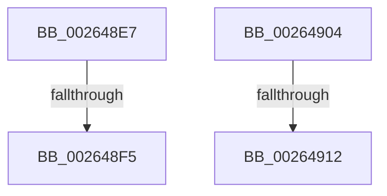

# sub_002648E7

- RVA: `0x002648E7`–`0x00264921` (길이 `58` bytes)
- VA: `0x00000001402648E7`
- 실행 섹션: `.text`
- PDB 이름 있음: `아니요`; PDB Function 태그: `아니요`
- unwind 정보 RVA: `0x00064928`
- 디코드: `12`개 명령, `58/58` bytes 표시
- 미해석 바이트: `0` (있으면 어셈블리에 `.byte`로 보존)

> 이 문서는 커널 이미지의 기계어와 PDB 기호를 분석해 생성했습니다. 4번과 5번은 함수 원형과 자료형을 바이너리 사용 방식에서 추정한 C 해석이며 원본 소스 복구 결과는 아닙니다.

## 1. Dependencies

- 직접 호출 지점: **2**; 고유 호출 대상: **1**
- 직접 호출자로 확인된 함수: **0**
- RIP 상대 이미지 참조: **1**

### Outgoing calls
- `0x002648FA` → [ExpReleaseSpinLockExclusiveFromDpcLevelInstrumented](../2C/ExpReleaseSpinLockExclusiveFromDpcLevelInstrumented_function_002C0F44.md) (function, `0x002C0F44`)
- `0x00264917` → [ExpReleaseSpinLockExclusiveFromDpcLevelInstrumented](../2C/ExpReleaseSpinLockExclusiveFromDpcLevelInstrumented_function_002C0F44.md) (function, `0x002C0F44`)

### Direct callers
- 이 함수 시작 RVA로 연결되는 직접 call은 확인되지 않았습니다. 간접 호출은 완전히 역산할 수 없습니다.

### Static image references
- `0x002648E7` → RVA `0x00F0DE58` (`.data`; read)

## 2. Other-region calls and transfers

- 다른 실행 섹션으로 향하는 call: **0**
- call이 아닌 외부 분기/꼬리 이동: **4**
  - `0x002648EF` → [sub_00264587 + 0x1B1](Unknown_function_00264587.md) (`tail-transfer`)
  - `0x002648FF` → [sub_00264587 + 0x1B4](Unknown_function_00264587.md) (`tail-transfer`)
  - `0x0026490C` → [sub_002647A9 + 0xD](Unknown_function_002647A9.md) (`tail-transfer`)
  - `0x0026491C` → [sub_00264587 + 0x1D2](Unknown_function_00264587.md) (`tail-transfer`)

## 3. Assembly (complete function range)

```asm
002648E7  8B 05 6B 95 CA 00               mov eax, dword ptr [rip + 0xca956b]
002648ED  85 C0                           test eax, eax
002648EF  0F 85 43 FE FF FF               jne 0x140264738
002648F5  48 8B 54 24 58                  mov rdx, qword ptr [rsp + 0x58]
002648FA  E8 45 C6 05 00                  call 0x1402c0f44
002648FF  E9 37 FE FF FF                  jmp 0x14026473b
00264904  8B 05 4E 95 CA 00               mov eax, dword ptr [rip + 0xca954e]
0026490A  85 C0                           test eax, eax
0026490C  0F 85 A4 FE FF FF               jne 0x1402647b6
00264912  48 8B 54 24 58                  mov rdx, qword ptr [rsp + 0x58]
00264917  E8 28 C6 05 00                  call 0x1402c0f44
0026491C  E9 38 FE FF FF                  jmp 0x140264759
```

## 4. C-style interpretation (structured pseudocode)

```c
__int64 __fastcall sub_002648E7(__int64 a1, __int64 a2, __int64 a3, __int64 a4, __int64 a5, __int64 a6, __int64 a7, __int64 a8, __int64 a9, __int64 a10, __int64 a11)
{
    __int64 result;
    unsigned __int64 v_stack_p58;

    result = ExpReleaseSpinLockExclusiveFromDpcLevelInstrumented(a1, a11, a3, a4);
}
```

## 5. (Beta) C Style

```c
int64_t sub_002648E7(int64_t Arg1, int64_t Arg2, int64_t Arg3, int64_t Arg4, uint64_t Arg5, uint64_t Arg6, uint64_t Arg7, uint64_t Arg8, uint64_t Arg9, uint64_t Arg10, int64_t Arg11)
{
    int64_t result;
    uint64_t v_stack_p58;

    result = ExpReleaseSpinLockExclusiveFromDpcLevelInstrumented(Arg1, Arg11, Arg3, Arg4);
}
```

## 6. Execution-region graph

[열기: 2D/3D 그래프와 함수 탐색 컨트롤 패널](../../../control-panel.html?section=text&rva=0x002648E7&view=graph)

- 2D 그래프는 위에서 아래로 흐르고, 3D 그래프는 빈 공간을 드래그해 회전합니다. Shift+드래그는 이동, 휠은 확대·축소, 함수 노드 선택은 대상 보고서 이동입니다.

### Static fallback


