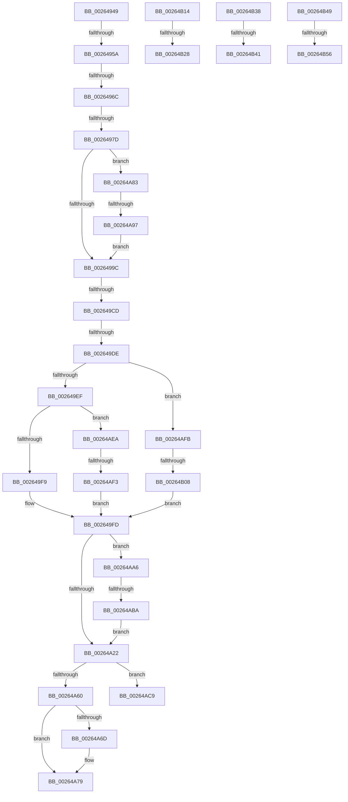

# sub_00264949

- RVA: `0x00264949`–`0x00264B62` (길이 `537` bytes)
- VA: `0x0000000140264949`
- 실행 섹션: `.text`
- PDB 이름 있음: `아니요`; PDB Function 태그: `아니요`
- unwind 정보 RVA: `0x0006494C`
- 디코드: `134`개 명령, `537/537` bytes 표시
- 미해석 바이트: `0` (있으면 어셈블리에 `.byte`로 보존)

> 이 문서는 커널 이미지의 기계어와 PDB 기호를 분석해 생성했습니다. 4번과 5번은 함수 원형과 자료형을 바이너리 사용 방식에서 추정한 C 해석이며 원본 소스 복구 결과는 아닙니다.

## 1. Dependencies

- 직접 호출 지점: **0**; 고유 호출 대상: **0**
- 직접 호출자로 확인된 함수: **0**
- RIP 상대 이미지 참조: **0**

### Outgoing calls
- 직접 디코드된 call 명령이 없습니다.

### Direct callers
- 이 함수 시작 RVA로 연결되는 직접 call은 확인되지 않았습니다. 간접 호출은 완전히 역산할 수 없습니다.

### Static image references
- 디코드된 RIP-relative 메모리 참조가 없습니다.

## 2. Other-region calls and transfers

- 다른 실행 섹션으로 향하는 call: **0**
- call이 아닌 외부 분기/꼬리 이동: **17**
  - `0x00264954` → [sub_002647A9 + 0x5D](Unknown_function_002647A9.md) (`tail-transfer`)
  - `0x00264966` → [sub_002647A9 + 0x5D](Unknown_function_002647A9.md) (`tail-transfer`)
  - `0x00264977` → [sub_002647A9 + 0x5D](Unknown_function_002647A9.md) (`tail-transfer`)
  - `0x002649C7` → [sub_002647A9 + 0x5D](Unknown_function_002647A9.md) (`tail-transfer`)
  - `0x002649D8` → [sub_002647A9 + 0x5D](Unknown_function_002647A9.md) (`tail-transfer`)
  - `0x00264A7E` → [sub_00264587 + 0x197](Unknown_function_00264587.md) (`tail-transfer`)
  - `0x00264A91` → [sub_002647A9 + 0x5D](Unknown_function_002647A9.md) (`tail-transfer`)
  - `0x00264AB4` → [sub_002647A9 + 0x5D](Unknown_function_002647A9.md) (`tail-transfer`)
  - `0x00264AE5` → [sub_00264587 + 0x197](Unknown_function_00264587.md) (`tail-transfer`)
  - `0x00264AED` → [sub_002647A9 + 0x5D](Unknown_function_002647A9.md) (`tail-transfer`)
  - `0x00264B02` → [sub_002647A9 + 0x5D](Unknown_function_002647A9.md) (`tail-transfer`)
  - `0x00264B22` → [sub_002647A9 + 0x5D](Unknown_function_002647A9.md) (`tail-transfer`)
  - `0x00264B33` → [sub_002647A9 + 0xD4](Unknown_function_002647A9.md) (`tail-transfer`)
  - `0x00264B3B` → [sub_002647A9 + 0x5D](Unknown_function_002647A9.md) (`tail-transfer`)
  - `0x00264B44` → [sub_002647A9 + 0xB2](Unknown_function_002647A9.md) (`tail-transfer`)
  - `0x00264B50` → [sub_002647A9 + 0x5D](Unknown_function_002647A9.md) (`tail-transfer`)
  - `0x00264B5D` → [sub_002647A9 + 0xB2](Unknown_function_002647A9.md) (`tail-transfer`)

## 3. Assembly (complete function range)

```asm
00264949  49 8B C3                        mov rax, r11
0026494C  48 83 F0 01                     xor rax, 1
00264950  4C 39 14 C6                     cmp qword ptr [rsi + rax*8], r10
00264954  0F 85 AC FE FF FF               jne 0x140264806
0026495A  4B 39 34 D8                     cmp qword ptr [r8 + r11*8], rsi
0026495E  4A 8D 1C DD 00 00 00 00         lea rbx, [r11*8]
00264966  0F 85 9A FE FF FF               jne 0x140264806
0026496C  48 8B 46 10                     mov rax, qword ptr [rsi + 0x10]
00264970  48 83 E0 FC                     and rax, 0xfffffffffffffffc
00264974  49 3B C0                        cmp rax, r8
00264977  0F 85 89 FE FF FF               jne 0x140264806
0026497D  4D 89 14 18                     mov qword ptr [r8 + rbx], r10
00264981  41 8B 42 10                     mov eax, dword ptr [r10 + 0x10]
00264985  83 E0 03                        and eax, 3
00264988  49 0B C0                        or rax, r8
0026498B  49 89 42 10                     mov qword ptr [r10 + 0x10], rax
0026498F  49 8B 0C 1A                     mov rcx, qword ptr [r10 + rbx]
00264993  48 85 C9                        test rcx, rcx
00264996  0F 85 E7 00 00 00               jne 0x140264a83
0026499C  49 8B C3                        mov rax, r11
0026499F  41 83 F3 01                     xor r11d, 1
002649A3  48 83 F0 01                     xor rax, 1
002649A7  48 89 0C C6                     mov qword ptr [rsi + rax*8], rcx
002649AB  49 89 34 1A                     mov qword ptr [r10 + rbx], rsi
002649AF  8B 46 10                        mov eax, dword ptr [rsi + 0x10]
002649B2  83 E0 03                        and eax, 3
002649B5  49 0B C2                        or rax, r10
002649B8  48 89 46 10                     mov qword ptr [rsi + 0x10], rax
002649BC  49 8B 42 10                     mov rax, qword ptr [r10 + 0x10]
002649C0  48 83 E0 FC                     and rax, 0xfffffffffffffffc
002649C4  49 3B C0                        cmp rax, r8
002649C7  0F 85 39 FE FF FF               jne 0x140264806
002649CD  41 8B C3                        mov eax, r11d
002649D0  48 83 F0 01                     xor rax, 1
002649D4  4D 39 14 C0                     cmp qword ptr [r8 + rax*8], r10
002649D8  0F 85 28 FE FF FF               jne 0x140264806
002649DE  49 8B 58 10                     mov rbx, qword ptr [r8 + 0x10]
002649E2  48 8B CB                        mov rcx, rbx
002649E5  48 83 E1 FC                     and rcx, 0xfffffffffffffffc
002649E9  0F 84 0C 01 00 00               je 0x140264afb
002649EF  4C 39 41 08                     cmp qword ptr [rcx + 8], r8
002649F3  0F 85 F1 00 00 00               jne 0x140264aea
002649F9  4C 89 51 08                     mov qword ptr [rcx + 8], r10
002649FD  49 8B 42 10                     mov rax, qword ptr [r10 + 0x10]
00264A01  48 8B C8                        mov rcx, rax
00264A04  48 33 CB                        xor rcx, rbx
00264A07  4B 8D 1C DA                     lea rbx, [r10 + r11*8]
00264A0B  48 83 E1 FC                     and rcx, 0xfffffffffffffffc
00264A0F  48 33 C8                        xor rcx, rax
00264A12  49 89 4A 10                     mov qword ptr [r10 + 0x10], rcx
00264A16  48 8B 0B                        mov rcx, qword ptr [rbx]
00264A19  48 85 C9                        test rcx, rcx
00264A1C  0F 85 84 00 00 00               jne 0x140264aa6
00264A22  41 8B C3                        mov eax, r11d
00264A25  48 83 F0 01                     xor rax, 1
00264A29  49 89 0C C0                     mov qword ptr [r8 + rax*8], rcx
00264A2D  4C 89 03                        mov qword ptr [rbx], r8
00264A30  41 8B 40 10                     mov eax, dword ptr [r8 + 0x10]
00264A34  83 E0 03                        and eax, 3
00264A37  49 0B C2                        or rax, r10
00264A3A  49 89 40 10                     mov qword ptr [r8 + 0x10], rax
00264A3E  24 FC                           and al, 0xfc
00264A40  41 88 40 10                     mov byte ptr [r8 + 0x10], al
00264A44  0F B6 5E 10                     movzx ebx, byte ptr [rsi + 0x10]
00264A48  0F B6 C3                        movzx eax, bl
00264A4B  24 FC                           and al, 0xfc
00264A4D  88 46 10                        mov byte ptr [rsi + 0x10], al
00264A50  45 0F B6 5A 10                  movzx r11d, byte ptr [r10 + 0x10]
00264A55  41 8B CB                        mov ecx, r11d
00264A58  83 E1 03                        and ecx, 3
00264A5B  44 3A C9                        cmp r9b, cl
00264A5E  74 69                           je 0x140264ac9
00264A60  41 83 F3 FE                     xor r11d, 0xfffffffe
00264A64  41 83 E3 03                     and r11d, 3
00264A68  45 3A CB                        cmp r9b, r11b
00264A6B  75 0C                           jne 0x140264a79
00264A6D  0F B6 C3                        movzx eax, bl
00264A70  32 C2                           xor al, dl
00264A72  24 03                           and al, 3
00264A74  32 C3                           xor al, bl
00264A76  88 46 10                        mov byte ptr [rsi + 0x10], al
00264A79  41 80 62 10 FC                  and byte ptr [r10 + 0x10], 0xfc
00264A7E  E9 9B FC FF FF                  jmp 0x14026471e
00264A83  48 8B 79 10                     mov rdi, qword ptr [rcx + 0x10]
00264A87  48 8B C7                        mov rax, rdi
00264A8A  48 83 E0 FC                     and rax, 0xfffffffffffffffc
00264A8E  49 3B C2                        cmp rax, r10
00264A91  0F 85 6F FD FF FF               jne 0x140264806
00264A97  83 E7 03                        and edi, 3
00264A9A  48 0B FE                        or rdi, rsi
00264A9D  48 89 79 10                     mov qword ptr [rcx + 0x10], rdi
00264AA1  E9 F6 FE FF FF                  jmp 0x14026499c
00264AA6  48 8B 79 10                     mov rdi, qword ptr [rcx + 0x10]
00264AAA  48 8B C7                        mov rax, rdi
00264AAD  48 83 E0 FC                     and rax, 0xfffffffffffffffc
00264AB1  49 3B C2                        cmp rax, r10
00264AB4  0F 85 4C FD FF FF               jne 0x140264806
00264ABA  83 E7 03                        and edi, 3
00264ABD  49 0B F8                        or rdi, r8
00264AC0  48 89 79 10                     mov qword ptr [rcx + 0x10], rdi
00264AC4  E9 59 FF FF FF                  jmp 0x140264a22
00264AC9  41 0F B6 40 10                  movzx eax, byte ptr [r8 + 0x10]
00264ACE  44 32 C8                        xor r9b, al
00264AD1  41 80 F1 FE                     xor r9b, 0xfe
00264AD5  41 80 E1 03                     and r9b, 3
00264AD9  44 32 C8                        xor r9b, al
00264ADC  45 88 48 10                     mov byte ptr [r8 + 0x10], r9b
00264AE0  41 80 62 10 FC                  and byte ptr [r10 + 0x10], 0xfc
00264AE5  E9 34 FC FF FF                  jmp 0x14026471e
00264AEA  4C 39 01                        cmp qword ptr [rcx], r8
00264AED  0F 85 13 FD FF FF               jne 0x140264806
00264AF3  4C 89 11                        mov qword ptr [rcx], r10
00264AF6  E9 02 FF FF FF                  jmp 0x1402649fd
00264AFB  4D 39 87 50 01 00 00            cmp qword ptr [r15 + 0x150], r8
00264B02  0F 85 FE FC FF FF               jne 0x140264806
00264B08  4D 89 97 50 01 00 00            mov qword ptr [r15 + 0x150], r10
00264B0F  E9 E9 FE FF FF                  jmp 0x1402649fd
00264B14  4C 8B 49 10                     mov r9, qword ptr [rcx + 0x10]
00264B18  49 8B C1                        mov rax, r9
00264B1B  48 83 E0 FC                     and rax, 0xfffffffffffffffc
00264B1F  48 3B C6                        cmp rax, rsi
00264B22  0F 85 DE FC FF FF               jne 0x140264806
00264B28  41 83 E1 03                     and r9d, 3
00264B2C  4D 0B C8                        or r9, r8
00264B2F  4C 89 49 10                     mov qword ptr [rcx + 0x10], r9
00264B33  E9 45 FD FF FF                  jmp 0x14026487d
00264B38  4C 39 02                        cmp qword ptr [rdx], r8
00264B3B  0F 85 C5 FC FF FF               jne 0x140264806
00264B41  48 89 32                        mov qword ptr [rdx], rsi
00264B44  E9 12 FD FF FF                  jmp 0x14026485b
00264B49  4D 39 87 50 01 00 00            cmp qword ptr [r15 + 0x150], r8
00264B50  0F 85 B0 FC FF FF               jne 0x140264806
00264B56  49 89 B7 50 01 00 00            mov qword ptr [r15 + 0x150], rsi
00264B5D  E9 F9 FC FF FF                  jmp 0x14026485b
```

## 4. C-style interpretation (structured pseudocode)

```c
__int64 __fastcall sub_00264949(__int64 a1, __int64 a2, __int64 a3, unsigned __int8 a4)
{
    __int64 result;
    __int64 v_r11;
    __int64 v_rdi;

    result = (v_r11) ^ (1);
    result = (*(unsigned __int64 *)(v_rsi + 16)) & (-4);
    *(unsigned __int64 *)(a3 + v_r11 * 8 * 1) = v_r10;
    result = (unsigned int)(((unsigned int)(*(unsigned int *)(v_r10 + 16))) & (3));
    result = (result) | (a3);
    *(unsigned __int64 *)(v_r10 + 16) = result;
    if (*(unsigned __int64 *)(v_r10 + v_r11 * 8 * 1) != 0) goto loc_00264A83;
loc_0026499C:
    v_r11 = (unsigned int)((v_r11) ^ (1));
    result = (v_r11) ^ (1);
    *(unsigned __int64 *)(v_rsi + result * 8) = *(unsigned __int64 *)(v_r10 + v_r11 * 8 * 1);
    *(unsigned __int64 *)(v_r10 + v_r11 * 8 * 1) = v_rsi;
    result = (unsigned int)(((unsigned int)(*(unsigned int *)(v_rsi + 16))) & (3));
    result = (result) | (v_r10);
    *(unsigned __int64 *)(v_rsi + 16) = result;
    result = (*(unsigned __int64 *)(v_r10 + 16)) & (-4);
    result = ((unsigned int)((unsigned int)(v_r11))) ^ (1);
    a1 = (*(unsigned __int64 *)(a3 + 16)) & (-4);
    if (condition_is_equal) goto loc_00264AFB;
    if ((*(unsigned __int64 *)(a1 + 8)) != a3) goto loc_00264AEA;
    *(unsigned __int64 *)(a1 + 8) = v_r10;
loc_002649FD:
    a1 = (*(unsigned __int64 *)(v_r10 + 16)) ^ (*(unsigned __int64 *)(a3 + 16));
    a1 = (a1) & (-4);
    a1 = (a1) ^ (*(unsigned __int64 *)(v_r10 + 16));
    *(unsigned __int64 *)(v_r10 + 16) = a1;
    if (*(unsigned __int64 *)(v_r10 + v_r11 * 8) != 0) goto loc_00264AA6;
loc_00264A22:
    result = ((unsigned int)((unsigned int)(v_r11))) ^ (1);
    *(unsigned __int64 *)(a3 + result * 8) = *(unsigned __int64 *)(v_r10 + v_r11 * 8);
    *(unsigned __int64 *)(v_r10 + v_r11 * 8) = a3;
    result = (unsigned int)(((unsigned int)(*(unsigned int *)(a3 + 16))) & (3));
    result = (result) | (v_r10);
    *(unsigned __int64 *)(a3 + 16) = result;
    result = (unsigned __int8)((result) & (252));
    *(unsigned __int8 *)(a3 + 16) = (unsigned __int8)(result);
    result = (unsigned __int8)(((unsigned __int8)(*(unsigned __int8 *)(v_rsi + 16))) & (252));
    *(unsigned __int8 *)(v_rsi + 16) = (unsigned __int8)(result);
    a1 = (unsigned int)(((unsigned int)((unsigned int)(*(unsigned __int8 *)(v_r10 + 16)))) & (3));
    if (a4 == ((unsigned __int8)(a1))) goto loc_00264AC9;
    v_r11 = (unsigned int)((*(unsigned __int8 *)(v_r10 + 16)) ^ (0xFFFFFFFEULL));
    v_r11 = (unsigned int)((v_r11) & (3));
    if (a4 == ((unsigned __int8)(v_r11))) {
        result = (unsigned __int8)(*(unsigned __int8 *)(v_rsi + 16));
        result = (unsigned __int8)((result) ^ ((unsigned __int8)(a2)));
        result = (unsigned __int8)((result) & (3));
        result = (unsigned __int8)((result) ^ ((unsigned __int8)(*(unsigned __int8 *)(v_rsi + 16))));
        *(unsigned __int8 *)(v_rsi + 16) = (unsigned __int8)(result);
    }
loc_00264A83:
    result = (*(unsigned __int64 *)(a1 + 16)) & (-4);
    v_rdi = (unsigned int)((*(unsigned __int64 *)(a1 + 16)) & (3));
    v_rdi = (v_rdi) | (v_rsi);
    *(unsigned __int64 *)(a1 + 16) = v_rdi;
    goto loc_0026499C;
loc_00264AA6:
    result = (*(unsigned __int64 *)(a1 + 16)) & (-4);
    v_rdi = (unsigned int)((*(unsigned __int64 *)(a1 + 16)) & (3));
    v_rdi = (v_rdi) | (a3);
    *(unsigned __int64 *)(a1 + 16) = v_rdi;
    goto loc_00264A22;
loc_00264AC9:
    a4 = (unsigned __int8)((a4) ^ ((unsigned __int8)(*(unsigned __int8 *)(a3 + 16))));
    a4 = (unsigned __int8)((a4) ^ (254));
    a4 = (unsigned __int8)((a4) & (3));
    a4 = (unsigned __int8)((a4) ^ ((unsigned __int8)(*(unsigned __int8 *)(a3 + 16))));
    *(unsigned __int8 *)(a3 + 16) = a4;
loc_00264AEA:
    *(unsigned __int64 *)(a1) = v_r10;
    goto loc_002649FD;
loc_00264AFB:
    *(unsigned __int64 *)(v_r15 + 336) = v_r10;
    goto loc_002649FD;
}
```

## 5. (Beta) C Style

```c
int64_t sub_00264949(int64_t Arg1, int64_t Arg2, void *Arg3, uint8_t Arg4)
{
    uint8_t *arg3 = (uint8_t *)Arg3;

    int64_t result;
    int64_t local_r11;
    int64_t local_rdi;

    result = (local_r11) ^ (1);
    result = (*(uint64_t *)(local_rsi + 0x10)) & (-4);
    *(uint64_t *)(arg3 + local_r11 * 8 * 1) = local_r10;
    result = (uint32_t)(((uint32_t)(*(uint32_t *)(local_r10 + 0x10))) & (3));
    result = (result) | (Arg3);
    *(uint64_t *)(local_r10 + 0x10) = result;
    if (*(uint64_t *)(local_r10 + local_r11 * 8 * 1) != 0) goto loc_00264A83;
loc_0026499C:
    local_r11 = (uint32_t)((local_r11) ^ (1));
    result = (local_r11) ^ (1);
    *(uint64_t *)(local_rsi + result * 8) = *(uint64_t *)(local_r10 + local_r11 * 8 * 1);
    *(uint64_t *)(local_r10 + local_r11 * 8 * 1) = local_rsi;
    result = (uint32_t)(((uint32_t)(*(uint32_t *)(local_rsi + 0x10))) & (3));
    result = (result) | (local_r10);
    *(uint64_t *)(local_rsi + 0x10) = result;
    result = (*(uint64_t *)(local_r10 + 0x10)) & (-4);
    result = ((uint32_t)((uint32_t)(local_r11))) ^ (1);
    Arg1 = (*(uint64_t *)(arg3 + 0x10)) & (-4);
    if (condition_is_equal) goto loc_00264AFB;
    if ((*(uint64_t *)(Arg1 + 0x8)) != Arg3) goto loc_00264AEA;
    *(uint64_t *)(Arg1 + 0x8) = local_r10;
loc_002649FD:
    Arg1 = (*(uint64_t *)(local_r10 + 0x10)) ^ (*(uint64_t *)(arg3 + 0x10));
    Arg1 = (Arg1) & (-4);
    Arg1 = (Arg1) ^ (*(uint64_t *)(local_r10 + 0x10));
    *(uint64_t *)(local_r10 + 0x10) = Arg1;
    if (*(uint64_t *)(local_r10 + local_r11 * 8) != 0) goto loc_00264AA6;
loc_00264A22:
    result = ((uint32_t)((uint32_t)(local_r11))) ^ (1);
    *(uint64_t *)(arg3 + result * 8) = *(uint64_t *)(local_r10 + local_r11 * 8);
    *(void **)(local_r10 + local_r11 * 8) = Arg3;
    result = (uint32_t)(((uint32_t)(*(uint32_t *)(arg3 + 0x10))) & (3));
    result = (result) | (local_r10);
    *(uint64_t *)(arg3 + 0x10) = result;
    result = (uint8_t)((result) & (252));
    *(uint8_t *)(arg3 + 0x10) = (uint8_t)(result);
    result = (uint8_t)(((uint8_t)(*(uint8_t *)(local_rsi + 0x10))) & (252));
    *(uint8_t *)(local_rsi + 0x10) = (uint8_t)(result);
    Arg1 = (uint32_t)(((uint32_t)((uint32_t)(*(uint8_t *)(local_r10 + 0x10)))) & (3));
    if (Arg4 == ((uint8_t)(Arg1))) goto loc_00264AC9;
    local_r11 = (uint32_t)((*(uint8_t *)(local_r10 + 0x10)) ^ (0xFFFFFFFEULL));
    local_r11 = (uint32_t)((local_r11) & (3));
    if (Arg4 == ((uint8_t)(local_r11))) {
        result = (uint8_t)(*(uint8_t *)(local_rsi + 0x10));
        result = (uint8_t)((result) ^ ((uint8_t)(Arg2)));
        result = (uint8_t)((result) & (3));
        result = (uint8_t)((result) ^ ((uint8_t)(*(uint8_t *)(local_rsi + 0x10))));
        *(uint8_t *)(local_rsi + 0x10) = (uint8_t)(result);
    }
loc_00264A83:
    result = (*(uint64_t *)(Arg1 + 0x10)) & (-4);
    local_rdi = (uint32_t)((*(uint64_t *)(Arg1 + 0x10)) & (3));
    local_rdi = (local_rdi) | (local_rsi);
    *(uint64_t *)(Arg1 + 0x10) = local_rdi;
    goto loc_0026499C;
loc_00264AA6:
    result = (*(uint64_t *)(Arg1 + 0x10)) & (-4);
    local_rdi = (uint32_t)((*(uint64_t *)(Arg1 + 0x10)) & (3));
    local_rdi = (local_rdi) | (Arg3);
    *(uint64_t *)(Arg1 + 0x10) = local_rdi;
    goto loc_00264A22;
loc_00264AC9:
    Arg4 = (uint8_t)((Arg4) ^ ((uint8_t)(*(uint8_t *)(arg3 + 0x10))));
    Arg4 = (uint8_t)((Arg4) ^ (254));
    Arg4 = (uint8_t)((Arg4) & (3));
    Arg4 = (uint8_t)((Arg4) ^ ((uint8_t)(*(uint8_t *)(arg3 + 0x10))));
    *(uint8_t *)(arg3 + 0x10) = Arg4;
loc_00264AEA:
    *(uint64_t *)(Arg1) = local_r10;
    goto loc_002649FD;
loc_00264AFB:
    *(uint64_t *)(local_r15 + 0x150) = local_r10;
    goto loc_002649FD;
}
```

### 관측된 메모리 오프셋

구조체 형식이 확인되지 않은 접근은 인자 기준의 오프셋으로만 기록했습니다.

| 기준 인자 | 오프셋 표현 | 폭 (bit) | 접근 |
|---|---:|---:|---|
| `Arg3` | `+ 0x0 + r11*8` | `64` | `R` |
| `Arg3` | `+ 0x0 + rax*8` | `64` | `R` |
| `Arg3` | `+ 0x0 + rax*8` | `64` | `W` |
| `Arg3` | `+ 0x0 + rbx*1` | `64` | `W` |
| `Arg3` | `+ 0x10` | `8` | `R` |
| `Arg3` | `+ 0x10` | `8` | `W` |
| `Arg3` | `+ 0x10` | `32` | `R` |
| `Arg3` | `+ 0x10` | `64` | `R` |
| `Arg3` | `+ 0x10` | `64` | `W` |

## 6. Execution-region graph

[열기: 2D/3D 그래프와 함수 탐색 컨트롤 패널](../../../control-panel.html?section=text&rva=0x00264949&view=graph)

- 2D 그래프는 위에서 아래로 흐르고, 3D 그래프는 빈 공간을 드래그해 회전합니다. Shift+드래그는 이동, 휠은 확대·축소, 함수 노드 선택은 대상 보고서 이동입니다.

### Static fallback


