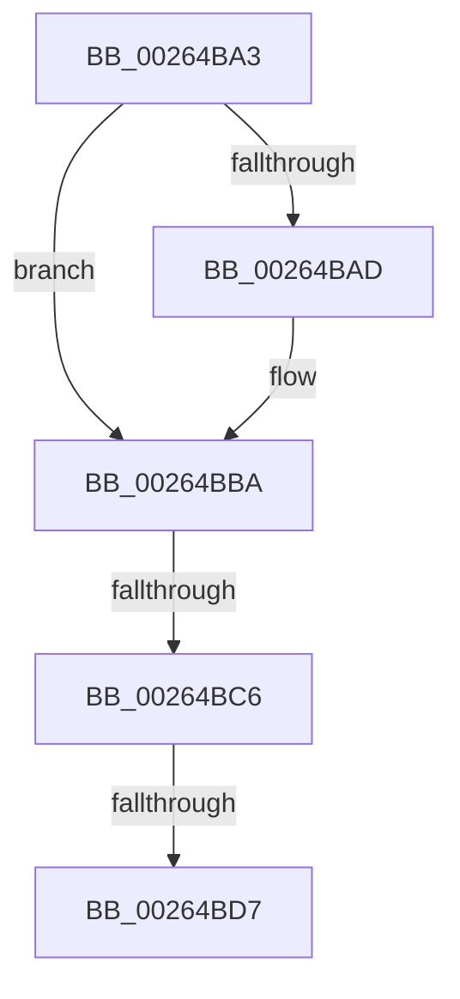

# sub_00264BA3

- RVA: `0x00264BA3`–`0x00264BFE` (길이 `91` bytes)
- VA: `0x0000000140264BA3`
- 실행 섹션: `.text`
- PDB 이름 있음: `아니요`; PDB Function 태그: `아니요`
- unwind 정보 RVA: `0x0006496C`
- 디코드: `21`개 명령, `91/91` bytes 표시
- 미해석 바이트: `0` (있으면 어셈블리에 `.byte`로 보존)

> 이 문서는 커널 이미지의 기계어와 PDB 기호를 분석해 생성했습니다. 4번과 5번은 함수 원형과 자료형을 바이너리 사용 방식에서 추정한 C 해석이며 원본 소스 복구 결과는 아닙니다.

## 1. Dependencies

- 직접 호출 지점: **1**; 고유 호출 대상: **1**
- 직접 호출자로 확인된 함수: **0**
- RIP 상대 이미지 참조: **1**

### Outgoing calls
- `0x00264BB2` → [KeAbPreAcquire](../21/KeAbPreAcquire_function_00210230.md) (function, `0x00210230`)

### Direct callers
- 이 함수 시작 RVA로 연결되는 직접 call은 확인되지 않았습니다. 간접 호출은 완전히 역산할 수 없습니다.

### Static image references
- `0x00264BD7` → RVA `0x00EFA278` (`.data`; read)

## 2. Other-region calls and transfers

- 다른 실행 섹션으로 향하는 call: **0**
- call이 아닌 외부 분기/꼬리 이동: **2**
  - `0x00264BC0` → [sub_00264D2C](Unknown_function_00264D2C.md) (`tail-transfer`)
  - `0x00264BD1` → [sub_00264CC5](Unknown_function_00264CC5.md) (`tail-transfer`)

## 3. Assembly (complete function range)

```asm
00264BA3  4C 89 74 24 30                  mov qword ptr [rsp + 0x30], r14
00264BA8  F6 C2 02                        test dl, 2
00264BAB  75 0D                           jne 0x140264bba
00264BAD  45 33 C0                        xor r8d, r8d
00264BB0  33 D2                           xor edx, edx
00264BB2  E8 79 B6 FA FF                  call 0x140210230
00264BB7  4C 8B E8                        mov r13, rax
00264BBA  F0 49 0F BA 2F 00               lock bts qword ptr [r15], 0
00264BC0  0F 82 66 01 00 00               jb 0x140264d2c
00264BC6  45 8B 4F 08                     mov r9d, dword ptr [r15 + 8]
00264BCA  45 8B F1                        mov r14d, r9d
00264BCD  41 F6 C1 01                     test r9b, 1
00264BD1  0F 84 EE 00 00 00               je 0x140264cc5
00264BD7  48 8B 05 9A 56 C9 00            mov rax, qword ptr [rip + 0xc9569a]
00264BDE  41 8B D1                        mov edx, r9d
00264BE1  C1 EA 0D                        shr edx, 0xd
00264BE4  41 B8 01 00 00 00               mov r8d, 1
00264BEA  81 E2 FF FF 03 00               and edx, 0x3ffff
00264BF0  49 C1 E9 04                     shr r9, 4
00264BF4  0F BD CA                        bsr ecx, edx
00264BF7  41 81 E1 FF 01 00 00            and r9d, 0x1ff
```

## 4. C-style interpretation (structured pseudocode)

```c
__int64 __fastcall sub_00264BA3(__int64 a1, int a2, int a3)
{
    __int64 result;
    __int64 v_r13;
    unsigned __int64 v_stack_p30;

    v_stack_p30 = v_r14;
    if ((((unsigned __int8)(a2)) & (2)) == 0) {
        a3 = 0;
        a2 = 0;
        result = KeAbPreAcquire(a1, a2, a3, a4);
        v_r13 = result;
    }
    a2 = (unsigned int)(((unsigned int)((unsigned int)((unsigned int)(*(unsigned int *)(v_r15 + 8))))) >> (13));
    a2 = (unsigned int)((a2) & (0x3FFFFULL));
    a4 = ((unsigned int)(*(unsigned int *)(v_r15 + 8))) >> (4);
    a4 = (unsigned int)((a4) & (511));
    return *(unsigned __int64 *)(v_rip + 13194906);
}
```

## 5. (Beta) C Style

```c
int64_t sub_00264BA3(int64_t Arg1, int32_t Arg2, int32_t Arg3)
{
    int64_t result;
    int64_t local_r13;
    uint64_t v_stack_p30;

    v_stack_p30 = local_r14;
    if ((((uint8_t)(Arg2)) & (2)) == 0) {
        Arg3 = 0;
        Arg2 = 0;
        result = KeAbPreAcquire(Arg1, Arg2, Arg3, a4);
        local_r13 = result;
    }
    Arg2 = (uint32_t)(((uint32_t)((uint32_t)((uint32_t)(*(uint32_t *)(local_r15 + 0x8))))) >> (13));
    Arg2 = (uint32_t)((Arg2) & (0x3FFFFULL));
    a4 = ((uint32_t)(*(uint32_t *)(local_r15 + 0x8))) >> (4);
    a4 = (uint32_t)((a4) & (511));
    return *(uint64_t *)(v_rip + 0xC9569A);
}
```

## 6. Execution-region graph

[열기: 2D/3D 그래프와 함수 탐색 컨트롤 패널](../../../control-panel.html?section=text&rva=0x00264BA3&view=graph)

- 2D 그래프는 위에서 아래로 흐르고, 3D 그래프는 빈 공간을 드래그해 회전합니다. Shift+드래그는 이동, 휠은 확대·축소, 함수 노드 선택은 대상 보고서 이동입니다.

### Static fallback


