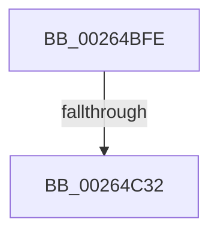

# sub_00264BFE

- RVA: `0x00264BFE`–`0x00264C47` (길이 `73` bytes)
- VA: `0x0000000140264BFE`
- 실행 섹션: `.text`
- PDB 이름 있음: `아니요`; PDB Function 태그: `아니요`
- unwind 정보 RVA: `0x00064980`
- 디코드: `18`개 명령, `73/73` bytes 표시
- 미해석 바이트: `0` (있으면 어셈블리에 `.byte`로 보존)

> 이 문서는 커널 이미지의 기계어와 PDB 기호를 분석해 생성했습니다. 4번과 5번은 함수 원형과 자료형을 바이너리 사용 방식에서 추정한 C 해석이며 원본 소스 복구 결과는 아닙니다.

## 1. Dependencies

- 직접 호출 지점: **1**; 고유 호출 대상: **1**
- 직접 호출자로 확인된 함수: **0**
- RIP 상대 이미지 참조: **0**

### Outgoing calls
- `0x00264C3C` → [KeQueryMaximumProcessorCountEx](KeQueryMaximumProcessorCountEx_function_00264D60.md) (function, `0x00264D60`)

### Direct callers
- 이 함수 시작 RVA로 연결되는 직접 call은 확인되지 않았습니다. 간접 호출은 완전히 역산할 수 없습니다.

### Static image references
- 디코드된 RIP-relative 메모리 참조가 없습니다.

## 2. Other-region calls and transfers

- 다른 실행 섹션으로 향하는 call: **0**
- call이 아닌 외부 분기/꼬리 이동: **2**
  - `0x00264C2C` → [sub_00264D3F](Unknown_function_00264D3F.md) (`tail-transfer`)
  - `0x00264C45` → [sub_00264CBB](Unknown_function_00264CBB.md) (`tail-transfer`)

## 3. Assembly (complete function range)

```asm
00264BFE  48 89 5C 24 70                  mov qword ptr [rsp + 0x70], rbx
00264C03  41 D3 E0                        shl r8d, cl
00264C06  4C 33 C2                        xor r8, rdx
00264C09  89 4C 24 78                     mov dword ptr [rsp + 0x78], ecx
00264C0D  48 89 7C 24 38                  mov qword ptr [rsp + 0x38], rdi
00264C12  8D 51 FE                        lea edx, [rcx - 2]
00264C15  48 8B 08                        mov rcx, qword ptr [rax]
00264C18  48 8B 04 D1                     mov rax, qword ptr [rcx + rdx*8]
00264C1C  4A 8B 44 C0 08                  mov rax, qword ptr [rax + r8*8 + 8]
00264C21  F0 4A 0F BA 2C C8 00            lock bts qword ptr [rax + r9*8], 0
00264C28  4A 8D 0C C8                     lea rcx, [rax + r9*8]
00264C2C  0F 82 0D 01 00 00               jb 0x140264d3f
00264C32  B9 FF FF 00 00                  mov ecx, 0xffff
00264C37  BB 01 00 00 00                  mov ebx, 1
00264C3C  E8 1F 01 00 00                  call 0x140264d60
00264C41  8B F8                           mov edi, eax
00264C43  3B C3                           cmp eax, ebx
00264C45  76 74                           jbe 0x140264cbb
```

## 4. C-style interpretation (structured pseudocode)

```c
__int64 __fastcall sub_00264BFE(__int64 a1, __int64 a2, int a3, __int64 a4)
{
    __int64 result;
    unsigned __int64 v_stack_p38;
    unsigned __int64 v_stack_p70;
    unsigned int v_stack_p78;

    v_stack_p70 = v_rbx;
    a3 = (unsigned int)((a3) << ((unsigned __int8)(a1)));
    a3 = (a3) ^ (a2);
    v_stack_p78 = (unsigned int)(a1);
    v_stack_p38 = v_rdi;
    result = KeQueryMaximumProcessorCountEx((unsigned int)(0xFFFFULL), a1 - 2, a3, a4);
}
```

## 5. (Beta) C Style

```c
int64_t sub_00264BFE(void *Arg1, int64_t Arg2, int32_t Arg3, int64_t Arg4)
{
    uint8_t *arg1 = (uint8_t *)Arg1;

    int64_t result;
    uint64_t v_stack_p38;
    uint64_t v_stack_p70;
    uint32_t v_stack_p78;

    v_stack_p70 = local_rbx;
    Arg3 = (uint32_t)((Arg3) << ((uint8_t)(Arg1)));
    Arg3 = (Arg3) ^ (Arg2);
    v_stack_p78 = (uint32_t)(Arg1);
    v_stack_p38 = local_rdi;
    result = KeQueryMaximumProcessorCountEx((uint32_t)(0xFFFFULL), Arg1 - 2, Arg3, Arg4);
}
```

### 관측된 메모리 오프셋

구조체 형식이 확인되지 않은 접근은 인자 기준의 오프셋으로만 기록했습니다.

| 기준 인자 | 오프셋 표현 | 폭 (bit) | 접근 |
|---|---:|---:|---|
| `Arg1` | `- 0x2` | `32` | `R` |

## 6. Execution-region graph

[열기: 2D/3D 그래프와 함수 탐색 컨트롤 패널](../../../control-panel.html?section=text&rva=0x00264BFE&view=graph)

- 2D 그래프는 위에서 아래로 흐르고, 3D 그래프는 빈 공간을 드래그해 회전합니다. Shift+드래그는 이동, 휠은 확대·축소, 함수 노드 선택은 대상 보고서 이동입니다.

### Static fallback


