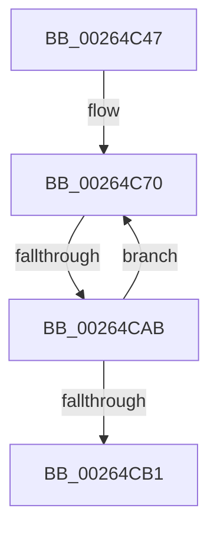

# sub_00264C47

- RVA: `0x00264C47`–`0x00264CBB` (길이 `116` bytes)
- VA: `0x0000000140264C47`
- 실행 섹션: `.text`
- PDB 이름 있음: `아니요`; PDB Function 태그: `아니요`
- unwind 정보 RVA: `0x00064998`
- 디코드: `28`개 명령, `116/116` bytes 표시
- 미해석 바이트: `0` (있으면 어셈블리에 `.byte`로 보존)

> 이 문서는 커널 이미지의 기계어와 PDB 기호를 분석해 생성했습니다. 4번과 5번은 함수 원형과 자료형을 바이너리 사용 방식에서 추정한 C 해석이며 원본 소스 복구 결과는 아닙니다.

## 1. Dependencies

- 직접 호출 지점: **0**; 고유 호출 대상: **0**
- 직접 호출자로 확인된 함수: **0**
- RIP 상대 이미지 참조: **1**

### Outgoing calls
- 직접 디코드된 call 명령이 없습니다.

### Direct callers
- 이 함수 시작 RVA로 연결되는 직접 call은 확인되지 않았습니다. 간접 호출은 완전히 역산할 수 없습니다.

### Static image references
- `0x00264C70` → RVA `0x00EFA278` (`.data`; read)

## 2. Other-region calls and transfers

- 다른 실행 섹션으로 향하는 call: **0**
- call이 아닌 외부 분기/꼬리 이동: **1**
  - `0x00264CA9` → [sub_00264CE0](Unknown_function_00264CE0.md) (`tail-transfer`)

## 3. Assembly (complete function range)

```asm
00264C47  48 89 6C 24 48                  mov qword ptr [rsp + 0x48], rbp
00264C4C  48 89 74 24 40                  mov qword ptr [rsp + 0x40], rsi
00264C51  41 8B F6                        mov esi, r14d
00264C54  C1 EE 0D                        shr esi, 0xd
00264C57  81 E6 FF FF 03 00               and esi, 0x3ffff
00264C5D  49 C1 EE 04                     shr r14, 4
00264C61  41 81 E6 FF 01 00 00            and r14d, 0x1ff
00264C68  0F 1F 84 00 00 00 00 00         nop dword ptr [rax + rax]
00264C70  48 8B 05 01 56 C9 00            mov rax, qword ptr [rip + 0xc95601]
00264C77  0F BD CE                        bsr ecx, esi
00264C7A  8B D3                           mov edx, ebx
00264C7C  89 8C 24 80 00 00 00            mov dword ptr [rsp + 0x80], ecx
00264C83  4C 8B 04 D0                     mov r8, qword ptr [rax + rdx*8]
00264C87  44 8D 49 FE                     lea r9d, [rcx - 2]
00264C8B  B8 01 00 00 00                  mov eax, 1
00264C90  D3 E0                           shl eax, cl
00264C92  8B C8                           mov ecx, eax
00264C94  8B C6                           mov eax, esi
00264C96  48 33 C8                        xor rcx, rax
00264C99  4B 8B 04 C8                     mov rax, qword ptr [r8 + r9*8]
00264C9D  48 8B 4C C8 08                  mov rcx, qword ptr [rax + rcx*8 + 8]
00264CA2  F0 4A 0F BA 2C F1 00            lock bts qword ptr [rcx + r14*8], 0
00264CA9  72 35                           jb 0x140264ce0
00264CAB  FF C3                           inc ebx
00264CAD  3B DF                           cmp ebx, edi
00264CAF  72 BF                           jb 0x140264c70
00264CB1  48 8B 74 24 40                  mov rsi, qword ptr [rsp + 0x40]
00264CB6  48 8B 6C 24 48                  mov rbp, qword ptr [rsp + 0x48]
```

## 4. C-style interpretation (structured pseudocode)

```c
__int64 __fastcall sub_00264C47(__int64 a1, __int64 a2, __int64 a3, __int64 a4, __int64 a5, __int64 a6, __int64 a7, __int64 a8, __int64 a9)
{
    __int64 result;
    __int64 v_r14;
    __int64 v_rbx;
    __int64 v_rsi;
    unsigned __int64 v_stack_p40;
    unsigned __int64 v_stack_p48;
    unsigned int v_stack_p80;

    v_stack_p48 = v_rbp;
    v_stack_p40 = v_rsi;
    v_rsi = (unsigned int)(((unsigned int)((unsigned int)(v_r14))) >> (13));
    v_rsi = (unsigned int)((v_rsi) & (0x3FFFFULL));
    v_r14 = (v_r14) >> (4);
    v_r14 = (unsigned int)((v_r14) & (511));
loc_00264C70:
    v_stack_p80 = (unsigned int)(a1);
    result = (unsigned int)((1) << ((unsigned __int8)(a1)));
    a1 = ((unsigned int)((unsigned int)(result))) ^ ((unsigned int)((unsigned int)(v_rsi)));
    v_rbx = (unsigned int)((v_rbx) + 1);
    if (((unsigned int)(v_rbx)) < ((unsigned int)(v_rdi))) goto loc_00264C70;
    return *(unsigned __int64 *)(*(unsigned __int64 *)(*(unsigned __int64 *)(v_rip + 13194753) + (unsigned int)((unsigned int)(v_rbx)) * 8) + a1 - 2 * 8);
}
```

## 5. (Beta) C Style

```c
int64_t sub_00264C47(int64_t Arg1, int64_t Arg2, int64_t Arg3, int64_t Arg4, uint64_t Arg5, uint64_t Arg6, uint64_t Arg7, int64_t Arg8, int64_t Arg9)
{
    int64_t result;
    int64_t local_r14;
    int64_t local_rbx;
    int64_t local_rsi;
    uint64_t v_stack_p40;
    uint64_t v_stack_p48;
    uint32_t v_stack_p80;

    v_stack_p48 = local_rbp;
    v_stack_p40 = local_rsi;
    local_rsi = (uint32_t)(((uint32_t)((uint32_t)(local_r14))) >> (13));
    local_rsi = (uint32_t)((local_rsi) & (0x3FFFFULL));
    local_r14 = (local_r14) >> (4);
    local_r14 = (uint32_t)((local_r14) & (511));
loc_00264C70:
    v_stack_p80 = (uint32_t)(Arg1);
    result = (uint32_t)((1) << ((uint8_t)(Arg1)));
    Arg1 = ((uint32_t)((uint32_t)(result))) ^ ((uint32_t)((uint32_t)(local_rsi)));
    local_rbx = (uint32_t)((local_rbx) + 1);
    if (((uint32_t)(local_rbx)) < ((uint32_t)(local_rdi))) goto loc_00264C70;
    return *(uint64_t *)(*(uint64_t *)(*(uint64_t *)(v_rip + 0xC95601) + (uint32_t)((uint32_t)(local_rbx)) * 8) + Arg1 - 0x2 * 8);
}
```

## 6. Execution-region graph

[열기: 2D/3D 그래프와 함수 탐색 컨트롤 패널](../../../control-panel.html?section=text&rva=0x00264C47&view=graph)

- 2D 그래프는 위에서 아래로 흐르고, 3D 그래프는 빈 공간을 드래그해 회전합니다. Shift+드래그는 이동, 휠은 확대·축소, 함수 노드 선택은 대상 보고서 이동입니다.

### Static fallback


