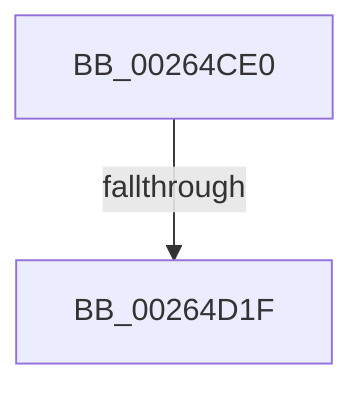

# sub_00264CE0

- RVA: `0x00264CE0`–`0x00264D2C` (길이 `76` bytes)
- VA: `0x0000000140264CE0`
- 실행 섹션: `.text`
- PDB 이름 있음: `아니요`; PDB Function 태그: `아니요`
- unwind 정보 RVA: `0x000649E4`
- 디코드: `20`개 명령, `76/76` bytes 표시
- 미해석 바이트: `0` (있으면 어셈블리에 `.byte`로 보존)

> 이 문서는 커널 이미지의 기계어와 PDB 기호를 분석해 생성했습니다. 4번과 5번은 함수 원형과 자료형을 바이너리 사용 방식에서 추정한 C 해석이며 원본 소스 복구 결과는 아닙니다.

## 1. Dependencies

- 직접 호출 지점: **1**; 고유 호출 대상: **1**
- 직접 호출자로 확인된 함수: **0**
- RIP 상대 이미지 참조: **1**

### Outgoing calls
- `0x00264D25` → [ExfAcquirePushLockExclusiveEx](../20/ExfAcquirePushLockExclusiveEx_function_0020FC90.md) (function, `0x0020FC90`)

### Direct callers
- 이 함수 시작 RVA로 연결되는 직접 call은 확인되지 않았습니다. 간접 호출은 완전히 역산할 수 없습니다.

### Static image references
- `0x00264CE0` → RVA `0x00EFA278` (`.data`; read)

## 2. Other-region calls and transfers

- 다른 실행 섹션으로 향하는 call: **0**
- call이 아닌 외부 분기/꼬리 이동: **2**
  - `0x00264D1D` → [sub_00264C47 + 0x66](Unknown_function_00264C47.md) (`tail-transfer`)
  - `0x00264D2A` → [sub_00264C47 + 0x66](Unknown_function_00264C47.md) (`tail-transfer`)

## 3. Assembly (complete function range)

```asm
00264CE0  48 8B 05 91 55 C9 00            mov rax, qword ptr [rip + 0xc95591]
00264CE7  FF CF                           dec edi
00264CE9  0F BD CE                        bsr ecx, esi
00264CEC  4C 8B 04 F8                     mov r8, qword ptr [rax + rdi*8]
00264CF0  B8 01 00 00 00                  mov eax, 1
00264CF5  D3 E0                           shl eax, cl
00264CF7  89 8C 24 88 00 00 00            mov dword ptr [rsp + 0x88], ecx
00264CFE  44 8D 49 FE                     lea r9d, [rcx - 2]
00264D02  8B C8                           mov ecx, eax
00264D04  8B C6                           mov eax, esi
00264D06  48 33 C8                        xor rcx, rax
00264D09  4B 8B 04 C8                     mov rax, qword ptr [r8 + r9*8]
00264D0D  48 8B 4C C8 08                  mov rcx, qword ptr [rax + rcx*8 + 8]
00264D12  F0 4A 0F BA 2C F1 00            lock bts qword ptr [rcx + r14*8], 0
00264D19  4A 8D 0C F1                     lea rcx, [rcx + r14*8]
00264D1D  73 8E                           jae 0x140264cad
00264D1F  4D 8B C7                        mov r8, r15
00264D22  49 8B D5                        mov rdx, r13
00264D25  E8 66 AF FA FF                  call 0x14020fc90
00264D2A  EB 81                           jmp 0x140264cad
```

## 4. C-style interpretation (structured pseudocode)

```c
__int64 __fastcall sub_00264CE0(void)
{
    __int64 result;
    __int64 v_rdi;
    unsigned int v_stack_p88;

    v_rdi = (unsigned int)((v_rdi) - 1);
    result = (unsigned int)((1) << ((unsigned __int8)(a1)));
    v_stack_p88 = (unsigned int)(a1);
    a1 = ((unsigned int)((unsigned int)(result))) ^ ((unsigned int)((unsigned int)(v_rsi)));
    result = ExfAcquirePushLockExclusiveEx(*(unsigned __int64 *)(*(unsigned __int64 *)(*(unsigned __int64 *)(*(unsigned __int64 *)(v_rip + 13194641) + v_rdi * 8) + a1 - 2 * 8) + a1 * 8 + 8) + v_r14 * 8, v_r13, v_r15, a1 - 2);
}
```

## 5. (Beta) C Style

```c
void sub_00264CE0(void)
{
    int64_t result;
    int64_t local_rdi;
    uint32_t v_stack_p88;

    local_rdi = (uint32_t)((local_rdi) - 1);
    result = (uint32_t)((1) << ((uint8_t)(a1)));
    v_stack_p88 = (uint32_t)(a1);
    a1 = ((uint32_t)((uint32_t)(result))) ^ ((uint32_t)((uint32_t)(local_rsi)));
    result = ExfAcquirePushLockExclusiveEx(*(uint64_t *)(*(uint64_t *)(*(uint64_t *)(*(uint64_t *)(v_rip + 0xC95591) + local_rdi * 8) + a1 - 0x2 * 8) + a1 * 8 + 0x8) + local_r14 * 8, local_r13, local_r15, a1 - 2);
}
```

## 6. Execution-region graph

[열기: 2D/3D 그래프와 함수 탐색 컨트롤 패널](../../../control-panel.html?section=text&rva=0x00264CE0&view=graph)

- 2D 그래프는 위에서 아래로 흐르고, 3D 그래프는 빈 공간을 드래그해 회전합니다. Shift+드래그는 이동, 휠은 확대·축소, 함수 노드 선택은 대상 보고서 이동입니다.

### Static fallback


