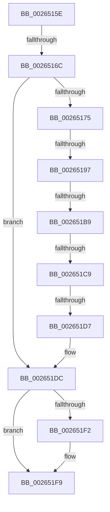

# sub_0026515E

- RVA: `0x0026515E`–`0x00265216` (길이 `184` bytes)
- VA: `0x000000014026515E`
- 실행 섹션: `.text`
- PDB 이름 있음: `아니요`; PDB Function 태그: `아니요`
- unwind 정보 RVA: `0x00064A74`
- 디코드: `45`개 명령, `184/184` bytes 표시
- 미해석 바이트: `0` (있으면 어셈블리에 `.byte`로 보존)

> 이 문서는 커널 이미지의 기계어와 PDB 기호를 분석해 생성했습니다. 4번과 5번은 함수 원형과 자료형을 바이너리 사용 방식에서 추정한 C 해석이며 원본 소스 복구 결과는 아닙니다.

## 1. Dependencies

- 직접 호출 지점: **3**; 고유 호출 대상: **3**
- 직접 호출자로 확인된 함수: **0**
- RIP 상대 이미지 참조: **1**

### Outgoing calls
- `0x00265181` → [ExAllocatePool2](../../poolcode/B8/ExAllocatePool2_function_00B820F0.md) (function, `0x00B820F0`)
- `0x002651DF` → [FsRtlAcquireAutoExpandPushLockExclusive](FsRtlAcquireAutoExpandPushLockExclusive_function_0026539C.md) (function, `0x0026539C`)
- `0x0026520A` → [FsRtlReleaseAutoExpandPushLockExclusive](FsRtlReleaseAutoExpandPushLockExclusive_function_00265B5C.md) (function, `0x00265B5C`)

### Direct callers
- 이 함수 시작 RVA로 연결되는 직접 call은 확인되지 않았습니다. 간접 호출은 완전히 역산할 수 없습니다.

### Static image references
- `0x002651B9` → RVA `0x00014730` (`.rdata`; read)

## 2. Other-region calls and transfers

- 다른 실행 섹션으로 향하는 call: **1**
  - `0x00265181` → [ExAllocatePool2](../../poolcode/B8/ExAllocatePool2_function_00B820F0.md) (`.text` → `POOLCODE`)
- call이 아닌 외부 분기/꼬리 이동: **5**
  - `0x00265166` → [sub_0026524F](Unknown_function_0026524F.md) (`tail-transfer`)
  - `0x00265191` → [sub_00265239](Unknown_function_00265239.md) (`tail-transfer`)
  - `0x002651B3` → [sub_0026525D + 0x5](Unknown_function_0026525D.md) (`tail-transfer`)
  - `0x002651C3` → [sub_0026525D + 0x5](Unknown_function_0026525D.md) (`tail-transfer`)
  - `0x002651D1` → [sub_0026525D](Unknown_function_0026525D.md) (`tail-transfer`)

## 3. Assembly (complete function range)

```asm
0026515E  48 89 7C 24 38                  mov qword ptr [rsp + 0x38], rdi
00265163  48 85 C0                        test rax, rax
00265166  0F 84 E3 00 00 00               je 0x14026524f
0026516C  48 8B 78 20                     mov rdi, qword ptr [rax + 0x20]
00265170  48 85 FF                        test rdi, rdi
00265173  75 67                           jne 0x1402651dc
00265175  8D 57 20                        lea edx, [rdi + 0x20]
00265178  41 B8 46 4F 43 58               mov r8d, 0x58434f46
0026517E  8D 4F 42                        lea ecx, [rdi + 0x42]
00265181  E8 6A CF 91 00                  call 0x140b820f0
00265186  48 89 44 24 30                  mov qword ptr [rsp + 0x30], rax
0026518B  48 8B C8                        mov rcx, rax
0026518E  48 85 C0                        test rax, rax
00265191  0F 84 A2 00 00 00               je 0x140265239
00265197  48 89 78 08                     mov qword ptr [rax + 8], rdi
0026519B  48 89 38                        mov qword ptr [rax], rdi
0026519E  48 83 C0 10                     add rax, 0x10
002651A2  48 89 40 08                     mov qword ptr [rax + 8], rax
002651A6  48 89 00                        mov qword ptr [rax], rax
002651A9  48 8B 93 D0 00 00 00            mov rdx, qword ptr [rbx + 0xd0]
002651B0  48 85 D2                        test rdx, rdx
002651B3  0F 84 A9 00 00 00               je 0x140265262
002651B9  48 8D 05 70 F5 DA FF            lea rax, [rip - 0x250a90]
002651C0  48 3B D0                        cmp rdx, rax
002651C3  0F 84 99 00 00 00               je 0x140265262
002651C9  33 C0                           xor eax, eax
002651CB  F0 48 0F B1 4A 20               lock cmpxchg qword ptr [rdx + 0x20], rcx
002651D1  0F 85 86 00 00 00               jne 0x14026525d
002651D7  48 8B 7C 24 30                  mov rdi, qword ptr [rsp + 0x30]
002651DC  48 8B CF                        mov rcx, rdi
002651DF  E8 B8 01 00 00                  call 0x14026539c
002651E4  48 8B 4F 10                     mov rcx, qword ptr [rdi + 0x10]
002651E8  48 8D 47 10                     lea rax, [rdi + 0x10]
002651EC  48 39 41 08                     cmp qword ptr [rcx + 8], rax
002651F0  74 07                           je 0x1402651f9
002651F2  B9 03 00 00 00                  mov ecx, 3
002651F7  CD 29                           int 0x29
002651F9  48 89 0E                        mov qword ptr [rsi], rcx
002651FC  48 89 46 08                     mov qword ptr [rsi + 8], rax
00265200  48 89 71 08                     mov qword ptr [rcx + 8], rsi
00265204  48 8B CF                        mov rcx, rdi
00265207  48 89 30                        mov qword ptr [rax], rsi
0026520A  E8 4D 09 00 00                  call 0x140265b5c
0026520F  33 C0                           xor eax, eax
00265211  48 8B 7C 24 38                  mov rdi, qword ptr [rsp + 0x38]
```

## 4. C-style interpretation (structured pseudocode)

```c
__int64 __fastcall sub_0026515E(__int64 a1, __int64 a2, __int64 a3, __int64 a4, __int64 a5, __int64 a6, __int64 a7)
{
    __int64 result;
    unsigned __int64 v_stack_p30;
    unsigned __int64 v_stack_p38;

    v_stack_p38 = v_rdi;
    if (*(unsigned __int64 *)(result + 32) != 0) goto loc_002651DC;
    result = ExAllocatePool2(*(unsigned __int64 *)(result + 32) + 66, *(unsigned __int64 *)(result + 32) + 32, (unsigned int)(0x58434F46ULL), a4);
    v_stack_p30 = result;
    *(unsigned __int64 *)(result + 8) = *(unsigned __int64 *)(result + 32);
    *(unsigned __int64 *)(result) = *(unsigned __int64 *)(result + 32);
    result = (result) + (16);
    *(unsigned __int64 *)(result + 8) = result;
    *(unsigned __int64 *)(result) = result;
    result = 0;
loc_002651DC:
    result = FsRtlAcquireAutoExpandPushLockExclusive(a6, *(unsigned __int64 *)(v_rbx + 208), (unsigned int)(0x58434F46ULL), a4);
    if ((*(unsigned __int64 *)(*(unsigned __int64 *)(a6 + 16) + 8)) != (a6 + 16)) {
        a1 = 3;
    }
    *(unsigned __int64 *)(v_rsi) = a1;
    *(unsigned __int64 *)(v_rsi + 8) = a6 + 16;
    *(unsigned __int64 *)(a1 + 8) = v_rsi;
    *(unsigned __int64 *)(a6 + 16) = v_rsi;
    result = FsRtlReleaseAutoExpandPushLockExclusive(a6, *(unsigned __int64 *)(v_rbx + 208), (unsigned int)(0x58434F46ULL), a4);
    result = 0;
    return result;
}
```

## 5. (Beta) C Style

```c
int64_t sub_0026515E(int64_t Arg1, int64_t Arg2, int64_t Arg3, int64_t Arg4, uint64_t Arg5, int64_t Arg6, int64_t Arg7)
{
    int64_t result;
    uint64_t v_stack_p30;
    uint64_t v_stack_p38;

    v_stack_p38 = local_rdi;
    if (*(uint64_t *)(result + 0x20) != 0) goto loc_002651DC;
    result = ExAllocatePool2(*(uint64_t *)(result + 0x20) + 66, *(uint64_t *)(result + 0x20) + 32, (uint32_t)(0x58434F46ULL), Arg4);
    v_stack_p30 = result;
    *(uint64_t *)(result + 0x8) = *(uint64_t *)(result + 0x20);
    *(uint64_t *)(result) = *(uint64_t *)(result + 0x20);
    result = (result) + (16);
    *(uint64_t *)(result + 0x8) = result;
    *(uint64_t *)(result) = result;
    result = 0;
loc_002651DC:
    result = FsRtlAcquireAutoExpandPushLockExclusive(Arg6, *(uint64_t *)(local_rbx + 0xD0), (uint32_t)(0x58434F46ULL), Arg4);
    if ((*(uint64_t *)(*(uint64_t *)(Arg6 + 0x10) + 0x8)) != (Arg6 + 16)) {
        Arg1 = 3;
    }
    *(uint64_t *)(local_rsi) = Arg1;
    *(uint64_t *)(local_rsi + 0x8) = Arg6 + 16;
    *(uint64_t *)(Arg1 + 0x8) = local_rsi;
    *(uint64_t *)(Arg6 + 0x10) = local_rsi;
    result = FsRtlReleaseAutoExpandPushLockExclusive(Arg6, *(uint64_t *)(local_rbx + 0xD0), (uint32_t)(0x58434F46ULL), Arg4);
    result = 0;
    return result;
}
```

## 6. Execution-region graph

[열기: 2D/3D 그래프와 함수 탐색 컨트롤 패널](../../../control-panel.html?section=text&rva=0x0026515E&view=graph)

- 2D 그래프는 위에서 아래로 흐르고, 3D 그래프는 빈 공간을 드래그해 회전합니다. Shift+드래그는 이동, 휠은 확대·축소, 함수 노드 선택은 대상 보고서 이동입니다.

### Static fallback


