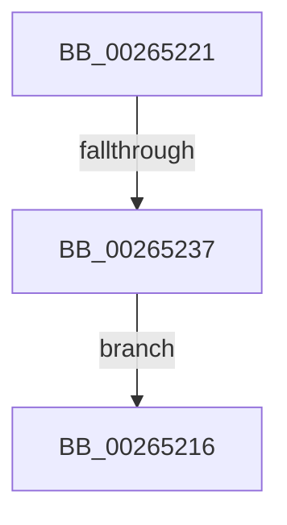

# sub_00265216

- RVA: `0x00265216`–`0x00265239` (길이 `35` bytes)
- VA: `0x0000000140265216`
- 실행 섹션: `.text`
- PDB 이름 있음: `아니요`; PDB Function 태그: `아니요`
- unwind 정보 RVA: `0x00064A88`
- 디코드: `11`개 명령, `35/35` bytes 표시
- 미해석 바이트: `0` (있으면 어셈블리에 `.byte`로 보존)

> 이 문서는 커널 이미지의 기계어와 PDB 기호를 분석해 생성했습니다. 4번과 5번은 함수 원형과 자료형을 바이너리 사용 방식에서 추정한 C 해석이며 원본 소스 복구 결과는 아닙니다.

## 1. Dependencies

- 직접 호출 지점: **1**; 고유 호출 대상: **1**
- 직접 호출자로 확인된 함수: **0**
- RIP 상대 이미지 참조: **0**

### Outgoing calls
- `0x0026522A` → [IopAllocateFileObjectExtension](../41/IopAllocateFileObjectExtension_function_00418FB0.md) (function, `0x00418FB0`)

### Direct callers
- 이 함수 시작 RVA로 연결되는 직접 call은 확인되지 않았습니다. 간접 호출은 완전히 역산할 수 없습니다.

### Static image references
- 디코드된 RIP-relative 메모리 참조가 없습니다.

## 2. Other-region calls and transfers

- 다른 실행 섹션으로 향하는 call: **0**
- call이 아닌 외부 분기/꼬리 이동: **1**
  - `0x00265231` → [FsRtlInsertPerFileObjectContext + 0x27](FsRtlInsertPerFileObjectContext_function_00265130.md) (`tail-transfer`)

## 3. Assembly (complete function range)

```asm
00265216  48 8B 5C 24 48                  mov rbx, qword ptr [rsp + 0x48]
0026521B  48 83 C4 20                     add rsp, 0x20
0026521F  5E                              pop rsi
00265220  C3                              ret
00265221  CC                              int3
00265222  45 33 C0                        xor r8d, r8d
00265225  48 8D 54 24 40                  lea rdx, [rsp + 0x40]
0026522A  E8 81 3D 1B 00                  call 0x140418fb0
0026522F  85 C0                           test eax, eax
00265231  0F 89 20 FF FF FF               jns 0x140265157
00265237  EB DD                           jmp 0x140265216
```

## 4. C-style interpretation (structured pseudocode)

```c
__int64 __fastcall sub_00265216(__int64 a1, __int64 a2, int a3, __int64 a4, __int64 a5, __int64 a6, __int64 a7, __int64 a8, __int64 a9)
{
    __int64 v_rsp;
    unsigned __int64 v_stack_p68;

    v_rsp = (v_rsp) + (32);
    return result;
}
```

## 5. (Beta) C Style

```c
int64_t sub_00265216(int64_t Arg1, int64_t Arg2, int32_t Arg3, int64_t Arg4, uint64_t Arg5, uint64_t Arg6, uint64_t Arg7, uint64_t Arg8, int64_t Arg9)
{
    int64_t local_rsp;
    uint64_t v_stack_p68;

    local_rsp = (local_rsp) + (32);
    return result;
}
```

## 6. Execution-region graph

[열기: 2D/3D 그래프와 함수 탐색 컨트롤 패널](../../../control-panel.html?section=text&rva=0x00265216&view=graph)

- 2D 그래프는 위에서 아래로 흐르고, 3D 그래프는 빈 공간을 드래그해 회전합니다. Shift+드래그는 이동, 휠은 확대·축소, 함수 노드 선택은 대상 보고서 이동입니다.

### Static fallback


