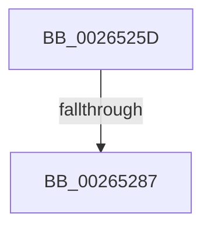

# sub_0026525D

- RVA: `0x0026525D`–`0x0026528E` (길이 `49` bytes)
- VA: `0x000000014026525D`
- 실행 섹션: `.text`
- PDB 이름 있음: `아니요`; PDB Function 태그: `아니요`
- unwind 정보 RVA: `0x00064AE8`
- 디코드: `12`개 명령, `49/49` bytes 표시
- 미해석 바이트: `0` (있으면 어셈블리에 `.byte`로 보존)

> 이 문서는 커널 이미지의 기계어와 PDB 기호를 분석해 생성했습니다. 4번과 5번은 함수 원형과 자료형을 바이너리 사용 방식에서 추정한 C 해석이며 원본 소스 복구 결과는 아닙니다.

## 1. Dependencies

- 직접 호출 지점: **2**; 고유 호출 대상: **2**
- 직접 호출자로 확인된 함수: **0**
- RIP 상대 이미지 참조: **0**

### Outgoing calls
- `0x00265264` → [ExFreePoolWithTag](../../poolcode/B8/ExFreePoolWithTag_function_00B82870.md) (function, `0x00B82870`)
- `0x00265274` → [IoGetFileObjectFilterContext](../41/IoGetFileObjectFilterContext_function_00418F30.md) (function, `0x00418F30`)

### Direct callers
- 이 함수 시작 RVA로 연결되는 직접 call은 확인되지 않았습니다. 간접 호출은 완전히 역산할 수 없습니다.

### Static image references
- 디코드된 RIP-relative 메모리 참조가 없습니다.

## 2. Other-region calls and transfers

- 다른 실행 섹션으로 향하는 call: **1**
  - `0x00265264` → [ExFreePoolWithTag](../../poolcode/B8/ExFreePoolWithTag_function_00B82870.md) (`.text` → `POOLCODE`)
- call이 아닌 외부 분기/꼬리 이동: **2**
  - `0x00265281` → [sub_0026515E + 0x7E](Unknown_function_0026515E.md) (`tail-transfer`)
  - `0x0026528C` → [sub_0026515E + 0xB3](Unknown_function_0026515E.md) (`tail-transfer`)

## 3. Assembly (complete function range)

```asm
0026525D  48 8B 4C 24 30                  mov rcx, qword ptr [rsp + 0x30]
00265262  33 D2                           xor edx, edx
00265264  E8 07 D6 91 00                  call 0x140b82870
00265269  45 33 C0                        xor r8d, r8d
0026526C  48 8D 54 24 30                  lea rdx, [rsp + 0x30]
00265271  48 8B CB                        mov rcx, rbx
00265274  E8 B7 3C 1B 00                  call 0x140418f30
00265279  48 8B 7C 24 30                  mov rdi, qword ptr [rsp + 0x30]
0026527E  48 85 FF                        test rdi, rdi
00265281  0F 85 55 FF FF FF               jne 0x1402651dc
00265287  B8 01 00 00 C0                  mov eax, 0xc0000001
0026528C  EB 83                           jmp 0x140265211
```

## 4. C-style interpretation (structured pseudocode)

```c
__int64 __fastcall sub_0026525D(__int64 a1, int a2, int a3, __int64 a4, __int64 a5, __int64 a6)
{
    __int64 result;

    a2 = 0;
    result = ExFreePoolWithTag(a6, a2, a3, a4);
    a3 = 0;
    result = IoGetFileObjectFilterContext(v_rbx, a6, a3, a4);
}
```

## 5. (Beta) C Style

```c
int64_t sub_0026525D(int64_t Arg1, int32_t Arg2, int32_t Arg3, int64_t Arg4, uint64_t Arg5, int64_t Arg6)
{
    int64_t result;

    Arg2 = 0;
    result = ExFreePoolWithTag(Arg6, Arg2, Arg3, Arg4);
    Arg3 = 0;
    result = IoGetFileObjectFilterContext(local_rbx, Arg6, Arg3, Arg4);
}
```

## 6. Execution-region graph

[열기: 2D/3D 그래프와 함수 탐색 컨트롤 패널](../../../control-panel.html?section=text&rva=0x0026525D&view=graph)

- 2D 그래프는 위에서 아래로 흐르고, 3D 그래프는 빈 공간을 드래그해 회전합니다. Shift+드래그는 이동, 휠은 확대·축소, 함수 노드 선택은 대상 보고서 이동입니다.

### Static fallback


